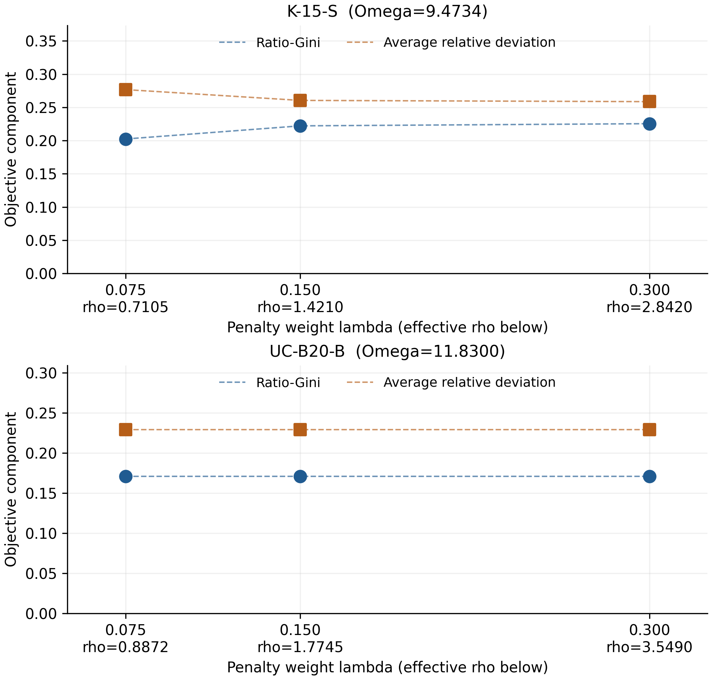

# An inventory-state exact algorithm for bicycle redistribution with ratio-Gini and target-deviation costs

## Abstract

Static bicycle redistribution couples final station inventories with vehicle routes, prefix loads and handling time. We minimize ratio-Gini dispersion plus weighted relative target deviation under empty departure, loaded return and unique nonzero one-way service. Our exact method shares finite inventory states between service and objective representations, uses problem-specific supply and support inequalities, and maintains complete Gini-interval coverage around native LP and MIP solves. We prove implicit service integrality and establish the physical embeddings and coverage conditions needed for certification. In historical twelve-input/two-Seed validation, the method obtains 17/24 qualified certificates versus 9/24 for a cold compact control. Final implementation confirmation on six known roles obtains 12/14 versus 9/14, while retaining two substantive paid-start compact reversals and unresolved positive-objective 35-station endpoints. Six certified within-instance weight points show an equity-target trade-off on one input and a stable operating platform on another. The results support the integrated exact method within the specified model and test scope, and a bounded state-penalty study distinguishes relaxation improvement from complete-search performance.

## 1. Introduction

Redistribution vehicles can improve station availability only when the chosen inventory vector can be realized by feasible routes and loading operations. Supply must be collected before it is delivered, capacity applies at every route prefix, and handling consumes the same time budget as travel. When equity is measured by inventory-to-target ratios, the final inventory vector also determines both the numerator and denominator of the Gini coefficient. These dependencies make routing and inventory allocation inseparable.

We study static bicycle redistribution with empty vehicle departure, loaded return, and at most one nonzero one-way service at each station. The objective combines ratio-Gini dispersion and weighted relative target deviation. The model and HGA-TGBC framework originate in the direct same-problem project manuscript [@hgaTgbcManuscript]. The present contribution is an exact solution method for that operational setting. The supplied decoder remains a feasible-solution component; the exact method supplies the bounds, coverage and termination arguments needed to distinguish a good plan from a certified optimum.

Our first contribution is a shared finite-state representation of final inventory, service and objective information. Unique service and binary direction imply integer pickup and delivery even when these quantities are declared continuous. Linking the same states to movement and visits prevents the relaxation from treating service decisions independently of the inventory mixtures used in the objective. We develop this representation with ordered supply compatibility and support/handling inequalities, and state their assumptions and physical embeddings.

Second, the Gini-interval tailored branch-and-cut method (GI-TBC, implemented as S2) combines a fully paid feasible startup, the shared representation, valid inequalities and complete interval coverage. The controller preserves the physical problem while refining objective intervals. Its correctness depends on applicable bounds and complete coverage; numerical source qualification and physical solution verification are stated separately.

Third, the computational study measures complete-method cost against cold compact and independently paid-start compact controls. Historical breadth and final implementation confirmation retain their own versions and denominators. The study identifies substantial certification and runtime advantages, paid-start reversals and a positive-objective size boundary. A within-instance weight experiment relates the equity-target trade-off to actual vehicle operations. A bounded formulation study explains why retaining more state information can improve an LP without guaranteeing a faster complete algorithm.

### 1.1 Relation to previous work

Static bike redistribution has been studied under several target, service and vehicle conventions. Raviv et al. develop static repositioning models; Chemla et al. study static rebalancing; Erdogan et al. address demand intervals and an exact rebalancing algorithm [@raviv2013; @chemla2013; @erdogan2014; @erdogan2015]. Schuijbroek et al. connect inventory requirements to routing [@schuijbroek2017]. Forbidden temporary operations, repeated visits, robust inventory requirements and demand-interval disjunctions give related but different feasible sets [@bruck2019; @bulhoes2018; @bruck2025; @ikonen2025]. The HGA-TGBC manuscript is the direct same-problem antecedent; the other studies supply routing and formulation context rather than matched performance baselines.

Station-ratio dispersion measures a different object from vehicle-workload equity [@matl2018]. Recent fairness-aware rebalancing and equity-based micromobility models motivate distributional objectives, while their distinct inventory, vehicle and operational definitions preclude a claim of model equivalence based on their abstracts alone [@qiao2026; @caggiani2026]. Here zero Gini means equal proportional inventory, which can still represent inadequate stock. The deviation term gives a separate incentive to approach station targets.

McCormick envelopes, value disjunctions and convex state epigraphs are established formulation tools [@mccormick1976; @gupte2013; @koppe2008; @boydVandenberghe2004]. Our claim concerns their connection to this problem's service structure and the resulting complete method. The state-penalty comparison in Section 6 applies Jensen's inequality and an elementary projection construction; it is not a new general theory of aggregation. Source access and the remaining narrowly defined bibliographic questions are documented in the supplement.

## 2. Physical model and objective

Let \(N\) contain \(n\) stations and let \(0\) be the depot. Station \(i\) has integer initial inventory \(b_i\), capacity \(C_i\), integer target \(D_i>0\), and weight \(\omega_i\ge0\). Vehicle \(k\) has capacity \(Q_k\) and route-duration limit \(T\). Routes depart empty. A station can be served by at most one vehicle, in one direction, with a nonzero operation. Loaded return is allowed and its unloading time is counted. The depot enters neither target deviation nor dispersion.

With pickup \(p_{ki}\) and delivery \(d_{ki}\),

\[
Y_i=b_i+\sum_k(d_{ki}-p_{ki}),\qquad
R_k=\sum_i(p_{ki}-d_{ki})\in[0,Q_k],\qquad
\sum_iY_i=\sum_i b_i-\sum_kR_k.
\]

Thus total final station inventory is bounded above by \(B=\sum_i b_i\), rather than fixed at \(B\). Vehicle capacity limits the instantaneous prefix load, rather than cumulative pickup. If pickup and unloading/delivery take \(t_p,t_d\) per unit, complete handling time is

\[
t_p\sum_i p_{ki}+t_d\left(\sum_i d_{ki}+R_k\right)
=(t_p+t_d)\sum_i p_{ki}.
\]

Travel plus this quantity cannot exceed \(T\). The tested distance convention is Euclidean travel time from serialized metre coordinates at 1.5 m/s. Inventory, route, assignment, direction and prefix-load logic retain their original integer domains. Continuous pickup/delivery variables preserve the integer physical operations because unique one-way service and integer \(Y_i\) fix the sole inventory difference. Appendix A gives the complete formulation and embedding proof.

Define

\[
r_i=Y_i/D_i,\quad S=\sum_i r_i,\quad
A=\sum_{i<j}|r_i-r_j|,\quad
P=\sum_i\omega_i|r_i-1|,
\]
\[
G=\begin{cases}A/(nS),&S>0,\\0,&S=0,\end{cases}
\qquad F=G+\lambda P,\quad\lambda\ge0.
\]

This is ratio dispersion and two-sided relative target deviation. It is not a direct measure of population equity, rental failure or travel burden. Put \(\Omega=\sum_i\omega_i>0\), \(P_{\rm avg}=P/\Omega\) and \(\rho=\lambda\Omega\). Then \(F=G+\rho P_{\rm avg}\). The generator normalizes weights by their maximum, so equal \(\lambda\) across inputs does not hold \(\rho\) fixed. Sensitivity in Section 5.4 changes \(\lambda\) within a fixed physical instance.

## 3. Shared inventory states and the S2 algorithm

### 3.1 Discrete states and implicit service integrality

For the legal finite inventory domain \(\mathcal Y_i\), binary selectors \(s_{iy}\) and continuous \(q_{iy}\) represent stock and products on a Gini interval \([\alpha,\beta]\):

\[
\sum_y s_{iy}=1,\quad Y_i=\sum_y ys_{iy},\quad
\alpha s_{iy}\le q_{iy}\le\beta s_{iy},\quad
\sum_yq_{iy}=g,\quad Z_i=\sum_y yq_{iy}.
\]

At an integer state, \(Z_i=gY_i\). The objective epigraph uses

\[
H_{ij}\ge r_i-r_j,\quad H_{ij}\ge r_j-r_i,\qquad
e_i\ge r_i-1,\quad e_i\ge1-r_i,
\]
\[
\sum_{i<j}H_{ij}\le n\sum_i Z_i/D_i,\qquad
\min f=g+\lambda\sum_i\omega_i e_i.
\]

For \(S>0\), integer state selection makes the numerator inequality imply \(g\ge G_{\rm true}\), so every integer completion satisfies \(f\ge F_{\rm true}\). Conversely a physical fleet assigned to its true-G interval has an objective-preserving extension: select its final inventories, set \(g=G_{\rm true}\), set each selected \(q_{iy}=g\), and use the true absolute differences and deviations. At \(S=0\), all ratios are zero and \(g=0\) supplies the physical extension. Valid domain and strengthening rows retain that extension, as established in Appendix A.

Let \(z_{ki}\) be the binary service assignment. The same state supports the service equations

\[
\sum_kp_{ki}=\sum_y(b_i-y)^+s_{iy},\quad
\sum_kd_{ki}=\sum_y(y-b_i)^+s_{iy},\quad
\sum_kz_{ki}=\sum_{y\ne b_i}s_{iy}.
\]

These links connect objective mixtures to movement and service. They are not the convex hull of all vehicle routes. In isolation, a finite-state product block with the same extreme stock bounds projects to the McCormick rectangle: its four corner graph points give one inclusion, and every state line lies in the rectangle hull, giving the other. An advantage must therefore come from the links, domain information or complete search, rather than the VD-P label alone.

**Lemma 1 (implicit service integrality).** Suppose initial and final inventories are integer, a station is assigned to at most one vehicle, and a binary direction permits either pickup or delivery at its unique service. Continuous pickup and delivery variables then take integer values at every integer solution of the remaining model.

**Proof.** An unassigned vehicle has zero quantities. At the unique assigned vehicle, pickup direction fixes delivery to zero, so inventory balance gives \(p_{ki}=b_i-Y_i\). Delivery direction fixes pickup to zero and gives \(d_{ki}=Y_i-b_i\). Each is integer. Integer load variables are unnecessary for this implication. The claim concerns integer feasible solutions; it does not equate the continuous relaxations of alternative formulations. \(\square\)

For an integer service, total movement is \(|b_i-Y_i|\), and nonzero one-way service occurs exactly when \(Y_i\ne b_i\). Hence the shared equations above reproduce the original operations without changing the physical problem. They also couple fractional inventory mixtures to the movement and visits that must support them.

### 3.2 Ordered supply and support/handling information

Let \(\tau\) be metric travel time and \(h=t_p+t_d\). For each receiving station \(j\), define

\[
\mathcal C_{kj}=\{i\ne j:\tau_{0i}+\tau_{ij}+\tau_{j0}+h\le T\}.
\]

**Proposition 1 (ordered supply compatibility).** Every physical fleet with empty departure satisfies

\[
d_{kj}\le\sum_{i\in\mathcal C_{kj}}p_{ki}.
\]

**Proof.** Label the units collected by a vehicle. In route order, match each delivered unit to an earlier collected unit that has not yet been delivered. Nonnegative prefix loads guarantee such a match. A unit delivered at \(j\) from source \(i\) entails the ordered subsequence \((0,i,j,0)\), whose travel lower bound follows by metric shortcutting. Collecting at least that unit incurs handling of at least \(h\), including delivery or final unloading. Thus its source lies in \(\mathcal C_{kj}\). Counting distinct matched units proves the inequality. Unmatched collected units can return to the depot. \(\square\)

For a set \(W\) of served stations, let \(\tau(W)\) be the shortest depot tour through \(W\), computed by explicit orders for pairs or triples. Write \(P_k^{\rm pick}=\sum_i p_{ki}\). Nonzero integer service and empty departure give

\[
|W|\le\sum_{i\in W}(p_{ki}+d_{ki})\le2P_k^{\rm pick},\qquad
P_k^{\rm pick}\ge\lceil |W|/2\rceil.
\]

Consequently \(\tau(W)+h\lceil|W|/2\rceil>T\) rules out serving all of \(W\) with that vehicle. Otherwise a conditional duration inequality combines the tour lower bound and pickup handling. Supply for \(W\) may come from outside \(W\); cumulative pickup is not bounded by \(Q_k\). Appendix A gives the exact conditional coefficients, deactivation proof and finite selection rule. S2 keeps pair support uniformly and omits triple support. These rows strengthen necessary physical conditions without replacing route-prefix capacity.

### 3.3 Complete startup and interval search

The startup \(H\) is a finite construction and descent procedure. It completes a joint insertion and 24 shuffled station/separator orders plus a constructive order, fully decodes them, applies guided first-improvement descent, and closes physical quantity/insertion and neutral balanced/exchange moves. The active path has no genetic generations. It provides a verified feasible upper bound and a possible MIP Start; it is never credited with a positive lower bound. Each S2 and paid-start compact run pays for its own complete \(H\).

The controller starts from the complete potentially improving domain \([0,\min\{U,(n-1)/n\}]\). It maintains incumbent epoch, valid cutoff complements and complete interval coverage. A local bound is used only for its model, interval, cutoff and qualified source. Split children replace a parent atomically only after complete coverage and both results are checked. NEXT and child-target values are requests, rather than proof that a milestone was reached.

~~~text
Algorithm 1  S2 / GI-TBC
1 Complete the run's own H; physically verify its fleet and upper bound U.
2 Initialize the complete potentially improving Gini interval, allowing
  the degenerate interval [0,0] when the own upper bound is zero.
3 While unresolved coverage and the common deadline permit:
    select the controlling leaf by the fixed bound/plateau rule;
    run its prescribed LP, lookahead/target or terminal MIP;
    verify any own fleet improvement and qualify the returned source;
    install valid scoped bounds or complete covering children;
    stop under the declared complete-proof or finite termination rules.
4 On source rejection, discard dependent closures and restore the unresolved
  full physical domain with its independent nonnegative floor and own U.
  A separately established zero proof can still finalize the original problem.
5 Release native resources and finalize the selected own fleet's physical check;
  apply the independent exact-zero rule, complete required output, and return
  certificate type, U/L and unresolved coverage.
~~~

**Proposition 2 (coverage).** In ideal arithmetic, a controller that preserves complete improving-domain coverage, retains valid bound/cutoff complements and closes a region only by an applicable proof provides a valid global lower bound. If it closes all relevant regions against a verified \(U\), it proves optimality to its declared certificate margin.

**Proof.** Every improving physical solution belongs to the root domain because \(F\ge G\) and \(G\le(n-1)/n\). A valid interval restriction and cutoff cover its regional solutions; the cutoff complement has floor equal to that cutoff. A complete split preserves the union. Taking the minimum over the valid regional floors and complements therefore bounds every physical solution from below. Closure against \(U\) eliminates every possible improvement to the margin. Revoking a source requires removing every conclusion that depends on it; an independent full-domain bound remains valid. \(\square\)

This proposition does not turn floating-point native calculations into exact rational proofs. Numerical qualification, physical objective agreement and lifecycle evidence are additional implementation conditions. The final implementation separates ordinary positive-objective native/outer certificates from the independent zero rule. Supporting material records numerical anomalies and version corrections without making them algorithmic contributions.

### 3.4 Numerical qualification and termination

**Independent zero termination.** Under the stated nonnegative objective premises, a complete physically verified fleet with exact objective zero is globally optimal, independently of the native search source.

**Proof.** For every original physical solution, \(F\ge0\). The verified fleet gives \(F^*\le0\), so \(0\le F^*\le0\). With positive \(\lambda\) and positive weights, integer equality \(Y_i=D_i\) for every station is a sufficient exact-zero condition. More generally equal exact ratios give zero Gini, and every positive-weight penalized station must meet its target. The implementation checks these conditions using integer stock arithmetic, then repeats the complete physical-fleet verification. A merely small positive floating objective does not establish exact zero. \(\square\)

The numerical \(\varepsilon\)-certificate policy is separate. A source-rejected positive solution without a sufficient independent bound remains open. Certification cost includes the verification needed to establish the proof, normal native cleanup and required output. A later offline audit cannot backdate a production proof.

## 4. Computational design

P starts the original compact model independently with no startup or MIP Start. PS pays its own complete startup \(H\) and then solves that compact model. S2 pays its own \(H\) and full interval method. Each comparison uses single-threaded native solves, serial independent launches and a fixed parameter policy. No fleet, bound, tree or Start crosses methods, Seeds or objective weights. The complete production clock includes startup, modeling, online verification, solving, proof formation, cleanup and required output; subsequent offline verification has its own measured clock.

Table 1 identifies the evidence versions. Solver Seeds repeat a fixed problem and are not independent problem samples. The R134 confirmation targets six known roles, and the AP study targets structural and protection roles; neither is described as a random holdout.

**Table 1. Evidence identity and purpose. Historical outcomes retain their original admission policies.**

| Version | Algorithm or change | Evidence used here |
|---|---|---|
| R132 | Frozen S2 and compact controls | Twelve inputs at two Seeds; breadth and original mechanism studies |
| R133 | Source/correctness repair | Fourteen exposed qualification positions and four old/new S2 bridge pairs |
| R134 | S2 with independent zero finalization | Final confirmation: 32 method positions; four new weight runs plus two reused points |
| R135 | Same S2, optional AP row | Two incremental LPs; preregistered 10-arm first stage and conditional 22-arm second stage |

The R134 confirmation uses opposite-order micro repetitions at Seeds 0/1 (90-second cap); K-15-S (600 seconds); UC-B20-B (1,200 seconds); and K-35-U, X-35-U and X-35-B (2,400 seconds). P and S2 appear at every paired role, with PS additionally present for K-15-S and X-35-B. Four S2 runs at \(\lambda=.075,.30\) supplement the fixed \(.15\) Seed0 baselines for K-15-S and UC-B20-B. The supplement gives every position, cap, Seed, repeat and measured cost.

An open run has no certification time. For two certified methods, a time difference is substantive when

\[
t_{\rm slow}-t_{\rm fast}\ge\max\{10\text{ s},0.10t_{\rm fast}\}.
\]

Micro observations retain their absolute repeated times. Open comparisons retain both \(U\) and \(L\), the signed gap \(U-L\), and source qualification; better primal and weaker dual endpoints are stated separately. Historical clocks are descriptive across environments, whereas each matched comparison shares its timing environment.

Coordinate sources and generated operational data are separate. CITI instances use the archived 443-station Citi Bike coordinate/capacity table; CABI instances use the archived Capital Bikeshare station table, and X instances use the archived Chicago Divvy station snapshot. Selection manifests identify source rows, hashes and projected coordinates. Depots are synthetic centroids; inventories, positive targets and weights follow recorded generation rules. D13 is entirely synthetic; the micro regression input uses CABI coordinates with generated operational data. These inputs test a static operational model and do not reconstruct observed trips or live station demand. Provider data services are attributed separately from the archived snapshot identities [@citiData; @cabiData; @divvyData]. The supplement records the source-to-input chain and the specific source-capture facts still needing author confirmation.

## 5. Complete-method and operational results

### 5.1 Historical breadth and attribution

The R132 twelve-input/two-Seed validation has 24 S2 and 24 P observations and 12 PS observations. Its original qualified certificate counts are 17/24, 9/24 and 4/12. S2/P has 16 favorable time/certificate directions, one adverse direction, six both-open comparisons and one comparison ineligible under its source policy. The excluded S2 observation has its own legal zero fleet but no production certificate qualified by that historical policy. These counts remain historical; the new independent-proof rule does not rewrite them.

Earlier six-role final-version evidence and the support-policy study show useful complete-method performance, but PS reversals matter. PS and inclusive-root controls establish that an initial feasible solution does not explain every S2 gain. They do not isolate a statistically or practically strong independent speed benefit from the outer controller. Equivalent-expression controls have mixed cost effects. S2 is supported as an integrated method; component-level causality requires its corresponding matched controls.

The R133 source/correctness bridge and its complete qualification record remain separately identified in the supplement. They do not relabel earlier performance observations. The current AP comparison uses the accepted S2 baseline and changes only the aggregate row.

### 5.2 Final-version confirmation

The final confirmation produces 12/14 S2, 9/14 P and 2/4 PS certificates. Against cold P, S2 has nine both-certified comparisons and three additional certificates; two pairs remain open on both sides. A repeated advantage on the actual split/child-target role UC-B20-B saves about 315 seconds at each Seed. X-35-U includes a large complete-time improvement, and all micro repetitions have lower S2 absolute time.

Paid-start compact remains effective on X-35-B: PS certifies in about 7.2 seconds while S2 takes about 18 seconds at both Seeds. Both reversals meet the substantive-difference rule. In both R134 S2 runs the own startup objective is positive, 0.0502575215; the zero fleet is obtained later. The reversal therefore concerns the complete search path and does not indicate that S2 began with an already optimal zero startup fleet. Table 2 retains them alongside the S2 gains. One independently certified exact-zero observation retains its rejected native-source flag.

**Table 2. All final-panel matched groups. C is a certificate with complete production seconds; O reports feasible U / qualified L and has no certificate time. Seed and repeat follow the problem name. Displayed values are rounded; Supplement S1-S2 retains full-precision values.**

| Problem / Seed / repeat | P | PS | S2 | S2/P result |
|---|---|---|---|---|
| SM-B10-B / 0 / 1 | C 1.641s | - | C 0.857s | S2 faster (micro) |
| SM-B10-B / 0 / 2 | C 1.041s | - | C 0.774s | S2 faster (micro) |
| SM-B10-B / 1 / 1 | C 1.043s | - | C 0.805s | S2 faster (micro) |
| SM-B10-B / 1 / 2 | C 1.016s | - | C 0.773s | S2 faster (micro) |
| K-15-S / 0 / 1 | O 0.59226/0.52741 | O 0.59226/0.52022 | C 112.935s | S2 only certified |
| K-15-S / 1 / 1 | O 0.59226/0.5289 | O 0.59226/0.53187 | C 115.021s | S2 only certified |
| UC-B20-B / 0 / 1 | C 319.060s | - | C 3.966s | S2 faster; substantive |
| UC-B20-B / 1 / 1 | C 318.377s | - | C 3.821s | S2 faster; substantive |
| K-35-U / 0 / 1 | O 0.66475/0.3355 | - | O 0.69285/0.56494 | both open |
| K-35-U / 1 / 1 | O 0.75885/0.33055 | - | O 0.66836/0.55427 | both open |
| X-35-U / 0 / 1 | O 0.016265/6.9389e-18 | - | C 120.257s (ind.) | S2 only certified |
| X-35-U / 1 / 1 | C 2064.949s (ind.) | - | C 452.841s (ind.) | S2 faster; substantive |
| X-35-B / 0 / 1 | C 157.954s (ind.) | C 7.251s (ind.) | C 17.606s (ind.) | S2 faster; substantive |
| X-35-B / 1 / 1 | C 50.151s (ind.) | C 7.196s (ind.) | C 18.277s (ind.) | S2 faster; substantive |

The full per-arm table in the supplement includes every micro repetition, certificate class, endpoint and complete production/verification cost. Source-rejected native conclusions remain rejected even where an independent exact-zero certificate exists. Actual split, child-target and cache observations describe exposed controller behavior rather than proving an independent controller speed effect. No natural NEXT observation is required to complete this finite confirmation.

### 5.3 Size and physical interpretation

The unresolved K-35-U endpoints delimit the positive-objective size evidence. The complete endpoint tables retain both bounds at each Seed. At Seed0 cold P has the better primal endpoint while S2 has the better lower bound; at Seed1 S2 improves both endpoints. This differs from the certified zero objectives on X-35-U and X-35-B: station count alone does not describe proof difficulty. K-35-B's optimum class remains unconfirmed.

Physical operation tables retain all quantities, final stocks, returns, prefix peaks and durations. A legal historical fleet collects 58 units with capacity 20 by delivering at intermediate stations; cumulative pickup remains compatible with prefix capacity. Loaded returns remove stock from station inventories and incur depot unloading time.

### 5.4 Within-instance objective weights

For a fixed physical feasible set and \(0<\rho_a<\rho_b\), let \(x_a,x_b\) be globally optimal. Write \(\Delta P=P_{\rm avg}(x_a)-P_{\rm avg}(x_b)\) and \(\Delta G=G(x_b)-G(x_a)\). The two optimality inequalities give

\[
\Delta P\ge0,\qquad \rho_a\Delta P\le\Delta G\le\rho_b\Delta P.
\]

Indeed, optimality at \(\rho_a\) gives the lower inequality, optimality at \(\rho_b\) gives the upper one, and their compatibility yields \((\rho_b-\rho_a)\Delta P\ge0\). Increasing the penalty weight therefore weakly reduces average relative deviation and weakly increases Gini among global optima; a platform and multiple optima are allowed.

If only feasible solutions with qualified objective errors \(\varepsilon_a,\varepsilon_b\ge0\) are known, the justified statements are

\[
\rho_a\Delta P-\varepsilon_a\le\Delta G\le\rho_b\Delta P+\varepsilon_b,
\qquad
\Delta P\ge-\frac{\varepsilon_a+\varepsilon_b}{\rho_b-\rho_a}.
\]

Here errors must be supported by valid original-objective upper/lower bounds and their numerical policy. A primal feasibility tolerance is not an objective-error bound.

All six points are certified. On K-15-S, increasing the weight reduces average relative deviation and increases Gini; pickups rise from 26 to 28 units, and the longest route uses over 99% of its duration budget. On UC-B20-B, all three weights give the same observed Gini/deviation values and aggregate operations: 14 pickups and 6 units returned. This platform is consistent with the optimality relations above. Effective weights and full-precision endpoints accompany the vehicle records; accepted objective gaps, rather than feasibility tolerance, control the numerical interpretation.

Figure 1 locates all six measured points. Connecting segments guide the eye and do not estimate an unobserved optimal frontier.

**Table 3. Fixed physical instances at all three weights. Gap is signed original-objective U-L.**

| Problem | lambda / rho | G | P average | F | certificate | gap |
|---|---|---|---|---|---|---|
| K-15-S | 0.075 / 0.710503 | 0.20237 | 0.276702 | 0.398967 | yes | 5.55112e-16 |
| K-15-S | 0.15 / 1.42101 | 0.222147 | 0.260462 | 0.592265 | yes | 3.01757e-09 |
| K-15-S | 0.3 / 2.84201 | 0.225433 | 0.258588 | 0.960344 | yes | 2.22045e-16 |
| UC-B20-B | 0.075 / 0.88725 | 0.170833 | 0.229079 | 0.374083 | yes | 1.11022e-16 |
| UC-B20-B | 0.15 / 1.7745 | 0.170833 | 0.229079 | 0.577333 | yes | 2.22045e-16 |
| UC-B20-B | 0.3 / 3.549 | 0.170833 | 0.229079 | 0.983833 | yes | 4.44089e-16 |

## 6. State information, relaxation strength and complete search

An objective epigraph can discard information retained in a finite inventory mixture. Let \(\rho_{iy}=y/D_i\) in the ideal model and define

\[
\phi_i(s)=\sum_y|\rho_{iy}-1|s_{iy},\qquad
a_i^+=\sum_y(\rho_{iy}-1)_+s_{iy},\quad
a_i^-=\sum_y(1-\rho_{iy})_+s_{iy}.
\]

Since \(r_i-1=a_i^+-a_i^-\), the state penalty exceeds the absolute deviation of its mean by

\[
\phi_i(s)-|r_i-1|=2\min\{a_i^+,a_i^-\}\ge0.
\]

This is the familiar convexity loss under mixing [@boydVandenberghe2004]. States on opposite sides of the target can cancel in the original epigraph; one-sided support gives no such loss. The diagnostic does not itself equal the improvement after reoptimization.

The historical VD-J formulation already tested stationwise joint penalty equalities. It reached root, pilot and development studies, but its stronger root bounds did not prevent a certificate loss and severe MIP regression on D13. The later S2 baseline has a shared inventory/service representation. We therefore test only the aggregate lower bound

\[
\sum_i\omega_i e_i\ge\sum_i\omega_i\phi_i(s),\tag{AP}
\]

which adds one row and no variables. The total nonzero count remains comparable to the stationwise system because the row is dense; fewer rows alone do not imply lower solve cost. Write \(P_e=\sum_i\omega_i e_i\), and let \(x\) collect all variables except \(e\). In the ideal formulation, if every applicable local lower bound is at most \(\phi_i(s)\), \(\phi_i(s)\le M_i\) for the actual finite local upper bound \(M_i\), and every other use of \(e\) is through its weighted total, AP has the same \((x,P_e)\) projection as all stationwise lower bounds \(e_i\ge\phi_i(s)\). The supplement gives the constructive proof, handles zero weights and states why this does not imply equivalence to VD-J equalities or independent \(Se_i\) products.

The two fixed S2 root domains confirm the intended numerical effect. K-20-S increases from 0.1951491524 to 0.3187585426; K-35-U increases from 0.2001776619 to 0.2738576813. AP matches the previously observed stationwise optima within the existing numerical policy. All layers use the same input, support, interval and cutoff. The original and stationwise optima are reused; exactly two new continuous LPs add only AP. Production coefficients use the loaded binary64 ratio coefficients and downward-rounded nonnegative state coefficients. The ideal projection result and floating-point observations are distinct statements.

All 32 preregistered positions completed, with 10/16 certificates for each method. K-20-S remains open with the same U at both Seeds; AP reduces the gaps by about 7% and 30%. K-35-U also remains open: AP improves U at both Seeds, but its qualified L is weaker at both. Its gaps are smaller by about 25% and 2.8%, so the result is a primal/dual trade-off rather than endpoint dominance or faster proof. On the original D13 input both methods remain open at the same U. AP slightly narrows the Seed0 gap but widens the Seed1 gap by about 14%. This is mixed protection evidence, despite the absence of a new certificate loss.

Among the ten both-certified pairs, AP has no substantive time advantage and two substantive adverse differences: K-15-S Seed0 takes 149.31 seconds versus 112.11 for S2, and X-35-B Seed0 takes 79.97 versus 17.59. Their Seed1 differences are small. UC-B20-B remains certified in about four seconds on both sides, and micro repetitions have small absolute differences. Most of the two slowdowns lies in native MIP time, accompanied by higher Work and node counts; LP setup is a small part of the added cost. Complete production, postverification and total clocks, every endpoint and the exposed root/child/MIP costs are retained in Supplement S4.

A separate inventory-threshold count inequality has a strict exact increment of \(3/16\) on two named tiny joint-service references while adding no reliable increment on these real roots after retaining the old state-penalty control. Its full derivation, controls and negative real-root evidence remain in the supplement. These comparisons distinguish useful state information, stronger relaxations and faster complete algorithms.

## 7. Conclusions and implications

Shared inventory/service states provide a coherent exact formulation for ratio-Gini bicycle redistribution. Unique one-way service yields implicit service integrality; ordered supply and support/handling information connect attainable inventory to vehicle resources. Complete interval coverage and physical verification turn qualified native bounds into whole-problem evidence.

The supported S2 implementation improves certification coverage and complete runtime against cold compact on the stated historical and final panels. Independently paid-start compact reversals and open positive-objective 35-station cases remain meaningful limits. The weight experiment shows why normalized penalty weight and actual vehicle operations are needed to interpret equitable service restoration.

AP retains the intended numerical root strengthening and improves some complete-search endpoints, but it does not improve certification coverage or establish a reliable complete-time advantage. The substantial Seed0 slowdowns and mixed D13 protection outcome do not justify replacing the accepted S2 method. We retain AP as a default-off research option and keep S2 as the supported main algorithm. The projection result explains retained state information under its stated premises; it does not guarantee a faster native search.

The principal limitations are targeted rather than random validation inputs, synthetic operating data on geographic coordinate sources, a single qualified native backend, and unresolved positive-objective scale. Future evidence should address these boundaries while retaining the full cost and proof-source distinctions used here.
