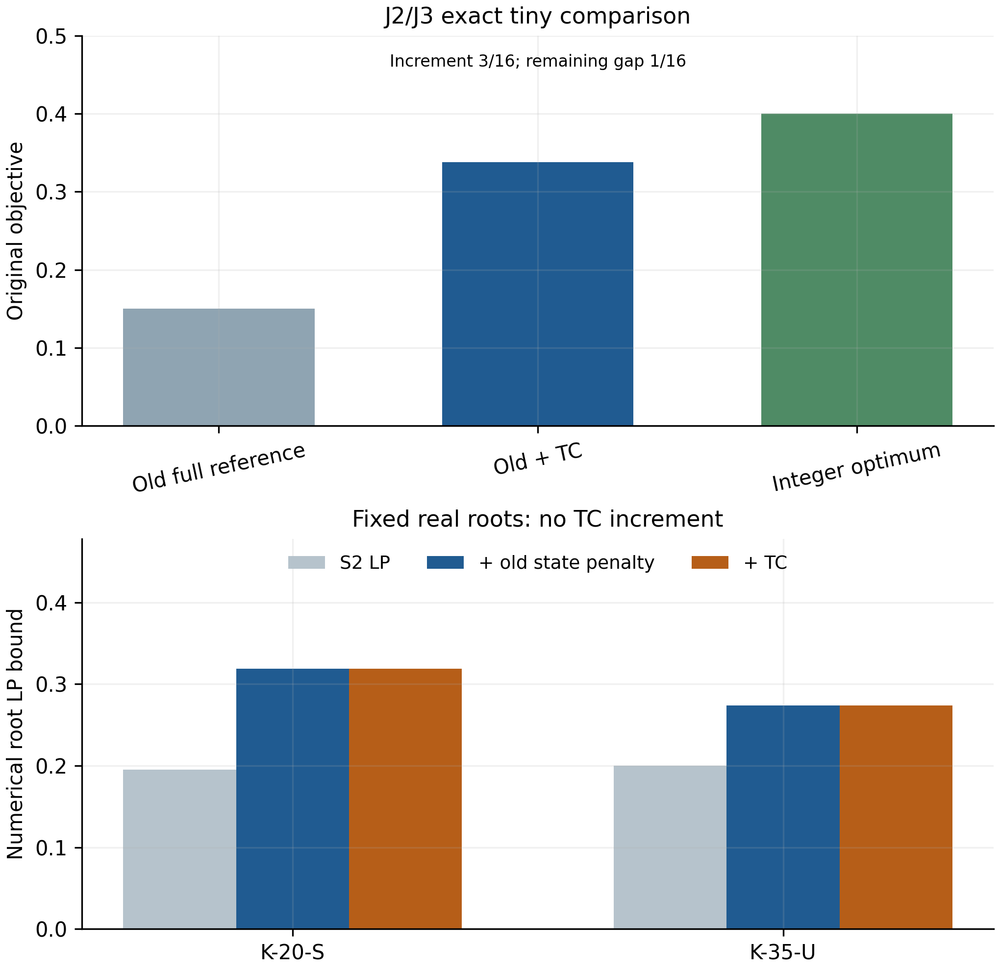

## 6. Inventory-threshold counting: an independent research result

### 6.1 Construction and validity

Let the legal finite supports \(\mathcal Y_i\) contain every physical stock in the applicable domain, including all donors and receivers. Put \(m_i=\min\mathcal Y_i\) and \(R=B-\sum_i m_i\). If \(R<0\), this inventory domain is empty. Otherwise sort the distinct allowed positive ratios as \(0=t_0<t_1<\cdots<t_L\), let \(\Delta_\ell=t_\ell-t_{\ell-1}\), and define \(K_\ell=\#\{i:Y_i/D_i\ge t_\ell\}\).

**Proposition 3 (threshold identities and TC).** At integer inventory points,

\[
S=\sum_\ell\Delta_\ell K_\ell,\qquad
A=\sum_\ell\Delta_\ell K_\ell(n-K_\ell).
\]

For each threshold, count stations already above it at \(m_i\). For every other station that can reach it, find the smallest actual allowed state \(a_{i\ell}\) above it, with incremental inventory cost \(a_{i\ell}-m_i>0\). Let \(u_\ell\) be the forced count plus the largest number of the cheapest increments that fit \(R\). Then the following single aggregate row is valid:

\[
\sum_{i<j}H_{ij}\ge
\sum_\ell\Delta_\ell(n-u_\ell)
\sum_i\sum_{y\in\mathcal Y_i:\,y/D_i\ge t_\ell}s_{iy}.
\tag{TC}
\]

**Proof.** A station contributes its ratio's height to the first sum. For a pair, the threshold levels between its two ratios contribute exactly their absolute difference; at a level there are \(K_\ell(n-K_\ell)\) high/low pairs. Any active set pays at least its forced baseline plus the specified minimum increments, hence \(K_\ell\le u_\ell\). Therefore \(K_\ell(n-K_\ell)\ge(n-u_\ell)K_\ell\). Sum over thresholds, use \(\sum H\ge A\), and linearly extend the integer inequality through the state selectors. \(\square\)

Here \(H_{ij}\) is a ratio-difference epigraph variable, not the startup \(H\). The right side can be preaggregated to \(\sum_{i,y}c_{iy}s_{iy}\), without new variables or a new combinatorial DP. Construction uses \(O(Ln\log n)\) threshold-count work plus state lookup/coefficient accumulation on explicit supports. This is not an input-bit-complexity claim for binary-encoded capacities. A leaf-specific support gives a leaf-specific row and cannot be moved outside its valid domain. At \(S=0\) its right side is zero.

The integer identity does not identify fractional threshold counts computed from LP state marginals with the threshold counts of the mean inventory ratios. Heterogeneous targets are allowed. For a strict comparison on a loaded matrix, the construction uses the exact rational interpretation of its ratio coefficient \(r_i=\widehat c_iY_i\) and state ratio \(\widehat c_i y\), rather than mixing independently rounded ideal ratios. Nonnegative state variables permit downward rounding of the aggregate TC and old state-penalty coefficients. Exact threshold decisions, loaded coefficients and actual written values are retained.

The threshold/CDF representation is an established way to express Gini dispersion [@yitzhakiSchechtman2013]. The sorted-increment count is a knapsack cardinality bound; Yu and Ahmed use such budget-derived cardinality information in concave epigraph formulations [@yuAhmed2017]. The chord bound is elementary. Our claim concerns their specified inventory-state combination and the comparisons below, rather than first discovery of these tools or a completed literature priority claim.

### 6.2 Strict increment on two complete tiny references

J2 and J3 have four stations, unit targets and weights, stock states \(0,1,2\), budget \(B=3\), and actual \(g\)-interval \([0,3/4]\). Their full common reference includes current S2 rows, complete per-vehicle service hulls, theta consistency, all tiny station-event ranks, cutset rows and complete fleet-pair service marginals. We additionally retain the old state-penalty lower bound and complete R88 pairwise CDF/product controls. This explicitly named reference is not the closure of every historical oracle.

The two threshold counts are bounded by 3 and 1, so TC is

\[
\sum_{i<j}H_{ij}\ge\sum_i(s_{i1}+4s_{i2}).
\]

Mix the four real fleets with inventories \((0,1,1,1),(1,0,1,1),(1,1,0,1),(1,1,1,0)\) equally. Their route, load, owner, theta and state extensions give \(s_{i0}=1/4,s_{i1}=3/4,s_{i2}=0\), \(Y_i=r_i=3/4\), \(e_i=1/4\). With \(g=q=Z=H=W=0\), this is a complete old-reference feasible point with objective \(\widehat\lambda\), the exact loaded binary64 value of .15. The old state penalty and complete CDF controls still hold. Sparse CDF and q-CDF prefix variables take their actual cumulative values; only their pairwise absolute-difference auxiliaries are zero.

More explicitly, define the state and product prefixes at stock threshold \(h\) as \(\sum_{y\le h}s_{iy}\) and \(\sum_{y\le h}q_{iy}\). At \(h=0,1\), their two-value vectors are \((1/4,1)\) and \((0,g)\) at every station, both for the old point and the attaining new point below. Every between-station difference of either prefix is therefore zero. The retained pairwise CDF/product controls admit zero absolute-difference auxiliaries; their cumulative prefix variables themselves keep these stated values. The explicit extension and actual old formulas are checked in the supporting mathematical record.

Put \(a=\sum_i s_{i1}\), \(b=\sum_i s_{i2}\). The stock budget gives \(a+2b\le3\), and the old penalty gives \(P\ge4-a\). From VD-P,
\(\sum_iZ_i\le4g+\beta b\), with \(\beta=3/4\le1\). TC and the numerator row imply \(a+4b\le4\sum_i Z_i\), hence \(g\ge a/16\). Since \(\widehat\lambda>1/16\) and \(a\le3\),

\[
F_{LP}\ge a/16+\widehat\lambda(4-a)\ge\widehat\lambda+3/16.
\]

Keep the balanced mixture and set \(g=q_{i1}=Z_i=3/16\), \(q_{i0}=q_{i2}=0\) and \(H_{ij}=1/2\). This attains the bound: both TC sides are 3. Complete exact rational checks pass all 583 actual rows and 284 variable bounds for J2, and all 583 rows and 298 bounds for J3; the old state-penalty and R88 CDF extensions also pass. These are actual-matrix checks plus explicit algebraic extensions, rather than a claim to have reexported every old control into one new native matrix.

The complete integer universe has optimum \(1/4+\widehat\lambda\). Thus the new exact LP value is \(\widehat\lambda+3/16\approx.3375\), its increment is \(3/16\), and the remaining gap is \(1/16\). It closes 75% of the old 1/4 gap. The conclusion uses these actual intervals and supports; it is not a full-size performance guarantee.

The retained pairwise CDF controls see identical station marginals and give no positive numerator floor at the old point. TC uses the all-station stock budget to exclude that zero numerator. Its gain supplies missing objective information even though the service mixture already has a complete joint physical extension. This explains the strict tiny result without implying that the same row must bind a real-root LP optimum.

### 6.3 Historical mechanisms and real-root value

State-weighted penalty was already present in R55's VD-J proposal. Its strict-improver penalty-budget covers and DP have a different premise; failure of a prerequisite gate did not prove them ineffective. R88 couples pairwise CDF/product marginals, R98 theta links vehicle and stock marginals, and R101/R103 use ranks/Hall and independent single-vehicle support. Those tiny common-reference structures are retained where specified. The older inventory DP, R118 stock-deficit/greedy penalty floor and R120 scalar \(g\)-envelope also remain separate references. R114 supplies the nonnegative/source rule, not the positive stock-deficit theorem. The supplement maps the exact read sources and the limited comparisons; no claim of dominance over all historical DP or joint closures is made.

The real-root comparison uses K-20-S/Seed0 and K-35-U/Seed0, with identical input, inventory support, interval and cutoff at all three layers: current S2 continuous LP, that LP plus the old state-penalty lower bound, and the latter plus TC. Non-comparison auxiliaries reoptimize freely. It uses no new integer solve or favorable-cutoff search, and does not rebuild every old oracle.

Both fixed root domains completed the three prescribed LP layers. K-20-S gives L0=0.1951491524, Lold=0.3187585426, Lold+TC=0.3187585426, with TC increment 0. K-35-U gives L0=0.2001776619, Lold=0.2738576813, Lold+TC=0.2738576813, with TC increment -1.665334537e-16. These are floating-point LP observations with recorded primal/dual quality and added-row residuals; the tiny result above is an exact rational theorem. No reliable positive TC increment is established on these real roots. The present exploration stops with the exact tiny result and this negative real-root evidence; it does not expand the root or Seed set.

**Table S7.1. Identical root domain at three relaxation layers. Times are native LP seconds; all non-comparison auxiliaries are free.**

| Problem | L0 | Lold | Lold+TC | TC increment | U / remaining gap | LP seconds 0 / old / TC |
|---|---|---|---|---|---|---|
| K-20-S | 0.195149152 | 0.318758543 | 0.318758543 | 0 | 0.716807 / 0.398048 | 0.131 / 0.165 / 0.175 |
| K-35-U | 0.200177662 | 0.273857681 | 0.273857681 | -1.665335e-16 | 0.692854 / 0.418997 | 0.322 / 1.122 / 0.876 |

