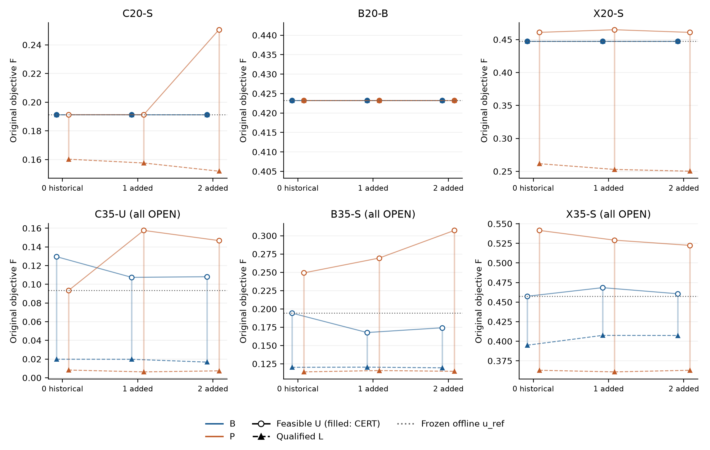
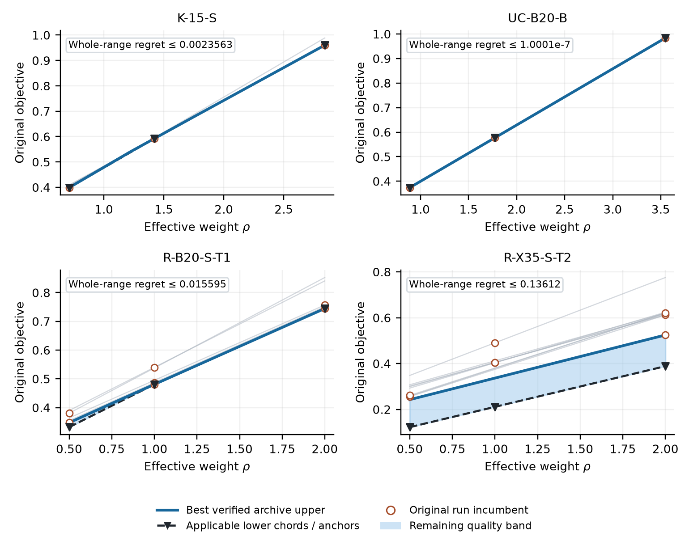

# Shared inventory states and exact search for equitable bicycle redistribution

## Abstract

We study static bicycle redistribution that balances dispersion in station inventory-to-target ratios and deviation from station targets. Final inventories must be realized by routes with empty departures, prefix capacity limits and paid unloading at the depot. Our Gini-interval tailored branch-and-cut method (GI-TBC) links inventory states to handling, visits and objective products, pays for its own feasible start, and maintains valid coverage of all potentially improving Gini values. The shared interface also exposes two distinct representation properties. Five legal supports suffice for the local physical hull, while a two-flow network preserves the joint hull after partial fixes in an absolute inventory code. These properties give different information to search, and the experimental controls leave the independent benefit of interval scheduling unresolved. GI-TBC certifies 9 of 12 breadth cases versus 7 for each compact control and 4 of 8 route-time cases versus zero for both controls. In six positive-objective 50-station comparisons at one solver seed and a 1,200-second cap, it improves five feasible objectives and all six global lower bounds relative to cold compact search. All twelve runs remain open. Verified fleets and global bounds establish strictly positive improvements from additional route time in four matched pairs and bound the quality of archived plans over continuous ranges of objective weights.

## 1. Introduction and related work

An operator redistributing bicycles chooses final station stocks and the routes that achieve them. Supply must be collected before delivery, and every prefix of a route must respect vehicle capacity. Travel, handling and final unloading share a time budget. An equity objective based on inventory-to-target ratios adds a second coupling because final stocks enter both the numerator and denominator of their Gini coefficient. The Gini term measures proportional dispersion, while a separate deviation penalty captures how far stocks lie from their targets. Equal ratios alone can leave every station short.

We study the physical problem in the HGA-TGBC author manuscript [@hgaTgbcManuscript], with empty departures, loaded returns and at most one nonzero one-way service per station. Our method uses its decoder within a finite initialization procedure. The research question is how to connect inventory and service in an exact method that returns useful bounds on the original problem and on transportation decisions.

First, GI-TBC links final stock to movement, visits and objective products, and uses physical valid inequalities to tighten the resulting integer model. From its own verified feasible start it solves a complete cover of the potentially improving Gini domain. The coverage argument includes the complements of objective cutoffs and exact continuation of unsplit intervals. The full computational comparison includes a cold compact model and a compact model that pays for the same startup procedure.

Second, we characterize two properties of the shared representation. On a contiguous stock domain, a small set of legal supports preserves the projected inventory, movement, visit and product hull. After fixing digits in an absolute inventory encoding, preserving the joint stock and code information requires retaining their linkage. A two-flow network does so for the local problem. These representation results and their finite diagnostics also show why common physical projections and complete solve costs require separate arguments.

Third, verified fleets and global lower bounds quantify the effect of changing the route horizon and bound plan quality between sampled deviation weights. The bounds show when more time is guaranteed to improve the objective even if both endpoints remain open. Over a covered weight range they quantify the potential loss from keeping a saved fleet or switching among known fleets.

### 1.1 Relation to previous work

Static redistribution models differ in their target, service and depot conventions [@raviv2013; @chemla2013; @erdogan2014; @erdogan2015; @schuijbroek2017]. Repeated visits, temporary operations, robust inventory requirements and demand-interval disjunctions give related feasible sets [@bruck2019; @bulhoes2018; @bruck2025; @ikonen2025]. Here the shared inventory state must support single nonzero service and paid loaded returns. Exact loading precedents include the single-vehicle demand-interval network in [@erdogan2014, section 2] and loading strategies with empty returns in [@szetoShui2018, sections 2–3]. The present ratio-Gini objective couples stocks across vehicles. The equity measure also differs from vehicle workload [@matl2018], task durations in two-echelon rebalancing [@qiao2026], and zonal availability and battery charge in electric micromobility [@caggiani2026].

Convex product envelopes, integer-continuous product reformulations, finite block-value linking and embedding formulations supply the mathematical tools [@mccormick1976; @boydVandenberghe2004; @gupte2013; @koppe2008; @vielma2018embedding; @huchetteVielma2023]. Our structural results concern the common visibility of the destination stock, its discrete service jump, movement and the Gini product, and the information available when stock digits are fixed. This linkage is the basis for the local projections in Section 2. The full method accounts for routing and bounds beyond those local projections.

## 2. Problem and shared-state formulation

### 2.1 Physical semantics and objective

Let \(N\) contain \(n\) stations and let \(0\) be the depot. Station \(i\) has integer initial inventory \(b_i\), capacity \(C_i\), positive target \(D_i>0\), and weight \(\omega_i\ge0\). Vehicle \(k\) has capacity \(Q_k\) and route-duration limit \(T\). Routes depart empty and every prefix load lies in \([0,Q_k]\). A station can be served by at most one vehicle, in one direction, with a nonzero operation. Loaded return is allowed and its unloading time is counted. The depot enters neither target deviation nor dispersion.

The computational text format stores integer targets. All present test targets also satisfy \(D_i\le C_i\), a data convention rather than an additional physical constraint; the inventory capacity bounds apply to \(b_i,Y_i\).

With pickup \(p_{ki}\) and delivery \(d_{ki}\),

\[
Y_i=b_i+\sum_k(d_{ki}-p_{ki}),\qquad
R_k=\sum_i(p_{ki}-d_{ki})\in[0,Q_k],\qquad
\sum_iY_i=\sum_i b_i-\sum_kR_k.
\]

Loaded returns reduce total station inventory from \(B=\sum_i b_i\). Vehicle capacity constrains instantaneous load. If pickup and unloading/delivery take \(t_p,t_d\) per unit, complete handling time is

\[
t_p\sum_i p_{ki}+t_d\left(\sum_i d_{ki}+R_k\right)
=(t_p+t_d)\sum_i p_{ki}.
\]

Travel plus this quantity cannot exceed \(T\). The tested distance convention is Euclidean travel time from serialized metre coordinates at 1.5 m/s. Final inventories are integers in \([0,C_i]\). Appendix A gives the route, capacity, service and time constraints in full.

Define

\[
r_i=Y_i/D_i,\quad S=\sum_i r_i,\quad
A=\sum_{i<j}|r_i-r_j|,\quad
P=\sum_i\omega_i|r_i-1|,
\]

\[
G=\begin{cases}A/(nS),&S>0,\\0,&S=0,\end{cases}
\qquad F=G+\lambda P,\quad\lambda\ge0.
\]

The objective measures station inventory adequacy and proportional dispersion. For the reported instances, \(\Omega=\sum_i\omega_i>0\). We report the normalized weight \(\rho=\lambda\Omega\), so \(\lambda=\rho/\Omega\) and \(F=G+\rho P/\Omega\). The generator scales individual weights by their maximum, so the same \(\lambda\) across inputs can give different \(\rho\).

For positive total shortage \(s=\sum_iD_i-\sum_ib_i>0\), positive weights and \(\lambda>0\) (equivalently \(\rho>0\)), let \(a=\min_i\omega_i/D_i>0\). Nonnegative loaded return yields

\[
P\ge a\sum_i|D_i-Y_i|\ge a\left|\sum_iD_i-\sum_iY_i\right|\ge as,
\qquad F\ge\lambda as=\rho as/\Omega>0.
\]

The resource and 50-station studies use this stock-shortage construction to ensure strictly positive optima before any search. Their algorithms use their existing online bound sources. With fixed physical and objective data apart from \(T\), \(T_1\le T_2\) gives \(X(T_1)\subseteq X(T_2)\) and \(F^*(T_2)\le F^*(T_1)\).

### 2.2 A shared inventory, service and product state

For the legal finite inventory domain \(\mathcal Y_i\), binary selectors \(s_{iy}\) and continuous \(q_{iy}\) represent stock and products on a Gini interval \([\alpha,\beta]\):

\[
\sum_y s_{iy}=1,\quad Y_i=\sum_y ys_{iy},\quad
\alpha s_{iy}\le q_{iy}\le\beta s_{iy},\quad
\sum_yq_{iy}=g,\quad Z_i=\sum_y yq_{iy}.
\]

At an integer state, \(Z_i=gY_i\). The objective epigraph uses

\[
H_{ij}\ge r_i-r_j,\quad H_{ij}\ge r_j-r_i,\qquad
e_i\ge r_i-1,\quad e_i\ge1-r_i,
\]

\[
\sum_{i<j}H_{ij}\le n\sum_i Z_i/D_i,\qquad
\min f=g+\lambda\sum_i\omega_i e_i.
\]

For \(S>0\), integer state selection makes the numerator inequality imply \(g\ge G_{\rm true}\), so every integer completion satisfies \(f\ge F_{\rm true}\). Conversely a physical fleet assigned to its true-G interval has an objective-preserving extension: select its final inventories, set \(g=G_{\rm true}\), set each selected \(q_{iy}=g\), and use the true absolute differences and deviations. At \(S=0\), all ratios are zero and \(g=0\) supplies the physical extension. Valid domain and strengthening rows retain that extension, as established in Appendix A.

Let \(z_{ki}\) be the binary service assignment. The same state supports the service equations

\[
\sum_kp_{ki}=\sum_y(b_i-y)^+s_{iy},\quad
\sum_kd_{ki}=\sum_y(y-b_i)^+s_{iy},\quad
\sum_kz_{ki}=\sum_{y\ne b_i}s_{iy}.
\]

GI-TBC/B uses this enumerated formulation and the shared service equations. In isolation, the product block projects to the McCormick hull over the stock and \(g\) bounds. The four corner graph points belong to the block, and every stock-product segment is in that hull. The additional information in the common interface comes from linking the same mixtures to service and movement.

**Lemma 1 (implicit service integrality).** Suppose initial and final inventories are integer, a station is assigned to at most one vehicle, and a binary direction permits either pickup or delivery at its unique service. Continuous pickup and delivery variables then take integer values at every integer solution of the remaining model.

**Proof.** An unassigned vehicle has zero quantities. At the unique assigned vehicle, pickup direction fixes delivery to zero, so inventory balance gives \(p_{ki}=b_i-Y_i\). Delivery direction fixes pickup to zero and gives \(d_{ki}=Y_i-b_i\). Each is integer. The argument needs no load integrality and applies at integer feasible solutions. \(\square\)

For an integer service, total movement is \(|b_i-Y_i|\), and nonzero one-way service occurs exactly when \(Y_i\ne b_i\). Hence the shared equations above reproduce the original operations without changing the physical problem. They also couple fractional inventory mixtures to the movement and visits that must support them.

### 2.3 What compact supports preserve

Let \(\mathcal D_i=[l_i,u_i]\cap\mathbb Z\) be a nonempty contiguous legal stock domain. Define \(m_i(y)=|b_i-y|\), \(v_i(y)=\mathbf1\{y\ne b_i\}\), and the common interface \((Y_i,M_i,V_i,g,Z_i)\), where \(M_i=\sum_k(p_{ki}+d_{ki})\) and \(V_i=\sum_k z_{ki}\). Inventory balance recovers total pickup and delivery linearly from \(Y_i,M_i\). The relaxed enumerated block with the shared service equations projects to

\[
\mathcal H_i=\operatorname{conv}\{(y,m_i(y),v_i(y),g,gy):y\in\mathcal D_i,\ g\in[\alpha,\beta]\}.
\]

**Proposition 1 (compact shared interface).** For \(0\le\alpha\le\beta\le 1\), the hull \(\mathcal H_i\) is generated by the graph at the at most five legal stocks

\[
\mathcal K_i=\{l_i,u_i\}\cup\bigl(\{b_i-1,b_i,b_i+1\}\cap\mathcal D_i\bigr).
\]

The compact block uses continuous support weights and a separate absolute-stock binary product layer. With the original service and balance constraints, and when all other uses of the deleted states pass through the common interface, the replacement preserves the integer physical projection, the original objective and the common raw LP projection.

**Proof sketch.** On the donor and receiver pieces, inventory and movement are affine and the visit indicator is one. At the initial singleton the visit indicator is zero. At fixed \(g\), interpolation between legal endpoints of each piece preserves movement, visits and \(gy\). Conversely every retained support is legal. The independent binary layer enforces \(Z_i=gY_i\) at integer stocks. Its relaxed projection contains every true stock-product point, and the two auxiliary blocks share only \((Y_i,g,Z_i)\), so the relaxed layer preserves the common hull. Appendix A.9 gives both embedding directions. \(\square\)

With only continuous support weights, different \(g\) values can be mixed at different stocks and an integer mean stock alone does not enforce the product. Binary support weights would restrict stock to the retained five positions. The original target penalty stays in its epigraph. Additional thresholds, exact state penalties and vehicle-level state assignments require their own shared functions. Holes in the allowed stocks require explicit membership. GI-TBC/B retains the enumerated states. The compact-support replacement is evaluated separately in §4.5.

### 2.4 Preserving conditional code information

For one station with capacity \(C\), omit the station subscript. Let \(c(y)\) be the absolute binary code of \(y\), with \(d=\max\{1,\lceil\log_2(C+1)\rceil\}\) digits. Write \(E(\mathcal D)\) for the convex hull of the same joint graph augmented by the digit vector \(\delta=c(y)\) and the digit products \(w=gc(y)\). If digits indexed by \(J\) are fixed to \(a_h\), the set of consistent stocks is \(\mathcal D_J=\{y\in\mathcal D:c_h(y)=a_h,\ h\in J\}\).

**Proposition 2 (conditional joint representation).** A directed acyclic graph reading absolute digits from most to least significant represents \(E(\mathcal D)\) with \(O(1+\log(C+1))\) local columns, rows and nonzeros. Use one interval graph for each nonempty donor, initial and receiver piece, connected to a common source and sink. Both the nonnegative base flow \(f\) and product flow \(q\) use the same edges. With incidence matrix \(A\) and unit source-to-sink balance \(e\), they satisfy

\[
Af=e,\qquad Aq=ge,\qquad \alpha f\le q\le\beta f.
\]

Path costs yield \(Y,M,V\) from \(f\), \(Z\) from \(q\) and each digit and digit product from edges that assign it one. After fixing the digits in \(J\), the projection is exactly \(E(\mathcal D_J)\), including infeasibility when that set of stocks is empty.

**Proof sketch.** An interval graph needs at most four lower/upper tightness states per bit layer and has one complete path per legal stock. For \(\alpha<\beta\), the flows \((\beta f-q)/(\beta-\alpha)\) and \((q-\alpha f)/(\beta-\alpha)\) are nonnegative and conserved internally. Their path decompositions give mixtures at the two \(g\) endpoints. If \(\alpha=\beta\), use \(q=\alpha f\) and decompose \(f\) alone. Fixing a digit removes inconsistent paths by nonnegativity. Appendix A.11 proves the reverse construction and the integer correspondence. This uses established network and disjunctive techniques [@behle2007; @balas2005; @muldoon2013]. \(\square\)

To see what separate mixtures lose, take \(\mathcal D=\{0,\ldots,4\}\), \(b=2\), \(g\in[0,1/2]\) and fix the least significant bit to one. Stocks 1 and 3 are the only legal paths, so the conditioned joint hull requires \(M=V=1\). A separated compact block can choose the support at stock 2 with \(g=1/4\), giving \(Y=2,M=V=0,Z=1/2\). Its relaxed code block can mix stocks 1 and 3 equally at the same \(g\). In least-significant-first order this gives \(\delta=(1,1/2,0)\) and \(w=(1/4,1/8,0)\), consistent with the shared \(Y,g,Z\) but impossible in the conditioned joint hull.

The enumerated same-code reference and the network retain the same enhanced projection. With the digits free, their physical projections also coincide with the separated compact block. Proposition 2 is local to the specified absolute digits and legal stock domain. The experiment uses an offline network prototype, and the full route and solver-tree effects remain unidentified (§4.5). Supplement S167.4 maps the representations to their implementation names.

## 3. The complete GI-TBC method

### 3.1 Physical strengthening

Let \(\tau\) be metric travel time and \(h=t_p+t_d\). For each receiving station \(j\), define

\[
\mathcal C_{kj}=\{i\ne j:\tau_{0i}+\tau_{ij}+\tau_{j0}+h\le T\}.
\]

**Proposition 3 (ordered supply compatibility).** Under metric travel and empty departure, every physical fleet satisfies

\[
d_{kj}\le\sum_{i\in\mathcal C_{kj}}p_{ki}.
\]

**Proof.** Label the units collected by a vehicle. In route order, match each delivered unit to an earlier collected unit that has not yet been delivered. Nonnegative prefix loads guarantee such a match. A unit delivered at \(j\) from source \(i\) entails the ordered subsequence \((0,i,j, 0)\), whose travel lower bound follows by metric shortcutting. Collecting at least that unit incurs handling of at least \(h\), including delivery or final unloading. Thus its source lies in \(\mathcal C_{kj}\). Counting distinct matched units proves the inequality. Unmatched collected units can return to the depot. \(\square\)

For a set \(W\) of served stations, let \(\tau(W)\) be the shortest depot tour through \(W\), computed by explicit orders for pairs or triples. Write \(P_k^{\rm pick}=\sum_i p_{ki}\). Nonzero integer service and empty departure give

\[
|W|\le\sum_{i\in W}(p_{ki}+d_{ki})\le2P_k^{\rm pick},\qquad
P_k^{\rm pick}\ge\lceil |W|/2\rceil.
\]

Consequently \(\tau(W)+h\lceil|W|/2\rceil>T\) rules out serving all of \(W\) with that vehicle. Otherwise a conditional duration inequality combines the tour lower bound and pickup handling. Supply for \(W\) may come from outside \(W\); cumulative pickup is not bounded by \(Q_k\). Appendix A gives the exact conditional coefficients, deactivation proof and finite selection rule. Default GI-TBC uses pair support, with triple support disabled. It supplies static rows to the canonical models, and Gurobi runs branch-and-cut within each model. These rows strengthen necessary physical conditions without replacing route-prefix capacity.

### 3.2 Verified startup and complete interval coverage

Startup \(H\) fully decodes a joint insertion and a pool of 24 shuffled station/separator orders plus a constructive order. It uses guided first-improvement descent and finishes with physical quantity, insertion and neutral exchange moves. Each run of B or the warm compact control pays for its own \(H\), physical verification and any compatible mapped start. Its feasible fleet supplies \(U\); the initial independent lower bound is zero.

The controller represents an interval \(I=[\alpha,\beta]\) by its depth, open or closed proof obligation, current regional floor \(b_I\) and applicable bound sources. A source records the model identity, incumbent version and objective cutoff at which it was obtained. A canonical model for \(I\) and cutoff \(c\) contains an objective-preserving extension of every physical fleet with true \(G\in I\) and \(F\le c\) (Appendix A). Thus a qualified source \(\ell\) gives a floor on that cutoff subset, and \(c\) bounds the omitted subset \(F>c\). An infeasible cutoff subset likewise leaves the complement with floor \(c\).

In the mathematical cover, a source therefore contributes \(\min\{\ell,c\}\) on its full interval. Take the maximum of applicable floors on the same domain, including any inherited proof whose scope contains it. Take the minimum over all intervals in the complete cover and the analytic complement of the improving domain, where \(F\ge U\). The scheduler's stored numerical floor and raw output follow the return rules in Appendix B.4. The minimum with a source cutoff is a proof-accounting operation.

For a selected parent with stored floor \(b\), adaptive mass (AM) evaluates two finite child LP bounds \(\ell_j\) using the native LP values before inheritance:

\[
\Delta=\max\{U-b,\max(\varepsilon,10^{-12})\},\quad
v_j=\min\{1,\max\{0,(\ell_j-b)/\Delta\}\},\quad
S_{\rm AM}=\min(v_0,v_1)(v_0+v_1)/2.
\]

The threshold is .08 with the score tolerance in Appendix B.3. The rule measures two-sided improvement relative to the own proof gap. Infeasibility uses a separate logical decision.

**Algorithm 1. GI-TBC with complete parent continuation.**

1. **Initialize.** Within the common deadline, complete \(H\), verify its fleet in the original problem and store its objective \(U\). Set the incumbent version to zero. Register \([0,\min\{U,(n-1)/n\}]\), including the zero boundary, as a single obligation with independent floor zero. Each new interval starts with its NEXT milestone unset.

2. **Select and bound.** Among open intervals with \(\alpha<U-\varepsilon\) and \(b_I<U-\varepsilon\), cycle widest first within \(\varepsilon=10^{-7}\) of the minimum stored floor. Reuse only an applicable complete LP or solve the current interval LP at cutoff \(c=U\). Keep the source and its complement. Close this obligation if the qualified LP is infeasible or the merged floor reaches \(U-\varepsilon\).

3. **Choose the continuation.** After the LP, return to selection if a relevant open competitor now has a strictly lower floor (by more than \(\varepsilon\)). Otherwise, if the NEXT milestone is unset and some relevant open floor exceeds \(b_I+\varepsilon\), solve the parent MIP with the smallest such floor as its NEXT stopping target. When this rule permits lookahead, use the following decisions.

   - At depth 8 or the minimum width \(10^{-4}\) (with geometric tolerance), solve the full parent MIP without a bound target.
   - Otherwise obtain both complete qualified midpoint child LPs on the current cutoff. If either is infeasible, install both covering children together and mark the infeasible subset or subsets empty. If both return finite optimal bounds, put \(t=\min\{\ell_0,\ell_1\}\). For \(t\le b_I+\varepsilon\), solve the full parent MIP. For \(t>b_I+\varepsilon\), split atomically if AM passes. Otherwise solve the parent MIP with stopping target \(t\). The parent covers the entire interval until both children are installed. Each installed child inherits applicable parent evidence and its own qualified evidence.

4. **Process the actual return.** After finalizing a native request, admit qualified bounds on their recorded scopes. Recheck a candidate fleet in the original physical problem. An improvement of more than \(10^{-9}\) replaces the own \(U\) and increments its version. The next access discards stale model, LP and child caches, while applicable older floors and NEXT milestones survive. A qualified optimal or infeasible return closes its own cutoff obligation under the physical-consistency rule. A solver optimum with an inadmissible physical gap leaves the region open. For a still unresolved parent, requeue when the solver reports reaching the target, requested termination and returned a qualified bound of at least the target minus \(\varepsilon\). Set its milestone only for a confirmed NEXT return. A child target leaves the next action to the selection and lookahead rules. Use the actual qualified bound in either case.

5. **Preserve obligations and return.** Repeat after a valid closure, split or requeue while relevant open obligations and time remain. An incomplete child pair, a failed qualification or an interrupted native return without confirmed target or qualified closure stops the lifecycle with the obligation retained. The physical-gap guard also stops without closure. Keep applicable partial bounds. If the journal cannot support the native proof chain, restore the full unresolved coverage with the independent zero floor. The paid return includes the final physical checks, solver cleanup and required output. Report \(U,L\) where qualified and CERT only under the independent exact-zero or qualified full-cover gap rule in §3.4. Otherwise return OPEN.

Appendix B maps the mathematical operations to both controller subprocedures, including tie order, cache gates, target-return flags and exact continuation. A requested stopping target and a parameter guard supply neither a lower bound nor proof of closure.

**Proposition 4 (coverage).** With objective-preserving embeddings, qualified bounds and complete accounting of the cutoff complements, the cover gives a valid global lower bound. If it closes all potentially improving regions against a verified \(U\) to the declared margin, it proves optimality to that margin.

**Proof.** \(F\ge G\) and \(G\le(n-1)/n\) place every improving fleet in the initial interval. Within a region, Lemma A3 applies the source and its cutoff complement to all fleets. Replacing a parent by both closed midpoint intervals preserves their union, including the shared endpoint. Retaining unresolved and closed obligations with their qualified floors leaves every physical fleet bounded by a region or an analytic complement. Lemma A4 then gives the full-cover minimum. If all applicable floors are at least \(U-\varepsilon\), the verified fleet is within that margin of the optimum. \(\square\)

The mathematical proof assumes valid evidence. Appendix B.4 describes the frozen numerical bookkeeping and its conservative source-rejection fallback. Finite tree depth and complete terminal MIPs permit exact search in ideal arithmetic. A finite process budget can interrupt the proof, including at the terminal guard.

### 3.3 A separately paid proof enhancement

E+ adds an independently qualified inventory lower source to B. On its own first canonical root it uses the actual supported stock domains and valid total-stock bounds. On an epigraph interval \([\gamma_L,\gamma_U]\) it minimizes

\[
\max\{\gamma_L,G(Y)\}+\lambda\sum_i\omega_i|Y_i/D_i-1|
\quad\text{over admissible stocks with }G(Y)\le\gamma_U.
\]

Here \(\gamma_L\) bounds the epigraph variable. The stock Gini may be below it. E+ uses the inherited hard-total dynamic program and one uniform finite inventory bound computation, including their zero and fallback rules. The extra floor enters only proof accounting, leaving the formal Native rows, raw AM inputs and start policy as in B. Each E+ run pays for \(H\), the root, inventory computation and qualification within its deadline. Its additional work and any earlier proof closure can change the remaining search and final incumbent. E+ is a separate comparator outside default B.

### 3.4 Numerical qualification, costs and termination

The process clock includes startup, input and model preparation, solver calls, online qualification, cleanup and required output. Later independent checks have separate costs. Solver Runtime, Work and nodes describe nested effort. Table 1 gives the process cap for each study. Physical route time \(T\) is an input constraint. Only the paired intersection of qualified certificates enters a certificate-time comparison. A paid difference is substantive at or above \(\max\{10\text{ s},0.1\times\text{faster time}\}\).

The principal panels use Gurobi 13.0.2 with one thread and fixed affinity on an Intel i7-12700KF Windows host. Requested relative and absolute MIP gaps are zero. Solver feasibility/optimality tolerances are \(10^{-6}\), integrality \(10^{-5}\) and the separate certificate tolerance \(10^{-7}\). A source must match the input, objective, model, interval and cutoff and pass the applicable return and consistency gates. Raw LP bounds come from relaxing all integer types before optimization. They are distinct from MIP-root bounds after cuts.

Report \(U\) from a complete verified fleet evaluated with the original objective and \(L\) from qualified full-domain evidence. Absolute display gap is \(\max\{0,U-L\}\), and relative gap divides this by \(U\) when \(U>0\). Source records retain the signed difference. A native objective is a separate measurement from the physical objective. B's numerical production rule requires a verified \(U\), valid root and child coverage, closure of all relevant obligations, qualified monotone bound evidence and a complete lifecycle with \(L+\varepsilon\ge U\). Admission of a reported positive certificate also checks the signed gap in \([-10^{-7},10^{-7}]\). \(T_{\rm cert,process}\) measures that paid completion. An OPEN result has no certificate time.

A verified fleet at exactly zero gives an independent certificate because \(F\ge0\) everywhere. The stock test checks exact equality of the station ratios and that every penalized station meets its target when its penalty coefficient is positive. The production predicate also repeats physical verification (Appendix B.4.1). A near-zero positive objective provides no such proof. Post-return audits cannot supply an earlier production proof or clock.

## 4. Computational evidence

### 4.1 Comparators and panel protocols

B denotes the complete GI-TBC method. The compact comparator P builds the original compact model and submits zero starts. PS independently runs and pays for complete \(H\) and maps its own feasible fleet to the compact model. The strengthened root-only control keeps B's shared states, physical rows and startup, using solver branch-and-cut on one inclusive unsplit root. B/P and B/PS compare complete methods. Full/root, row deletion and E+ comparisons ask narrower questions. All methods pay their own lifecycles. Matched runs share protocol settings without sharing fleets, bounds, starts or search trees.

The breadth and route-time studies precommit their draws from CITI, CABI and Divvy station archives. Six known roles and six draws give 12 breadth inputs with four per size. Four further shortage draws each supply a pair of physical horizons. Archive geometry and capacity are combined with synthetic or transformed initial stock, targets, weights and depot. These configurations support controlled comparisons on specified inputs. They do not estimate operator demand or a population of cities.

**Table 1. Panel protocols and nominal process caps per arm.** Shared default runs appear once. The historical protocols are specified in the supplement.

| Study and scope | Methods and number of runs | Solver Seed / cap (s) | Question |
|---|---|---|---|
| Breadth, 12 inputs, \(n=15/20/35\) | B/P/PS, 36 | 0 / 600, 1,200, 2,400, respectively | Complete certificates and endpoints |
| Route time, 4 bases at \(n=20/35\) and 2 horizons each | B/P/PS, 24 | 0 / 1,200, 2,400, respectively | Resource value at \(\rho=1\) |
| Weights, 2 route-time configurations, 2 additional weights each | B/P/PS, 12 | 0 / 1,200, 2,400, respectively | Sensitivity within an input |
| AM and mechanism controls, 4 roles in each | B with 2 extra AM thresholds, 8; root and 3 row deletions, 16 | 0 / 600, 1,200 or 2,400 as for matching main runs | Conditional component evidence |
| Limited earlier Seed repeat | B/P/PS on 4 roles, 12; AM, 4; mechanism, 8 | 1 / same cap as each matched Seed 0 run | Repeat selected contrasts |
| Within-input Seed cohort, 6 inputs, \(n=20/35\) | B/E+/P, 18 at Seed 0; B/P, 24 at Seeds 1/2 | 0, 1, 2 / 1,200, 2,400, respectively by size | Seed variation and paid inventory proof |
| Positive-objective 50-station panel, 6 configurations | B/P, 12 | 0 / 1,200 for all | Endpoint progress on new configurations |
| Compact-support comparison, same 6 cohort inputs at \(n=20/35\) | B and compact variant, 12 fresh runs | 0 / 1,200, 2,400, respectively | Common LP projection and complete cost |
| Paid initialization, same 6 cohort inputs and a 4-input confirmation subset | B and 2 startup variants, 18; confirmation B and variants including cold P, 22 | 0 / 300 at \(n=20\), 600 at \(n=35\); 1/2 / 600 for all confirmation runs | Reweighting against paid restarts |

Breadth uses \(\lambda=.15\). The resource pairs change only \(T\) at \(\rho=1\). The weight study uses R-B20-S-T1 and R-X35-S-T2, reusing their \(\rho=1\) baselines and adding \(\rho\in\{.5,2\}\). For each resource base and 50-station configuration, \(d_{\max}\) is the maximum serialized depot-to-station distance and \(M\) is the number of vehicles. The design sets

\[
\begin{aligned}
T_{\rm base}&=2d_{\max}/1.5+120\sum_{i\in N}\max(b_i-D_i,0)/M,\\
T_1&=300\left\lceil\max(1800,.75T_{\rm base})/300\right\rceil,\\
T_2&=300\left\lceil1.5T_1/300\right\rceil.
\end{aligned}
\]

The resource pairs use both horizons. The 50-station comparison uses \(T_1\) alone. The rule uses input data before optimization and does not imply a binding time constraint.

### 4.2 Complete methods against cold and paid-start compact controls

**Table 2. Qualified certificates in the main Seed 0 panels.**

| Panel | GI-TBC | P | PS |
|---|---|---|---|
| Breadth | 9/12 | 7/12 | 7/12 |
| Resource pairs | 4/8 | 0/8 | 0/8 |

**Table 3. Certificate-time comparisons conditioned on both methods certifying.**

| Panel | Other | Both certified | GI-TBC W / L | Geo Other / GI-TBC |
|---|---|---|---|---|
| Breadth | P | 7 | 6 / 0 | 11.3534 |
| Breadth | PS | 7 | 4 / 1 | 4.22522 |
| Resource pairs | P | 0 | 0 / 0 | n/a |
| Resource pairs | PS | 0 | 0 / 0 | n/a |

Table 3 conditions the time ratios and substantive wins/losses on both methods certifying (§3.4). At the same paid cap, the breadth cases include N-B15-B (B/P/PS certificate seconds 24.068/279.663/306.307), and N-C20-U (B certifies in 265.529 s, P and PS remain OPEN). On X-35-B, PS certifies in 7.450 s versus B's 17.905 s. B and PS pay independently for matching H fleets, so search still matters after the start.

On K-35-U, cold P has better \(U\) (.664747 versus .692854), while B has better \(L\) (.565766 versus .335556). Both are OPEN. The N-X20-B cold P certificate uses its own exact zero fleet and the independent nonnegative floor after native-source rejection. The earlier two-Seed breadth study retains 17/24 versus P 9/24 and PS 4/12, and the earlier confirmation 12/14 versus P 9/14 and PS 2/4 under their respective source and eligibility rules. The historical source-rejected zero case remains outside its formal timing sample. These panels have separate denominators.

### 4.3 Archived-source cohort and within-input Seed variation

The six-input cohort was selected before the first B/E+/P comparison. At Seed 0, B and E+ certify 3/6 versus P's 1/6. B and E+ attain the same physical \(U\) on each input. E+ raises X35's \(L\) from .394988256 to .423199550 and lowers its relative gap from 13.66% to 7.49%, with X35 still OPEN. The independent proof comes with additional paid time. On the three B/E+ joint certificates, E+ adds 26.10, 1.70 and 6.18 s on C20, B20 and X20, respectively. Only C20 clears the substantive-time threshold.

**Table 4. Historical Seed0 configuration confirmation, separate from the earlier panels.** Each entry is state, physical U / qualified proof L, then paid T_cert for CERT (seconds). Full binary64 values, verification costs, Work/nodes and source identities are in the supplement.

| Configuration | B | E+ | P |
|---|---|---|---|
| C20-S | CERT; 0.1912805923 / 0.1912805923; T_cert=199.7793504 | CERT; 0.1912805923 / 0.1912805923; T_cert=225.8837082 | OPEN; 0.1912805923 / 0.1602342164 |
| B20-B | CERT; 0.4232321817 / 0.4232321817; T_cert=5.058292441 | CERT; 0.4232321817 / 0.4232321817; T_cert=6.756586993 | CERT; 0.4232321817 / 0.4232321815; T_cert=235.8555019 |
| X20-S | CERT; 0.4477476266 / 0.4477476266; T_cert=119.7493879 | CERT; 0.4477476266 / 0.4477476266; T_cert=125.9267332 | OPEN; 0.4609477662 / 0.2616496512 |
| C35-U | OPEN; 0.1295663897 / 0.01983750282 | OPEN; 0.1295663897 / 0.01983750282 | OPEN; 0.09331934375 / 0.008286772138 |
| B35-S | OPEN; 0.1942903111 / 0.1202340026 | OPEN; 0.1942903111 / 0.1202340026 | OPEN; 0.2492530135 / 0.1139794085 |
| X35-S | OPEN; 0.457475317 / 0.3949882559 | OPEN; 0.457475317 / 0.4231995496 | OPEN; 0.5415306805 / 0.362971432 |

The B/P confirmation adds twelve pairs on the same six exposed configurations at Seeds 1 and 2, each with fresh startup for B at fixed H seed 20260626. At every Seed, B certifies 3/6 and P 1/6. B20 is the sole joint-CERT input and B is substantively faster at each Seed. Every \(n=35\) run remains OPEN. Table 5 and the endpoint figure retain the paired variation.

**Table 5. Within-input paired differences in Seed order 0/1/2.** Seed 0 is historical; Seeds 1/2 are the subsequent confirmation observations. ΔU=B−P is favorable to B when negative; ΔL=B−P
is favorable when positive. Values within 1e-7 are displayed as 0; individual endpoints and costs remain in the supplement.

| Configuration | B CERT /3 | P CERT /3 | ΔU: S0 / S1 / S2 | ΔL: S0 / S1 / S2 |
| --- | --- | --- | --- | --- |
| C20-S | 3 | 0 | 0 / 0 / -0.0592739276 | 0.0310463758 / 0.0336984584 / 0.0394115797 |
| B20-B | 3 | 3 | 0 / 0 / 0 | 0 / 0 / 0 |
| X20-S | 3 | 0 | -0.0132001396 / -0.0172134837 / -0.0132001396 | 0.186097975 / 0.194824544 / 0.197495547 |
| C35-U | 0 | 0 | 0.0362470459 / -0.0501944461 / -0.0386805194 | 0.0115507307 / 0.0134743346 / 0.00933437769 |
| B35-S | 0 | 0 | -0.0549627024 / -0.101715977 / -0.132960007 | 0.00625459405 / 0.00466145812 / 0.00475241402 |
| X35-S | 0 | 0 | -0.0840553635 / -0.060652829 / -0.0617878527 | 0.0320168239 / 0.0466015852 / 0.0444201335 |

C35 exhibits a primal reversal across Seeds. P wins \(U\) at Seed 0 and B at Seeds 1/2. The historical Seed 0 P fleet has \(U=.093319344\), below all three B incumbents (about .129566390, .107429866 and .108083936). Its feasible value exposes an absolute incumbent deficit even when B beats its own same-Seed P comparator. The archived X35 target is also missed by B on both added Seeds. The supplement gives all individual endpoints and feasible-target availability intervals. The earlier four-role triplet repeat separately has B 3/4 versus P and PS 1/4 at each Seed.

{width=87%}

### 4.4 Complete-method endpoints at 50 stations

All six precommitted shortage configurations enter the panel, one compact and one regional geometry per archive. Each uses three vehicles of capacities 20, 25 and 30, \(\rho=1\), the input-specific \(T_1\), and the positivity property in §2.1. B pays one complete own \(H\) and P is cold with zero submitted starts. The common one-thread, single-Seed protocol and complete observations are in Supplement S171.

**Table 6. Feasible objectives and qualified global bounds on six positive-objective 50-station configurations.** Both methods are OPEN on every row at solver Seed 0 and a 1,200 s process cap.

| Archive / geometry | B \(U\) / \(L\) | P \(U\) / \(L\) | Abs. gap B / P | Rel. gap B / P (%) |
|---|---|---|---|---|
| CITI compact | 0.536923 / 0.356919 | 0.523772 / 0.291331 | 0.180003 / 0.232440 | 33.53 / 44.38 |
| CITI regional | 0.541165 / 0.355390 | 0.574631 / 0.312450 | 0.185775 / 0.262181 | 34.33 / 45.63 |
| CABI compact | 0.653336 / 0.416792 | 0.705181 / 0.343940 | 0.236544 / 0.361241 | 36.21 / 51.23 |
| CABI regional | 0.572824 / 0.378424 | 0.608779 / 0.186291 | 0.194400 / 0.422488 | 33.94 / 69.40 |
| Divvy compact | 0.660495 / 0.436240 | 0.729345 / 0.284463 | 0.224255 / 0.444882 | 33.95 / 61.00 |
| Divvy regional | 0.843694 / 0.551354 | 0.920095 / 0.445402 | 0.292340 / 0.474693 | 34.65 / 51.59 |

At the registered descriptive scale, B obtains a lower physical \(U\) on 5/6 inputs, a higher qualified \(L\) on 6/6 and a smaller absolute gap on 6/6. The relative gap is smaller on all six. Both arms return qualified fleets on all six inputs. CITI compact is the upper-bound reversal: P finds the better fleet while B ends with smaller absolute and relative gaps. Neither method certifies any of the six instances. B's remaining relative gaps span 33.5% to 36.2%.

The panel extends direct observations of the frozen complete method to these six configurations. Earlier 50- and 100-station results used historical methods and retain their own protocols. Geometry, stocks and horizons also vary, so the comparison gives neither an isolated effect of size nor evidence of stability across solver Seeds at 50 stations. Supplement S171 records the legacy evidence and the native versus physical objective diagnostic for CABI compact P.

### 4.5 Representation, continuation and startup controls

**Independent value of interval scheduling.** The four-role full/root contrast keeps the strengthened model and own startup. The two easier Seed 0 roles have nonmaterial time differences. On the two harder roles, root-only has slightly stronger final \(L\) and all runs remain OPEN. In the 50-station panel B accepts zero splits, records six declined splits and requeues parents after four child-target MIP phases. Native MIP accounts for 98.81% of joint production time. These observations describe work done by B. The causal contribution of the controller remains unresolved because the B/P comparison also changes model, cutoff and startup.

Single deletions of movement/visit, resource and Gini/objective rows show conditional effects. At K-15-S, deleting resource rows reduces the Seed 0 proof time from about 113 to 75 s, mainly in MIP. The deletion direction reverses at Seed 1. On K-35-U, deleting movement/visit links improves \(U\) while weakening \(L\). All observed finite AM scores in the exposed threshold tests fall below .04 for the .04/.08/.16 comparisons, with separate logical splits. Supplement S167.2 has the matched scopes, costs and observed states.

**Compactness and conditioning.** On the six same-build Seed 0 comparisons, the compact-support variant loses C20's certificate (2/6 against B's 3/6) and increases X20's paid proof cost from 125.3 to 544.9 s. C35 and B35 obtain lower \(U\) with weaker \(L\), and X35 worsens on both endpoints. Eight same-scope LP pairs agree within \(3.33\times10^{-16}\). Fewer columns and matched recorded AM actions on the three \(n=20\) inputs coexist with much more Native MIP work at X20. The supplement preserves the paired endpoints. [Table S166.1](supplement.md#same-build-compact-support-endpoints)

The separate conditional-network diagnostics compare the enumerated same-code reference, the separated compact block and the shared-flow code representation. At Seed 0 their 72 canonical LPs, 12 local LPs and four tiny MIPs have respective per-call Native limits of 20, 5 and 60 s. The network and enumerated same-code objectives agree in all 24 frame/condition triples. The network improves the separated compact bound in 3/16 partial-bit triples at the registered tolerance and adds rows and columns relative to the enumerated same-code reference in every frame. This is offline conditional evidence. Both representation variants remain outside B, with no complete cost improvement established (Supplement S167.3).

**What inventory and fixed routes can explain.** For a necessary inventory relaxation with optimum \(f_I^*\) and original optimum \(f_P^*\), a physical incumbent \(U_P\) and inventory lower \(L_I\) give

\[
U_P-L_I=(U_P-f_P^*)+(f_P^*-f_I^*)+(f_I^*-L_I).
\]

Inventory price precision controls only the last term. An inherited four-station example keeps a strict \(1/4\) objective gap even with the shared local service hull. The shared-\(G\) completion and projected rows also have positive scoped LP results alongside adverse complete search results. The supplement preserves these comparisons.

The route-family evidence asks whether a saved feasible target can be attained by changing integer quantities and deleting zero operations within fixed owner and relative order, then by releasing order and ownership. It uses the original objective, travel, prefix capacities and unloading. Seven initially nonattaining fixed-order families are excluded by qualified lower bounds across nine saved parents. On C35 Seed 0, the fixed-owner family also misses the target. A target-reaching fleet must change an old served owner or use an old ineligible station. The broader eligible-family query remains unresolved at its 300 s cap. These are restricted-domain results with full intervals in Supplement S168.

**Paid initialization.** A fixed reweighting recipe retains complete \(H\) at the original \(\lambda\), adds complete starts at \(\lambda/2,2\lambda\), and selects by the reverified original objective. A matched control uses the same additional start seeds at the original weight. This design follows the objective-diversification idea [@paquete2003two]. In the first Seed 0 study the reweighted candidate improves all three \(n=35\) upper endpoints but loses proof strength on two and slows C20 certification. Supplement S169 retains those costs.

In the 600 s exposed-input confirmation, reweighting worsens final \(U\) on four of six \(n=35\) B/candidate pairs. Only B35 at Seed 1 improves absolute gap. All \(n=35\) runs remain OPEN. On C20 both added Seeds certify the same objective more slowly with reweighting, by about 0.66% and 33.22%. Two Seed 1 primal gains exceed the matched original-weight restarts, but neither role improves at both Seeds. In the three separately matched \(n=35\) Seed 1 pairs against cold P, B improves \(U,L\) and both gaps. These endpoint comparisons are on already exposed inputs. The reweighting recipe is closed and default \(H\) retained. The supplement preserves the paired and individual observations and expenses. [Table S170.6](supplement.md#matched-initialization-endpoints-by-role-and-seed) · [Tables S170.1–S170.5](supplement.md#s170-fixed-paid-initialization-and-matched-cold-controls)

## 5. Bounded transportation decisions

### 5.1 What additional route time can achieve

The four resource pairs change only the route horizon \(T\) at \(\rho=1\). The serialized shortage gives a positive floor under §2.1. Table 7 reports the actual horizons and floors. Additional route time enlarges the feasible set.

**Table 7. Input-based positive-objective resource design.**

| Base / source | \(n\) | T1 / T2 (s) | Shortage s | \(\Omega\) | Floor lambda a s |
|---|---|---|---|---|---|
| R-B20-S /CABI | 20 | 3300 /5100 | 20 | 13.47 | 0.103935 |
| R-X20-S /DIVVY | 20 | 4800 /7200 | 20 | 7.88889 | 0.126761 |
| R-B35-S /CABI | 35 | 4800 /7200 | 35 | 18.1405 | 0.0797268 |
| R-X35-S /DIVVY | 35 | 4200 /6300 | 35 | 13.2617 | 0.0977471 |

GI-TBC certifies the two B20 objectives .480735/.198473 at 3300/5100 s, with certificate costs 784.143/538.603 s. It certifies X20's .645325/.434796 at 4800/7200 s, with costs 20.5065/337.305 s. Thus both pairs have the same resource-value direction and opposite proof-cost directions. On X20's smaller horizon every method attains the same feasible objective, but P/PS remain open at L=.589197/.590359. The distinction is proof-gap closure, not a transferred incumbent or certificate.

All three methods remain OPEN on all four n35 resource configurations. B has lower U and higher L than the compact controls at the registered caps. For X35's larger horizon B gives .403272/.210887, PS .404567/.203817 and P .490517/.201288. These are endpoint improvements with no certificate-time ranking. On B35 the smaller-horizon interval [.455904,.591518] lies above the larger-horizon upper .344643, even though both B runs are open. The same separation can be bounded in both directions on every pair.

If \([L_j,U_j]\) contains the optimum at \(T_j\), feasible-set nesting gives

\[
\max\{0,L_1-U_2\}\le F^*(T_1)-F^*(T_2)\le U_1-L_2.
\]

The computation uses the complete full-precision fleets and qualified global lower sources. Each original lower is reduced by \(10^{-7}\), and recomputed feasible objectives receive \(10^{-12}\) upward protection. These guards and outward display rounding are retained in Table 8; all arithmetic and source ownership are preserved in the decision data.

**Table 8. Two-sided resource-value improvement intervals.** The bounds use complete physical fleets and qualified global lower sources. Displayed interval endpoints are rounded outward after reducing each original lower by \(10^{-7}\) and adding \(10^{-12}\) to exactly recomputed feasible objectives; full original endpoints and arithmetic are retained in the decision data.

| Base | T1 / T2 (s) | Improvement interval | Interval width | B state T1 / T2 |
|---|---|---|---|---|
| R-B20-S | 3300 / 5100 | [0.2822618761, 0.2822620892] | 0.0000002131 | C / C |
| R-X20-S | 4800 / 7200 | [0.2105292995, 0.2105295021] | 0.0000002026 | C / C |
| R-B35-S | 4800 / 7200 | [0.1112611656, 0.3725317852] | 0.2612706196 | open / open |
| R-X35-S | 4200 / 6300 | [0.0600858983, 0.3813035291] | 0.3212176308 | open / open |

All four pairs guarantee a gain in the dispersion/deviation objective. The two 20-station pairs locate it to within about \(2.1\times10^{-7}\) objective units. The 35-station pairs retain widths of about .261 and .321 even though both prove a positive gain. A required objective reduction below a lower endpoint is supported by the bounds, while one above the upper endpoint is ruled out. A requirement between them remains unresolved. The intervals have units of the stated objective.

All four larger-horizon saved B fleets reduce both Gini and average target deviation and collect more units: pickups change 30 to 43, 16 to 22, 41 to 60 and 29 to 42 on B20/X20/B35/X35. Return loads change 0 to 0, 1 to 0, 2 to 3 and 1 to 0. B35 improves while returning more inventory and reducing total station stock by one; X35 returns less and increases that total by one. X35's normalized stock sum S nevertheless falls from 28.7591 to 28.2238, because target denominators weight allocation differently from mass. The saved route durations are near their limits, but near-full utilization does not prove that an unknown optimum has a binding horizon. The supplement retains every route's travel, handling, unloading, prefix peak and station inventory distribution.

### 5.2 Quality between sampled objective weights

**Table 9. Sampled complete-method outcomes across normalized weights. C denotes an own qualified certificate.**

| Physical configuration | \(\rho\) | P: U / L | PS: U / L | GI-TBC: U / L |
|---|---|---|---|---|
| R-B20-S-T1 | 0.5 | 0.380389 /0.229542 (open) | 0.347458 /0.240479 (open) | 0.347458 /0.331864 (open) |
| R-B20-S-T1 | 1 | 0.540085 /0.358158 (open) | 0.486639 /0.365324 (open) | 0.480735 /0.480735 (C) |
| R-B20-S-T1 | 2 | 0.756988 /0.610312 (open) | 0.744646 /0.616106 (open) | 0.744646 /0.744646 (C) |
| R-X35-S-T2 | 0.5 | 0.260978 /0.108223 (open) | 0.257631 /0.108019 (open) | 0.255825 /0.122332 (open) |
| R-X35-S-T2 | 1 | 0.490517 /0.201288 (open) | 0.404567 /0.203817 (open) | 0.403272 /0.210887 (open) |
| R-X35-S-T2 | 2 | 0.620443 /0.36178 (open) | 0.611892 /0.363572 (open) | 0.524553 /0.388438 (open) |

The sampled comparisons retain different search outcomes: B certifies R-B20-S-T1 at \(\rho=1,2\), while all methods remain open at \(\rho=.5\); all three methods remain open at every tested R-X35-S-T2 weight. The table reports each original run's own U/L. Cross-weight information is used only for the following offline analysis.

We reconstruct every available complete fleet from the two configurations above and from the earlier K-15-S and UC-B20-B weight study: 32 run records, with all method/Seed owners retained. Routes, nonzero one-way operations, stock balance, empty departure, load prefixes, loaded returns and unloading time are independently checked. Each family has identical physical data and normalized station weights. True Gini and weighted penalty are recomputed from the full inventories and actual loaded weights; rounded table components are not used to manufacture fleets or certificates.

For a fixed family, put \(p(x)=P(x)/\Omega\) and

\[
v(\rho)=\min_{x\in\mathcal F}\{G(x)+\rho p(x)\},\qquad
U_{\mathcal A}(\rho)=\min_{x\in\mathcal A}\{G(x)+\rho p(x)\}.
\]

The archive \(\mathcal A\) contains only verified physical fleets. Thus \(U_{\mathcal A}\) is a feasible upper bound obtained by reevaluating known plans at any weight in the family. The value \(v\) is concave as an infimum of affine functions. For qualified global \(L_a\le v(\rho_a)\), \(L_b\le v(\rho_b)\), \(\rho_a<\rho_b\), concavity gives the lower chord

\[
v(\rho)\ge\frac{\rho_b-\rho}{\rho_b-\rho_a}L_a+
\frac{\rho-\rho_a}{\rho_b-\rho_a}L_b,\qquad \rho\in[\rho_a,\rho_b].
\]

Let \(L_C\) be the maximum of applicable chords. A repeated actual coordinate uses the greatest qualified lower and contributes no zero-length chord. Each chord applies only between its anchors. These standard parametric-optimization facts yield
\(0\le U_{\mathcal A}(\rho)-v(\rho)\le U_{\mathcal A}(\rho)-L_C(\rho)\).
We calculate the worst bound over the entire covered interval from all true affine-line intersections, active-chord intersections and domain endpoints using rational arithmetic. The arithmetic uses actual loaded \(\lambda,\omega_i\) coordinates, including small differences from displayed .5/1/2. The numerical guards are those stated with Table 8.

**Table 10. Continuous-weight quality guarantees from the complete fleet archive.** Ranges below are display coordinates; the machine-readable data preserve exact loaded coordinates. Regret bounds are rounded upward.

| Fixed physical family | Covered rho range | Runs / distinct G,p lines | Supported archive lines | Worst absolute regret bound |
|---|---|---|---|---|
| K-15-S | [0.710502825, 2.8420113] | 8 / 3 | 3 | 0.002356282 |
| UC-B20-B | [0.88725, 3.549] | 6 / 1 | 1 | 0.000000100002 |
| R-B20-S-T1 | [0.5, 2] | 9 / 7 | 3 | 0.015594269 |
| R-X35-S-T2 | [0.5, 2] | 9 / 9 | 1 | 0.136115162 |

On UC-B20-B a single known fleet can be retained throughout the historical range with regret at most \(1.00002\times10^{-7}\). On K-15-S the archive offers three supported component choices and the worst regret bound occurs at \(\rho\approx1.217804157\), between sampled weights. R-B20-S-T1 offers feasible switches with a wider low-weight gap. R-X35-S-T2 has one preferred archived plan throughout, with a substantial unresolved quality band. These are guarantees for the specified scalar objective and ranges. A complete Pareto frontier would require accounting for undiscovered component trade-offs.

At the original unit-weight coordinate, the higher-weight R-X35-S-T2 fleet improves both components and reduces the feasible objective from 0.4032719989 to 0.3365058165, a difference of 0.06676618239. This offline reevaluation leaves the original endpoint and its production clock intact.

{width=83%}

## 6. Conclusions

Static redistribution with ratio-based equity couples route feasibility, movement and the fractional Gini objective through final inventories. GI-TBC makes that coupling explicit in a shared stock state. With physical valid inequalities, a paid feasible start and complete Gini-interval coverage, it provides feasible fleets and global bounds on the original problem. The cutoff complements and full parent continuations preserve the proof obligations through changes in incumbent and interval. A process deadline can leave these obligations open.

The integrated method certifies more of the breadth and route-time cases than either the cold or the paid-start compact comparator. On six new positive-objective configurations at 50 stations, it gives higher qualified lower bounds throughout, with a worse fleet on CITI compact and no certificates at the single tested Seed and cap. The historical C35 reversal similarly illustrates why feasible solution quality and proof progress need separate reporting. The strengthened root-only controls leave the independent net benefit of interval scheduling unresolved.

The local results distinguish the information carried by a formulation from its complete computational cost. Compact supports preserve the shared physical hull under the stated interface. The two-flow network also retains the relation to absolute code digits under partial fixing. A compact representation with the same physical projection can lose certificates, and the network prototype adds matrix cost at the tested capacities. Paid reweighting gives a better initial fleet on some inputs but does not establish a reliable complete-method improvement. These limits support retaining the enumerated representation and original startup in B.

Decision bounds remain informative with open proof gaps. Additional route time strictly improves the specified objective in all four controlled pairs, while the improvement magnitude remains uncertain at 35 stations. Continuous-weight bounds quantify when a known fleet can be retained within a tolerance and where switching among archived plans leaves substantial regret unresolved.

\clearpage

# Appendix A. Complete model, scoped strengthening and proof obligations

The complete physical formulation and strengthening proofs below are retained from the maintained manuscript. GI-TBC uses uniform pair support and no triple support. The GI-TBC termination rule includes the independent exact-zero proof in Section 3.4; native-source qualification and all normal positive-objective rules remain separate. Historical source pointers identify their own snapshots and are not claims that an old executable produced the final panel.

This appendix is the single maintained model specification. It transcribes the frozen writer, including constraints redundant for some integer solutions, while preserving the physical vehicle-routing problem. Equations use ideal real arithmetic; A.7 states the numerical implementation boundary. Historical implementation identities and source-version navigation are retained in Supplement S167.4.

## A.1 Sets, data and variables

Let \(N=\{1,\ldots,n\}\) be service stations, \(N_0=N\cup\{0\}\), \(K=\{1,\ldots,m\}\), and \(A=\{(i,j)\in N_0^2:i\ne j\}\). Depot 0 is absent from every inventory, ratio, weight and Gini sum. Vehicle indexing is shifted by one relative to source indices \(0,\ldots,M-1\). All vehicle-indexed formulas hold for each \(k\in K\); all station formulas hold for each \(i\in N\), unless otherwise stated.

Station capacity \(C_i\) and initial inventory \(b_i\) are integers with \(0\le b_i\le C_i\); Target inventory satisfies \(D_i>0\). The computational text format stores integer targets, and the present test targets additionally satisfy \(D_i\le C_i\); this describes the data rather than adding a target-capacity constraint to physical feasibility. The parser's depot capacity/stock fields do not provide departure supply. Vehicle capacity \(Q_k>0\) is integer. A vehicle starts empty and returns to the same depot, possibly loaded. Travel time \(\tau_{ij}=\|v_i-v_j\|_2/1.5\) uses the serialized planar coordinates. The route horizon is \(T\); unit pickup/drop times are \(t_p,t_d\), with \(h=t_p+t_d\). Penalty multiplier \(\lambda\ge0\) and station weights \(\omega_i\ge0\) are data; the current breadth panel uses \(\lambda=.15\), the resource and prospective n50 panels fix \(\rho=1\), and the within-configuration weight study uses \(\rho\in\{.5,1,2\}\), with \(\lambda=\rho/\Omega\), positive weights and \(t_p=t_d=60\). No inventory floor is imposed by the compatibility field min_ratio.

The binary variables are arc decisions \(x_{kij}\), station service assignments \(z_{ki}\), and pickup-direction indicators \(a_{ki}\). Source calls the last variable mName(k,i); we rename it \(a\) to avoid confusing it with the fleet size. Pickup \(p_{ki}\), drop \(d_{ki}\), final inventory \(Y_i\), and post-service load \(\ell_{ki}\) are nonnegative. The rank \(u_{ki}\) is continuous. Define \(\bar p_{ki}=\min(b_i,Q_k)\) and \(\bar d_{ki}=\min(C_i-b_i,Q_k)\).

| Variable | Domain and bound in the active formulation |
|---|---|
| \(x_{kij},z_{ki},a_{ki}\) | Binary, for all stated indices; no self arcs |
| \(p_{ki},d_{ki}\) | Integer for cold P and ENS-C; continuous for M-B; upper bounds \(\bar p_{ki},\bar d_{ki}\) |
| \(\ell_{ki}\) | Integer in \([0,Q_k]\), retained by all three methods |
| \(u_{ki}\) | Continuous in \([0,n]\) |
| \(Y_i\) | Integer in \([\underline y_i,\bar y_i]\); plain model has \([0,C_i]\) |
| \(r_i\) | Continuous in \([0,C_i/D_i]\) |
| \(e_i\) | Continuous in \([0,\max(1,C_i/D_i-1)]\) |
| \(H_{ij}\), \(i<j\) | Continuous in \([0,C_i/D_i+C_j/D_j]\) |
| \(g,Z_i\) | Continuous; \(g\in[0,1]\) in the unsliced writer, \(g\in[\alpha,\beta]\subseteq[0,1]\) for an interval; \(Z_i\in[0,C_i]\) |
| \(f_{kij}\) | Continuous in \([0,n]\), F0 connectivity flow only |
| \(s_{iy},q_{iy}\) | Binary inventory selectors and continuous selected-G products, for \(y\in\mathcal Y_i=\{\underline y_i,\ldots,\bar y_i\}\), VD-P only |
| \(b_{it}^{\rm bit},w_{it}\) | Binary inventory bits and continuous products, plain P only |
| \(W_{SP}\) | Continuous in \([\max(0,\underline S\underline P),\max\{\max(0,\underline S\underline P),\bar S\bar P\}]\), when the aggregate SP estimator is active |

The model objective is \(f=g+\lambda P\), where \(P=\sum_i\omega_i e_i\); \(f,S=\sum_i r_i\), and \(H_\Sigma=\sum_{i<j}H_{ij}\) are expressions, not new columns. Constants \(\underline y,\bar y,\underline S,\bar S,\underline P,\bar P\) are defined in A.5. Bound-only extrema columns r_min,r_max may still be allocated by the writer; with the shared factory their centering inequalities use the projected pair form below and those columns have only their original bounds \([0,\max_i C_i/D_i]\). No additional vehicle-used binary exists: \(v_k=\sum_jx_{k0j}\) is an expression.

## A.2 Routing, service and physical resources

The complete routing core is

\[
\sum_{j\in N}x_{k0j}=\sum_{i\in N}x_{ki0},\qquad
\sum_{j\in N}x_{k0j}\le1,
\tag{A1}
\]
\[
\sum_{j\in N_0\setminus\{i\}}x_{kji}
=\sum_{j\in N_0\setminus\{i\}}x_{kij}=z_{ki},\qquad
\sum_kz_{ki}\le1,
\tag{A2}
\]
\[
z_{ki}\le u_{ki}\le nz_{ki},\qquad
u_{ki}-u_{kj}+nx_{kij}\le n-1
\quad(i,j\in N,\ i\ne j).
\tag{A3}
\]

These are the writer's original depot degree, station degree and MTZ rows. Any selected station cycle contradicts the sum of (A3) around the cycle. Thus an integer nonempty selection has one depot-connected elementary tour; an unused vehicle has all arcs and assignments zero. A depot-to-depot empty route is represented without a self arc. The MTZ rows remain when F0 also adds the following connectivity flow:

\[
0\le f_{kij}\le n x_{kij}\quad((i,j)\in A),\qquad
\sum_{j\ne i}f_{kji}-\sum_{j\ne i}f_{kij}=z_{ki},
\tag{A4}
\]
\[
\sum_{j\in N}(f_{k0j}-f_{kj0})=\sum_{i\in N}z_{ki}.
\]

F0 here means the round20-current flow variant, including return-arc columns, with no \(f\ge x\) normalization or start-coupling additions. A route visiting \(q\) stations admits downstream-count flows \(q,q-1,\ldots,1,0\). These flows establish validity for every original route, independently of MTZ. Cold plain P does not receive this strengthening. The row package also called F0 has additional families in A.5; these two uses of the historical label must not be confused.

All protected service rows are retained:

\[
p_{ki}\le\bar p_{ki}z_{ki},\quad d_{ki}\le\bar d_{ki}z_{ki},\quad
a_{ki}\le z_{ki},\quad p_{ki}\le\bar p_{ki}a_{ki},
\tag{A5}
\]
\[
d_{ki}\le\bar d_{ki}(z_{ki}-a_{ki}),\quad
p_{ki}+d_{ki}\ge z_{ki},\quad
0\le\ell_{ki}\le Q_kz_{ki}.
\]

The first pair is not silently dropped even where implied by direction rows. Zero directional bounds cause no division. Unique service, a binary direction and the last service inequality forbid split service, simultaneous pickup/drop and zero-operation visits.

Loads are the writer's original two-sided Big-M recurrences:

\[
-Q_k(1-x_{k0i})\le\ell_{ki}-p_{ki}+d_{ki}
\le Q_k(1-x_{k0i}),
\tag{A6}
\]
\[
-Q_k(1-x_{kij})\le\ell_{kj}-\ell_{ki}-p_{kj}+d_{kj}
\le Q_k(1-x_{kij})\quad(i,j\in N,\ i\ne j),
\tag{A7}
\]
\[
R_k:=\sum_i(p_{ki}-d_{ki})\ge0,\qquad
\sum_{(i,j)\in A}\tau_{ij}x_{kij}+h\sum_i p_{ki}\le T.
\tag{A8}
\]

The first selected arc fixes departure load to zero. Selected internal arcs propagate each post-service load. A return has no service operation: its load equals the last \(\ell\), hence is at most \(Q_k\). Summing the recurrence gives \(R_k\) as that load, so its upper bound follows without a separate \(R_k\) column or explicit upper row. Inactive recurrence rows are valid because their difference is between a feasible before-service load and another feasible post-service load, each in \([0,Q_k]\). Empty vehicles have \(p=d=\ell=R=0\).

In (A8), let \(P_k=\sum_i p_{ki}\) and \(D_k^{\rm drop}=\sum_i d_{ki}\). Since \(R_k=P_k-D_k^{\rm drop}\), original handling time is

\[
t_pP_k+t_d(D_k^{\rm drop}+R_k)=(t_p+t_d)P_k.
\tag{A9}
\]

Return unloading is paid. Capacity \(Q_k\) limits every load, not cumulative pickup \(P_k\), which may exceed \(Q_k\) after intermediate drops. There is one physical time limit per vehicle and a separate computational deadline.

Inventories and objective auxiliaries satisfy

\[
Y_i+\sum_k(p_{ki}-d_{ki})=b_i,\quad r_i=Y_i/D_i,\quad
e_i\ge r_i-1,\quad e_i\ge1-r_i,
\tag{A10}
\]
\[
H_{ij}\ge r_i-r_j,\quad H_{ij}\ge r_j-r_i\quad(i<j).
\tag{A11}
\]

Consequently \(\sum_iY_i+\sum_kR_k=\sum_i b_i\). Loaded returns permit a decrease of station inventory; no external depot inventory can increase it.

## A.3 Original and disaggregated Gini objective

The physical objective is

\[
F(Y)=G_{\rm true}(Y)+\lambda\sum_i\omega_i|Y_i/D_i-1|,\quad
G_{\rm true}=\begin{cases}
\dfrac{\sum_{i<j}|r_i-r_j|}{n\sum_i r_i},&S>0,\\
0,&S=0.
\end{cases}
\tag{A12}
\]

The native epigraph is

\[
n\sum_i Z_i/D_i\ge H_\Sigma,\qquad\min f=g+\lambda\sum_i\omega_i e_i.
\tag{A13}
\]

Cold P uses inventory bits. With \(B_i=\max(1,\lceil\log_2(C_i+1)\rceil)\), for \(t=0,\ldots,B_i-1\),

\[
Y_i=\sum_t2^t b_{it}^{\rm bit},\quad Z_i=\sum_t2^t w_{it},\quad
0\le w_{it},\quad w_{it}\le g,\quad w_{it}\le b_{it}^{\rm bit},
\quad w_{it}\ge g+b_{it}^{\rm bit}-1.
\tag{A14}
\]

The capacity bound removes unused bit encodings. These products are exact at binary bits. ENS-C and M-B instead use the finite value-disaggregated perspective block VD-P:

\[
\sum_{y\in\mathcal Y_i}s_{iy}=1,\quad
Y_i=\sum_y y s_{iy},\quad
\alpha s_{iy}\le q_{iy}\le\beta s_{iy},\quad
\sum_yq_{iy}=g,\quad Z_i=\sum_y yq_{iy}.
\tag{A15}
\]

The active mode is VD-P, not VD-J: equalities reconstructing \(r_i\) or \(e_i\) from selectors are not substituted for (A10). The shared factory's bit-product McCormick rows are skipped for this block because those bit columns are absent. Products (A15) already use interval bounds. M-B additionally writes the original A/B rows

\[
\sum_k(p_{ki}+d_{ki})=\sum_{y\in\mathcal Y_i}|b_i-y|s_{iy},
\qquad \sum_kz_{ki}+s_{i,b_i}=1.
\tag{A16}
\]

A missing initial state means \(s_{i,b_i}=0\), not a new selector. The independent ENS-Q option is false. The mode-linked direction equality of another variant is absent; M-B retains its original binary \(a_{ki}\). ENS-C uses integer \(p/d\) and omits (A16). These are the material representation differences; the complete H and controller are shared.

## A.4 Integrality, embedding and fairness propositions

**Lemma A1 (implicit service integrality).** With integer \(b_i,Y_i\), (A2), (A5), inventory balance (A10), and binary assignments/directions, M-B's continuous quantities are integer.

*Proof.* If \(z=0\), its quantities and direction are zero. At the only assigned vehicle, direction 1 forces \(d=0\), so \(p=b_i-Y_i\) is integer. Direction 0 forces \(p=0\), so \(d=Y_i-b_i\) is integer. No other vehicle contributes. Retained integer loads are not needed for this argument. Removing unique service, one-way direction or integer inventory invalidates the inference. The statement concerns integer feasible solutions, not equality of LP convex hulls. ∎

**Validity of A/B.** For an integer original service, total movement at a station equals \(|b_i-Y_i|\), which its selected state reproduces. An assigned service is nonzero and one-way, so \(Y_i\ne b_i\) exactly when the station is served. This proves both (A16); neither is an extra premise of Lemma A1.

**Lemma A2 (physical objective embedding).** Assume inventory domains and rows preserve all physical points assigned to a true-G interval \([\alpha,\beta]\) and cutoff \(F\le c\). Every such fleet has an extension satisfying the applicable original or VD-P groups, with \(g=G_{\rm true}\) and \(f=F\), up to permutation of identical vehicle labels if symmetry rows are present.

*Proof.* Use the physical arcs, service, load prefixes, tour ranks and downstream flows. Select its integer inventory state, put \(q_{iy}=g\) at the selected state and zero at others; (A15) yields \(Z_i=gY_i\). Set \(e_i=|r_i-1|\) and \(H_{ij}=|r_i-r_j|\). Then (A13) holds, with equality for \(S>0\). At \(S=0\) all inventories, ratios and differences are zero and \(g=0\) realizes the stipulated convention. Bounds and valid strengthening are satisfied by assumption. Conversely an integer product completion has \(Z_i=gY_i\), hence \(g\ge G_{\rm true}\) for \(S>0\) and \(f\ge F\); at zero sum, \(g\ge0\) suffices. ∎

Arbitrary native \(g\) may exceed physical Gini. A fleet with \(G_{\rm true}<\alpha\) can have an inflated-g auxiliary completion. The proof assigns physical points by their true Gini and requires their objective-preserving extension; it does not classify every completion by its auxiliary g. An inventory vector without compatible routes is not an upper-bound witness.

For \(n>1\), triangle inequalities give \(A:=\sum_{i<j}|r_i-r_j|\le(n-1)S\), so \(G_{\rm true}\le(n-1)/n\). For \(S>0\), \(G_{\rm true}=0\) means every ratio is equal; at \(S=0\) all are zero by nonnegativity. A common ratio below one is a common proportional shortage, not target attainment. If \(\lambda>0\) and all \(\omega_i>0\), \(F=0\) if and only if every \(Y_i=D_i\). These are dispersion and target-deviation statements, with no implied demographic/service/revenue interpretation.

## A.5 Enabled strengthening: construction, proofs and scope

The finite list below describes the actual M-B path, not every option in the repository. All rows are assembled **statically when a canonical interval model is written**, before its LP or MIP request. A new cutoff epoch rewrites the relevant model; it does not separate these rows at fractional native nodes. The writer supplies physical rows, and the shared interval factory supplies the interval rows. Families registered by the factory are not all rows emitted by it. In particular, the factory's bit-product rows are filtered out for VD-P. The original objective and physical constraints remain present.

### A.5.1 Construction of the inventory rectangle (D1)

Let the current true-G interval be \(I=[\alpha,\beta]\), the independently verified own incumbent be \(U_e\), and the cutoff be \(c=U_e\). **The active controller sets incumbent_epsilon to zero**, so this is a non-strict objective cutoff; a generic writer can subtract an epsilon, but that is not this frozen request. Start with \(l_i=0,u_i=C_i\). With \(\lambda>10^{-12}\), finite positive \(U_e\), and \(B=(c-\alpha)/\lambda\ge-10^{-10}\), for each \(\omega_i>10^{-12}\) intersect with

\[
l_i\gets\max\{l_i,\lceil D_i(1-\max(0,B/\omega_i))-10^{-9}\rceil\},\quad
u_i\gets\min\{u_i,\lfloor D_i(1+\max(0,B/\omega_i))+10^{-9}\rfloor\}.
\tag{A19}
\]

This is followed by one intersection with physical movement reachability. Write \(t_i=\tau_{0i}+\tau_{i0}\) and

\[
\begin{aligned}
M_{ki}&=\begin{cases}
\min\{Q_k,\lfloor(T-t_i)/h+10^{-9}\rfloor\},&T+10^{-9}\ge t_i,\ h>10^{-12},\\
Q_k,&T+10^{-9}\ge t_i,\ h\le10^{-12},\\0,&\text{otherwise}.
\end{cases}\\
l_i&\gets\max\{l_i,b_i-\max(0,\max_k\min(b_i,Q_k,M_{ki}))\},\\
u_i&\gets\min\{u_i,b_i+\max(0,\max_k\min(C_i-b_i,Q_k,M_{ki}))\}.
\end{aligned}
\tag{A20}
\]

The outer max with zero transcribes the actual zero-initialized reachability accumulators, including a slightly negative quotient admitted by a floating travel guard. The mathematical version omits the floating guards, uses \(h=0\) for the second case, and clips movement below at zero. Positive published \(h=120\) avoids the small-positive-h threshold ambiguity. If an interval becomes empty, the code flags domain infeasibility, resets that station's storage bounds to \([0,C_i]\), and emits an impossible row. The reset prevents malformed column ranges; it does not reinstate the excluded domain as feasible.

**Proposition A5 (budget and reachability).** Every physical point in \(I,F\le c\) satisfies the ideal versions of (A19)-(A20). Indeed \(F=G+\lambda P\), \(G\ge\alpha\), and nonnegative weighted deviations imply \(\omega_i|Y_i/D_i-1|\le(c-\alpha)/\lambda\). Integer \(Y_i\) gives the rounded bounds. A visited station requires a depot tour with travel at least \(t_i\). Its pickup is at most \(Q_k,b_i\), and its drop is at most \(Q_k,C_i-b_i\); because \(D_k^{\rm drop}\le P_k\), either operation is at most cumulative pickup, which has handling cost \(hP_k\le T-t_i\). Maximize over its unique possible vehicle. These are necessary, not sufficient, attainability conditions: a delivery still needs a source. Zero weight or zero lambda supplies no individual penalty bound and is skipped. ∎

**Actual order and pass count.** The writer first computes budget bounds, intersects reachability, and derives interval extrema; the shared factory recomputes this same sequence from \([0,C_i]\) and replaces the local arrays. It does not feed the first result into a second tightening pass. There is no propagation loop in this enabled path and no iterative fixed point. The preset advertises `iterative` and requested rounds 2, but the legacy completion field is capped at 1. Thus the operative definition is one budget intersection plus one reachability intersection, independently recomputed by the factory. R124's “original two passes” description was incorrect; production is unchanged.

Set \(\underline y_i=l_i,\bar y_i=u_i,\mathcal Y_i=\{l_i,\ldots,u_i\}\), and

\[
\begin{aligned}
\underline r_i&=l_i/D_i,\quad\bar r_i=u_i/D_i,\\
\underline S&=\sum_i\underline r_i,\quad\bar S=\sum_i\bar r_i,\\
\underline e_i&=\operatorname{dist}(1,[\underline r_i,\bar r_i]),\quad
\bar e_i=\max\{|\underline r_i-1|,|\bar r_i-1|\},\\
\underline P&=\sum_i\omega_i\underline e_i,\quad\bar P=\sum_i\omega_i\bar e_i.
\end{aligned}
\tag{A21}
\]

The last extrema bound the **tight physical completion** of \(e\). They do not assert that every nonminimal native epigraph \(e_i\) is at most \(\bar e_i\). There is no stock-weighted knapsack or optimization in the denominator calculation: these are sums over the rectangle, with no extra conservation-driven tightening.

### A.5.2 Physical conservation and activation (P1-P4)

The following rows hold on the full physical domain, independently of (I,c):

\[
\sum_i b_i-\sum_kQ_k\le\sum_iY_i\le\sum_i b_i;
\quad -b_i\sum_kz_{ki}\le Y_i-b_i\le(C_i-b_i)\sum_kz_{ki}\quad(i\in N);
\tag{A22}
\]
\[
h\sum_{k,i}p_{ki}\le mT;
\qquad z_{ki}\le0\quad\text{if }t_i+h>T+10^{-9}.
\tag{A23}
\]

**Proof.** Each return load lies in \([0,Q_k]\); insert this into conservation (A10). If no vehicle serves \(i\), inventory balance fixes \(Y_i=b_i\); otherwise unique assignment makes the visit sum one and the two activation bounds reduce to \(0\le Y_i\le C_i\). Sum (A8) and drop nonnegative travel for global handling. Any nonzero integer service has at least one pickup somewhere on the vehicle: for a drop use empty departure and load nonnegativity. Consequently a tour through \(i\) takes at least \(t_i+h\). The physical meaning of the historical `transfer_subset_capacity` flag here is this singleton visit exclusion, not a separate general subset-flow formulation. All vehicles and stations are enumerated in increasing index order. These inequalities are implied for integer physical points, but can strengthen the relaxation. The global-handling impossible-row diagnostic based on accumulated required pickup is inactive in the shared-factory path because that legacy accumulator is not populated there. ∎

### A.5.3 Ordered supply compatibility (P5)

For every vehicle \(k\) and receiving station \(j\), define

\[
\mathcal C_{kj}=\{i\in N\setminus\{j\}:\tau_{0i}+\tau_{ij}+\tau_{j0}+h\le T+10^{-9}\}.
\qquad d_{kj}\le\sum_{i\in\mathcal C_{kj}}p_{ki}.
\tag{A24}
\]

All stations passing this test enter the set, even those with zero stock; their pickup column is then fixed at zero. Common \(T,h,\tau\) make the sets identical across vehicles, but their pickup bounds still use \(Q_k\). No demand assumption or target sign is used.

**Proposition A6.** (A24) is necessary for a physical fleet under metric travel and empty departure. Label the integer units collected by a vehicle. Scan its route in order, assigning each delivered unit to one previously collected, not yet delivered unit. Every prefix load is nonnegative, so this matching always exists. If a unit received at \(j\) came from \(i\), the route includes the ordered subsequence (0,i,j,0). Repeated triangle inequalities give travel at least \(\tau_{0i}+\tau_{ij}+\tau_{j0}\), and its at least one collected unit entails \(hP_k\ge h\). Hence \(i\in\mathcal C_{kj}\). Counting matched units at \(j\) proves the row; a pickup unit can be delivered only once. Intermediate stations can add travel or receive other units but cannot create supply. Unmatched collected units may return to depot. An unvisited source has \(p_{ki}=0\); an empty compatibility set forces \(d_{kj}=0\). Preloading, cross-vehicle handoffs, or nonmetric shortcut assumptions would break this proof and are excluded. ∎

The row is a coarse aggregate necessity, not a claim that all compatible pickups can simultaneously reach \(j\). It neither imposes \(P_k\le Q_k\) nor substitutes for prefix loads.

### A.5.4 Two- and three-station support (P6)

For \(W=\{a,b\}\),
\[
\tau(W)=\min\{\tau_{0a}+\tau_{ab}+\tau_{b0},\tau_{0b}+\tau_{ba}+\tau_{a0}\}.
\]
For \(W=\{a,b,c\}\), take the minimum of the six expressions

\[
\tau_{0\pi_1}+\tau_{\pi_1\pi_2}+\tau_{\pi_2\pi_3}+\tau_{\pi_30},\quad \pi\text{ a permutation of }(a,b,c).
\tag{A25}
\]

These are explicit finite formulas, not new shortest-route optimization calls. Metric shortcutting of a complete tour yields one such order, so its travel is at least \(\tau(W)\).

**Lemma A7 (integer handling).** If all stations in \(W\) are served by \(k\), their nonzero integer operations give

\[
|W|\le\sum_{i\in W}(p_{ki}+d_{ki})\le P_k+D_k^{\rm drop}\le2P_k,
\quad P_k\ge\lceil |W|/2\rceil.
\tag{A26}
\]

Here \(P_k=\sum_{i\in N}p_{ki}\), not \(\sum_{i\in W}p_{ki}\): supplies may lie outside \(W\). Integer \(P_k\) gives the ceiling; the LP relaxation alone cannot justify it. Capacity does not bound cumulative pickup. Therefore the writer emits exactly one of the following rows for each selected support:

\[
\begin{aligned}
&\begin{cases}
\sum_{i\in W}z_{ki}\le |W|-1,&\tau(W)+h\lceil|W|/2\rceil>T+10^{-9},\\
h\sum_{i\in W}p_{ki}+M_{kW}\sum_{i\in W}z_{ki}\le T-\tau(W)+M_{kW}|W|,&\text{otherwise},
\end{cases}\\
&M_{kW}=T+\tau(W)+h\max\{1,\sum_{i\in W}\min(b_i,Q_k)\}.
\end{aligned}
\tag{A27}
\]

**Proposition A8 (both branches).** The cover branch follows from (A8), (A25), (A26). In the conditional branch, if every station is served, cancel \(M_{kW}|W|\). Since full travel is at least \(\tau(W)\) and \(\sum_Wp\le P_k\), the remaining inequality is necessary. If at least one is unserved, put \(q=|W|-\sum_Wz\ge1\), \(B_W=\sum_W\min(b_i,Q_k)\). The right side after moving the visit terms is \(T-\tau(W)+qM_{kW}\ge2T+h\max(1,B_W)\ge hB_W\ge h\sum_Wp\). This proves deactivation for all nonnegative \(T,h\), including \(B_W=0\), empty vehicle and \(h=0\). It does not rely on an invalid cumulative-capacity bound. ∎

**Selection is finite and ordered.** GI-TBC visits vehicles k in increasing order and enumerates only increasing pairs \(a<b\). Triple emission is disabled, so no triple row consumes the shared counter budget. One counter starts at zero outside the vehicle loop. The helper returns without adding a row once it reaches 50000; it increments once before choosing cover versus conditional. At n=50, the current pair-only enumeration has 1225 candidate supports per full vehicle before this shared limit.

The historical full-M-B writer with triples enabled enumerates each vehicle's pairs first and then its increasing triples \(a<b<c\). Only in that historical configuration does a full n=50 vehicle contribute 1225+19600=20825 supports, with the third vehicle receiving the prefix needed to reach 50000. Outer loops can continue evaluating cycle formulas after the helper stops adding rows. The limit counts emitted supports, rather than violated covers, and is shared across vehicles. Row validity is independent of selection policy; the dormant exhaustive-subset and rank3 variants have different coefficients/order and are excluded.

### A.5.5 Dispersion, spread and centering (G1-G4)

For every pair \(i<j\), let \(d_{ij}=|r_i-r_j|\). For each \(u\notin\{i,j\}\), triangle inequality gives \(d_{iu}+d_{ju}\ge d_{ij}\). These pairs are distinct in the unordered numerator; the omitted pairs among the other stations are nonnegative. Hence

\[
A=d_{ij}+\sum_{u\ne i,j}(d_{iu}+d_{ju})+\sum_{u<v;\ u,v\ne i,j}d_{uv}
\ge[1+(n-2)]d_{ij}=(n-1)d_{ij}.
\tag{A28}
\]

For \(n=2\) the other sums are empty and equality holds. For \(n=1\), spread and centering are skipped. For true \(G\in[\alpha,\beta]\) and \(S>0\), \(n\alpha S\le A\le n\beta S\). At \(S=0\), all ratios and \(A\) are zero; only the interval containing true \(G=0\) needs that physical embedding. With **tight** \(H_{ij}=d_{ij}\), the emitted rows are

\[
n\alpha S\le H_\Sigma\le n\beta S;\qquad
(n-1)H_{ij}\le n\beta S\quad(i<j).
\tag{A29}
\]

This proves existence of an objective-preserving completion. It does **not** prove that an arbitrary inflated native \(H_{ij}\), even at integer physical variables, satisfies the new row. For example \(r=(1,1),g=.5,H_{12}=1\) satisfies the unsliced original epigraph \(2gS\ge H\); the true-G-zero cap excludes this completion while preserving \(H=0,g=0\). Accordingly these static rows are not advertised as callback user cuts preserving all original native integer completions.

Using the retained \(H_{ij}\ge\pm(r_i-r_j)\) in the pairwise row gives the two variable-S rows, and \(S\le\bar S\) then gives the fixed rows:

\[
(n-1)(r_i-r_j)\le n\beta S,\quad(n-1)(r_j-r_i)\le n\beta S;
\quad \pm(r_i-r_j)\le\frac{n\beta\bar S}{n-1}.
\tag{A30}
\]

The fixed form is the projection of a common min/max ratio band. The allocated extrema columns do not receive that extended formulation in the shared path. All increasing pairs, forward then reverse, are generated. The ideal implication chain is (A29)+absolute-value lower rows → variable-S → fixed-S. Redundancy in ideal arithmetic is not an ablation and authorizes neither row deletion nor an individual speedup claim. The cap/floor, H-spread and signed-difference rows constrain different auxiliary completions even though they preserve the same tight physical embedding.

### A.5.6 Required movement and penalty closure (C1-C3)

For each station, emit only the applicable bound consequence:

\[
\sum_k(d_{ki}-p_{ki})\ge l_i-b_i\quad(l_i>b_i),\qquad
\sum_k(p_{ki}-d_{ki})\ge b_i-u_i\quad(u_i<b_i).
\tag{A31}
\]

These follow by substituting inventory balance in \(Y_i\ge l_i\) or \(Y_i\le u_i\). Their scope inherits the domain: a cutoff-derived \(l_i\) is not an unrestricted physical bound. If \(b_i\notin\mathcal Y_i\), A/B forces service, consistently with required movement. If \(\mathcal Y_i=\{b_i\}\), A/B forces no service. A singleton zero domain and zero operation bounds require no divisions.

For all active finite positive-cutoff requests write

\[
g+\lambda P\le c,\qquad P\ge\underline P,\qquad
e_i\le\max(0,B/\omega_i)\ (\omega_i>10^{-12}).
\tag{A32}
\]

The last row uses the same budget activation tests as A19. The floor follows station by station from the distance to 1 in (A21); the original e upper bound is retained and the budget row intersects it. \(\alpha+\lambda\underline P>c\) proves ideal cutoff infeasibility. The historical pre-repair writer tested \(\alpha+\lambda\underline P\ge c-10^{-9}\) and wrote an impossible row. Equality to c is not infeasibility of the non-strict cutoff set, so that row fails the inclusive embedding contract. The corrected current writer deletes it in both emitters and keeps the legal floor; A.7 states the exact boundary check and the separate version qualification. The factory's “Global” metadata on the incumbent row means the entire current model, not all physical objectives at every cutoff.

Historical Round128 clarification (the ordinary rule was unchanged at that stage): if the actual cutoff-domain bound is \(L_a=\alpha+\lambda\underline P\), its unconditional regional bound is \(\min\{L_a,c\}\) by coverage with the cutoff complement. \(L_a>c\) excludes the inclusive cutoff domain; \(L_a=c\) permits equality and excludes only strict improvement. For \(c-10^{-9}\le L_a<c\), the raw supported bound remains \(L_a\) and does not rule out every arbitrarily small improvement. The impossible-row shortcut is not a physical embedding inequality for all \(F\le c\). A known witness contradicting its alleged own-domain bound takes priority for investigation. The separately defined MD-R omits only this named shortcut and checks its own Start against the inclusive root; no frozen production numerical policy is upgraded by that control.

### A.5.7 Scalar objective estimate and SP lifting (C4-C6)

For \(S>0\), multiplying the true cutoff inequality by \(nS\) gives

\[
A+n\lambda SP\le ncS.
\tag{A33}
\]

Since \(A\ge0\), \(\bar S\ge S\) gives \(A/(n\bar S)\le A/(nS)\), so \(A+n\bar S\lambda P\le n\bar Sc\) when \(\bar S>0\). Equivalently A33 implies \(A\le nS(c-\lambda P)\le n\bar S(c-\lambda P)\), because the original cutoff and nonnegative G imply \(c-\lambda P\ge0\). The emitted scalar row is

\[
H_\Sigma+n\bar S\lambda\sum_i\omega_i e_i\le n\bar S c\quad(\bar S>10^{-12}).
\tag{A34}
\]

The bound on S is the rectangular upper estimate (A21), not a new optimum of S. Tight H/e complete every physical point. If \(S=0\), then \(A=0\), \(P=\sum_i\omega_i\), and the original condition is \(\lambda P\le c\). Multiplication alone makes A33 tautological and cannot enforce that condition. Thus the original objective cutoff (A32) remains essential. A34 also holds directly at S=0 if that cutoff holds.

Introduce \(W=W_{SP}\) and take \(W=SP\) on physical completions. The four nonnegative products on the rectangle are \((S-\underline S)(P-\underline P)\), \((\bar S-S)(\bar P-P)\), \((\bar S-S)(P-\underline P)\), and \((S-\underline S)(\bar P-P)\). Expanding them proves respectively

\[
\begin{aligned}
W&\ge\underline S P+\underline P S-\underline S\underline P,\\
W&\ge\bar S P+\bar P S-\bar S\bar P,\\
W&\le\bar S P+\underline P S-\bar S\underline P,\\
W&\le\underline S P+\bar P S-\underline S\bar P.
\end{aligned}\tag{A17}
\]

These are the standard McCormick envelopes [@mccormick1976], stated here for the declared bounds. They are relaxations, not an exact continuous-product identity. The writer bounds \(W\) by \(w_l=\max(0,\underline S\underline P)\), \(w_u=\max(w_l,\bar S\bar P)\), and emits

\[
H_\Sigma+n\lambda W-nc\sum_i r_i\le0.
\tag{A35}
\]

Every coefficient is explicit: H coefficients 1; r coefficients \(-nc\); W coefficient \(n\lambda\); e coefficients in each McCormick row are the corresponding S coefficient times \(\omega_i\). The active objective remains \(g+\lambda\sum_i\omega_i e_i\) with **ObjCon=0**; W is absent from the objective. Equal S or P bounds cause valid degenerate envelopes. Zero S forces the physical W to zero but does not remove the original penalty. These rows preserve a joint tight completion of g,e,H,W and must not be claimed to preserve all loose auxiliary assignments. No GS or disaggregated-SP lift is enabled.

### A.5.8 Symmetry, skipped rows and dependency order

With the active symmetry option, if **all** capacities are equal and \(m>1\), the writer adds \(\sum_i z_{ki}\ge\sum_i z_{k+1,i}\) for adjacent vehicles. Common T, travel and handling make those vehicles interchangeable; relabel routes by nonincreasing visits to obtain an objective-preserving representative. Heterogeneous capacities skip the whole writer family. Start normalization may sort within equal-capacity classes, which is harmless relabelling but does not add mixed-fleet symmetry rows. A physically feasible labelled route need not itself satisfy the symmetry rows before relabelling.

Bit-only interval envelopes are \(\alpha b\le w\le\beta b\), \(g-\beta(1-b)\le w\le g-\alpha(1-b)\). They follow by the cases b=0,1; they are **not emitted in active VD-P**, whose q block already embeds its interval bounds. Dormant receiver-source covers, Benders, pricing, D1, exhaustive subset duration, dynamic resource cuts, custom branch priorities, S buckets, GS, AMF/RC, and old timed quanta are not part of this specification. Monitoring/target callbacks do not turn the static strengthening into dynamic separation.

The proof dependency is: physical core → implicit integer service and conservation → reachability/transfer/support; budget plus reachability → rectangle → movement/penalty/S bounds; triangle lemma plus true-G membership → Gini rows; rectangle plus original cutoff → SP/scalar rows. A/B use unique nonzero one-way service independently of the implicit-integer lemma. All can be satisfied by the same physical completion, which avoids circularly assuming the validity of a tightened domain to prove its own construction. Analytic validity and actual partial support selection are separate from computational contribution; no family-level performance attribution is made without an ablation.

\clearpage

## A.6 Cutoff and coverage proof

**Lemma A3 (cutoff complement).** Suppose a returned lower bound \(\ell\) is qualified for a model containing objective-preserving embeddings of every physical point with \(G_{\rm true}\in I\) and \(F\le c\). Then \(\min(\ell,c)\) is an unconditional regional lower bound.

*Proof.* A point in the cutoff set has \(F=f\ge\ell\). A point outside has \(F>c\). The minimum covers both. If the cutoff model is infeasible, only that cutoff set is empty, so c, rather than \(+\infty\), is the original-region floor. ∎

**Lemma A4 (complete cover).** Let every possible improving true-G value belong to at least one registered unit \(I\), with a qualified unconditional floor \(\beta_I\). Include the analytic complement, whose applicable floor is U. Then

\[
L=\min\{U,\min_{I\in\mathcal C}\beta_I\}
\tag{A18}
\]

is a lower bound on the original optimum.

*Proof.* Any feasible point is in the complement or at least one covering region. Its corresponding floor bounds its objective. Taking the minimum is safe for the union. Initially \(F\ge G_{\rm true}\) allows \([0,\min((n-1)/n,U)]\) as the improving Gini range. Replacing \([\alpha,\beta]\) by both closed children \([\alpha,\mu]\), \([\mu,\beta]\) preserves coverage, including the shared endpoint. Replacement commits both children atomically with their evidence. An unsplit parent, unresolved leaf, or qualified closed leaf remains represented. Induction over updates proves the invariant. ∎

Bounds on the same physical domain can be combined by maximum; the union of sibling domains requires minimum. Transfer to a narrower domain requires containing scope and a handled cutoff complement, and does not construct that domain's feasible Start. Proof identities include actual model SHA, input, call, epoch, domain, cutoff and return. A local terminal status cannot certify the whole original problem. Depth/width/scheduling limits can select a request or leave an obligation open; they cannot delete it.

For a compatible own fleet, the mapped complete Start includes unused vehicles and all auxiliaries. Setting \(g=G_{\rm true}\) outside a leaf is not a valid exact-g Start. Submission, API acceptance and an improved native incumbent are different observations. No optimality proof follows from H, repeated physical U or Start acceptance.

## A.7 Numerical implementation boundary

Lemmas A1-A4 concern ideal exact arithmetic and valid mathematical domains. Stored matrices use binary64 arithmetic and Gurobi 13.0.2. Native FeasibilityTol and OptimalityTol are \(10^{-6}\), IntFeasTol \(10^{-5}\), requested MIPGap/MIPGapAbs zero; retained evidence closure uses \(10^{-7}\). Ordinary native/outer certificates are numerical certificates under this policy. The stock-based independent zero theorem and the rational tiny-reference proof have their separately stated exact premises.

A historical inclusive-cutoff writer could serialize an artificial contradictory row at a legal cutoff boundary. R133 removed that row while retaining valid penalty and domain rows. Its exact boundary fixture and finite qualification remain in the supplement; historical raw and performance denominators are not rewritten. The final implementation retains the corrected writer. For a native-derived bound or closure, the complete physical embedding, applicable cutoff complement and qualified source are required even when an analytic floor independently exists.

Every final selected own fleet is physically verified. B's production check for ordinary numerical certification additionally requires a qualified source/return chain, complete coverage and closure of all relevant obligations, normal lifecycle completion and \(L+\varepsilon\ge U\). Admission of a reported positive certificate applies the signed-gap band \([-10^{-7},10^{-7}]\). Rejected native proof dependencies cannot close a domain. A sufficient independent original-objective zero proof can instead establish optimality while the native-source flag stays rejected. A near-zero positive objective is not exact zero. The finalizer, normal process completion and required output belong to the production clock; later postproduction checks cannot backdate a certificate.

The source-rejected zero observations in R132/R133 keep their historical unqualified certificate/performance decisions. They are distinct from the newly executed final-panel observations under the independent-proof rule. Historical numerical anomalies and readout repairs are collected in the supporting material, with unavailable hidden-tree causes left unresolved.

The total process deadline makes a run finite, rather than guaranteeing certification in every finite window. Finite physical space and ideal complete search provide no linear forecast from a remaining objective gap.

## A.8 Writer and variable map

| Appendix group | Frozen source authority / mapping |
|---|---|
| Data, travel, physical objective | Parser.cpp; Evaluator.cpp; Result.cpp physical objective evaluator around line 109 |
| Variables and VTypes | CplexBaseline.cpp 890-1005; \(a\leftrightarrow mName\), \(Y\leftrightarrow yName\), \(\ell\leftrightarrow lName\), \(H\leftrightarrow hName\), \(Z\leftrightarrow zprodName\) |
| A1-A4 | Same writer 1600-1695 and 1807-1824; ConnectivityFlow.cpp downstream-count embedding and Round20Current bounds |
| A5-A9 | Same writer 1826-1932; no Round66 arc-load replacement or Round92 handling activation |
| A10-A11 | Same writer 2241-2274 and 2329-2335 |
| A13-A16 | Same writer 2975-3154; stateName and stateGName give \(s,q\); bitName and prodName give plain bits/products |
| F0 configuration and domains | PaperK1AmSf.cpp 38-114; IntervalRowFactory.cpp 391-807; writer 1697-1750, 2049-2108, 2203-2238, 2311-2327 |
| Factory global/local metadata | IntervalRowFactory.cpp 402-451; verified-incumbent “Global” remains cutoff-scoped |
| M-B mode isolation | include/Round98StateService.hpp; no projected direction, linked direction, ENS-Q or other opt-in mode |
| AM, targets, cover and lifecycle | PaperExternalGiniTree.cpp; GurobiBaseline.cpp; ProcessPhaseLedger.cpp; MipStartMapping.cpp |

The formulation map below identifies actual variable and row groups. Supplement S167.4 and the current reproduction record identify the archived implementation snapshots and exact-byte evidence; those identities do not replace the mathematical derivations.

\clearpage

## A.9 Compact supports for the shared interface

The compact-support candidate in Proposition 1 changes only the inventory representation of B. Let \(M_i=\sum_k(p_{ki}+d_{ki})\), \(V_i=\sum_kz_{ki}\), and fix the legal integer interval \(\mathcal Y_i=\{l_i,\ldots,u_i\}\) and \(0\le\alpha\le\beta\le1\). Put \(m_i(y)=|b_i-y|\), \(v_i(y)=\mathbf1\{y\ne b_i\}\). The shared object is

\[
\mathcal H_i=\operatorname{conv}\{(y,m_i(y),v_i(y),g,gy):y\in\mathcal Y_i,\ g\in[\alpha,\beta]\}.
\tag{AC1}
\]

The continuous relaxation of (A15)-(A16) projects to (AC1). Inventory balance recovers aggregate pickup/drop as \((M_i+b_i-Y_i)/2\) and \((M_i-b_i+Y_i)/2\). This assertion adds neither a linked-direction equation nor a vehicle-state product to B.

**Proposition A9 (legal-piece compression).** Define
\(\mathcal K_i=\{l_i,u_i\}\cup(\{b_i-1,b_i,b_i+1\}\cap\mathcal Y_i)\).
Then (AC1) is unchanged when its stock support is restricted to \(\mathcal K_i\), which contains at most five values.

*Proof.* Partition the legal integers into their nonempty donor piece below b, initial singleton and receiver piece above b. On each piece, \((y,m_i(y),v_i(y))\) is affine. If a legal interior integer y lies between the legal endpoints a<c of its piece, choose \(\theta=(c-y)/(c-a)\). At the same g,
\((y,m_i(y),v_i(y),g,gy)\) equals the \(\theta,1-\theta\) combination of the endpoint graph points. Singletons require no interpolation. All endpoints are in \(\mathcal K_i\), proving one inclusion for all convex mixtures. Every retained endpoint is legal, proving the reverse. ∎

Use continuous variables \(t_{ia},q_{ia}\) for a in \(\mathcal K_i\):

\[
\begin{aligned}
&\sum_a t_{ia}=1,\quad Y_i=\sum_a a t_{ia},\quad
M_i=\sum_a|b_i-a|t_{ia},\\
&V_i=\sum_a\mathbf1\{a\ne b_i\}t_{ia},\quad
\sum_a q_{ia}=g,\quad Z_i=\sum_a a q_{ia},\\
&t_{ia}\ge0,\qquad\alpha t_{ia}\le q_{ia}\le\beta t_{ia}.
\end{aligned}
\tag{AC2}
\]

If \(t_{ia}>0\), set \(g_a=q_{ia}/t_{ia}\in[\alpha,\beta]\); zero t forces zero q. Hence (AC2) is a convex combination of legal graph points. Conversely collect any such combination into t/q. This proves its exact continuous projection without imposing adjacency or SOS2 on hull mixtures.

Continuous (AC2) plus integer Y does not make the product exact. For b=0, domain \(\{1,2,3\}\), g=1/4, supports \(\{1,3\}\), weights 1/2 each and q=(0,1/4), it gives Y=2,Z=3/4 instead of gY=1/2. Making t binary excludes that legitimate interior stock. C166 therefore also keeps the independent absolute-Y binary layer (A14), with interval products

\[
\begin{aligned}
&Y_i=\sum_h2^h b_{ih}^{\rm bit},\quad Z_i=\sum_h2^h w_{ih},\\
&\alpha b_{ih}^{\rm bit}\le w_{ih}\le\beta b_{ih}^{\rm bit},\\
&g-\beta(1-b_{ih}^{\rm bit})\le w_{ih}\le
g-\alpha(1-b_{ih}^{\rm bit}),\quad b_{ih}^{\rm bit}\in\{0,1\}.
\end{aligned}
\tag{AC3}
\]

The implementation retains the three additional original [0,1] product rows in (A14) and all four factory interval rows in (AC3). It does not skip the bit family as VD-P does.

**Proposition A10 (integer correspondence and common LP projection).** Under B's original unique nonzero one-way service, balance and integer inventory constraints, replacing (A15)-(A16) by (AC2)-(AC3) preserves the integer physical projection and original objective. Their raw LP projections in \((Y_i,M_i,V_i,g,Z_i)\) are equal. Global equality holds when every remaining row and the objective uses deleted state variables only through that common interface.

*Proof.* Extend an old integer physical point by the absolute bits of its legal stock, exact w=g*bit, and the same-g legal-piece interpolation of Proposition A9. It keeps all physical columns and the original g/e objective. Conversely (AC3) gives exact Z=gY; retained physical constraints and Lemma A1 give the original integer service. The old extension s_Y=1,q_Y=g reproduces that point. For the LP claim, the relaxed bit block is convex and contains an extension of every true legal (Y,g,gY) graph point, so its projection contains the projection of (AC1). More explicitly, for endpoint weights t and q, let B_h(a) be the h-th absolute bit of a and choose the relaxed variables as \(\bar b_h=\sum_a B_h(a)t_a\), \(\bar w_h=\sum_a B_h(a)q_a\). Convexity gives every inherited bit inequality, while binary expansion recovers the same Y and Z. The two auxiliary blocks are disjoint, sharing only (Y,g,Z). Every point of (AC1) therefore still extends to their intersection. Equal projected local sets, intersected with the same outside system through their shared coordinates, give equal global projection, station by station. ∎

For actual B, r=Y/D and e retain (A10), H/S/Gini and physical/resource rows use common or route columns, and the objective uses G and weighted e. The computed state-penalty/ratio reconstructions are emitted only by VD-J, which is not active. Thus no target kink is missing from (AC2). AP, exact state penalties, threshold counts/CDF, theta, linked direction, RN and historical state-dependent resource/decomposition combinations are not silently extended; the research entry rejects unsupported combinations. Original domain-infeasibility flags and explicit contradiction rows remain authoritative even if storage bounds reset.

Singleton and one-sided domains, b outside a tightened domain, b=0/C and fixed/zero g are covered by the same construction. Holes must remain separately enforced: on legal \(\{1,3\}\), integer Y=2 would otherwise be added by a breakpoint-plus-bit model. An additional exact state penalty \(|Y-2|\) with b=5 and domain [0,10] cannot use only \(\{0,4,5,6,10\}\), because its legitimate zero at Y=2 is absent. Additional state functions require their own common affine-piece endpoints.

More generally, if an integer state is externally visible only through y,gy and a finite collection of functions affine on common legal integer pieces, retaining all legal piece endpoints preserves that local continuous graph hull. This is a standard disjunctive consequence, specialized here to the joint service interface [@vielma2018embedding; @huchetteVielma2023]. When both sides of b have length at least two, the four V=1 endpoints are vertices of their quadrilateral and b is the unique V=0 graph point. Five supports are then necessary *within legal graph-point generator representations*, not among arbitrary extended formulations.

Let \(N_i=u_i-l_i+1\), \(k_i=|\mathcal K_i|\), \(d_i=\max\{1,\lceil\log_2(C_i+1)\rceil\}\). Excluding common physical columns/rows, B uses 2N columns, N binaries and 2N+6 rows. The implemented C166 uses 2k+2d columns, d binaries and 2k+8+7d rows. The continuous support is bounded by five; total exact encoding still depends logarithmically on capacity. Nonzero formulas and actual counts are retained with the implementation study. These are raw-model projection statements, not ideality of the combined extension, route/objective hull claims, or predictions of native cuts and branch trajectories. Fewer columns or binaries need not reduce complete cost.

## A.10 Continuous decision bounds from existing physical fleets

For a fixed physical domain and normalized weight vector, \(v(\rho)=\min_x\{G(x)+\rho P(x)/\Omega\}\) is concave: for \(0\le\theta\le1\), every feasible x has
\(G(x)+(\theta\rho_a+(1-\theta)\rho_b)p(x)=\theta F_{\rho_a}(x)+(1-\theta)F_{\rho_b}(x)\ge\theta v(\rho_a)+(1-\theta)v(\rho_b)\); minimize over x. Replacing endpoint values by qualified global lower bounds preserves the lower chord on its closed endpoint interval. Taking the maximum of applicable chords is safe. The minimum of the verified archive's objective lines is an upper bound. These facts require no assertion that the sampled incumbents are optimal or Pareto efficient.

All feasible-line intersections, overlapping lower-chord intersections and chord interval endpoints partition the covered parameter range into finitely many pieces on which both envelope expressions are affine. Using every distinct anchor pair also makes the maximum applicable-chord envelope continuous: at an interior anchor, starting/ending chords share its L value with an incoming/outgoing anchor chord, while spanning chords remain continuous. The gap therefore attains a maximum at a partition endpoint (or everywhere on a constant piece). Checking all such points proves the stated continuous-interval regret bounds; a grid would not suffice. Same-coordinate lowers combine by maximum, never by a zero-length chord. Outside a chord's endpoint interval no extrapolation is granted.

The application reconstructs complete fleets, verifies fixed physical/normalized-weight identity and uses actual loaded lambda/omega values. Rational G/P/coordinate arithmetic supplements the inherited numerical lower qualifications; it does not turn native solves into rational proofs. Original lowers are conservatively reduced by 1e-7, and exact feasible objectives receive a 1e-12 upward guard. No source crossing is clipped. The original run objectives, statuses and clocks remain unchanged. Likewise, nested physical time domains give the two-sided difference interval in Table 8 of the main text. The bound is measured in objective units.

## A.11 Conditional stock, service, product and code hull

Write \(D=[l,u]\cap\mathbb Z\), \(m(y)=|b-y|\), \(v(y)=\mathbf1[y\ne b]\), and let \(c(y)\) be the absolute d-bit stock code, \(d=\max\{1,\operatorname{bit\_width}(C)\}\). The enhanced hull is

\[
E(D)=\operatorname{conv}\{(y,m(y),v(y),g,gy,c(y),gc(y)):y\in D,\ g\in[\alpha,\beta]\}.
\]

The continuous enumerated reference R_abs uses the state/perspective equations (A15)-(A16), movement/visit links, and \(\delta_h=\sum_yc_h(y)s_y\), \(w_h=\sum_yc_h(y)q_y\). Its selectors remain continuous even when delta is declared binary. This is a common absolute code; the historical LOG offset code \(y-l\) is different. For fixed digits \(a_h\), define \(D(F)=\{y\in D:c_h(y)=a_h,\ h\in F\}\).

Partition D into nonempty donor, initial singleton and receiver intervals. Each has a separate source entry and MSB-first bit DAG. At each layer at most four prefix states record tightness to that part's lower and upper bounds. A 0/1 edge is permitted exactly when consistent with its tight bounds; the next flags record equality. Every path reads all d bits and reaches the common sink. Prefix induction proves a bijection between paths and legal stocks. No graph nodes are shared between service parts before the sink. Bounds on nodes and arcs are \(n_G\le2+r(1+4d)\), \(a_G\le r(8d+5)\), \(r\le3\).

Let \(A\) use tail +1 and head -1 and let \(e\) be source +1, sink -1. On this single graph use

\[
Af=e,\quad Aq=ge,\quad f\ge0,\quad \alpha f\le q\le\beta f.
\tag{AD1}
\]

Every bit-one edge h has Y cost \(2^h\). On donor entries the M cost is b and donor digit-edge M cost is minus its Y cost; on receiver entries it is -b and receiver digit-edge cost is its Y cost. Initial-piece M costs are zero. Donor/receiver entries have V cost one; all others zero. Thus path totals are y, m(y), v(y). Denoting these costs by \(a_Y,a_M,a_V\), reconstruct

\[
Y=a_Y^\top f,\ M=a_M^\top f,\ V=a_V^\top f,\ Z=a_Y^\top q,
\quad \delta_h=\sum_{e\in A_h^1}f_e,\quad w_h=\sum_{e\in A_h^1}q_e.
\tag{AD2}
\]

Entry/terminal edges do not contribute to code coordinates. Both flows conserve at every internal node. Omitting each sink equation is equivalent because the incidence-column sums are zero. D167 adds no independent bit-product block.

**Proposition A11 (enhanced projection and partial digits).** Equations (AD1)-(AD2) project exactly to E(D). After fixing any subset of absolute digits, the projection is \(E(D(F))\); its physical projection is \(H(D(F))\). Empty conditional domains are infeasible. Integer delta recovers the exact local stock/service/product object.

**Proof.** For \(\alpha<\beta\), define nonnegative conserved endpoint flows

\[
f^\alpha=\frac{\beta f-q}{\beta-\alpha},\qquad
f^\beta=\frac{q-\alpha f}{\beta-\alpha}.
\]

Their source masses are \((\beta-g)/(\beta-\alpha)\) and \((g-\alpha)/(\beta-\alpha)\), summing to one. Decompose each acyclic flow into nonnegative source-sink path flows by repeatedly subtracting the minimum positive flow along a complete path. No residual cycle or disconnected positive component can remain. Equations (AD2) give a convex combination of legal stock/code points at the two Gini endpoints. Conversely a legal stock/g uses f=1,q=g on its unique path, zero elsewhere; convex combinations extend all E(D) points. For \(\alpha=\beta=a\), the bounds imply q=af and g=a; decompose only f. The implementation uses the direct path map and never divides by the Gini width.

Each unit path crosses each bit layer once. If \(\delta_h=0\), nonnegative one-edge flow vanishes; if \(\delta_h=1\), zero-edge flow vanishes because total layer mass is one. The q bounds eliminate the same inconsistent edges. Only compatible paths remain in the endpoint decomposition, exactly the stocks in D(F). Conversely all compatible paths extend. With all digits integer, the injective absolute code leaves one legal stock/path; conservation gives q=gf, and the desired M,V,Z,w follow. The empty, singleton and C=0 cases are included. The physical bidirectional mapping then uses the unchanged one-way service, unique assignment and integer balance premises of Lemmas A1-A2. \(\square\)

Every E(D) point extends to C166: compress its physical graph terms to legal affine-piece endpoints at the same g, but retain the original full-mixture delta/w for the separate bit layer. Those coordinates satisfy its global and interval product inequalities by convexity. Thus D167 and R_abs have identical enhanced projections contained in C166's; partial fixed-bit physical inclusion follows. With no bit fixes all physical projections equal H(D). In D=0..4,b=2,g in [0,1/2], the C166 point t2=1,q2=1/4, delta=(1,1/2,0), w=(1/4,1/8,0) has M=V=0 while delta0=1 leaves legal stocks {1,3} and requires M=V=1 in the conditional hull. This proves local strictness, not a claim about a visited Native node.

For any conditional domain, the minimum/maximum legal donor stocks, legal initial singleton, and minimum/maximum receiver stocks generate H with at most five supports: same-g affine interpolation preserves Y,M,V,Z on each side. Holes do not invalidate this physical-hull argument, but integer membership and E still need the compatible code/path set. Five supports do not generally represent E.

The complete-model conclusion requires all outside rows to use the replaced state only through the declared interface. Actual B's e epigraph, H/S, original objective, physical route/service/time, cutoff and enabled valid rows meet that condition; AP/count/RN/CDF/theta/linked-direction/VD-J extensions are unsupported by the offline entry. The network's auxiliary counts are \(2a_G+2d\) columns, d binaries and \(2(n_G-1)+2a_G+4+2d\) rows, excluding unchanged physical rows. Nonzero counts scale likewise; integer path-cost coefficients have O(d) bits. If rational Gini endpoints have encoding length L, total coefficient description length is O(r*d*(d+L)). The research note gives exact nonzero counts and actual full-model dimensions.

Path-flow projection and endpoint disjunction are established methods [@behle2007; @balas2005; @vanhoeve2024]; bounded ideal base-2 encodings are established as well [@muldoon2013]. This local guarantee concerns the specified partial digits. Adding an arbitrary stock inequality or a narrower g bound to an old model does not rebuild the hull for the new domain; actual new bounds must be used in (AD1) and path legality. Local ideality does not imply the full BRP hull or effective branching [@huchetteVielma2023]. The default-off C++ entry verifies the frozen representation and physical interface, without integrating a complete controller or claiming a speedup.

\clearpage

# Appendix B. Executable method specification

**Current frozen method.** GI-TBC (historical S2, configuration ms2) uses the unchanged H and controller specified below with uniform pair-only support. Historical full-M-B traces and development variants retain their named identity. GI-TBC-R (implementation s2-root, historical S2R) is the diagnostic root-only control.

This appendix defines the controller and finite feasible startup H shared by the adopted GI-TBC method (historical S2, configuration ms2) and its full-M-B predecessor. The current GI-TBC row policy is uniformly pair-only; the underlying H and controller definitions are unchanged. Algorithm 1 appears in Section 3; the two implementation-facing subprocedures below provide the decisions, decoding and return semantics behind it. Mathematical symbols refer to Appendix A. Historical names are source-map aliases, not additional algorithm variants. The definitions and proofs are retained from R125. The historical Round126 panel used the fixed full-M-B predecessor and cold P-GRB; it is retained under its own identity in [the R130 historical account](https://github.com/yifanXovo/TailoredExact/blob/39043b15b3cceae2cab14a3fbaec39e2b16339ce/results/unified_exact_round130/manuscript.md).

The separately evaluated inclusive-root, support and equivalent-expression controls are documented in Supplement S11 with their original evidence identity.

## B.0 Complete leaf and cover subprocedures

| Algorithm 1 operation | Realization in the frozen method |
|---|---|
| 1. Startup, verified \(U\) and inclusive root | Appendix B.6 and the root-entry check. The inclusive writer retains the cutoff boundary (A.7). |
| 2. Plateau, current LP and scoped floor | `ControllingLeafScheduler::selectNextByBoundOnly`, `solveLp` and Algorithm 2 step 1. B.2 defines relevance, ordering and cache qualification. |
| 3. NEXT and child/parent decisions | `evaluateC6FrontierDecision` and `evaluateC6AdaptiveMassSplitDecision`, Algorithm 2 steps 2–5. `runC6NativeTarget` distinguishes NEXT from the child-disjunction target. |
| 4. Return, fleet and cover | Algorithm 3, the scheduler's `splitLeafAtomically` and the terminal return gate `evaluatePaperTerminalMipDecision`. B.4 lists the recorded flags and the closure priority. |
| 5. Qualified final return | Native lifecycle and source-usability gates in B.4–B.4.1. The conservative restoration replaces abandoned dependent cover state with a full-domain open obligation if necessary. |

The C++ controller and scheduler are the implementation authority. Algorithms 2 and 3 summarize their active branches and the evidence required to interpret their results. [Frozen controller](https://github.com/yifanXovo/TailoredExact/blob/781c548b410a2749190e3f0c4b149c2ad885c054/src/PaperExternalGiniTree.cpp) · [Frozen scheduler](https://github.com/yifanXovo/TailoredExact/blob/781c548b410a2749190e3f0c4b149c2ad885c054/src/ControllingLeafScheduler.cpp)

~~~text
Algorithm 2  ProcessLeaf / ChooseAction
Precondition: selected unit is still represented; no pending native call.
1  Validate/rebuild artifact for current epoch; reuse a qualified same-epoch
   parent LP or request its complete LP relaxation.
   On deadline/invalid LP return OPEN_STOP/ERROR, with parent unchanged.
   On qualified infeasible LP return CLOSE(parent,cutoff evidence).
   Merge a finite optimal parent-LP bound on this same domain.
   If b >= current U-epsilon return FATHOM with its bound source.
2  Apply NEXT rule (B.3) in its stated priority order:
       noncontrolling -> REQUEUE;
       strict target -> Native(parent MIP,target NEXT), then RETURN_NATIVE;
       otherwise proceed to 3.
3  If depth>=8 or width<=1e-4+1e-12:
       Native(complete parent MIP,no target), then RETURN_NATIVE.
4  Form midpoint children [alpha,mid],[mid,beta], ids parent.0,parent.1.
   Obtain both complete current LP results or reuse B.2's valid cached pair.
   A child starts with max(parent bound,its qualified finite LP bound),
       but retain raw child LP fields for AM. Children are not active leaves.
   On either incomplete/invalid result return OPEN_STOP/ERROR; keep parent.
5  If either child is qualified infeasible: return SPLIT(children,empty flags).
   Otherwise use (B1) to form score=eta*mu, (B2) for score_tolerance,
   and b_min=min(raw child bounds):
       b_min <= b + epsilon -> Native(complete parent MIP,no target);
       score+score_tolerance>=.08 -> return SPLIT(both children);
       otherwise -> Native(parent MIP,target b_min,kind CHILD).
   For a native action return its actually finalized outcome and source identity.
Postcondition: no unresolved domain removed; no target value admitted as proof
   merely because it was requested; no speculative child counted as active.
~~~

~~~text
Algorithm 3  FinalizeAndUpdateCover
Input: ProcessLeaf outcome, current cover, own witness/epoch/runtime caches
1  For native outcomes require actual return and request cleanup first.
   On failed engineering qualification: stop ERROR; leave unresolved region.
   Admit any finite qualified native bound only on its recorded domain/cutoff.
   Retain the source cutoff for proof accounting in A.6; do not clip the
       raw stored numerical bound (B.4).
2  Replay a candidate fleet and original objective. If own U improves by >1e-9,
       replace own witness, increment epoch and tighten current cutoffs.
       Keep qualified old scoped floors; invalidate retained models/LP/children
       on next access using B.2; never transfer a child-only floor upward.
3  SPLIT: validate parent identity, both child ids/lineage/endpoints, shared
       midpoint, inherited bounds and full union. Install both in one transaction,
       mark parent Replaced, then mark proved infeasible children Empty.
       Discard replaced/empty backend models; failed transaction retains parent.
4  CLOSE/FATHOM or qualified native OPTIMAL/INFEASIBLE with admissible
       physical consistency: close only this cutoff obligation and keep
       its complement floor. A native optimum with a disqualifying
       physical objective gap leaves the obligation open and stops.
   Target reached + termination requested + bound>=target-epsilon:
       set NEXT milestone only for NEXT, then requeue parent (no forced split).
   REQUEUE: retain all state/coverage, return to selection.
   TimeLimit/interrupted before proof/target: retain eligible partial bound,
       keep unit Open, stop common lifecycle. Unknown/error is never Empty.
5  Recompute full-cover minimum; output unresolved units if any remain.
Postcondition: every potential physical improver is still covered by an open
   obligation or a qualified closed/complement floor.
~~~

## B.1 Active entry and parameters

The inherited settings below originate in the saved R123 full-M-B command. The current GI-TBC command additionally selects `--round127-mode ms2`, so every three-station support predicate is false. Both versions select `gcap-frontier`, preset `research-round83-vds-equal-net-exchange`, `round98-state-service=m-binary`, `round90-lp-g-split=false`, candidate mode off, witness audit on and H verified-zero stop on. The preset recursively selects joint-seeded interroute decoded descent, VD-P and verified Start; the canonical paper configuration supplies the static row package and first-class interval controller. R122 uses this same M-B method with the panel's declared limits/Seeds. Input, lambda, capacities and physical times remain data, not tuned choices in this round.

| Item | Frozen active value / interpretation |
|---|---|
| Initial geometry | One true-G interval \([0,\min(U,(n-1)/n)]\), n>1; n=1 has G=0 |
| Split | Midpoint; two closed children; depth <8 and width >\(10^{-4}+10^{-12}\) |
| Score | Balanced normalized closure, threshold .08; exact formula B.3 |
| Infeasible child policy | Two-child split, then mark proved children empty; contraction_enabled=false |
| Native work | Gurobi 13.0.2; one thread; Seed from arm; PresolveAuto; requested MIP gaps 0 |
| Numerical policy | Scheduler epsilon \(10^{-7}\); FeasibilityTol/OptimalityTol \(10^{-6}\), IntFeasTol \(10^{-5}\) |
| Cutoff | Current own U; writer epsilon=0; ObjCon=0 |
| Resource | One process deadline; 30 s shutdown reserve in the saved runs; preparation and H are charged |
| Products | VD-P; continuous p/d; binary direction retained; A/B on; integer loads retained |
| Row generation | Uniform two-station support, no three-station support; static physical plus shared interval factory; no dynamic user/lazy cut separation; native Gurobi cuts remain available |
| Domain option vs execution | Requested iterative/2; operative one budget intersection plus reachability intersection, recomputed by shared factory; no feedback iteration |
| H orders | 24 shuffled chromosomes from mt19937 seed 20260626; appended constructive order; no genetic generations |
| H decoder | Full compaction mode 1; cache limit 200000 complete decoded orders; no generation/stagnation quota in this active branch |

The interval-mip-core-no-exhaustive-subset-duration policy is overridden by the VD-P preset to `round55-vd-p`, retaining the exclusion of exhaustive subset duration. Shuffle and equivalent-key sorting follow the recorded implementation; no canonical cross-library tie rule is asserted.

The historical breadth/resource study's GI-TBC source/PE and policy are fixed in [candidate_manifest.json](candidate_manifest.json); its 120 actual method vectors, inputs, physical horizons, weights, Seeds and caps are in [matrix_frozen.json](matrix_frozen.json), with the prospectively registered sharing and order in [experiment_plan.json](experiment_plan.json). The default vector below uses ms2, tau=.08 and AP off. The three AM values are .04/.08/.16; the explicit `--round137-am-threshold` overrides the actual first-class field after presets. The four research controls are `--round127-mode s2-root`, `--round137-delete-ab`, `--round137-delete-cr`, and `--round137-delete-cg`; each changes only the declared comparison. Actual threshold/deletion readback is checked before qualification closes. The accepted inclusive root is the post-R130 implementation, not the old MD workflow. P and PS use their own complete vectors in the matrix rather than an abbreviated derivation from the GI-TBC vector.

INPUT, OUT, physical T, cap B, B_MINUS_6 and SEED take their registered values. H seed20260626 and native settings remain fixed. The zero-stop flag does not assert return before the native lifecycle: an own zero U can produce the degenerate [0,0] root, and the independent proof is finalized after resource release and complete physical verification. The supervisor starts the production clock before admission and seals required output; native Runtime alone is not T_cert.

~~~text
PE --input INPUT --lambda LAMBDA --T T
   --pickup-time 60 --drop-time 60 --time-limit B_MINUS_6
   --process-wall-time-limit B --process-shutdown-margin 30
   --threads 1 --mip-threads 1 --gurobi-seed SEED --gurobi-presolve -1
   --method gcap-frontier
   --algorithm-preset research-round83-vds-equal-net-exchange
   --round90-lp-g-split false --round61-candidate-mode off
   --round65-witness-audit true --round65-hga-zero-stop true
   --out OUT/result.json --log OUT/native.log
   --process-phase-ledger OUT/phases.csv
   --external-gini-artifact-dir OUT/external
   --primal-heuristic-generation-log OUT/hga.csv
   --progress-log OUT/progress.csv --native-evidence-dir OUT/journal
   --round98-state-service m-binary --round127-mode ms2
~~~

## B.2 State, identity and order

A coverage unit has id, interval endpoints, parent id, child index, depth, base/inherited bound, current bound and sources, cutoff, status, and replacement flag. Active statuses are Open (Invalid may remain selectable as an unresolved obligation); Closed, Empty and Fathomed retain their proof role. Replaced parents are represented by their committed children. TerminalReady/Coalesced are dormant sibling-coalescing states, not normal M-B actions. Native status is not interchangeable with coverage status.

Runtime state separately contains canonical artifact path/SHA/row signature, generation and incumbent epoch; LP result (terminal-valid, optimal/infeasible, bound available, raw bound), LP epoch/SHA/endpoints; cached speculative child objects; terminal-started state; native phase count; and the NEXT milestone bit. Own witness state contains complete routes, integer operations, inventory, recomputed U and true G. The model's epigraph G never replaces the latter. Epoch starts at zero and increments on an independently verified incumbent improvement exceeding \(10^{-9}\). Callback observations and physical witnesses retain separate identities.

Selection uses the **current own U** as cutoff, not an old source cutoff. It considers unreplaced Open/Invalid units with α<U−epsilon and b<U−epsilon. Find their minimum bound and form the epsilon plateau \(b_I\le b_{min}+\epsilon\). Sort the plateau by decreasing width, increasing lower endpoint, increasing upper endpoint, then lexicographic id (the first three comparisons use \(10^{-12}\)). Cycle through this order. Reset the cursor when the plateau membership/order changes or its minimum changes by more than epsilon; after a full cycle increment the tie round. Effort, elapsed time and requested_quantum fields do not affect this `selectNextByBoundOnly` call.

On a new epoch, before reusing a selected artifact verify its old saved bytes, discard its retained backend model, clear artifact/LP state, terminal flags and child cache, and build a new generation at the current cutoff. Qualified old-domain lower bounds remain on their covering units: a smaller cutoff does not invalidate a bound already completed by its old cutoff complement. The NEXT milestone bit is initialized false in each newly created runtime and set true only by a returned NEXT target. **It is not reset in the active epoch invalidation block.** Child-target returns do not set it. No stronger child bound is sent upward to the parent merely because the child has a higher value.

Parent LP reuse requires complete evidence and the same incumbent epoch. A retained artifact must exist and match its SHA. The ordinary cached-child reuse gate requires the parent's ready flag, exactly two cached children and complete child runtime LPs; epoch invalidation clears that flag before reuse. The more elaborate endpoint/path/SHA `validRound90LpGCachedChild` check is conditional on round90 and is off here; its existence is not claimed as an active gate. When reusing children, their stored bounds inherit max(old child bound,current parent bound) and their cutoff is refreshed. AM still reads the **raw LP bound fields**, not those inherited maxima. Missing/incomplete cache falls back to constructing and solving both children; it is never interpreted as infeasible.

## B.3 NEXT, child target and terminal decisions

Call NEXT after the selected parent has completed its LP and merged any qualified bound; re-read the current bound b. The function first rejects nonfinite bounds, and first requeues if any other relevant bound satisfies \(b_j+\epsilon<b\), even if the milestone was already reached. Otherwise, if the milestone is false and any \(b_j>b+\epsilon\), return NEXT with \(t=\min\{b_j:b_j>b+\epsilon\}\). If there is no such bound, or the milestone is true, allow lookahead. The caller supplies only other **Open/Invalid schedulable units** whose current bound is below current U−epsilon (and whose interval remains relevant). Closed, Empty, Fathomed and replaced units are excluded from NEXT competitors even though their floors remain in proof coverage. Thus a lone closed unit at .40 does not supply a NEXT target to an open unit at .20. Source-cutoff metadata governs bound scope, never this current scheduling filter. The function does not use a timed quantum.

If geometry is ineligible, proceed to terminal MIP after NEXT permits lookahead. If eligible, form closed midpoint children in index order 0,1. Each is speculative until the complete replacement transaction. Solve both complete LP relaxations, or use the current admissible cache. A terminal valid child means either proved infeasible, or optimal with an available finite bound; TimeLimit/UNKNOWN is not terminal valid. Deadline exits retain the parent; an unexpected nonterminal/invalid LP is an engineering failure with the parent retained, not permission to prune it. The optional UNKNOWN→core-due research branch is off.

If either qualified child LP is infeasible, AM immediately requests a two-child atomic split. With contraction=false this applies also when both are infeasible; only after installing both does the controller mark the infeasible child or children Empty and discard those backend models. The inactive one-child contraction/both-child parent-close code is not part of M-B.

For two finite optimal LPs with raw bounds ℓ0,ℓ1, use

\[
\Delta=\max(U-b,\max(\epsilon,10^{-12})),\quad
v_j=\min(1,\max(0,(\ell_j-b)/\Delta)),\quad
\eta=\min(v_0,v_1),\quad\mu=(v_0+v_1)/2.
\tag{B1}
\]
\[
\begin{aligned}
s&=\max(1,|b|,|\ell_0|,|\ell_1|,|U|),\\
\delta_b&=\max(\epsilon,32\epsilon_{mach}s),\\
\delta_{score}&=\min(1,\delta_b/\Delta+32\epsilon_{mach}),\quad \epsilon_{mach}=2^{-52}.
\end{aligned}
\tag{B2}
\]

Put \(b_+=\min(\ell_0,\ell_1)\). If \(b_+\le b+\epsilon\), return terminal; else if \(\eta\mu+\delta_{score}\ge.08\), split; else request a **parent-domain MIP** with bound target \(b_+\). A child target is an intended stopping threshold, not a bound to merge into the parent before native evidence returns. A returned target requeues the parent and re-evaluates the current rule; it does not force a delayed split. This distinguishes NEXT (competitors), child target (lookahead), and terminal (complete parent MIP without a bound-target stop). The recorded adaptive rho is \(\min(1,.08/\max(\mu,\max(\epsilon,10^{-12})))\); it is diagnostic, not another active score rule.

## B.4 Native requests, Starts and returned actions

An LP request relaxes the actual original VTypes, keeps the complete row set, and retains the model when permitted. A MIP request restores the exact saved VTypes before optimization. Targets and terminal requests receive the remaining common deadline after preparation, with native TimeLimit set/read back; no new per-leaf budget is created. Native bound callbacks can request termination when the qualified target is reached. Such a request is not the native return itself.

For enabled verified Start, normalize the current own fleet only among equal-capacity vehicle classes, stable sorting by decreasing number of operations and assigning smaller vehicle ids first. Clear explicit previous Starts even if the replacement is ineligible. Reverify routes, true G and F. Check interval membership with \(10^{-8}\) and non-strict cutoff with \(10^{-8}\max(1,|F|,|c|)\). An outside-interval/cutoff fleet is simply ineligible, and the MIP can run without it. Other mapping failures fail the request's engineering gate; they do not establish infeasibility.

For each used route set selected arcs to one, visit z=1, direction to pickup indicator, quantities to its integers, load to each prefix and rank to position. Flow along a q-station route is q,q−1,...,1,0. All absent route columns, including unused vehicles, are zero. Set (Y,r,e,H,G,Z) to physical values, state selector to one at Y, state_g to true G there and zero elsewhere, W_SP=SP, and the unused extrema to actual min/max ratios. Check every actual column bound/type, every actual linear row at \(10^{-7}\), and actual objective including ObjCon at \(10^{-7}\); require minimization and no unexpected nonlinear structure. Then submit a complete Start and read it back. Submission, native-log acceptance, integer-vector observation and a later improved incumbent are different observations.

The outcome object is consumed only after the optimize call returns and request finalization detaches callbacks/settles native data. Retaining the same in-memory model can preserve useful solver state, but this paper does not promise that the entire native branch-and-bound tree survives type changes or later calls. Once returned, merge finite qualified bounds only on the actual interval/cutoff; replay a proposed fleet before accepting an improved own U. This order precedes the next controller transaction.

| Returned condition after required identity, finalization, zero-gap-setting and consistency gates | Coverage action |
|---|---|
| LP optimal with finite qualified bound | Merge into that parent, or save on speculative child; child alone changes no active cover |
| LP infeasible | Parent Empty, or speculative infeasibility retained until atomic split |
| Target MIP OPTIMAL with bound and admissible physical gap / INFEASIBLE | Close selected cutoff obligation; retain cutoff-complement floor; discard its model and speculative child models |
| Target reached flag, termination-request flag, available bound ≥target−epsilon | Merge returned bound; set milestone only for NEXT; requeue; preserve parent and siblings |
| MIP interrupted/TimeLimit before target | Keep qualified partial bound if engineering gates passed; leave region open and end the common lifecycle |
| Terminal MIP OPTIMAL with admissible physical gap / INFEASIBLE | Close its own cutoff obligation. Other intervals retain their own obligations. |
| OPTIMAL with physical gap still open under the return rule | Retain the obligation and stop with the qualified open state. This status alone supplies no physical closure. |
| Terminal MIP interrupted | Leave region open and stop |
| Unsupported status, missing optimal bound, failed identity, incomplete LP or native error | Stop with explicit failure; preserve unresolved coverage; dependent unqualified evidence is not admitted |
| No launch because deadline expired | Leave region and previous evidence unchanged; finalize open result |

The frozen implementation merges same-unit bounds with max(old bound,new bound), without clipping to U. It has no general online source-dependency revocation ledger. The actual qualification/finalization fallback rejects dependent native proof and restores the full unresolved physical domain with its independent nonnegative floor; this does not reconstruct or resume a repaired hidden native tree. Such monotonic accumulation does not itself support revocation of a later-refuted source; replacement qualification must audit actual dependent state rather than simply rename the trace. Empty/Fathomed stores max(previous bound,cutoff); Closed keeps its qualified returned floor. The scheduler's raw lower bound is the minimum stored floor over relevant unreplaced intervals, including applicable Closed, Empty and Fathomed intervals, **without clipping to U**. Tiny negative signed gaps can therefore remain in the record. With no relevant interval the scheduler helper returns 0. The enclosing lifecycle and certificate logic determine the final reported outcome.

For the exact mathematical proof, each cutoff-bound source has unconditional regional floor min(bound,source cutoff), and the analytic complement contributes its cutoff floor (A.6). This describes proof accounting, rather than an extra min-assignment performed by the frozen scheduler. Raw numerical evidence and exact proof-accounting expressions must not be interchanged. The final implementation retains the R133 source qualification and corrected inclusive-domain writer, as explained in A.7 and B.4.1. Its independent zero proof is separate from native-dependent coverage; the supplement retains the historical correction evidence. Remaining numerical limitations still apply.

### B.4.1 Final independent and native proof rules

Every own final fleet is independently checked against the original physical problem. An exact stock proof of equal ratios and zero positive-weight target penalties establishes F=0; the shared production predicate additionally repeats complete per-vehicle physical verification. It does not accept a merely near-zero positive objective. P, PS and GI-TBC use the same predicate. P obtains no H, while PS and GI-TBC pay their complete own startup.

An independently valid full-domain nonnegative floor may prove a zero fleet even after native-source rejection. The rejected native journal and conservative restoration of the full unresolved domain remain unchanged; this is not a successful native proof or a repaired hidden search tree. Without sufficient independent proof, source-rejected positive outcomes retain the restored open domain. Ordinary qualified positive native and outer coverage certificates retain their original policy.

The enclosing finalization accounts for the final selected fleet, its physical checks and native resource release. Ordinary B coverage certification requires every relevant obligation closed, valid coverage and monotone evidence, a verified incumbent and \(L+\varepsilon\ge U\). The independent zero rule includes its own final physical verification. Required outputs and normal process completion are included in the complete production clock. Postproduction verification has its own elapsed time and cannot backfill a proof or an earlier production timestamp. Engineering source anomalies, the finite R133 checks and historical bridge tables are collected in the supplement.

## B.5 Teaching states and a separately sourced event

These first numbers are **synthetic teaching states**, not measurements. Take U=1, epsilon=\(10^{-7}\). With selected b=.20 and competitor bounds (.20,.35,.60), the plateau contains the tied .20 units and NEXT=.35. After a qualified NEXT return b=.35 the milestone is true; if all other relevant bounds are at least .35, lookahead is permitted. (If the tied .20 unit still exists, the requeue check wins first.)

For a fresh controlling parent b=.20 with no strict competitor, children (.21,.30) give Δ=.8, v=(.0125,.125), score=.000859375, b+=.21: run parent MIP to .21. Children (.20,.90) instead give b+=b: terminal, regardless of the strong sibling. Children (.50,.60) give v=(.375,.5), score=.1640625: split, install both children, with union floor .50. If the other covering unit has floor .25, global L remains .25. A target TimeLimit at .205 keeps the parent open at its qualified .205 bound; a missing Start changes none of these implications.

The following is an **actual R123 saved event** from M-B's `adaptive_mass_decision_ledger.csv` and `paper_tree_events.csv`, selected as a finite trace excerpt. On L0.0.0=[0,.09308544387476185], depth 2, b=.33371261877766062, raw child LPs (.34112380854511071,.35882784229299913), U=.3723417754990474 give eta=.19185481632186216, mu=.42100858578645295, score=.08077252489598688 and score tolerance=.0000025887181797865216. The decision is split; the event at telemetry 127.2749697 records atomic replacement and global floor .34112380854511071. Earlier recorded splits at 38.3552841 and 72.829994 used the infeasible-child two-child branch. These times are native-run telemetry, not newly measured clocks or a reconstructed unknown checkpoint. Compact source excerpts and hashes accompany the finite checks.

## B.6 H encoding and top-level procedure

Physical routes are labelled lists \(0,i_1,\ldots,i_q,0\) with one signed integer operation \(a_i=p_i-d_i\ne0\) per station; missing vehicle means empty route. H's **order encoding** is different: M ordered lists partition all n stations, including a tail that the decoder may not execute. A chromosome is a permutation of station ids 1..n and M−1 identical separator tokens; splitting at separators preserves empty vehicle lists. Reordering an encoded tail does not itself describe a feasible service plan. Decoding returns signed operations; materialization deletes zero-operation stations, closes used routes at depot and verifies the entire fleet.

~~~text
H(instance, common deadline):
    C := empty physical fleet, verify Y=b
    repeat choose and admit best joint insertion (B.7) until none/deadline
    keep verified C as an own candidate
    generate all 24 shuffled order chromosomes with mt19937(20260626)
    append C's order after deterministic tail completion (below)
    initialize a shared complete-decode cache, empty
    decode all 25 orders in order, publishing verified improvements
    for each seed in order:
        repeat generate guided candidates (B.10), order by proxy fitness
        fully decode candidates in that order
        accept first fitness improvement >1e-12; restart this seed's pass
        if every candidate checked without improvement: finish this seed
        honor verified-zero/deadline between calls and candidates
    take the best independently verified candidate, including C
    run strict insertion/quantity closure followed by best neutral block move;
        repeat these two phases (B.11) until zero/no neutral/deadline/failure
    return best admitted complete fleet and stop reason
~~~

Constructive tail completion starts with C's visited order and each vehicle's complete physical duration as a proxy. For each unvisited station i in increasing id, append it to the vehicle minimizing proxy[k]+tau(last,i)+tau(i,0)−tau(last,0), choosing the first vehicle on an exact tie; update that proxy. The remaining operations are decided by the same full decoder. Twenty-four shuffles are generated before appending this extra seed, preserving random draws. `constructive_mode=0` means there are no additional biased population members. The snapshot's C++ shuffle is authoritative for exact seed orders; the algorithm specifies the generator/seed/order and permits cross-library sequence differences. HGA crossover, mutation, education generations, 2000-generation stagnation and obsolete “10 iterations” fields do not run in this decoded-descent branch.

The outer physical candidate store keeps a candidate only after full verification and an improvement greater than \(10^{-10}\), unless no incumbent exists. Verified-zero can terminate startup early. This publication threshold differs from inner \(10^{-12}\) move thresholds; an internally accepted tiny improvement need not replace the outer witness.

## B.7 Joint insertion

At a verified fleet let \(L_k(a)\) be load on leg a, numbering the original legs from 0 through the number of visited stations. For each ordered (pickup station i or 0,drop station j or 0), excluding (0,0), i=j, and already visited nonzero stations, enumerate vehicles and positions. Zero denotes an absent side, not depot stock. Both sides use the same integer quantity q. For a pair choose original legs a≤b, inserting i then j; on one leg the sequence is predecessor,i,j,successor. Travel increment is the sum of replaced arc differences (one combined expression when a=b).

The load upper amount is \(Q_k-\max_{v=a..b}L_k(v)\) for a pair; \(Q_k-\max_{v=a..end}L_k(v)\) for pickup only; \(\min_{v=a..end}L_k(v)\) for drop only. Intersect with available inventory at i, room at j and max vehicle capacity. Complete duration increment is travel increment plus hq when a pickup is inserted, and just travel increment for drop only (that drop replaces return unloading). The time test uses T+\(10^{-7}\). For each amount, retain the cheapest feasible travel placement, ties (vehicle,a,b), by a suffix scan of placement amount limits. Evaluate all amounts 1..limit using F on the changed one/two inventories; accept only gain>\(10^{-12}\).

Choose globally: nonpositive added duration before positive; then greatest gain per added duration (compare cross products, or gain for both nonpositive), greater gain, smaller added duration, and lexicographically (i,j,q,k,a,b). Apply and fully replay; require objective agreement within \(10^{-10}\) and verified gain>\(10^{-12}\). Every insertion adds at least one previously unvisited station, so construction has at most n accepted insertions. This finite placement/amount scan is a heuristic neighborhood, not an optimization backend.

## B.8 Single and paired quantity modification

Only currently served stations participate. Enumerate a increasing, then b=0 (single) and each served b>a (pair). For every nonzero integer t set \(a'_a=a_a+t\), and \(a'_b=a_b-t\) if b exists. Station bounds give

\[
b_a-C_a-a_a\le t\le b_a-a_a;\qquad
a_b-b_b\le t\le a_b-b_b+C_b\quad(b\ne0).
\tag{B3}
\]

Intersect these with every affected prefix load \(0\le L+\chi t\le Q_k\), where chi is +1 after a, −1 after b, zero before/beyond the cancelling pair. This includes cross-vehicle modifications; each route has its own capacity. Enumerate all integers in the resulting interval increasing, skip zero. Convert signed operations to pickup=max(a',0), drop=max(−a',0), remove zero stops and shortcut travel. Sign reversal is allowed. Check complete duration, including depot unloading, at \(10^{-7}\); evaluate F; require gain>\(10^{-12}\). Choose lowest proposed objective, tie (a,b,t). Full replay and objective agreement within \(10^{-10}\) precede acceptance. Missing stations cannot be added by this operator; insertion handles them.

Strict closure computes both the best insertion and best quantity move on the same current fleet, chooses smaller proposed F, insertion on an exact tie, admits the verified strict improvement, and repeats. If neither exists, that union neighborhood is exhausted. Verification failure retains the previous fleet and records failure. This is exactly the Round76 subprocedure called by active exchange descent; the standalone Round75/76 preset entry branches are not separately run by main.

## B.9 Complete greedy decoder and its compensating moves

For each encoded route take its maximal prefix whose travel with direct return stays within T+\(10^{-12}\), stopping at the first exceeding station. Fix this travel during that decoder pass. Set the cumulative pickup budget \(B_k=\max(0,\lfloor(T-travel+10^{-12})/h\rfloor)\) (an integer sentinel max-int/4 if \(h\le10^{-12}\)); this is a handling budget, not Q. Initialize all operations zero and Y=b. The single-route proxy version instead keeps other-route operations fixed. The active mode is 1: visit vehicles and stations forward, greedily match each current surplus above clipped target to later deficits, as much as remaining supply, demand, station bounds, all intervening load bounds and pickup budget allow; leftover surplus may be collected for depot return. This constructive initialization does not require each step to decrease F.

Define an interval move by vehicle k, positions a<b, sign \(\sigma\in\{+1,-1\}\), amount \(q\ge1\). Increase a's signed operation by sigma q and decrease b's by sigma q. The sink may instead be the depot after the last position, in which case only a changes. Loads on [a,b) change by sigma q. Each final inventory must stay in [0,C], loads in [0,Q], and total positive operations in [0,B_k]. Thus an earlier delivery can be reduced/reversed and a pickup compensated elsewhere; there is still only one net one-way operation per physical station. Feasible amount bounds come from station room and the minimum/maximum load on the changed interval; the positive-part pickup change is piecewise linear with breakpoints at operation sign changes. The implementation finds the largest feasible q by these segments, then evaluates every positive integer up to it. The feasible amount sublevel contains q=0 and is an interval, so no integer hole is skipped. Objective arithmetic updates the changed ratios, pairwise absolute sum and penalties; it is not an LP/DP solve.

The active decoder loop is:

~~~text
repeat:
    repeatedly apply the best strict atomic interval move, until none
    if a strict same-route composite exists: apply best; restart
    if a strict two-route composite exists: apply best; restart
    if a strict unit interval polish exists: apply best; restart
    if a strict flow-pair redistribution exists: apply best; restart
    if no atomic move occurred in this pass: return current operations
~~~

Atomic enumeration is vehicle, source position, later sink positions then depot, sign + then −, amount increasing. Keep the best move and the eight best atoms per route. To update the best, initialize value F−EPS and replace only when candidate+EPS<best, EPS=\(10^{-12}\); this gives an effective initial gain test >2EPS. For each bounded list, append candidates until size K (\(K=8\) atoms or \(K=6\) local candidates), maintaining a max heap with comparator a.objective<b.objective. Once full, replace its front only if candidate.objective+EPS<front.objective, then restore the heap. Final sorting compares only ascending objective, with no secondary key. Equivalent-key heap positions consequently depend on the frozen standard library. Local candidates comprise each retained atom and each pair of distinct atoms on one route, adding their operation deltas simultaneously. Recheck all combined loads, positive-operation budget and station bounds, then retain at most six best candidates per route using the same bounded-heap objective logic. Candidates can individually worsen F: their combination may compensate that worsening. Same-route best selection uses F−EPS and candidate+EPS<best. Cross-route candidates combine one retained local candidate from each pair of vehicles, recompute the full common Gini/penalty objective for their jointly changed (up to eight) stations, and use the same strict test. Distinct routes have disjoint stations, so combined physical feasibility follows from their checked local feasibility; joint objective evaluation remains necessary.

Unit polish checks amount 1 for every legal atomic interval, with initial best F−\(10^{-14}\) and candidate+\(10^{-14}\)<best. Flow-pair polish ignores zero operations, partitions the route into consecutive same-sign runs, and pairs each pickup run with its immediately following drop run. For each ordered pair of distinct such run pairs, choose one pickup and drop position in each: subtract one unit from the first pickup/drop flow and add one to the second. Check both interval load changes together, station bounds and original signs; pickup total is unchanged. Its candidate helper still requires gain>\(10^{-12}\), followed by the \(10^{-14}\) best-comparison guard. Residual pair-unit, route-exact and pair-exact neighborhoods return false in this active implementation; they are not hidden optimization oracles.

After a first full decode, if its executed prefix contains zero-operation stations, delete them, keep only its nonzero active order, and run this same full decoder from zero operations **once more** on those compacted routes. Return whichever has smaller F, first decode on exact tie. This does not repeat compaction to a fixed point and does not restore the removed tail. The cached object contains complete signed operations and fitness=−F. Materializing that object removes remaining zero operations and independently checks the original physical route duration.

Decoder cache key is compaction mode plus the ordered lists with separators; it includes tail positions, even if they decode identically. On a hit return the entire stored decode. On a miss at size≥200000 clear the whole map before inserting; this is neither LRU nor a permanent visited-state ban. Internal atomic/local caches are tied to an incremented operation-state epoch and cleared after accepted updates. The static ratio/penalty preprocessing cache keys capacities, targets and weights (including source slice offsets); it affects arithmetic reuse, not candidate admission. No general accepted-state de-duplication is claimed.

## B.10 Guided order descent and ties

For each route compute the travel-only executable prefix as above. Within it record first negative-operation position and last positive-operation position. A station's role is pickup if its decoded operation>0, drop if <0; if zero, use surplus/shortage of decoded final inventory relative to target, otherwise neutral. Supply anchor is first drop, or position 0; demand anchor is immediately after last pickup, otherwise prefix end.

Generate, in vehicle order: move the last zero-operation prefix station to that route's end; collect every nonneutral prefix position plus the first supply and first demand in its tail. Move a supply lying after first drop, or in tail, to the supply anchor; move a demand before last pickup, or in tail with a last pickup present, to the demand anchor. Duplicate generated candidates are not globally removed. Same-route erase/insert decrements destination position if it originally lay after the erased position; skip unchanged order. For interroute proposals take only the first supply/demand in each source tail, each different destination in order: insert supply at destination's supply anchor if that route contains any demand-role station; insert demand at its demand anchor if it has an executed pickup.

The proxy fully runs the single-route incremental decoder with other-route operations fixed. For a two-route change try both route decoding orders and take the larger fitness (smaller F). Proxies only order proposals: sort decreasing proxy fitness, then fully decode in that order and accept the first fitness increase>\(10^{-12}\). An unsuccessful pass evaluates every generated proposal, including a poor proxy. There is no top-k rejection here.

The guided comparator has no secondary key: equal proxy values are equivalent to C++ `std::sort`, which is not stable. Likewise internal bounded-heap/objective-only sorts have implementation-dependent equivalent-key order. For the frozen compiler/library they supply the recorded run's repeatable behavior; a cross-language implementation may choose a different equivalent-key order and consequently a different heuristic path. Specifying lexicographic ties here would change the frozen algorithm. By contrast B.7/B.8 and the physical block operators do have explicit deterministic ties. This limitation affects path-level reproduction, not feasibility, exact model scope or native lower-bound validity.

## B.11 Neutral block moves and exit argument

Strict closure is followed by one best neutral move from the union below. The potential is the **complete** vector of all vehicle durations, sorted decreasingly, including zeros for unused vehicles; compare it with exact C++ lexicographic `<`, never by an aggregate sum or a tolerance that ignores an earlier increase.

Balanced relocation enumerates source vehicle, all nonempty contiguous half-open position blocks [a,b), other target vehicle and every insertion leg. Require net signed operation zero. If relative prefix load extrema inside the block are lo,hi, require target load+lo≥0 and target load+hi≤Q_target. Removing a net-zero block leaves source suffix loads unchanged; inserting it leaves target suffix loads unchanged. Keep operation quantities and order inside the block; recompute both full durations and accept only if each≤T+\(10^{-7}\) and the sorted vector strictly improves. Choose smallest potential, tie (source,a,b,target,leg).

Equal-net exchange enumerates every contiguous nonempty block per route, bucketed by integer net operation in increasing net order; pair vehicles s<t and blocks from equal-net buckets. At each insertion prefix require its old load plus the incoming block's relative extrema in that vehicle's [0,Q]. Equal net preserves all suffix loads, even when the common net is nonzero. Replace the two blocks in their original internal order, preserve all station operations, recompute complete durations and compare the same potential. Choose smallest potential, tie \(kind,source,a,b,target,target_a,target_b\), with kind 0 relocation before kind 1 exchange. `bestRound83Neutral` evaluates the whole relocation neighborhood first and then exchanges.

Before accepting a neutral candidate, independent replay requires identical final-inventory vector, **exactly equal recomputed objective**, and exact equality between recomputed duration potential and the proposed potential, which must strictly improve the prior one. Failed admission retains the prior fleet. After an accepted neutral move, run strict closure again. Stop on exact verified objective zero, common deadline, failed verification, or closure plus no improving neutral move. A selected no-move event is an exhaustion claim only for these enumerated neighborhoods.

In ideal arithmetic, after the finite construction the accepted physical phases strictly decrease (F,sorted durations) lexicographically, and the finite space of labelled routes/integer quantities excludes cycles. The order-descent phase strictly increases its deterministic decoded fitness on a finite set of orders. The implementation uses incremental floating arithmetic and tolerances in the decoder; these comparisons are not a proof of exact rational monotonicity or an accumulated error bound. The physical block phases have exact inventory/objective equality for neutral steps, unlike a merely tolerance-neutral rule. There is no fabricated de-duplication argument. The common deadline and external lifecycle cap are the operational stopping boundary; expensive decoder calls are finite routines and do not have a separate native optimization timeout. H neighborhood closure never certifies the original optimum.
