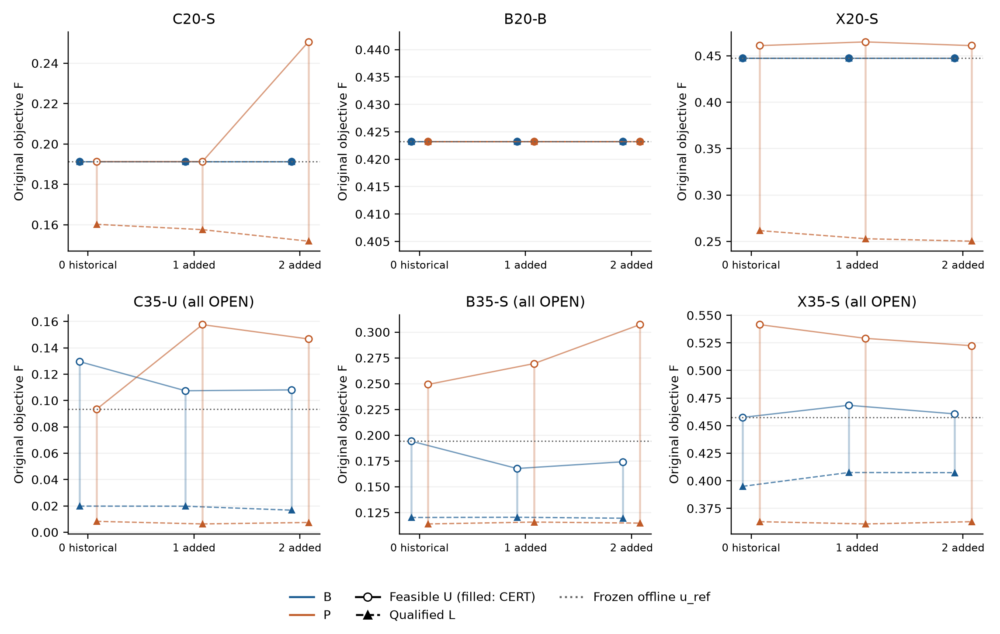
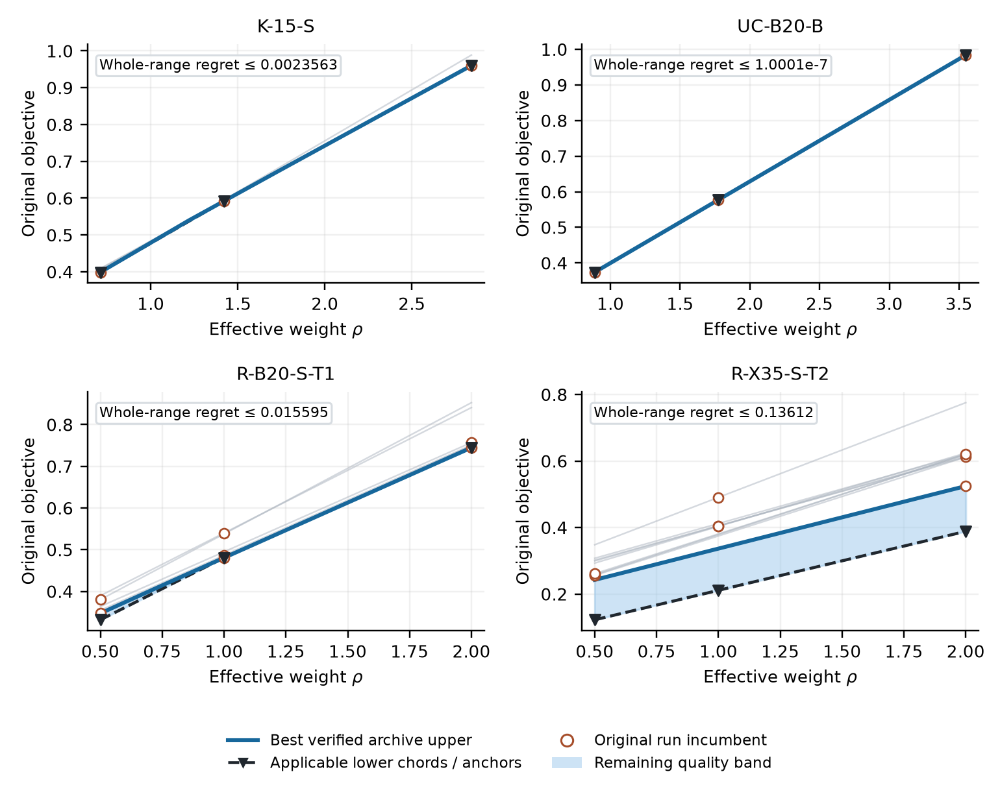

# Shared inventory states and exact search for equitable bicycle redistribution

## Abstract

We study static bicycle redistribution that balances dispersion in station inventory-to-target ratios and deviation from station targets. Final inventories must be realized by routes with empty departures, prefix capacity limits and paid unloading at the depot. Our Gini-interval tailored branch-and-cut method (GI-TBC) links inventory states to handling, visits and objective products, pays for its own feasible start, and maintains valid coverage of all potentially improving Gini values. The shared interface also exposes two distinct representation properties. Five legal supports suffice for the local physical hull, while a two-flow network preserves the joint hull after partial fixes in an absolute inventory code. These properties give different information to search, and the experimental controls leave the independent benefit of interval scheduling unresolved. GI-TBC certifies 9 of 12 breadth cases versus 7 for each compact control and 4 of 8 route-time cases versus zero for both controls. In six positive-objective 50-station comparisons at one solver seed and a 1,200-second cap, it improves five feasible objectives and all six global lower bounds relative to cold compact search. All twelve runs remain open. Verified fleets and global bounds establish strictly positive improvements from additional route time in four matched pairs and bound the quality of archived plans over continuous ranges of objective weights.

## 1. Introduction and related work

An operator redistributing bicycles chooses final station stocks and the routes that achieve them. Supply must be collected before delivery, and every prefix of a route must respect vehicle capacity. Travel, handling and final unloading share a time budget. An equity objective based on inventory-to-target ratios adds a second coupling because final stocks enter both the numerator and denominator of their Gini coefficient. The Gini term measures proportional dispersion, while a separate deviation penalty captures how far stocks lie from their targets. Equal ratios alone can leave every station short.

We study the physical problem in the HGA-TGBC author manuscript [@hgaTgbcManuscript], with empty departures, loaded returns and at most one nonzero one-way service per station. Our method uses its decoder within a finite initialization procedure. The research question is how to connect inventory and service in an exact method that returns useful bounds on the original problem and on transportation decisions.

First, GI-TBC links final stock to movement, visits and objective products, and uses physical valid inequalities to tighten the resulting integer model. From its own verified feasible start it solves a complete cover of the potentially improving Gini domain. The coverage argument includes the complements of objective cutoffs and exact continuation of unsplit intervals. The full computational comparison includes a cold compact model and a compact model that pays for the same startup procedure.

Second, we characterize two properties of the shared representation. On a contiguous stock domain, a small set of legal supports preserves the projected inventory, movement, visit and product hull. After fixing digits in an absolute inventory encoding, preserving the joint stock and code information requires retaining their linkage. A two-flow network does so for the local problem. These representation results and their finite diagnostics also show why common physical projections and complete solve costs require separate arguments.

Third, verified fleets and global lower bounds quantify the effect of changing the route horizon and bound plan quality between sampled deviation weights. The bounds show when more time is guaranteed to improve the objective even if both endpoints remain open. Over a covered weight range they quantify the potential loss from keeping a saved fleet or switching among known fleets.

### 1.1 Relation to previous work

Static redistribution models differ in their target, service and depot conventions [@raviv2013; @chemla2013; @erdogan2014; @erdogan2015; @schuijbroek2017]. Repeated visits, temporary operations, robust inventory requirements and demand-interval disjunctions give related feasible sets [@bruck2019; @bulhoes2018; @bruck2025; @ikonen2025]. Here the shared inventory state must support single nonzero service and paid loaded returns. Exact loading precedents include the single-vehicle demand-interval network in [@erdogan2014, section 2] and loading strategies with empty returns in [@szetoShui2018, sections 2–3]. The present ratio-Gini objective couples stocks across vehicles. The equity measure also differs from vehicle workload [@matl2018], task durations in two-echelon rebalancing [@qiao2026], and zonal availability and battery charge in electric micromobility [@caggiani2026].

Convex product envelopes, integer-continuous product reformulations, finite block-value linking and embedding formulations supply the mathematical tools [@mccormick1976; @boydVandenberghe2004; @gupte2013; @koppe2008; @vielma2018embedding; @huchetteVielma2023]. Our structural results concern the common visibility of the destination stock, its discrete service jump, movement and the Gini product, and the information available when stock digits are fixed. This linkage is the basis for the local projections in Section 2. The full method accounts for routing and bounds beyond those local projections.

## 2. Problem and shared-state formulation

### 2.1 Physical semantics and objective

Let \(N\) contain \(n\) stations and let \(0\) be the depot. Station \(i\) has integer initial inventory \(b_i\), capacity \(C_i\), positive target \(D_i>0\), and weight \(\omega_i\ge0\). Vehicle \(k\) has capacity \(Q_k\) and route-duration limit \(T\). Routes depart empty and every prefix load lies in \([0,Q_k]\). A station can be served by at most one vehicle, in one direction, with a nonzero operation. Loaded return is allowed and its unloading time is counted. The depot enters neither target deviation nor dispersion.

The computational text format stores integer targets. All present test targets also satisfy \(D_i\le C_i\), a data convention rather than an additional physical constraint; the inventory capacity bounds apply to \(b_i,Y_i\).

With pickup \(p_{ki}\) and delivery \(d_{ki}\),

\[
Y_i=b_i+\sum_k(d_{ki}-p_{ki}),\qquad
R_k=\sum_i(p_{ki}-d_{ki})\in[0,Q_k],\qquad
\sum_iY_i=\sum_i b_i-\sum_kR_k.
\]

Loaded returns reduce total station inventory from \(B=\sum_i b_i\). Vehicle capacity constrains instantaneous load. If pickup and unloading/delivery take \(t_p,t_d\) per unit, complete handling time is

\[
t_p\sum_i p_{ki}+t_d\left(\sum_i d_{ki}+R_k\right)
=(t_p+t_d)\sum_i p_{ki}.
\]

Travel plus this quantity cannot exceed \(T\). The tested distance convention is Euclidean travel time from serialized metre coordinates at 1.5 m/s. Final inventories are integers in \([0,C_i]\). Appendix A gives the route, capacity, service and time constraints in full.

Define

\[
r_i=Y_i/D_i,\quad S=\sum_i r_i,\quad
A=\sum_{i<j}|r_i-r_j|,\quad
P=\sum_i\omega_i|r_i-1|,
\]

\[
G=\begin{cases}A/(nS),&S>0,\\0,&S=0,\end{cases}
\qquad F=G+\lambda P,\quad\lambda\ge0.
\]

The objective measures station inventory adequacy and proportional dispersion. For the reported instances, \(\Omega=\sum_i\omega_i>0\). We report the normalized weight \(\rho=\lambda\Omega\), so \(\lambda=\rho/\Omega\) and \(F=G+\rho P/\Omega\). The generator scales individual weights by their maximum, so the same \(\lambda\) across inputs can give different \(\rho\).

For positive total shortage \(s=\sum_iD_i-\sum_ib_i>0\), positive weights and \(\lambda>0\) (equivalently \(\rho>0\)), let \(a=\min_i\omega_i/D_i>0\). Nonnegative loaded return yields

\[
P\ge a\sum_i|D_i-Y_i|\ge a\left|\sum_iD_i-\sum_iY_i\right|\ge as,
\qquad F\ge\lambda as=\rho as/\Omega>0.
\]

The resource and 50-station studies use this stock-shortage construction to ensure strictly positive optima before any search. Their algorithms use their existing online bound sources. With fixed physical and objective data apart from \(T\), \(T_1\le T_2\) gives \(X(T_1)\subseteq X(T_2)\) and \(F^*(T_2)\le F^*(T_1)\).

### 2.2 A shared inventory, service and product state

For the legal finite inventory domain \(\mathcal Y_i\), binary selectors \(s_{iy}\) and continuous \(q_{iy}\) represent stock and products on a Gini interval \([\alpha,\beta]\):

\[
\sum_y s_{iy}=1,\quad Y_i=\sum_y ys_{iy},\quad
\alpha s_{iy}\le q_{iy}\le\beta s_{iy},\quad
\sum_yq_{iy}=g,\quad Z_i=\sum_y yq_{iy}.
\]

At an integer state, \(Z_i=gY_i\). The objective epigraph uses

\[
H_{ij}\ge r_i-r_j,\quad H_{ij}\ge r_j-r_i,\qquad
e_i\ge r_i-1,\quad e_i\ge1-r_i,
\]

\[
\sum_{i<j}H_{ij}\le n\sum_i Z_i/D_i,\qquad
\min f=g+\lambda\sum_i\omega_i e_i.
\]

For \(S>0\), integer state selection makes the numerator inequality imply \(g\ge G_{\rm true}\), so every integer completion satisfies \(f\ge F_{\rm true}\). Conversely a physical fleet assigned to its true-G interval has an objective-preserving extension: select its final inventories, set \(g=G_{\rm true}\), set each selected \(q_{iy}=g\), and use the true absolute differences and deviations. At \(S=0\), all ratios are zero and \(g=0\) supplies the physical extension. Valid domain and strengthening rows retain that extension, as established in Appendix A.

Let \(z_{ki}\) be the binary service assignment. The same state supports the service equations

\[
\sum_kp_{ki}=\sum_y(b_i-y)^+s_{iy},\quad
\sum_kd_{ki}=\sum_y(y-b_i)^+s_{iy},\quad
\sum_kz_{ki}=\sum_{y\ne b_i}s_{iy}.
\]

GI-TBC/B uses this enumerated formulation and the shared service equations. In isolation, the product block projects to the McCormick hull over the stock and \(g\) bounds. The four corner graph points belong to the block, and every stock-product segment is in that hull. The additional information in the common interface comes from linking the same mixtures to service and movement.

**Lemma 1 (implicit service integrality).** Suppose initial and final inventories are integer, a station is assigned to at most one vehicle, and a binary direction permits either pickup or delivery at its unique service. Continuous pickup and delivery variables then take integer values at every integer solution of the remaining model.

**Proof.** An unassigned vehicle has zero quantities. At the unique assigned vehicle, pickup direction fixes delivery to zero, so inventory balance gives \(p_{ki}=b_i-Y_i\). Delivery direction fixes pickup to zero and gives \(d_{ki}=Y_i-b_i\). Each is integer. The argument needs no load integrality and applies at integer feasible solutions. \(\square\)

For an integer service, total movement is \(|b_i-Y_i|\), and nonzero one-way service occurs exactly when \(Y_i\ne b_i\). Hence the shared equations above reproduce the original operations without changing the physical problem. They also couple fractional inventory mixtures to the movement and visits that must support them.

### 2.3 What compact supports preserve

Let \(\mathcal D_i=[l_i,u_i]\cap\mathbb Z\) be a nonempty contiguous legal stock domain. Define \(m_i(y)=|b_i-y|\), \(v_i(y)=\mathbf1\{y\ne b_i\}\), and the common interface \((Y_i,M_i,V_i,g,Z_i)\), where \(M_i=\sum_k(p_{ki}+d_{ki})\) and \(V_i=\sum_k z_{ki}\). Inventory balance recovers total pickup and delivery linearly from \(Y_i,M_i\). The relaxed enumerated block with the shared service equations projects to

\[
\mathcal H_i=\operatorname{conv}\{(y,m_i(y),v_i(y),g,gy):y\in\mathcal D_i,\ g\in[\alpha,\beta]\}.
\]

**Proposition 1 (compact shared interface).** For \(0\le\alpha\le\beta\le 1\), the hull \(\mathcal H_i\) is generated by the graph at the at most five legal stocks

\[
\mathcal K_i=\{l_i,u_i\}\cup\bigl(\{b_i-1,b_i,b_i+1\}\cap\mathcal D_i\bigr).
\]

The compact block uses continuous support weights and a separate absolute-stock binary product layer. With the original service and balance constraints, and when all other uses of the deleted states pass through the common interface, the replacement preserves the integer physical projection, the original objective and the common raw LP projection.

**Proof sketch.** On the donor and receiver pieces, inventory and movement are affine and the visit indicator is one. At the initial singleton the visit indicator is zero. At fixed \(g\), interpolation between legal endpoints of each piece preserves movement, visits and \(gy\). Conversely every retained support is legal. The independent binary layer enforces \(Z_i=gY_i\) at integer stocks. Its relaxed projection contains every true stock-product point, and the two auxiliary blocks share only \((Y_i,g,Z_i)\), so the relaxed layer preserves the common hull. Appendix A.9 gives both embedding directions. \(\square\)

With only continuous support weights, different \(g\) values can be mixed at different stocks and an integer mean stock alone does not enforce the product. Binary support weights would restrict stock to the retained five positions. The original target penalty stays in its epigraph. Additional thresholds, exact state penalties and vehicle-level state assignments require their own shared functions. Holes in the allowed stocks require explicit membership. GI-TBC/B retains the enumerated states. The compact-support replacement is evaluated separately in §4.5.

### 2.4 Preserving conditional code information

For one station with capacity \(C\), omit the station subscript. Let \(c(y)\) be the absolute binary code of \(y\), with \(d=\max\{1,\lceil\log_2(C+1)\rceil\}\) digits. Write \(E(\mathcal D)\) for the convex hull of the same joint graph augmented by the digit vector \(\delta=c(y)\) and the digit products \(w=gc(y)\). If digits indexed by \(J\) are fixed to \(a_h\), the set of consistent stocks is \(\mathcal D_J=\{y\in\mathcal D:c_h(y)=a_h,\ h\in J\}\).

**Proposition 2 (conditional joint representation).** A directed acyclic graph reading absolute digits from most to least significant represents \(E(\mathcal D)\) with \(O(1+\log(C+1))\) local columns, rows and nonzeros. Use one interval graph for each nonempty donor, initial and receiver piece, connected to a common source and sink. Both the nonnegative base flow \(f\) and product flow \(q\) use the same edges. With incidence matrix \(A\) and unit source-to-sink balance \(e\), they satisfy

\[
Af=e,\qquad Aq=ge,\qquad \alpha f\le q\le\beta f.
\]

Path costs yield \(Y,M,V\) from \(f\), \(Z\) from \(q\) and each digit and digit product from edges that assign it one. After fixing the digits in \(J\), the projection is exactly \(E(\mathcal D_J)\), including infeasibility when that set of stocks is empty.

**Proof sketch.** An interval graph needs at most four lower/upper tightness states per bit layer and has one complete path per legal stock. For \(\alpha<\beta\), the flows \((\beta f-q)/(\beta-\alpha)\) and \((q-\alpha f)/(\beta-\alpha)\) are nonnegative and conserved internally. Their path decompositions give mixtures at the two \(g\) endpoints. If \(\alpha=\beta\), use \(q=\alpha f\) and decompose \(f\) alone. Fixing a digit removes inconsistent paths by nonnegativity. Appendix A.11 proves the reverse construction and the integer correspondence. This uses established network and disjunctive techniques [@behle2007; @balas2005; @muldoon2013]. \(\square\)

To see what separate mixtures lose, take \(\mathcal D=\{0,\ldots,4\}\), \(b=2\), \(g\in[0,1/2]\) and fix the least significant bit to one. Stocks 1 and 3 are the only legal paths, so the conditioned joint hull requires \(M=V=1\). A separated compact block can choose the support at stock 2 with \(g=1/4\), giving \(Y=2,M=V=0,Z=1/2\). Its relaxed code block can mix stocks 1 and 3 equally at the same \(g\). In least-significant-first order this gives \(\delta=(1,1/2,0)\) and \(w=(1/4,1/8,0)\), consistent with the shared \(Y,g,Z\) but impossible in the conditioned joint hull.

The enumerated same-code reference and the network retain the same enhanced projection. With the digits free, their physical projections also coincide with the separated compact block. Proposition 2 is local to the specified absolute digits and legal stock domain. The experiment uses an offline network prototype, and the full route and solver-tree effects remain unidentified (§4.5). Supplement S167.4 maps the representations to their implementation names.

## 3. The complete GI-TBC method

### 3.1 Physical strengthening

Let \(\tau\) be metric travel time and \(h=t_p+t_d\). For each receiving station \(j\), define

\[
\mathcal C_{kj}=\{i\ne j:\tau_{0i}+\tau_{ij}+\tau_{j0}+h\le T\}.
\]

**Proposition 3 (ordered supply compatibility).** Under metric travel and empty departure, every physical fleet satisfies

\[
d_{kj}\le\sum_{i\in\mathcal C_{kj}}p_{ki}.
\]

**Proof.** Label the units collected by a vehicle. In route order, match each delivered unit to an earlier collected unit that has not yet been delivered. Nonnegative prefix loads guarantee such a match. A unit delivered at \(j\) from source \(i\) entails the ordered subsequence \((0,i,j, 0)\), whose travel lower bound follows by metric shortcutting. Collecting at least that unit incurs handling of at least \(h\), including delivery or final unloading. Thus its source lies in \(\mathcal C_{kj}\). Counting distinct matched units proves the inequality. Unmatched collected units can return to the depot. \(\square\)

For a set \(W\) of served stations, let \(\tau(W)\) be the shortest depot tour through \(W\), computed by explicit orders for pairs or triples. Write \(P_k^{\rm pick}=\sum_i p_{ki}\). Nonzero integer service and empty departure give

\[
|W|\le\sum_{i\in W}(p_{ki}+d_{ki})\le2P_k^{\rm pick},\qquad
P_k^{\rm pick}\ge\lceil |W|/2\rceil.
\]

Consequently \(\tau(W)+h\lceil|W|/2\rceil>T\) rules out serving all of \(W\) with that vehicle. Otherwise a conditional duration inequality combines the tour lower bound and pickup handling. Supply for \(W\) may come from outside \(W\); cumulative pickup is not bounded by \(Q_k\). Appendix A gives the exact conditional coefficients, deactivation proof and finite selection rule. Default GI-TBC uses pair support, with triple support disabled. It supplies static rows to the canonical models, and Gurobi runs branch-and-cut within each model. These rows strengthen necessary physical conditions without replacing route-prefix capacity.

### 3.2 Verified startup and complete interval coverage

Startup \(H\) fully decodes a joint insertion and a pool of 24 shuffled station/separator orders plus a constructive order. It uses guided first-improvement descent and finishes with physical quantity, insertion and neutral exchange moves. Each run of B or the warm compact control pays for its own \(H\), physical verification and any compatible mapped start. Its feasible fleet supplies \(U\); the initial independent lower bound is zero.

The controller represents an interval \(I=[\alpha,\beta]\) by its depth, open or closed proof obligation, current regional floor \(b_I\) and applicable bound sources. A source records the model identity, incumbent version and objective cutoff at which it was obtained. A canonical model for \(I\) and cutoff \(c\) contains an objective-preserving extension of every physical fleet with true \(G\in I\) and \(F\le c\) (Appendix A). Thus a qualified source \(\ell\) gives a floor on that cutoff subset, and \(c\) bounds the omitted subset \(F>c\). An infeasible cutoff subset likewise leaves the complement with floor \(c\).

In the mathematical cover, a source therefore contributes \(\min\{\ell,c\}\) on its full interval. Take the maximum of applicable floors on the same domain, including any inherited proof whose scope contains it. Take the minimum over all intervals in the complete cover and the analytic complement of the improving domain, where \(F\ge U\). The scheduler's stored numerical floor and raw output follow the return rules in Appendix B.4. The minimum with a source cutoff is a proof-accounting operation.

For a selected parent with stored floor \(b\), adaptive mass (AM) evaluates two finite child LP bounds \(\ell_j\) using the native LP values before inheritance:

\[
\Delta=\max\{U-b,\max(\varepsilon,10^{-12})\},\quad
v_j=\min\{1,\max\{0,(\ell_j-b)/\Delta\}\},\quad
S_{\rm AM}=\min(v_0,v_1)(v_0+v_1)/2.
\]

The threshold is .08 with the score tolerance in Appendix B.3. The rule measures two-sided improvement relative to the own proof gap. Infeasibility uses a separate logical decision.

**Algorithm 1. GI-TBC with complete parent continuation.**

1. **Initialize.** Within the common deadline, complete \(H\), verify its fleet in the original problem and store its objective \(U\). Set the incumbent version to zero. Register \([0,\min\{U,(n-1)/n\}]\), including the zero boundary, as a single obligation with independent floor zero. Each new interval starts with its NEXT milestone unset.

2. **Select and bound.** Among open intervals with \(\alpha<U-\varepsilon\) and \(b_I<U-\varepsilon\), cycle widest first within \(\varepsilon=10^{-7}\) of the minimum stored floor. Reuse only an applicable complete LP or solve the current interval LP at cutoff \(c=U\). Keep the source and its complement. Close this obligation if the qualified LP is infeasible or the merged floor reaches \(U-\varepsilon\).

3. **Choose the continuation.** After the LP, return to selection if a relevant open competitor now has a strictly lower floor (by more than \(\varepsilon\)). Otherwise, if the NEXT milestone is unset and some relevant open floor exceeds \(b_I+\varepsilon\), solve the parent MIP with the smallest such floor as its NEXT stopping target. When this rule permits lookahead, use the following decisions.

   - At depth 8 or the minimum width \(10^{-4}\) (with geometric tolerance), solve the full parent MIP without a bound target.
   - Otherwise obtain both complete qualified midpoint child LPs on the current cutoff. If either is infeasible, install both covering children together and mark the infeasible subset or subsets empty. If both return finite optimal bounds, put \(t=\min\{\ell_0,\ell_1\}\). For \(t\le b_I+\varepsilon\), solve the full parent MIP. For \(t>b_I+\varepsilon\), split atomically if AM passes. Otherwise solve the parent MIP with stopping target \(t\). The parent covers the entire interval until both children are installed. Each installed child inherits applicable parent evidence and its own qualified evidence.

4. **Process the actual return.** After finalizing a native request, admit qualified bounds on their recorded scopes. Recheck a candidate fleet in the original physical problem. An improvement of more than \(10^{-9}\) replaces the own \(U\) and increments its version. The next access discards stale model, LP and child caches, while applicable older floors and NEXT milestones survive. A qualified optimal or infeasible return closes its own cutoff obligation under the physical-consistency rule. A solver optimum with an inadmissible physical gap leaves the region open. For a still unresolved parent, requeue when the solver reports reaching the target, requested termination and returned a qualified bound of at least the target minus \(\varepsilon\). Set its milestone only for a confirmed NEXT return. A child target leaves the next action to the selection and lookahead rules. Use the actual qualified bound in either case.

5. **Preserve obligations and return.** Repeat after a valid closure, split or requeue while relevant open obligations and time remain. An incomplete child pair, a failed qualification or an interrupted native return without confirmed target or qualified closure stops the lifecycle with the obligation retained. The physical-gap guard also stops without closure. Keep applicable partial bounds. If the journal cannot support the native proof chain, restore the full unresolved coverage with the independent zero floor. The paid return includes the final physical checks, solver cleanup and required output. Report \(U,L\) where qualified and CERT only under the independent exact-zero or qualified full-cover gap rule in §3.4. Otherwise return OPEN.

Appendix B maps the mathematical operations to both controller subprocedures, including tie order, cache gates, target-return flags and exact continuation. A requested stopping target and a parameter guard supply neither a lower bound nor proof of closure.

**Proposition 4 (coverage).** With objective-preserving embeddings, qualified bounds and complete accounting of the cutoff complements, the cover gives a valid global lower bound. If it closes all potentially improving regions against a verified \(U\) to the declared margin, it proves optimality to that margin.

**Proof.** \(F\ge G\) and \(G\le(n-1)/n\) place every improving fleet in the initial interval. Within a region, Lemma A3 applies the source and its cutoff complement to all fleets. Replacing a parent by both closed midpoint intervals preserves their union, including the shared endpoint. Retaining unresolved and closed obligations with their qualified floors leaves every physical fleet bounded by a region or an analytic complement. Lemma A4 then gives the full-cover minimum. If all applicable floors are at least \(U-\varepsilon\), the verified fleet is within that margin of the optimum. \(\square\)

The mathematical proof assumes valid evidence. Appendix B.4 describes the frozen numerical bookkeeping and its conservative source-rejection fallback. Finite tree depth and complete terminal MIPs permit exact search in ideal arithmetic. A finite process budget can interrupt the proof, including at the terminal guard.

### 3.3 A separately paid proof enhancement

E+ adds an independently qualified inventory lower source to B. On its own first canonical root it uses the actual supported stock domains and valid total-stock bounds. On an epigraph interval \([\gamma_L,\gamma_U]\) it minimizes

\[
\max\{\gamma_L,G(Y)\}+\lambda\sum_i\omega_i|Y_i/D_i-1|
\quad\text{over admissible stocks with }G(Y)\le\gamma_U.
\]

Here \(\gamma_L\) bounds the epigraph variable. The stock Gini may be below it. E+ uses the inherited hard-total dynamic program and one uniform finite inventory bound computation, including their zero and fallback rules. The extra floor enters only proof accounting, leaving the formal Native rows, raw AM inputs and start policy as in B. Each E+ run pays for \(H\), the root, inventory computation and qualification within its deadline. Its additional work and any earlier proof closure can change the remaining search and final incumbent. E+ is a separate comparator outside default B.

### 3.4 Numerical qualification, costs and termination

The process clock includes startup, input and model preparation, solver calls, online qualification, cleanup and required output. Later independent checks have separate costs. Solver Runtime, Work and nodes describe nested effort. Table 1 gives the process cap for each study. Physical route time \(T\) is an input constraint. Only the paired intersection of qualified certificates enters a certificate-time comparison. A paid difference is substantive at or above \(\max\{10\text{ s},0.1\times\text{faster time}\}\).

The principal panels use Gurobi 13.0.2 with one thread and fixed affinity on an Intel i7-12700KF Windows host. Requested relative and absolute MIP gaps are zero. Solver feasibility/optimality tolerances are \(10^{-6}\), integrality \(10^{-5}\) and the separate certificate tolerance \(10^{-7}\). A source must match the input, objective, model, interval and cutoff and pass the applicable return and consistency gates. Raw LP bounds come from relaxing all integer types before optimization. They are distinct from MIP-root bounds after cuts.

Report \(U\) from a complete verified fleet evaluated with the original objective and \(L\) from qualified full-domain evidence. Absolute display gap is \(\max\{0,U-L\}\), and relative gap divides this by \(U\) when \(U>0\). Source records retain the signed difference. A native objective is a separate measurement from the physical objective. B's numerical production rule requires a verified \(U\), valid root and child coverage, closure of all relevant obligations, qualified monotone bound evidence and a complete lifecycle with \(L+\varepsilon\ge U\). Admission of a reported positive certificate also checks the signed gap in \([-10^{-7},10^{-7}]\). \(T_{\rm cert,process}\) measures that paid completion. An OPEN result has no certificate time.

A verified fleet at exactly zero gives an independent certificate because \(F\ge0\) everywhere. The stock test checks exact equality of the station ratios and that every penalized station meets its target when its penalty coefficient is positive. The production predicate also repeats physical verification (Appendix B.4.1). A near-zero positive objective provides no such proof. Post-return audits cannot supply an earlier production proof or clock.

## 4. Computational evidence

### 4.1 Comparators and panel protocols

B denotes the complete GI-TBC method. The compact comparator P builds the original compact model and submits zero starts. PS independently runs and pays for complete \(H\) and maps its own feasible fleet to the compact model. The strengthened root-only control keeps B's shared states, physical rows and startup, using solver branch-and-cut on one inclusive unsplit root. B/P and B/PS compare complete methods. Full/root, row deletion and E+ comparisons ask narrower questions. All methods pay their own lifecycles. Matched runs share protocol settings without sharing fleets, bounds, starts or search trees.

The breadth and route-time studies precommit their draws from CITI, CABI and Divvy station archives. Six known roles and six draws give 12 breadth inputs with four per size. Four further shortage draws each supply a pair of physical horizons. Archive geometry and capacity are combined with synthetic or transformed initial stock, targets, weights and depot. These configurations support controlled comparisons on specified inputs. They do not estimate operator demand or a population of cities.

**Table 1. Panel protocols and nominal process caps per arm.** Shared default runs appear once. The historical protocols are specified in the supplement.

| Study and scope | Methods and number of runs | Solver Seed / cap (s) | Question |
|---|---|---|---|
| Breadth, 12 inputs, \(n=15/20/35\) | B/P/PS, 36 | 0 / 600, 1,200, 2,400, respectively | Complete certificates and endpoints |
| Route time, 4 bases at \(n=20/35\) and 2 horizons each | B/P/PS, 24 | 0 / 1,200, 2,400, respectively | Resource value at \(\rho=1\) |
| Weights, 2 route-time configurations, 2 additional weights each | B/P/PS, 12 | 0 / 1,200, 2,400, respectively | Sensitivity within an input |
| AM and mechanism controls, 4 roles in each | B with 2 extra AM thresholds, 8; root and 3 row deletions, 16 | 0 / 600, 1,200 or 2,400 as for matching main runs | Conditional component evidence |
| Limited earlier Seed repeat | B/P/PS on 4 roles, 12; AM, 4; mechanism, 8 | 1 / same cap as each matched Seed 0 run | Repeat selected contrasts |
| Within-input Seed cohort, 6 inputs, \(n=20/35\) | B/E+/P, 18 at Seed 0; B/P, 24 at Seeds 1/2 | 0, 1, 2 / 1,200, 2,400, respectively by size | Seed variation and paid inventory proof |
| Positive-objective 50-station panel, 6 configurations | B/P, 12 | 0 / 1,200 for all | Endpoint progress on new configurations |
| Compact-support comparison, same 6 cohort inputs at \(n=20/35\) | B and compact variant, 12 fresh runs | 0 / 1,200, 2,400, respectively | Common LP projection and complete cost |
| Paid initialization, same 6 cohort inputs and a 4-input confirmation subset | B and 2 startup variants, 18; confirmation B and variants including cold P, 22 | 0 / 300 at \(n=20\), 600 at \(n=35\); 1/2 / 600 for all confirmation runs | Reweighting against paid restarts |

Breadth uses \(\lambda=.15\). The resource pairs change only \(T\) at \(\rho=1\). The weight study uses R-B20-S-T1 and R-X35-S-T2, reusing their \(\rho=1\) baselines and adding \(\rho\in\{.5,2\}\). For each resource base and 50-station configuration, \(d_{\max}\) is the maximum serialized depot-to-station distance and \(M\) is the number of vehicles. The design sets

\[
\begin{aligned}
T_{\rm base}&=2d_{\max}/1.5+120\sum_{i\in N}\max(b_i-D_i,0)/M,\\
T_1&=300\left\lceil\max(1800,.75T_{\rm base})/300\right\rceil,\\
T_2&=300\left\lceil1.5T_1/300\right\rceil.
\end{aligned}
\]

The resource pairs use both horizons. The 50-station comparison uses \(T_1\) alone. The rule uses input data before optimization and does not imply a binding time constraint.

### 4.2 Complete methods against cold and paid-start compact controls

**Table 2. Qualified certificates in the main Seed 0 panels.**

| Panel | GI-TBC | P | PS |
|---|---|---|---|
| Breadth | 9/12 | 7/12 | 7/12 |
| Resource pairs | 4/8 | 0/8 | 0/8 |

**Table 3. Certificate-time comparisons conditioned on both methods certifying.**

| Panel | Other | Both certified | GI-TBC W / L | Geo Other / GI-TBC |
|---|---|---|---|---|
| Breadth | P | 7 | 6 / 0 | 11.3534 |
| Breadth | PS | 7 | 4 / 1 | 4.22522 |
| Resource pairs | P | 0 | 0 / 0 | n/a |
| Resource pairs | PS | 0 | 0 / 0 | n/a |

Table 3 conditions the time ratios and substantive wins/losses on both methods certifying (§3.4). At the same paid cap, the breadth cases include N-B15-B (B/P/PS certificate seconds 24.068/279.663/306.307), and N-C20-U (B certifies in 265.529 s, P and PS remain OPEN). On X-35-B, PS certifies in 7.450 s versus B's 17.905 s. B and PS pay independently for matching H fleets, so search still matters after the start.

On K-35-U, cold P has better \(U\) (.664747 versus .692854), while B has better \(L\) (.565766 versus .335556). Both are OPEN. The N-X20-B cold P certificate uses its own exact zero fleet and the independent nonnegative floor after native-source rejection. The earlier two-Seed breadth study retains 17/24 versus P 9/24 and PS 4/12, and the earlier confirmation 12/14 versus P 9/14 and PS 2/4 under their respective source and eligibility rules. The historical source-rejected zero case remains outside its formal timing sample. These panels have separate denominators.

### 4.3 Archived-source cohort and within-input Seed variation

The six-input cohort was selected before the first B/E+/P comparison. At Seed 0, B and E+ certify 3/6 versus P's 1/6. B and E+ attain the same physical \(U\) on each input. E+ raises X35's \(L\) from .394988256 to .423199550 and lowers its relative gap from 13.66% to 7.49%, with X35 still OPEN. The independent proof comes with additional paid time. On the three B/E+ joint certificates, E+ adds 26.10, 1.70 and 6.18 s on C20, B20 and X20, respectively. Only C20 clears the substantive-time threshold.

**Table 4. Historical Seed0 configuration confirmation, separate from the earlier panels.** Each entry is state, physical U / qualified proof L, then paid T_cert for CERT (seconds). Full binary64 values, verification costs, Work/nodes and source identities are in the supplement.

| Configuration | B | E+ | P |
|---|---|---|---|
| C20-S | CERT; 0.1912805923 / 0.1912805923; T_cert=199.7793504 | CERT; 0.1912805923 / 0.1912805923; T_cert=225.8837082 | OPEN; 0.1912805923 / 0.1602342164 |
| B20-B | CERT; 0.4232321817 / 0.4232321817; T_cert=5.058292441 | CERT; 0.4232321817 / 0.4232321817; T_cert=6.756586993 | CERT; 0.4232321817 / 0.4232321815; T_cert=235.8555019 |
| X20-S | CERT; 0.4477476266 / 0.4477476266; T_cert=119.7493879 | CERT; 0.4477476266 / 0.4477476266; T_cert=125.9267332 | OPEN; 0.4609477662 / 0.2616496512 |
| C35-U | OPEN; 0.1295663897 / 0.01983750282 | OPEN; 0.1295663897 / 0.01983750282 | OPEN; 0.09331934375 / 0.008286772138 |
| B35-S | OPEN; 0.1942903111 / 0.1202340026 | OPEN; 0.1942903111 / 0.1202340026 | OPEN; 0.2492530135 / 0.1139794085 |
| X35-S | OPEN; 0.457475317 / 0.3949882559 | OPEN; 0.457475317 / 0.4231995496 | OPEN; 0.5415306805 / 0.362971432 |

The B/P confirmation adds twelve pairs on the same six exposed configurations at Seeds 1 and 2, each with fresh startup for B at fixed H seed 20260626. At every Seed, B certifies 3/6 and P 1/6. B20 is the sole joint-CERT input and B is substantively faster at each Seed. Every \(n=35\) run remains OPEN. Table 5 and the endpoint figure retain the paired variation.

**Table 5. Within-input paired differences in Seed order 0/1/2.** Seed 0 is historical; Seeds 1/2 are the subsequent confirmation observations. ΔU=B−P is favorable to B when negative; ΔL=B−P
is favorable when positive. Values within 1e-7 are displayed as 0; individual endpoints and costs remain in the supplement.

| Configuration | B CERT /3 | P CERT /3 | ΔU: S0 / S1 / S2 | ΔL: S0 / S1 / S2 |
| --- | --- | --- | --- | --- |
| C20-S | 3 | 0 | 0 / 0 / -0.0592739276 | 0.0310463758 / 0.0336984584 / 0.0394115797 |
| B20-B | 3 | 3 | 0 / 0 / 0 | 0 / 0 / 0 |
| X20-S | 3 | 0 | -0.0132001396 / -0.0172134837 / -0.0132001396 | 0.186097975 / 0.194824544 / 0.197495547 |
| C35-U | 0 | 0 | 0.0362470459 / -0.0501944461 / -0.0386805194 | 0.0115507307 / 0.0134743346 / 0.00933437769 |
| B35-S | 0 | 0 | -0.0549627024 / -0.101715977 / -0.132960007 | 0.00625459405 / 0.00466145812 / 0.00475241402 |
| X35-S | 0 | 0 | -0.0840553635 / -0.060652829 / -0.0617878527 | 0.0320168239 / 0.0466015852 / 0.0444201335 |

C35 exhibits a primal reversal across Seeds. P wins \(U\) at Seed 0 and B at Seeds 1/2. The historical Seed 0 P fleet has \(U=.093319344\), below all three B incumbents (about .129566390, .107429866 and .108083936). Its feasible value exposes an absolute incumbent deficit even when B beats its own same-Seed P comparator. The archived X35 target is also missed by B on both added Seeds. The supplement gives all individual endpoints and feasible-target availability intervals. The earlier four-role triplet repeat separately has B 3/4 versus P and PS 1/4 at each Seed.

{width=87%}

### 4.4 Complete-method endpoints at 50 stations

All six precommitted shortage configurations enter the panel, one compact and one regional geometry per archive. Each uses three vehicles of capacities 20, 25 and 30, \(\rho=1\), the input-specific \(T_1\), and the positivity property in §2.1. B pays one complete own \(H\) and P is cold with zero submitted starts. The common one-thread, single-Seed protocol and complete observations are in Supplement S171.

**Table 6. Feasible objectives and qualified global bounds on six positive-objective 50-station configurations.** Both methods are OPEN on every row at solver Seed 0 and a 1,200 s process cap.

| Archive / geometry | B \(U\) / \(L\) | P \(U\) / \(L\) | Abs. gap B / P | Rel. gap B / P (%) |
|---|---|---|---|---|
| CITI compact | 0.536923 / 0.356919 | 0.523772 / 0.291331 | 0.180003 / 0.232440 | 33.53 / 44.38 |
| CITI regional | 0.541165 / 0.355390 | 0.574631 / 0.312450 | 0.185775 / 0.262181 | 34.33 / 45.63 |
| CABI compact | 0.653336 / 0.416792 | 0.705181 / 0.343940 | 0.236544 / 0.361241 | 36.21 / 51.23 |
| CABI regional | 0.572824 / 0.378424 | 0.608779 / 0.186291 | 0.194400 / 0.422488 | 33.94 / 69.40 |
| Divvy compact | 0.660495 / 0.436240 | 0.729345 / 0.284463 | 0.224255 / 0.444882 | 33.95 / 61.00 |
| Divvy regional | 0.843694 / 0.551354 | 0.920095 / 0.445402 | 0.292340 / 0.474693 | 34.65 / 51.59 |

At the registered descriptive scale, B obtains a lower physical \(U\) on 5/6 inputs, a higher qualified \(L\) on 6/6 and a smaller absolute gap on 6/6. The relative gap is smaller on all six. Both arms return qualified fleets on all six inputs. CITI compact is the upper-bound reversal: P finds the better fleet while B ends with smaller absolute and relative gaps. Neither method certifies any of the six instances. B's remaining relative gaps span 33.5% to 36.2%.

The panel extends direct observations of the frozen complete method to these six configurations. Earlier 50- and 100-station results used historical methods and retain their own protocols. Geometry, stocks and horizons also vary, so the comparison gives neither an isolated effect of size nor evidence of stability across solver Seeds at 50 stations. Supplement S171 records the legacy evidence and the native versus physical objective diagnostic for CABI compact P.

### 4.5 Representation, continuation and startup controls

**Independent value of interval scheduling.** The four-role full/root contrast keeps the strengthened model and own startup. The two easier Seed 0 roles have nonmaterial time differences. On the two harder roles, root-only has slightly stronger final \(L\) and all runs remain OPEN. In the 50-station panel B accepts zero splits, records six declined splits and requeues parents after four child-target MIP phases. Native MIP accounts for 98.81% of joint production time. These observations describe work done by B. The causal contribution of the controller remains unresolved because the B/P comparison also changes model, cutoff and startup.

Single deletions of movement/visit, resource and Gini/objective rows show conditional effects. At K-15-S, deleting resource rows reduces the Seed 0 proof time from about 113 to 75 s, mainly in MIP. The deletion direction reverses at Seed 1. On K-35-U, deleting movement/visit links improves \(U\) while weakening \(L\). All observed finite AM scores in the exposed threshold tests fall below .04 for the .04/.08/.16 comparisons, with separate logical splits. Supplement S167.2 has the matched scopes, costs and observed states.

**Compactness and conditioning.** On the six same-build Seed 0 comparisons, the compact-support variant loses C20's certificate (2/6 against B's 3/6) and increases X20's paid proof cost from 125.3 to 544.9 s. C35 and B35 obtain lower \(U\) with weaker \(L\), and X35 worsens on both endpoints. Eight same-scope LP pairs agree within \(3.33\times10^{-16}\). Fewer columns and matched recorded AM actions on the three \(n=20\) inputs coexist with much more Native MIP work at X20. The supplement preserves the paired endpoints. [Table S166.1](supplement.md#same-build-compact-support-endpoints)

The separate conditional-network diagnostics compare the enumerated same-code reference, the separated compact block and the shared-flow code representation. At Seed 0 their 72 canonical LPs, 12 local LPs and four tiny MIPs have respective per-call Native limits of 20, 5 and 60 s. The network and enumerated same-code objectives agree in all 24 frame/condition triples. The network improves the separated compact bound in 3/16 partial-bit triples at the registered tolerance and adds rows and columns relative to the enumerated same-code reference in every frame. This is offline conditional evidence. Both representation variants remain outside B, with no complete cost improvement established (Supplement S167.3).

**What inventory and fixed routes can explain.** For a necessary inventory relaxation with optimum \(f_I^*\) and original optimum \(f_P^*\), a physical incumbent \(U_P\) and inventory lower \(L_I\) give

\[
U_P-L_I=(U_P-f_P^*)+(f_P^*-f_I^*)+(f_I^*-L_I).
\]

Inventory price precision controls only the last term. An inherited four-station example keeps a strict \(1/4\) objective gap even with the shared local service hull. The shared-\(G\) completion and projected rows also have positive scoped LP results alongside adverse complete search results. The supplement preserves these comparisons.

The route-family evidence asks whether a saved feasible target can be attained by changing integer quantities and deleting zero operations within fixed owner and relative order, then by releasing order and ownership. It uses the original objective, travel, prefix capacities and unloading. Seven initially nonattaining fixed-order families are excluded by qualified lower bounds across nine saved parents. On C35 Seed 0, the fixed-owner family also misses the target. A target-reaching fleet must change an old served owner or use an old ineligible station. The broader eligible-family query remains unresolved at its 300 s cap. These are restricted-domain results with full intervals in Supplement S168.

**Paid initialization.** A fixed reweighting recipe retains complete \(H\) at the original \(\lambda\), adds complete starts at \(\lambda/2,2\lambda\), and selects by the reverified original objective. A matched control uses the same additional start seeds at the original weight. This design follows the objective-diversification idea [@paquete2003two]. In the first Seed 0 study the reweighted candidate improves all three \(n=35\) upper endpoints but loses proof strength on two and slows C20 certification. Supplement S169 retains those costs.

In the 600 s exposed-input confirmation, reweighting worsens final \(U\) on four of six \(n=35\) B/candidate pairs. Only B35 at Seed 1 improves absolute gap. All \(n=35\) runs remain OPEN. On C20 both added Seeds certify the same objective more slowly with reweighting, by about 0.66% and 33.22%. Two Seed 1 primal gains exceed the matched original-weight restarts, but neither role improves at both Seeds. In the three separately matched \(n=35\) Seed 1 pairs against cold P, B improves \(U,L\) and both gaps. These endpoint comparisons are on already exposed inputs. The reweighting recipe is closed and default \(H\) retained. The supplement preserves the paired and individual observations and expenses. [Table S170.6](supplement.md#matched-initialization-endpoints-by-role-and-seed) · [Tables S170.1–S170.5](supplement.md#s170-fixed-paid-initialization-and-matched-cold-controls)

## 5. Bounded transportation decisions

### 5.1 What additional route time can achieve

The four resource pairs change only the route horizon \(T\) at \(\rho=1\). The serialized shortage gives a positive floor under §2.1. Table 7 reports the actual horizons and floors. Additional route time enlarges the feasible set.

**Table 7. Input-based positive-objective resource design.**

| Base / source | \(n\) | T1 / T2 (s) | Shortage s | \(\Omega\) | Floor lambda a s |
|---|---|---|---|---|---|
| R-B20-S /CABI | 20 | 3300 /5100 | 20 | 13.47 | 0.103935 |
| R-X20-S /DIVVY | 20 | 4800 /7200 | 20 | 7.88889 | 0.126761 |
| R-B35-S /CABI | 35 | 4800 /7200 | 35 | 18.1405 | 0.0797268 |
| R-X35-S /DIVVY | 35 | 4200 /6300 | 35 | 13.2617 | 0.0977471 |

GI-TBC certifies the two B20 objectives .480735/.198473 at 3300/5100 s, with certificate costs 784.143/538.603 s. It certifies X20's .645325/.434796 at 4800/7200 s, with costs 20.5065/337.305 s. Thus both pairs have the same resource-value direction and opposite proof-cost directions. On X20's smaller horizon every method attains the same feasible objective, but P/PS remain open at L=.589197/.590359. The distinction is proof-gap closure, not a transferred incumbent or certificate.

All three methods remain OPEN on all four n35 resource configurations. B has lower U and higher L than the compact controls at the registered caps. For X35's larger horizon B gives .403272/.210887, PS .404567/.203817 and P .490517/.201288. These are endpoint improvements with no certificate-time ranking. On B35 the smaller-horizon interval [.455904,.591518] lies above the larger-horizon upper .344643, even though both B runs are open. The same separation can be bounded in both directions on every pair.

If \([L_j,U_j]\) contains the optimum at \(T_j\), feasible-set nesting gives

\[
\max\{0,L_1-U_2\}\le F^*(T_1)-F^*(T_2)\le U_1-L_2.
\]

The computation uses the complete full-precision fleets and qualified global lower sources. Each original lower is reduced by \(10^{-7}\), and recomputed feasible objectives receive \(10^{-12}\) upward protection. These guards and outward display rounding are retained in Table 8; all arithmetic and source ownership are preserved in the decision data.

**Table 8. Two-sided resource-value improvement intervals.** The bounds use complete physical fleets and qualified global lower sources. Displayed interval endpoints are rounded outward after reducing each original lower by \(10^{-7}\) and adding \(10^{-12}\) to exactly recomputed feasible objectives; full original endpoints and arithmetic are retained in the decision data.

| Base | T1 / T2 (s) | Improvement interval | Interval width | B state T1 / T2 |
|---|---|---|---|---|
| R-B20-S | 3300 / 5100 | [0.2822618761, 0.2822620892] | 0.0000002131 | C / C |
| R-X20-S | 4800 / 7200 | [0.2105292995, 0.2105295021] | 0.0000002026 | C / C |
| R-B35-S | 4800 / 7200 | [0.1112611656, 0.3725317852] | 0.2612706196 | open / open |
| R-X35-S | 4200 / 6300 | [0.0600858983, 0.3813035291] | 0.3212176308 | open / open |

All four pairs guarantee a gain in the dispersion/deviation objective. The two 20-station pairs locate it to within about \(2.1\times10^{-7}\) objective units. The 35-station pairs retain widths of about .261 and .321 even though both prove a positive gain. A required objective reduction below a lower endpoint is supported by the bounds, while one above the upper endpoint is ruled out. A requirement between them remains unresolved. The intervals have units of the stated objective.

All four larger-horizon saved B fleets reduce both Gini and average target deviation and collect more units: pickups change 30 to 43, 16 to 22, 41 to 60 and 29 to 42 on B20/X20/B35/X35. Return loads change 0 to 0, 1 to 0, 2 to 3 and 1 to 0. B35 improves while returning more inventory and reducing total station stock by one; X35 returns less and increases that total by one. X35's normalized stock sum S nevertheless falls from 28.7591 to 28.2238, because target denominators weight allocation differently from mass. The saved route durations are near their limits, but near-full utilization does not prove that an unknown optimum has a binding horizon. The supplement retains every route's travel, handling, unloading, prefix peak and station inventory distribution.

### 5.2 Quality between sampled objective weights

**Table 9. Sampled complete-method outcomes across normalized weights. C denotes an own qualified certificate.**

| Physical configuration | \(\rho\) | P: U / L | PS: U / L | GI-TBC: U / L |
|---|---|---|---|---|
| R-B20-S-T1 | 0.5 | 0.380389 /0.229542 (open) | 0.347458 /0.240479 (open) | 0.347458 /0.331864 (open) |
| R-B20-S-T1 | 1 | 0.540085 /0.358158 (open) | 0.486639 /0.365324 (open) | 0.480735 /0.480735 (C) |
| R-B20-S-T1 | 2 | 0.756988 /0.610312 (open) | 0.744646 /0.616106 (open) | 0.744646 /0.744646 (C) |
| R-X35-S-T2 | 0.5 | 0.260978 /0.108223 (open) | 0.257631 /0.108019 (open) | 0.255825 /0.122332 (open) |
| R-X35-S-T2 | 1 | 0.490517 /0.201288 (open) | 0.404567 /0.203817 (open) | 0.403272 /0.210887 (open) |
| R-X35-S-T2 | 2 | 0.620443 /0.36178 (open) | 0.611892 /0.363572 (open) | 0.524553 /0.388438 (open) |

The sampled comparisons retain different search outcomes: B certifies R-B20-S-T1 at \(\rho=1,2\), while all methods remain open at \(\rho=.5\); all three methods remain open at every tested R-X35-S-T2 weight. The table reports each original run's own U/L. Cross-weight information is used only for the following offline analysis.

We reconstruct every available complete fleet from the two configurations above and from the earlier K-15-S and UC-B20-B weight study: 32 run records, with all method/Seed owners retained. Routes, nonzero one-way operations, stock balance, empty departure, load prefixes, loaded returns and unloading time are independently checked. Each family has identical physical data and normalized station weights. True Gini and weighted penalty are recomputed from the full inventories and actual loaded weights; rounded table components are not used to manufacture fleets or certificates.

For a fixed family, put \(p(x)=P(x)/\Omega\) and

\[
v(\rho)=\min_{x\in\mathcal F}\{G(x)+\rho p(x)\},\qquad
U_{\mathcal A}(\rho)=\min_{x\in\mathcal A}\{G(x)+\rho p(x)\}.
\]

The archive \(\mathcal A\) contains only verified physical fleets. Thus \(U_{\mathcal A}\) is a feasible upper bound obtained by reevaluating known plans at any weight in the family. The value \(v\) is concave as an infimum of affine functions. For qualified global \(L_a\le v(\rho_a)\), \(L_b\le v(\rho_b)\), \(\rho_a<\rho_b\), concavity gives the lower chord

\[
v(\rho)\ge\frac{\rho_b-\rho}{\rho_b-\rho_a}L_a+
\frac{\rho-\rho_a}{\rho_b-\rho_a}L_b,\qquad \rho\in[\rho_a,\rho_b].
\]

Let \(L_C\) be the maximum of applicable chords. A repeated actual coordinate uses the greatest qualified lower and contributes no zero-length chord. Each chord applies only between its anchors. These standard parametric-optimization facts yield
\(0\le U_{\mathcal A}(\rho)-v(\rho)\le U_{\mathcal A}(\rho)-L_C(\rho)\).
We calculate the worst bound over the entire covered interval from all true affine-line intersections, active-chord intersections and domain endpoints using rational arithmetic. The arithmetic uses actual loaded \(\lambda,\omega_i\) coordinates, including small differences from displayed .5/1/2. The numerical guards are those stated with Table 8.

**Table 10. Continuous-weight quality guarantees from the complete fleet archive.** Ranges below are display coordinates; the machine-readable data preserve exact loaded coordinates. Regret bounds are rounded upward.

| Fixed physical family | Covered rho range | Runs / distinct G,p lines | Supported archive lines | Worst absolute regret bound |
|---|---|---|---|---|
| K-15-S | [0.710502825, 2.8420113] | 8 / 3 | 3 | 0.002356282 |
| UC-B20-B | [0.88725, 3.549] | 6 / 1 | 1 | 0.000000100002 |
| R-B20-S-T1 | [0.5, 2] | 9 / 7 | 3 | 0.015594269 |
| R-X35-S-T2 | [0.5, 2] | 9 / 9 | 1 | 0.136115162 |

On UC-B20-B a single known fleet can be retained throughout the historical range with regret at most \(1.00002\times10^{-7}\). On K-15-S the archive offers three supported component choices and the worst regret bound occurs at \(\rho\approx1.217804157\), between sampled weights. R-B20-S-T1 offers feasible switches with a wider low-weight gap. R-X35-S-T2 has one preferred archived plan throughout, with a substantial unresolved quality band. These are guarantees for the specified scalar objective and ranges. A complete Pareto frontier would require accounting for undiscovered component trade-offs.

At the original unit-weight coordinate, the higher-weight R-X35-S-T2 fleet improves both components and reduces the feasible objective from 0.4032719989 to 0.3365058165, a difference of 0.06676618239. This offline reevaluation leaves the original endpoint and its production clock intact.

{width=83%}

## 6. Conclusions

Static redistribution with ratio-based equity couples route feasibility, movement and the fractional Gini objective through final inventories. GI-TBC makes that coupling explicit in a shared stock state. With physical valid inequalities, a paid feasible start and complete Gini-interval coverage, it provides feasible fleets and global bounds on the original problem. The cutoff complements and full parent continuations preserve the proof obligations through changes in incumbent and interval. A process deadline can leave these obligations open.

The integrated method certifies more of the breadth and route-time cases than either the cold or the paid-start compact comparator. On six new positive-objective configurations at 50 stations, it gives higher qualified lower bounds throughout, with a worse fleet on CITI compact and no certificates at the single tested Seed and cap. The historical C35 reversal similarly illustrates why feasible solution quality and proof progress need separate reporting. The strengthened root-only controls leave the independent net benefit of interval scheduling unresolved.

The local results distinguish the information carried by a formulation from its complete computational cost. Compact supports preserve the shared physical hull under the stated interface. The two-flow network also retains the relation to absolute code digits under partial fixing. A compact representation with the same physical projection can lose certificates, and the network prototype adds matrix cost at the tested capacities. Paid reweighting gives a better initial fleet on some inputs but does not establish a reliable complete-method improvement. These limits support retaining the enumerated representation and original startup in B.

Decision bounds remain informative with open proof gaps. Additional route time strictly improves the specified objective in all four controlled pairs, while the improvement magnitude remains uncertain at 35 stations. Continuous-weight bounds quantify when a known fleet can be retained within a tolerance and where switching among archived plans leaves substantial regret unresolved.
