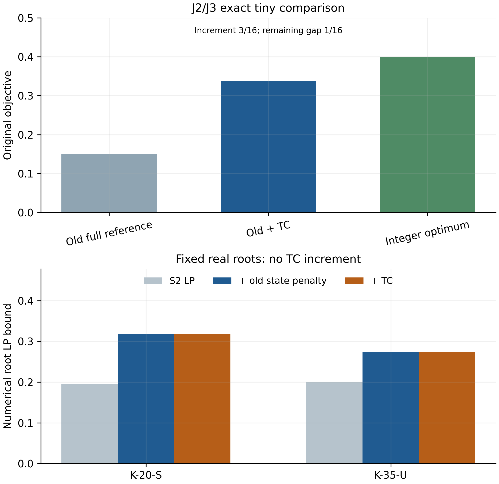

# Supplement: complete observations, mathematical comparisons and reproducibility

The current tables contain every registered position. C means a performance-eligible qualified certificate; O means open; UEV means evidence outside formal performance eligibility. Open times are null, not the cap. Detailed full-precision arrays, physical operations, raw lifecycle/model evidence and source identities accompany the CSV/JSON authorities. Prior evidence below keeps its original version and denominators.

## Reading and source map

The main paper and complete model/algorithm appendices are assembled from
`paper_body.md` and `model_and_algorithm_appendices.md`. This supplement keeps
complete breadth/resource/weight/AM/mechanism observations, useful historical
mathematical comparisons, source provenance and the later cohort evidence.
The [mathematical companion](mathematical_analysis.md) distinguishes the
relaxation objects and proof contracts. The [current source manifest](../unified_exact_round165/source_manifest.json)
and [document build receipt](../unified_exact_round165/document_build.json)
bind the current PDF to those components. Administrative author decisions are
kept in the internal memo and are not part of the technical manuscript.

## Current detailed panel tables

Complete panel observations accompany the compact question-led main text. Shared defaults retain their actual position identities.

## Breadth: complete two-sided endpoints

| Input | P: U / L | PS: U / L | GI-TBC: U / L |
|---|---|---|---|
| K-15-S | 0.592265 / 0.527663 | 0.592265 / 0.520583 | 0.592265 / 0.592265 |
| X-15-B | 0 / 0 | 0 / 0 | 0 / 0 |
| UC-B20-B | 0.577333 / 0.577333 | 0.577333 / 0.577333 | 0.577333 / 0.577333 |
| K-20-S | 0.727702 / 0.541868 | 0.775213 / 0.541233 | 0.716807 / 0.705356 |
| K-35-U | 0.664747 / 0.335556 | 0.767457 / 0.331922 | 0.692854 / 0.565766 |
| X-35-B | 0 / 0 | 0 / 0 | 0 / 0 |
| N-B15-B | 0.250494 / 0.250494 | 0.250494 / 0.250494 | 0.250494 / 0.250494 |
| N-X15-S | 0.628986 / 0.628986 | 0.628986 / 0.628986 | 0.628986 / 0.628986 |
| N-C20-U | 0.248551 / 0.217719 | 0.252309 / 0.214733 | 0.245505 / 0.245505 |
| N-X20-B | 0 / 0 | 0 / 0 | 0 / 0 |
| N-B35-S | 0.844874 / 0.371908 | 0.486013 / 0.373343 | 0.450292 / 0.389311 |
| N-C35-B | 0 / 0 | 0 / 0 | 0 / 0 |

## Positive-resource GI-TBC operating points

| Configuration | G / \(P_{\mathrm{avg}}\) / S | Returned units | Max duration / T | Status |
|---|---|---|---|---|
| R-B20-S-T1 | 0.216444 /0.264291 /17.2599 | 0 | 0.999851 | C |
| R-B20-S-T2 | 0.0819181 /0.116555 /17.4317 | 0 | 0.999816 | C |
| R-X20-S-T1 | 0.314652 /0.330673 /14.5762 | 1 | 0.999834 | C |
| R-X20-S-T2 | 0.206001 /0.228795 /15.7226 | 0 | 0.997641 | C |
| R-B35-S-T1 | 0.285367 /0.30615 /29.2099 | 2 | 0.994109 | open |
| R-B35-S-T2 | 0.181545 /0.163098 /29.8127 | 3 | 0.996291 | open |
| R-X35-S-T1 | 0.268135 /0.324055 /28.7591 | 1 | 0.999456 | open |
| R-X35-S-T2 | 0.18255 /0.220722 /28.2238 | 0 | 0.998568 | open |

## Objective weights: all methods and decompositions

| Configuration | \(\rho\) | Method | G / \(P_{\mathrm{avg}}\) | U / L | Certificate |
|---|---|---|---|---|---|
| R-B20-S-T1 | 1 | P | 0.239416 / 0.300668 | 0.540085 / 0.358158 | open |
| R-B20-S-T1 | 1 | PS | 0.222348 / 0.264291 | 0.486639 / 0.365324 | open |
| R-B20-S-T1 | 1 | GI-TBC | 0.216444 / 0.264291 | 0.480735 / 0.480735 | C |
| R-X35-S-T2 | 1 | PS | 0.194085 / 0.210482 | 0.404567 / 0.203817 | open |
| R-X35-S-T2 | 1 | GI-TBC | 0.18255 / 0.220722 | 0.403272 / 0.210887 | open |
| R-X35-S-T2 | 1 | P | 0.205654 / 0.284863 | 0.490517 / 0.201288 | open |
| R-B20-S-T1 | 0.5 | P | 0.223002 / 0.314774 | 0.380389 / 0.229542 | open |
| R-B20-S-T1 | 0.5 | PS | 0.213456 / 0.268003 | 0.347458 / 0.240479 | open |
| R-B20-S-T1 | 0.5 | GI-TBC | 0.213456 / 0.268003 | 0.347458 / 0.331864 | open |
| R-B20-S-T1 | 2 | P | 0.232861 / 0.262064 | 0.756988 / 0.610312 | open |
| R-B20-S-T1 | 2 | PS | 0.217549 / 0.263549 | 0.744646 / 0.616106 | open |
| R-B20-S-T1 | 2 | GI-TBC | 0.217549 / 0.263549 | 0.744646 / 0.744646 | C |
| R-X35-S-T2 | 0.5 | PS | 0.136611 / 0.242041 | 0.257631 / 0.108019 | open |
| R-X35-S-T2 | 0.5 | GI-TBC | 0.137132 / 0.237386 | 0.255825 / 0.122332 | open |
| R-X35-S-T2 | 0.5 | P | 0.141354 / 0.239248 | 0.260978 / 0.108223 | open |
| R-X35-S-T2 | 2 | PS | 0.198468 / 0.206712 | 0.611892 / 0.363572 | open |
| R-X35-S-T2 | 2 | GI-TBC | 0.148459 / 0.188047 | 0.524553 / 0.388438 | open |
| R-X35-S-T2 | 2 | P | 0.203202 / 0.20862 | 0.620443 / 0.36178 | open |

## Limited Seed 1: complete main triplets

| Role | Method | Status | Own \(T_{\mathrm{cert}}\) (s) | U / L | Production (s) |
|---|---|---|---|---|---|
| K-15-S | P | open | n/a | 0.592265 /0.529115 | 571.412 |
| K-15-S | PS | open | n/a | 0.592265 /0.53228 | 571.362 |
| K-15-S | GI-TBC | C | 115.444 | 0.592265 /0.592265 | 115.444 |
| R-B20-S-T1 | P | open | n/a | 0.493224 /0.354626 | 1171.09 |
| R-B20-S-T1 | PS | open | n/a | 0.480735 /0.367482 | 1171.18 |
| R-B20-S-T1 | GI-TBC | C | 656.734 | 0.480735 /0.480735 | 656.734 |
| UC-B20-B | P | C | 314.513 | 0.577333 /0.577333 | 314.513 |
| UC-B20-B | PS | C | 125.391 | 0.577333 /0.577333 | 125.391 |
| UC-B20-B | GI-TBC | C | 4.0999 | 0.577333 /0.577333 | 4.0999 |
| K-35-U | P | open | n/a | 0.758852 /0.330574 | 2371.17 |
| K-35-U | PS | open | n/a | 0.712648 /0.335095 | 2371.03 |
| K-35-U | GI-TBC | open | n/a | 0.668358 /0.55478 | 2371 |

## Limited Seed 1 AM observations

**Seed 1 limited AM repeat**

| Role | \(\tau_{\mathrm{AM}}\) | Max gate score | Actions | Production (s) |
|---|---|---|---|---|
| K-15-S | 0.04 | 0.000356687 | native-target:1, exact-close:1 | 114.938 |
| K-15-S | 0.08 | 0.000356687 | native-target:1, exact-close:1 | 115.444 |
| K-15-S | 0.16 | 0.000356687 | native-target:1, exact-close:1 | 115.503 |
| UC-B20-B | 0.04 | 0.00031863 | split:3, native-target:1, exact-close:1 | 4.08256 |
| UC-B20-B | 0.08 | 0.00031863 | split:3, native-target:1, exact-close:1 | 4.0999 |
| UC-B20-B | 0.16 | 0.00031863 | split:3, native-target:1, exact-close:1 | 4.0657 |

## Seed 0 main mechanism comparison

| Contrast | Role | Root LP optimum | Production (s) | Status |
|---|---|---|---|---|
| GI-TBC | K-15-S | 0.167137 | 112.769 | C |
| GI-TBC-R | K-15-S | 0.167137 | 112.649 | C |
| minus A/B | K-15-S | 0.167016 | 128.325 | C |
| minus \(C_R\) | K-15-S | 0.167137 | 75.1064 | C |
| minus \(C_G\) | K-15-S | 0.167137 | 143.15 | C |
| GI-TBC | UC-B20-B | 0.479076 | 4.14897 | C |
| GI-TBC-R | UC-B20-B | 0.479076 | 1.87206 | C |
| minus A/B | UC-B20-B | 0.479076 | 4.18619 | C |
| minus \(C_R\) | UC-B20-B | 0.479076 | 4.91775 | C |
| minus \(C_G\) | UC-B20-B | 0.479076 | 3.34912 | C |
| GI-TBC | K-20-S | 0.195149 | 1172.19 | open |
| GI-TBC-R | K-20-S | 0.195149 | 1172.22 | open |
| minus A/B | K-20-S | 0.193825 | 1172.12 | open |
| minus \(C_R\) | K-20-S | 0.195149 | 1171.91 | open |
| minus \(C_G\) | K-20-S | 0.195149 | 1171.96 | open |
| GI-TBC | K-35-U | 0.200178 | 2371.15 | open |
| GI-TBC-R | K-35-U | 0.200178 | 2370.99 | open |
| minus A/B | K-35-U | 0.200178 | 2372.38 | open |
| minus \(C_R\) | K-35-U | 0.200178 | 2370.97 | open |
| minus \(C_G\) | K-35-U | 0.200178 | 2370.98 | open |

## Seed 1 limited mechanism repeat

| Contrast | Role | Root LP optimum | Production (s) | Status |
|---|---|---|---|---|
| GI-TBC | K-15-S | 0.167137 | 115.444 | C |
| GI-TBC-R | K-15-S | 0.167137 | 113.58 | C |
| minus A/B | K-15-S | 0.167016 | 93.6997 | C |
| minus \(C_R\) | K-15-S | 0.167137 | 132.475 | C |
| minus \(C_G\) | K-15-S | 0.167137 | 99.6006 | C |
| GI-TBC | UC-B20-B | 0.479076 | 4.0999 | C |
| GI-TBC-R | UC-B20-B | 0.479076 | 1.95408 | C |
| minus A/B | UC-B20-B | 0.479076 | 4.46646 | C |
| minus \(C_R\) | UC-B20-B | 0.479076 | 4.60284 | C |
| minus \(C_G\) | UC-B20-B | 0.479076 | 2.95877 | C |

| Position / study | Input / Seed | Method | Status | U | L | Production / verification / total s |
|---|---|---|---|---|---|---|
| 1 /B1 | K-15-S /0 | P | O | 0.592265 | 0.527663 | 571.702 /142.568 /714.27 |
| 2 /B1 | K-15-S /0 | PS | O | 0.592265 | 0.520583 | 571.245 /2.27522 /573.52 |
| 3 /B1 | K-15-S /0 | GI-TBC | C | 0.592265 | 0.592265 | 112.769 /3.77037 /116.54 |
| 4 /B1 | X-15-B /0 | PS | C | 0 | 0 | 2.46104 /0.365936 /2.82698 |
| 5 /B1 | X-15-B /0 | GI-TBC | C | 0 | 0 | 2.55662 /0.645774 /3.2024 |
| 6 /B1 | X-15-B /0 | P | C | 0 | 0 | 7.0233 /0.248991 /7.2723 |
| 7 /B1 | UC-B20-B /0 | GI-TBC | C | 0.577333 | 0.577333 | 4.14897 /2.347 /6.49597 |
| 8 /B1 | UC-B20-B /0 | P | C | 0.577333 | 0.577333 | 315.403 /1.24106 /316.644 |
| 9 /B1 | UC-B20-B /0 | PS | C | 0.577333 | 0.577333 | 236.091 /1.30849 /237.399 |
| 10 /B1 | K-20-S /0 | P | O | 0.727702 | 0.541868 | 1171.16 /1.44439 /1172.61 |
| 11 /B1 | K-20-S /0 | PS | O | 0.775213 | 0.541233 | 1171.21 /1.5361 /1172.74 |
| 12 /B1 | K-20-S /0 | GI-TBC | O | 0.716807 | 0.705356 | 1172.19 /61.1438 /1233.33 |
| 13 /B1 | K-35-U /0 | PS | O | 0.767457 | 0.331922 | 2371 /1.72964 /2372.73 |
| 14 /B1 | K-35-U /0 | GI-TBC | O | 0.692854 | 0.565766 | 2371.15 /3.80005 /2374.95 |
| 15 /B1 | K-35-U /0 | P | O | 0.664747 | 0.335556 | 2371.06 /0.722418 /2371.78 |
| 16 /B1 | X-35-B /0 | GI-TBC | C | 0 | 0 | 17.9046 /3.63609 /21.5407 |
| 17 /B1 | X-35-B /0 | P | C | 0 | 0 | 158.585 /0.596178 /159.181 |
| 18 /B1 | X-35-B /0 | PS | C | 0 | 0 | 7.45014 /1.38966 /8.8398 |
| 19 /B1 | N-B15-B /0 | P | C | 0.250494 | 0.250494 | 279.663 /1.67388 /281.337 |
| 20 /B1 | N-B15-B /0 | PS | C | 0.250494 | 0.250494 | 306.307 /1.67192 /307.979 |
| 21 /B1 | N-B15-B /0 | GI-TBC | C | 0.250494 | 0.250494 | 24.0684 /0.790358 /24.8587 |
| 22 /B1 | N-X15-S /0 | PS | C | 0.628986 | 0.628986 | 401.931 /3.09583 /405.027 |
| 23 /B1 | N-X15-S /0 | GI-TBC | C | 0.628986 | 0.628986 | 10.2683 /0.739441 /11.0077 |
| 24 /B1 | N-X15-S /0 | P | C | 0.628986 | 0.628986 | 538.867 /3.46182 /542.329 |
| 25 /B1 | N-C20-U /0 | GI-TBC | C | 0.245505 | 0.245505 | 265.529 /4.06871 /269.598 |
| 26 /B1 | N-C20-U /0 | P | O | 0.248551 | 0.217719 | 1171.18 /1.83559 /1173.01 |
| 27 /B1 | N-C20-U /0 | PS | O | 0.252309 | 0.214733 | 1171.14 /11.7494 /1182.89 |
| 28 /B1 | N-X20-B /0 | P | C | 0 | 0 | 24.0892 /0.306578 /24.3958 |
| 29 /B1 | N-X20-B /0 | PS | C | 0 | 0 | 6.08515 /0.486901 /6.57205 |
| 30 /B1 | N-X20-B /0 | GI-TBC | C | 0 | 0 | 7.45537 /1.0786 /8.53397 |
| 31 /B1 | N-B35-S /0 | PS | O | 0.486013 | 0.373343 | 2371.01 /1.74441 /2372.76 |
| 32 /B1 | N-B35-S /0 | GI-TBC | O | 0.450292 | 0.389311 | 2370.98 /3.84726 /2374.82 |
| 33 /B1 | N-B35-S /0 | P | O | 0.844874 | 0.371908 | 2371.11 /0.661396 /2371.77 |
| 34 /B1 | N-C35-B /0 | GI-TBC | C | 0 | 0 | 59.6234 /3.71224 /63.3357 |
| 35 /B1 | N-C35-B /0 | P | C | 0 | 0 | 397.807 /0.653354 /398.461 |
| 36 /B1 | N-C35-B /0 | PS | C | 0 | 0 | 154.668 /1.42879 /156.097 |
| 37 /B2 | R-B20-S-T1 /0 | P | O | 0.540085 | 0.358158 | 1171.18 /0.980204 /1172.16 |
| 38 /B2 | R-B20-S-T1 /0 | PS | O | 0.486639 | 0.365324 | 1171.29 /1.3497 /1172.64 |
| 39 /B2 | R-B20-S-T1 /0 | GI-TBC | C | 0.480735 | 0.480735 | 784.143 /18.1789 /802.322 |
| 40 /B2 | R-B20-S-T2 /0 | PS | O | 0.208465 | 0.146203 | 1171.14 /1.19298 /1172.33 |
| 41 /B2 | R-B20-S-T2 /0 | GI-TBC | C | 0.198473 | 0.198473 | 538.603 /5.73802 /544.341 |
| 42 /B2 | R-B20-S-T2 /0 | P | O | 0.269095 | 0.141262 | 1171.19 /0.766113 /1171.96 |
| 43 /B2 | R-X20-S-T1 /0 | GI-TBC | C | 0.645325 | 0.645325 | 20.5065 /1.08205 /21.5885 |
| 44 /B2 | R-X20-S-T1 /0 | P | O | 0.645325 | 0.589197 | 1171.57 /5.00163 /1176.57 |
| 45 /B2 | R-X20-S-T1 /0 | PS | O | 0.645325 | 0.590359 | 1171.69 /4.9291 /1176.62 |
| 46 /B2 | R-X20-S-T2 /0 | P | O | 0.476731 | 0.291101 | 1171.1 /0.410932 /1171.51 |
| 47 /B2 | R-X20-S-T2 /0 | PS | O | 0.51972 | 0.28447 | 1171.18 /0.839506 /1172.02 |
| 48 /B2 | R-X20-S-T2 /0 | GI-TBC | C | 0.434796 | 0.434796 | 337.305 /2.72864 /340.034 |
| 49 /B2 | R-B35-S-T1 /0 | PS | O | 0.631765 | 0.334519 | 2371.04 /1.73506 /2372.77 |
| 50 /B2 | R-B35-S-T1 /0 | GI-TBC | O | 0.591518 | 0.455904 | 2376.07 /5.60112 /2381.67 |
| 51 /B2 | R-B35-S-T1 /0 | P | O | 0.606311 | 0.337002 | 2372.2 /0.733367 /2372.93 |
| 52 /B2 | R-B35-S-T2 /0 | GI-TBC | O | 0.344643 | 0.218986 | 2371.04 /3.76611 /2374.8 |
| 53 /B2 | R-B35-S-T2 /0 | P | O | 0.471637 | 0.154376 | 2371.07 /0.692204 /2371.77 |
| 54 /B2 | R-B35-S-T2 /0 | PS | O | 0.438291 | 0.155416 | 2371.03 /1.71384 /2372.75 |
| 55 /B2 | R-X35-S-T1 /0 | P | O | 0.655713 | 0.296009 | 2371.09 /0.694498 /2371.79 |
| 56 /B2 | R-X35-S-T1 /0 | PS | O | 0.593231 | 0.298839 | 2371.01 /4.60794 /2375.62 |
| 57 /B2 | R-X35-S-T1 /0 | GI-TBC | O | 0.59219 | 0.463358 | 2379.12 /3.67396 /2382.79 |
| 58 /B2 | R-X35-S-T2 /0 | PS | O | 0.404567 | 0.203817 | 2370.99 /1.72903 /2372.71 |
| 59 /B2 | R-X35-S-T2 /0 | GI-TBC | O | 0.403272 | 0.210887 | 2371.09 /3.72914 /2374.82 |
| 60 /B2 | R-X35-S-T2 /0 | P | O | 0.490517 | 0.201288 | 2371.02 /0.664748 /2371.68 |
| 61 /B3 | R-B20-S-T1-rho0.5 /0 | P | O | 0.380389 | 0.229542 | 1171.17 /0.87512 /1172.05 |
| 62 /B3 | R-B20-S-T1-rho0.5 /0 | PS | O | 0.347458 | 0.240479 | 1171.16 /1.17614 /1172.33 |
| 63 /B3 | R-B20-S-T1-rho0.5 /0 | GI-TBC | O | 0.347458 | 0.331864 | 1171.29 /5.89166 /1177.18 |
| 64 /B3 | R-B20-S-T1-rho2 /0 | P | O | 0.756988 | 0.610312 | 1171.15 /1.29992 /1172.45 |
| 65 /B3 | R-B20-S-T1-rho2 /0 | PS | O | 0.744646 | 0.616106 | 1171.34 /1.7534 /1173.1 |
| 66 /B3 | R-B20-S-T1-rho2 /0 | GI-TBC | C | 0.744646 | 0.744646 | 309.113 /8.59128 /317.704 |
| 67 /B3 | R-X35-S-T2-rho0.5 /0 | PS | O | 0.257631 | 0.108019 | 2371.05 /1.73565 /2372.78 |
| 68 /B3 | R-X35-S-T2-rho0.5 /0 | GI-TBC | O | 0.255825 | 0.122332 | 2371.1 /3.68103 /2374.78 |
| 69 /B3 | R-X35-S-T2-rho0.5 /0 | P | O | 0.260978 | 0.108223 | 2371.1 /0.679667 /2371.78 |
| 70 /B3 | R-X35-S-T2-rho2 /0 | PS | O | 0.611892 | 0.363572 | 2371.03 /1.71701 /2372.74 |
| 71 /B3 | R-X35-S-T2-rho2 /0 | GI-TBC | O | 0.524553 | 0.388438 | 2370.96 /3.7818 /2374.74 |
| 72 /B3 | R-X35-S-T2-rho2 /0 | P | O | 0.620443 | 0.36178 | 2371.09 /0.700077 /2371.79 |
| 73 /C1 | K-15-S /0 | AM .04 | C | 0.592265 | 0.592265 | 113.062 /3.77321 /116.835 |
| 74 /C1 | K-15-S /0 | AM .16 | C | 0.592265 | 0.592265 | 113.315 /3.74081 /117.056 |
| 75 /C1 | K-20-S /0 | AM .04 | O | 0.716807 | 0.705366 | 1172.26 /61.3126 /1233.57 |
| 76 /C1 | K-20-S /0 | AM .16 | O | 0.716807 | 0.705386 | 1172.26 /62.835 /1235.09 |
| 77 /C1 | UC-B20-B /0 | AM .04 | C | 0.577333 | 0.577333 | 4.21966 /2.27593 /6.49559 |
| 78 /C1 | UC-B20-B /0 | AM .16 | C | 0.577333 | 0.577333 | 4.08117 /2.26691 /6.34809 |
| 79 /C1 | K-35-U /0 | AM .04 | O | 0.692854 | 0.565893 | 2371.02 /3.76777 /2374.79 |
| 80 /C1 | K-35-U /0 | AM .16 | O | 0.692854 | 0.566106 | 2371.03 /3.79054 /2374.82 |
| 81 /C2 | K-15-S /0 | GI-TBC-R | C | 0.592265 | 0.592265 | 112.649 /3.34597 /115.995 |
| 82 /C2 | K-15-S /0 | minus A/B | C | 0.592265 | 0.592265 | 128.325 /3.61312 /131.938 |
| 83 /C2 | K-15-S /0 | minus \(C_R\) | C | 0.592265 | 0.592265 | 75.1064 /2.39997 /77.5064 |
| 84 /C2 | K-15-S /0 | minus \(C_G\) | C | 0.592265 | 0.592265 | 143.15 /4.47363 /147.624 |
| 85 /C2 | UC-B20-B /0 | minus A/B | C | 0.577333 | 0.577333 | 4.18619 /2.24829 /6.43448 |
| 86 /C2 | UC-B20-B /0 | minus \(C_R\) | C | 0.577333 | 0.577333 | 4.91775 /2.28857 /7.20632 |
| 87 /C2 | UC-B20-B /0 | minus \(C_G\) | C | 0.577333 | 0.577333 | 3.34912 /1.70325 /5.05237 |
| 88 /C2 | UC-B20-B /0 | GI-TBC-R | C | 0.577333 | 0.577333 | 1.87206 /0.407894 /2.27996 |
| 89 /C2 | K-20-S /0 | minus \(C_R\) | O | 0.716807 | 0.703444 | 1171.91 /36.6745 /1208.59 |
| 90 /C2 | K-20-S /0 | minus \(C_G\) | O | 0.716807 | 0.705296 | 1171.96 /43.4998 /1215.46 |
| 91 /C2 | K-20-S /0 | GI-TBC-R | O | 0.716807 | 0.706405 | 1172.22 /61.8919 /1234.12 |
| 92 /C2 | K-20-S /0 | minus A/B | O | 0.716807 | 0.704128 | 1172.12 /41.7358 /1213.86 |
| 93 /C2 | K-35-U /0 | minus \(C_G\) | O | 0.666262 | 0.55098 | 2370.98 /2.63835 /2373.62 |
| 94 /C2 | K-35-U /0 | GI-TBC-R | O | 0.692854 | 0.566106 | 2370.99 /6.52797 /2377.52 |
| 95 /C2 | K-35-U /0 | minus A/B | O | 0.654639 | 0.564355 | 2372.38 /3.79162 /2376.17 |
| 96 /C2 | K-35-U /0 | minus \(C_R\) | O | 0.689763 | 0.536996 | 2370.97 /3.56291 /2374.53 |
| 97 /D2-main | K-15-S /1 | P | O | 0.592265 | 0.529115 | 571.412 /3.04329 /574.455 |
| 98 /D2-main | K-15-S /1 | PS | O | 0.592265 | 0.53228 | 571.362 /3.10724 /574.469 |
| 99 /D2-main | K-15-S /1 | GI-TBC | C | 0.592265 | 0.592265 | 115.444 /4.17556 /119.62 |
| 100 /D2-main | UC-B20-B /1 | PS | C | 0.577333 | 0.577333 | 125.391 /1.15372 /126.545 |
| 101 /D2-main | UC-B20-B /1 | GI-TBC | C | 0.577333 | 0.577333 | 4.0999 /2.28866 /6.38856 |
| 102 /D2-main | UC-B20-B /1 | P | C | 0.577333 | 0.577333 | 314.513 /1.42972 /315.943 |
| 103 /D2-main | R-B20-S-T1 /1 | GI-TBC | C | 0.480735 | 0.480735 | 656.734 /19.5677 /676.302 |
| 104 /D2-main | R-B20-S-T1 /1 | P | O | 0.493224 | 0.354626 | 1171.09 /0.941944 /1172.03 |
| 105 /D2-main | R-B20-S-T1 /1 | PS | O | 0.480735 | 0.367482 | 1171.18 /1.33337 /1172.51 |
| 106 /D2-main | K-35-U /1 | P | O | 0.758852 | 0.330574 | 2371.17 /0.731285 /2371.91 |
| 107 /D2-main | K-35-U /1 | PS | O | 0.712648 | 0.335095 | 2371.03 /1.7395 /2372.77 |
| 108 /D2-main | K-35-U /1 | GI-TBC | O | 0.668358 | 0.55478 | 2371 /3.76418 /2374.76 |
| 109 /D2-AM | K-15-S /1 | AM .04 | C | 0.592265 | 0.592265 | 114.938 /4.23062 /119.169 |
| 110 /D2-AM | K-15-S /1 | AM .16 | C | 0.592265 | 0.592265 | 115.503 /4.18745 /119.691 |
| 115 /D2-AM | UC-B20-B /1 | AM .04 | C | 0.577333 | 0.577333 | 4.08256 /2.29383 /6.37639 |
| 116 /D2-AM | UC-B20-B /1 | AM .16 | C | 0.577333 | 0.577333 | 4.0657 /2.28894 /6.35465 |
| 111 /D2-mechanism | K-15-S /1 | GI-TBC-R | C | 0.592265 | 0.592265 | 113.58 /3.78707 /117.367 |
| 112 /D2-mechanism | K-15-S /1 | minus A/B | C | 0.592265 | 0.592265 | 93.6997 /2.95424 /96.654 |
| 113 /D2-mechanism | K-15-S /1 | minus \(C_R\) | C | 0.592265 | 0.592265 | 132.475 /4.49508 /136.97 |
| 114 /D2-mechanism | K-15-S /1 | minus \(C_G\) | C | 0.592265 | 0.592265 | 99.6006 /2.39181 /101.992 |
| 117 /D2-mechanism | UC-B20-B /1 | GI-TBC-R | C | 0.577333 | 0.577333 | 1.95408 /0.416184 /2.37026 |
| 118 /D2-mechanism | UC-B20-B /1 | minus A/B | C | 0.577333 | 0.577333 | 4.46646 /2.28714 /6.7536 |
| 119 /D2-mechanism | UC-B20-B /1 | minus \(C_R\) | C | 0.577333 | 0.577333 | 4.60284 /2.24667 /6.8495 |
| 120 /D2-mechanism | UC-B20-B /1 | minus \(C_G\) | C | 0.577333 | 0.577333 | 2.95877 /1.70396 /4.66273 |

## Historical breadth/resource study: detailed interpretation

All 120 registered method observations appear above. The original
[fixed report](https://github.com/yifanXovo/TailoredExact/blob/de01e8fb27a954d031abac5fe99442d6c8d29d44/results/unified_exact_round137/final_report.md)
retains the study's timing, native-effort, action and eligibility diagnostics.
The current main text integrates its conclusions with later evidence without
pooling the study denominators.

## Preserved historical supplement (R135 observations retained; headings nested and figure links pinned)

### Supplement: complete evidence and formulation analysis

This supplement retains complete numerical observations and separates evidence versions. C means a qualified certificate; O means open. No open cap is substituted for a certification time. Displayed bounds are original-objective values; gap is signed U-L. Full-precision CSV/JSON files and finite raw carriers are the numerical authorities.

#### S1. R134 final implementation: every method position

| Position / problem | Seed / repeat | method | proof | U | L | production seconds |
|---|---|---|---|---|---|---|
| C01 SM-B10-B | 0 / 1 | P | native/outer | 0.5358910752996684 | 0.53589107529966828 | 1.641208466491662 |
| C02 SM-B10-B | 0 / 1 | S2 | native/outer | 0.5358910752996684 | 0.5358910752996684 | 0.85733476874884218 |
| C03 SM-B10-B | 0 / 2 | S2 | native/outer | 0.5358910752996684 | 0.5358910752996684 | 0.7744989802595228 |
| C04 SM-B10-B | 0 / 2 | P | native/outer | 0.5358910752996684 | 0.53589107529966828 | 1.0408740653656423 |
| C05 SM-B10-B | 1 / 1 | S2 | native/outer | 0.5358910752996684 | 0.5358910752996684 | 0.80483507376629859 |
| C06 SM-B10-B | 1 / 1 | P | native/outer | 0.5358910752996684 | 0.5358910752996684 | 1.0432951427064836 |
| C07 SM-B10-B | 1 / 2 | P | native/outer | 0.5358910752996684 | 0.5358910752996684 | 1.0162093546241522 |
| C08 SM-B10-B | 1 / 2 | S2 | native/outer | 0.5358910752996684 | 0.5358910752996684 | 0.77312812907621264 |
| C09 K-15-S | 0 / 1 | P | O | 0.59226488225608254 | 0.52741476565912426 | 571.09011773474049 |
| C10 K-15-S | 0 / 1 | S2 | native/outer | 0.59226488225608254 | 0.59226487923851112 | 112.93495272356085 |
| C11 K-15-S | 0 / 1 | PS | O | 0.59226488225608254 | 0.52021552438678098 | 571.01766042027157 |
| C12 K-15-S | 1 / 1 | PS | O | 0.59226488225608254 | 0.53187261241580452 | 571.17800757987425 |
| C13 K-15-S | 1 / 1 | S2 | native/outer | 0.59226488225608254 | 0.59226488225605578 | 115.02057574014179 |
| C14 K-15-S | 1 / 1 | P | O | 0.59226488225608254 | 0.52890061340465544 | 571.12909410567954 |
| C15 UC-B20-B | 0 / 1 | P | native/outer | 0.57733306997029277 | 0.57733306997029266 | 319.06004932010546 |
| C16 UC-B20-B | 0 / 1 | S2 | native/outer | 0.57733306997029277 | 0.57733306997029255 | 3.9657152621075511 |
| C17 UC-B20-B | 1 / 1 | S2 | native/outer | 0.57733306997029277 | 0.57733306997029255 | 3.8206901535158977 |
| C18 UC-B20-B | 1 / 1 | P | native/outer | 0.57733306997029277 | 0.57733306997029232 | 318.37744219752494 |
| C19 K-35-U | 0 / 1 | P | O | 0.66474660181829859 | 0.33550123769342638 | 2370.8627517689019 |
| C20 K-35-U | 0 / 1 | S2 | O | 0.69285435863131362 | 0.56494150394342635 | 2370.941779125249 |
| C21 K-35-U | 1 / 1 | S2 | O | 0.66835825474454524 | 0.55427196382355215 | 2370.7849446644541 |
| C22 K-35-U | 1 / 1 | P | O | 0.75885159764783316 | 0.33054832396382849 | 2370.8440815587528 |
| C23 X-35-U | 0 / 1 | P | O | 0.016264564336372848 | 6.9388939039072284e-18 | 2370.8640295162331 |
| C24 X-35-U | 0 / 1 | S2 | independent zero | 0 | 0 | 120.2566853313474 |
| C25 X-35-U | 1 / 1 | S2 | independent zero | 0 | 0 | 452.84144015004858 |
| C26 X-35-U | 1 / 1 | P | independent zero | 0 | 0 | 2064.9493677320424 |
| C27 X-35-B | 0 / 1 | P | independent zero | 0 | 0 | 157.95417694339994 |
| C28 X-35-B | 0 / 1 | PS | independent zero | 0 | 0 | 7.2505462232511491 |
| C29 X-35-B | 0 / 1 | S2 | independent zero | 0 | 0 | 17.606032623560168 |
| C30 X-35-B | 1 / 1 | S2 | independent zero | 0 | 0 | 18.27744961460121 |
| C31 X-35-B | 1 / 1 | PS | independent zero | 0 | 0 | 7.1957794689806178 |
| C32 X-35-B | 1 / 1 | P | independent zero | 0 | 0 | 50.150547508616 |

#### S2. R134 complete cost and paired outcomes

| Position | production | postverification | total | certification |
|---|---|---|---|---|
| C01 | 1.641208466491662 | 46.645632400061004 | 48.286840866552666 | 1.641208466491662 |
| C02 | 0.85733476874884218 | 0.23014050000347197 | 1.0874752687523142 | 0.85733476874884218 |
| C03 | 0.7744989802595228 | 0.22661289991810918 | 1.001111880177632 | 0.7744989802595228 |
| C04 | 1.0408740653656423 | 0.2392841000109911 | 1.2801581653766334 | 1.0408740653656423 |
| C05 | 0.80483507376629859 | 0.22692279994953424 | 1.0317578737158328 | 0.80483507376629859 |
| C06 | 1.0432951427064836 | 0.22571640007663518 | 1.2690115427831188 | 1.0432951427064836 |
| C07 | 1.0162093546241522 | 0.23388549999799579 | 1.250094854622148 | 1.0162093546241522 |
| C08 | 0.77312812907621264 | 0.22831899998709559 | 1.0014471290633082 | 0.77312812907621264 |
| C09 | 571.09011773474049 | 2.4273113000672311 | 573.51742903480772 | - |
| C10 | 112.93495272356085 | 3.7583510000258684 | 116.69330372358672 | 112.93495272356085 |
| C11 | 571.01766042027157 | 2.2171896999934688 | 573.23485012026504 | - |
| C12 | 571.17800757987425 | 3.1282583000138402 | 574.30626587988809 | - |
| C13 | 115.02057574014179 | 4.0986800999380648 | 119.11925584007986 | 115.02057574014179 |
| C14 | 571.12909410567954 | 2.9784281000029296 | 574.10752220568247 | - |
| C15 | 319.06004932010546 | 1.2434149000328034 | 320.30346422013827 | 319.06004932010546 |
| C16 | 3.9657152621075511 | 2.202236800105311 | 6.1679520622128621 | 3.9657152621075511 |
| C17 | 3.8206901535158977 | 2.2351581000257283 | 6.055848253541626 | 3.8206901535158977 |
| C18 | 318.37744219752494 | 1.4310659999027848 | 319.80850819742773 | 318.37744219752494 |
| C19 | 2370.8627517689019 | 0.7067805000115186 | 2371.5695322689135 | - |
| C20 | 2370.941779125249 | 3.6650486000580713 | 2374.6068277253071 | - |
| C21 | 2370.7849446644541 | 3.6163409999571741 | 2374.4012856644113 | - |
| C22 | 2370.8440815587528 | 0.71036210004240274 | 2371.5544436587952 | - |
| C23 | 2370.8640295162331 | 0.59006960003171116 | 2371.4540991162648 | - |
| C24 | 120.2566853313474 | 3.4503352000610903 | 123.70702053140849 | 120.2566853313474 |
| C25 | 452.84144015004858 | 3.4633971999865025 | 456.30483735003509 | 452.84144015004858 |
| C26 | 2064.9493677320424 | 0.59091300005093217 | 2065.5402807320934 | 2064.9493677320424 |
| C27 | 157.95417694339994 | 0.59015209996141493 | 158.54432904336136 | 157.95417694339994 |
| C28 | 7.2505462232511491 | 1.3739650999195874 | 8.6245113231707364 | 7.2505462232511491 |
| C29 | 17.606032623560168 | 3.5490938000148162 | 21.155126423574984 | 17.606032623560168 |
| C30 | 18.27744961460121 | 3.5100391999585554 | 21.787488814559765 | 18.27744961460121 |
| C31 | 7.1957794689806178 | 1.3705275000538677 | 8.5663069690344855 | 7.1957794689806178 |
| C32 | 50.150547508616 | 0.58718589995987713 | 50.737733408575878 | 50.150547508616 |

| Problem / Seed / repeat | comparison | class | direction | substantive | S2/control cert seconds |
|---|---|---|---|---|---|
| SM-B10-B / 0 / 1 | S2/P | BOTH_CERTIFIED | Win | False | 0.85733476874884218 / 1.641208466491662 |
| SM-B10-B / 0 / 2 | S2/P | BOTH_CERTIFIED | Win | False | 0.7744989802595228 / 1.0408740653656423 |
| SM-B10-B / 1 / 1 | S2/P | BOTH_CERTIFIED | Win | False | 0.80483507376629859 / 1.0432951427064836 |
| SM-B10-B / 1 / 2 | S2/P | BOTH_CERTIFIED | Win | False | 0.77312812907621264 / 1.0162093546241522 |
| K-15-S / 0 / 1 | S2/P | LEFT_ONLY_CERTIFIED | Win | - | 112.93495272356085 / - |
| K-15-S / 0 / 1 | S2/PS | LEFT_ONLY_CERTIFIED | Win | - | 112.93495272356085 / - |
| K-15-S / 1 / 1 | S2/P | LEFT_ONLY_CERTIFIED | Win | - | 115.02057574014179 / - |
| K-15-S / 1 / 1 | S2/PS | LEFT_ONLY_CERTIFIED | Win | - | 115.02057574014179 / - |
| UC-B20-B / 0 / 1 | S2/P | BOTH_CERTIFIED | Win | True | 3.9657152621075511 / 319.06004932010546 |
| UC-B20-B / 1 / 1 | S2/P | BOTH_CERTIFIED | Win | True | 3.8206901535158977 / 318.37744219752494 |
| K-35-U / 0 / 1 | S2/P | BOTH_OPEN | UNDETERMINED | - | - / - |
| K-35-U / 1 / 1 | S2/P | BOTH_OPEN | UNDETERMINED | - | - / - |
| X-35-U / 0 / 1 | S2/P | LEFT_ONLY_CERTIFIED | Win | - | 120.2566853313474 / - |
| X-35-U / 1 / 1 | S2/P | BOTH_CERTIFIED | Win | True | 452.84144015004858 / 2064.9493677320424 |
| X-35-B / 0 / 1 | S2/P | BOTH_CERTIFIED | Win | True | 17.606032623560168 / 157.95417694339994 |
| X-35-B / 0 / 1 | S2/PS | BOTH_CERTIFIED | Lose | True | 17.606032623560168 / 7.2505462232511491 |
| X-35-B / 1 / 1 | S2/P | BOTH_CERTIFIED | Win | True | 18.27744961460121 / 50.150547508616 |
| X-35-B / 1 / 1 | S2/PS | BOTH_CERTIFIED | Lose | True | 18.27744961460121 / 7.1957794689806178 |

Every adverse direction is retained. In particular X-35-B favors independently paid-start compact at both Seeds. R134 C01 had one failed postreader metadata access, repaired read-only using the same sealed native run. Its real verification delay remains in the costs. Native-source rejection remains visible even when an independent zero argument certifies the original problem.

#### S3. Six within-instance weight points

| Problem | lambda | effective rho | G | P average | F | U-L | certificate |
|---|---|---|---|---|---|---|---|
| K-15-S | 0.074999999999999997 | 0.71050282499999995 | 0.20236968415399592 | 0.27670203678631405 | 0.39896726297392598 | 5.5511151231257827e-16 | True |
| K-15-S | 0.14999999999999999 | 1.4210056499999999 | 0.22214662764652537 | 0.26046219774675566 | 0.59226488225608254 | 3.017571414964948e-09 | True |
| K-15-S | 0.29999999999999999 | 2.8420112999999998 | 0.22543269240189592 | 0.25858836875043245 | 0.96034375843919173 | 2.2204460492503131e-16 | True |
| UC-B20-B | 0.074999999999999997 | 0.88724999999999998 | 0.17083306997029268 | 0.22907861369399835 | 0.37408306997029273 | 1.1102230246251565e-16 | True |
| UC-B20-B | 0.14999999999999999 | 1.7745 | 0.17083306997029268 | 0.22907861369399835 | 0.57733306997029277 | 2.2204460492503131e-16 | True |
| UC-B20-B | 0.29999999999999999 | 3.5489999999999999 | 0.17083306997029268 | 0.22907861369399835 | 0.98383306997029274 | 4.4408920985006262e-16 | True |

The same-feasible-set relations use accepted original-objective errors. Station inventories, target-under/equal/over counts, every vehicle operation, returns, prefix peaks and durations remain in the fixed R134 operations tables. No new weight run is added here.

#### S4. AP: preregistration, every entered position and stage decision

The plan fixes seven inputs, 16 pairs and 32 arms: ten first-stage arms with 8,760 cap-seconds and 22 conditional arms with 14,760 cap-seconds. The two methods use the same PE and complete S2 algorithm; only the AP flag differs. Seeds, repeat orders, caps and inputs are fixed in experiment_plan.json and both matrix manifests before results. D13 uses the original physical input and T=3,600; historical subinterval times are not new whole-method controls.

Both preregistered stages were entered and all 32 positions completed, giving 16 matched pairs across seven known structural/protection inputs. The first-stage decision used all ten sealed positions and their original-objective endpoint signal. No position, Seed, order or cap was replaced after observing outcomes. The plan retained 8,760 plus 14,760 cap-seconds; actual costs are reported separately. Every ordinary adverse and open observation remains in the evidence.

| Position / problem | Seed / repeat | variant | C/O | U | L | U-L | production |
|---|---|---|---|---|---|---|---|
| C01 SM-B10-B | 0 / 1 | S2 | C | 0.5358910752996684 | 0.5358910752996684 | 0 | 1.1886323710205033 |
| C02 SM-B10-B | 0 / 1 | AP | C | 0.5358910752996684 | 0.5358910752996684 | 0 | 0.81220612581819296 |
| C03 SM-B10-B | 0 / 2 | AP | C | 0.5358910752996684 | 0.5358910752996684 | 0 | 0.82246625667903572 |
| C04 SM-B10-B | 0 / 2 | S2 | C | 0.5358910752996684 | 0.5358910752996684 | 0 | 0.86343272833619267 |
| C05 K-20-S | 0 / 1 | S2 | O | 0.7168065462777502 | 0.70532595601069703 | 0.01148059026705317 | 1171.9802716831909 |
| C06 K-20-S | 0 / 1 | AP | O | 0.7168065462777502 | 0.70613521607543916 | 0.010671330202311036 | 1172.0158158859704 |
| C07 K-35-U | 0 / 1 | AP | O | 0.65367124566222801 | 0.55891060264955894 | 0.094760643012669066 | 2370.8042844543234 |
| C08 K-35-U | 0 / 1 | S2 | O | 0.69285435863131362 | 0.56597614196525814 | 0.12687821666605548 | 2370.7419885438867 |
| C09 R55-D13 | 0 / 1 | S2 | O | 2.4434031919431991 | 2.3928286548136919 | 0.050574537129507213 | 570.91426332644187 |
| C10 R55-D13 | 0 / 1 | AP | O | 2.4434031919431991 | 2.3932844224266034 | 0.050118769516595663 | 570.77328741503879 |
| D01 K-20-S | 1 / 1 | AP | O | 0.7168065462777502 | 0.70622720213382739 | 0.010579344143922809 | 1171.9176525182556 |
| D02 K-20-S | 1 / 1 | S2 | O | 0.7168065462777502 | 0.70163548467172332 | 0.015171061606026881 | 1171.7550542864483 |
| D03 K-35-U | 1 / 1 | S2 | O | 0.66835825474454524 | 0.55479973409307148 | 0.11355852065147376 | 2370.8416610131972 |
| D04 K-35-U | 1 / 1 | AP | O | 0.65083560829350728 | 0.54039985993809458 | 0.1104357483554127 | 2370.9208790343255 |
| D05 R55-D13 | 1 / 1 | AP | O | 2.4434031919431991 | 2.3913419209507909 | 0.052061270992408204 | 570.78703252295963 |
| D06 R55-D13 | 1 / 1 | S2 | O | 2.4434031919431991 | 2.3976671263450426 | 0.045736065598156461 | 570.72953421249986 |
| D07 K-15-S | 0 / 1 | S2 | C | 0.59226488225608254 | 0.59226487923851112 | 3.017571414964948e-09 | 112.11311539378949 |
| D08 K-15-S | 0 / 1 | AP | C | 0.59226488225608254 | 0.59226488225608176 | 7.7715611723760958e-16 | 149.30963609972969 |
| D09 K-15-S | 1 / 1 | AP | C | 0.59226488225608254 | 0.5922648817120082 | 5.4407434113556974e-10 | 115.3093625260517 |
| D10 K-15-S | 1 / 1 | S2 | C | 0.59226488225608254 | 0.59226488225605578 | 2.6756374893466273e-14 | 113.85029233922251 |
| D11 UC-B20-B | 0 / 1 | AP | C | 0.57733306997029277 | 0.57733306997029255 | 2.2204460492503131e-16 | 4.2052002120763063 |
| D12 UC-B20-B | 0 / 1 | S2 | C | 0.57733306997029277 | 0.57733306997029255 | 2.2204460492503131e-16 | 3.9309600652195513 |
| D13 UC-B20-B | 1 / 1 | S2 | C | 0.57733306997029277 | 0.57733306997029255 | 2.2204460492503131e-16 | 3.8680739323608577 |
| D14 UC-B20-B | 1 / 1 | AP | C | 0.57733306997029277 | 0.57733306997029255 | 2.2204460492503131e-16 | 3.7955262111499906 |
| D15 X-35-B | 0 / 1 | S2 | C | 0 | 0 | 0 | 17.588701438158751 |
| D16 X-35-B | 0 / 1 | AP | C | 0 | 0 | 0 | 79.973826370202005 |
| D17 X-35-B | 1 / 1 | AP | C | 0 | 0 | 0 | 17.462860916741192 |
| D18 X-35-B | 1 / 1 | S2 | C | 0 | 0 | 0 | 18.17769737704657 |
| D19 SM-B10-B | 1 / 1 | AP | C | 0.5358910752996684 | 0.5358910752996684 | 0 | 0.75498839397914708 |
| D20 SM-B10-B | 1 / 1 | S2 | C | 0.5358910752996684 | 0.5358910752996684 | 0 | 0.78381483652628958 |
| D21 SM-B10-B | 1 / 2 | S2 | C | 0.5358910752996684 | 0.5358910752996684 | 0 | 0.79964613285847008 |
| D22 SM-B10-B | 1 / 2 | AP | C | 0.5358910752996684 | 0.5358910752996684 | 0 | 0.73793506622314453 |

| Position | postverification | total | Work | nodes | root LP / child LP / MIP seconds | splits / target MIP |
|---|---|---|---|---|---|---|
| C01 | 0.23790239996742457 | 1.4265347709879279 | 0.001649863829585708 | 0 | 0.0019998550415039062 / 0 / 0 | 0 / 0 |
| C02 | 0.22853970003779978 | 1.0407458258559927 | 0.0017657299770903112 | 0 | 0 / 0 / 0 | 0 / 0 |
| C03 | 0.2378315000096336 | 1.0602977566886693 | 0.0017657299770903112 | 0 | 0 / 0 / 0 | 0 / 0 |
| C04 | 0.22937770001590252 | 1.0928104283520952 | 0.001649863829585708 | 0 | 0.015000104904174805 / 0 / 0 | 0 / 0 |
| C05 | 60.423933499958366 | 1232.4042051831493 | 1896.8192958982581 | 447343 | 0.14299988746643066 / 0.18899989128112793 / 1168.3129999637604 | 0 / 1 |
| C06 | 56.829639199888334 | 1228.8454550858587 | 1892.1217870426697 | 476720 | 0.16300010681152344 / 0.28900027275085449 / 1168.194000005722 | 0 / 1 |
| C07 | 3.8639760999940336 | 2374.6682605543174 | 5076.7423280942048 | 17193 | 1.122999906539917 / 2.6200001239776611 / 2361.6570000648499 | 0 / 1 |
| C08 | 3.7957102998625487 | 2374.5376988437492 | 5054.4645485643805 | 18947 | 0.34099984169006348 / 0.62799978256225586 / 2364.6040000915527 | 0 / 0 |
| C09 | 1.4910454999189824 | 572.40530882636085 | 1100.7673530820177 | 11576 | 0.1790001392364502 / 0.45600008964538574 / 567.91100001335144 | 0 / 1 |
| C10 | 2.786274200072512 | 573.55956161511131 | 1110.5574094420792 | 12542 | 0.43900012969970703 / 0.96100020408630371 / 566.06600022315979 | 0 / 1 |
| D01 | 49.690950999967754 | 1221.6086035182234 | 1921.7233406654721 | 432818 | 0.19799995422363281 / 0.29600000381469727 / 1168.1399998664856 | 0 / 1 |
| D02 | 33.353537099901587 | 1205.1085913863499 | 1870.0397909870678 | 415820 | 0.13199996948242188 / 0.20500016212463379 / 1168.3039999008179 | 0 / 1 |
| D03 | 3.7409735999535769 | 2374.5826346131507 | 5131.3076361812091 | 18687 | 0.26100015640258789 / 0.5820000171661377 / 2364.694000005722 | 0 / 0 |
| D04 | 3.857093800092116 | 2374.7779728344176 | 4953.3913802080924 | 14623 | 1.3500001430511475 / 2.7909996509552002 / 2361.2439999580383 | 0 / 1 |
| D05 | 1.5338510000146925 | 572.32088352297433 | 1109.4166988624229 | 14028 | 0.21399998664855957 / 0.43800020217895508 / 567.91499996185303 | 0 / 1 |
| D06 | 1.4879322000779212 | 572.21746641257778 | 1074.0487198346189 | 13351 | 0.22099995613098145 / 0.43699979782104492 / 567.91799998283386 | 0 / 1 |
| D07 | 3.7371036999393255 | 115.85021909372881 | 160.92570304225362 | 48701 | 0.075999975204467773 / 0.11799979209899902 / 110.15899991989136 | 0 / 1 |
| D08 | 5.2864341998938471 | 154.59607029962353 | 213.66192380677913 | 60497 | 0.095999956130981445 / 0.11999988555908203 / 147.07299995422363 | 0 / 1 |
| D09 | 3.8546991001348943 | 119.16406162618659 | 168.88984742515481 | 46417 | 0.10400009155273438 / 0.1099998950958252 / 113.25999999046326 | 0 / 1 |
| D10 | 4.1318171001039445 | 117.98210943932645 | 161.82766985129314 | 42579 | 0.067000150680541992 / 0.10400009155273438 / 111.87599992752075 | 0 / 1 |
| D11 | 2.2673618998378515 | 6.4725621119141579 | 1.1774715972799443 | 3 | 0.016999959945678711 / 0.11599969863891602 / 0.73299980163574219 | 3 / 0 |
| D12 | 2.2735852000769228 | 6.2045452652964741 | 0.95944409397319008 | 2 | 0.016000032424926758 / 0.1400001049041748 / 0.46899986267089844 | 3 / 1 |
| D13 | 2.2916634001303464 | 6.1597373324912041 | 0.87248001358904614 | 2 | 0.012000083923339844 / 0.1249997615814209 / 0.43299984931945801 | 3 / 1 |
| D14 | 2.2529705001506954 | 6.048496711300686 | 0.75580222891487325 | 1 | 0.0279998779296875 / 0.094000101089477539 / 0.39599990844726562 | 3 / 0 |
| D15 | 3.6484022999648005 | 21.237103738123551 | 27.013716007565041 | 1 | 0.40000009536743164 / 0.76199984550476074 / 10.740000009536743 | 0 / 0 |
| D16 | 3.6017611999996006 | 83.575587570201606 | 158.19580568150334 | 681 | 0.50300002098083496 / 0.9869999885559082 / 72.766999959945679 | 0 / 0 |
| D17 | 3.5902072000317276 | 21.05306811677292 | 27.308861932152244 | 1 | 0.59899997711181641 / 0.94499993324279785 / 10.259999990463257 | 0 / 0 |
| D18 | 3.5936797000467777 | 21.771377077093348 | 27.83272701221463 | 3 | 0.36799979209899902 / 0.6400001049041748 / 11.496999979019165 | 0 / 0 |
| D19 | 0.22548640007153153 | 0.98047479405067861 | 0.0017657299770903112 | 0 | 0.0020000934600830078 / 0 / 0 | 0 / 0 |
| D20 | 0.22919840016402304 | 1.0130132366903126 | 0.001649863829585708 | 0 | 0.0020000934600830078 / 0 / 0 | 0 / 0 |
| D21 | 0.22986229998059571 | 1.0295084328390658 | 0.001649863829585708 | 0 | 0 / 0 / 0 | 0 / 0 |
| D22 | 0.23277380014769733 | 0.97070886637084186 | 0.0017657299770903112 | 0 | 0 / 0 / 0 | 0 / 0 |

| Problem / Seed / repeat | class | AP-S2 cert seconds | AP-S2 U | AP-S2 L | AP-S2 gap |
|---|---|---|---|---|---|
| SM-B10-B / 0 / 1 | BOTH_CERTIFIED | -0.37642624520231038 | 0 | 0 | 0 |
| SM-B10-B / 0 / 2 | BOTH_CERTIFIED | -0.040966471657156944 | 0 | 0 | 0 |
| K-20-S / 0 / 1 | BOTH_OPEN | - | 0 | 0.00080926006474213441 | -0.00080926006474213441 |
| K-35-U / 0 / 1 | BOTH_OPEN | - | -0.039183112969085609 | -0.0070655393156991986 | -0.032117573653386411 |
| R55-D13 / 0 / 1 | BOTH_OPEN | - | 0 | 0.00045576761291155066 | -0.00045576761291155066 |
| K-20-S / 1 / 1 | BOTH_OPEN | - | 0 | 0.0045917174621040724 | -0.0045917174621040724 |
| K-35-U / 1 / 1 | BOTH_OPEN | - | -0.01752264645103796 | -0.014399874154976899 | -0.0031227722960610604 |
| R55-D13 / 1 / 1 | BOTH_OPEN | - | 0 | -0.0063252053942517428 | 0.0063252053942517428 |
| K-15-S / 0 / 1 | BOTH_CERTIFIED | 37.196520705940202 | 0 | 3.0175706378088307e-09 | -3.0175706378088307e-09 |
| K-15-S / 1 / 1 | BOTH_CERTIFIED | 1.4590701868291944 | 0 | -5.4404758476067627e-10 | 5.4404758476067627e-10 |
| UC-B20-B / 0 / 1 | BOTH_CERTIFIED | 0.27424014685675502 | 0 | 0 | 0 |
| UC-B20-B / 1 / 1 | BOTH_CERTIFIED | -0.072547721210867167 | 0 | 0 | 0 |
| X-35-B / 0 / 1 | BOTH_CERTIFIED | 62.385124932043254 | 0 | 0 | 0 |
| X-35-B / 1 / 1 | BOTH_CERTIFIED | -0.71483646030537784 | 0 | 0 | 0 |
| SM-B10-B / 1 / 1 | BOTH_CERTIFIED | -0.028826442547142506 | 0 | 0 | 0 |
| SM-B10-B / 1 / 2 | BOTH_CERTIFIED | -0.061711066635325551 | 0 | 0 | 0 |

All 32 preregistered positions completed, with 10/16 certificates for each method. K-20-S remains open with the same U at both Seeds; AP reduces the gaps by about 7% and 30%. K-35-U also remains open: AP improves U at both Seeds, but its qualified L is weaker at both. Its gaps are smaller by about 25% and 2.8%, so the result is a primal/dual trade-off rather than endpoint dominance or faster proof. On the original D13 input both methods remain open at the same U. AP slightly narrows the Seed0 gap but widens the Seed1 gap by about 14%. This is mixed protection evidence, despite the absence of a new certificate loss.

Among the ten both-certified pairs, AP has no substantive time advantage and two substantive adverse differences: K-15-S Seed0 takes 149.31 seconds versus 112.11 for S2, and X-35-B Seed0 takes 79.97 versus 17.59. Their Seed1 differences are small. UC-B20-B remains certified in about four seconds on both sides, and micro repetitions have small absolute differences. Most of the two slowdowns lies in native MIP time, accompanied by higher Work and node counts; LP setup is a small part of the added cost. Complete production, postverification and total clocks, every endpoint and the exposed root/child/MIP costs are retained in Supplement S4.

AP retains the intended numerical root strengthening and improves some complete-search endpoints, but it does not improve certification coverage or establish a reliable complete-time advantage. The substantial Seed0 slowdowns and mixed D13 protection outcome do not justify replacing the accepted S2 method. We retain AP as a default-off research option and keep S2 as the supported main algorithm. The projection result explains retained state information under its stated premises; it does not guarantee a faster native search.

#### S5. Two incremental AP LPs

| Root | S2 reused | IND reused | AP new | AP-IND | AP construction / LP seconds | rows / columns / nonzeros |
|---|---|---|---|---|---|---|
| K-20-S | 0.19514915244120534 | 0.31875854261558056 | 0.31875854261558051 | -5.5511151231257827e-17 | 0.001338499947451055 / 0.1659998893737793 | 6638 / 3096 / 38737 |
| K-35-U | 0.20017766194929548 | 0.27385768132726535 | 0.27385768132726473 | -6.106226635438361e-16 | 0.0012525999918580055 / 1.4159998893737793 | 23625 / 10007 / 164059 |

| Root | AP slack | primal row violation | bound violation | dual violation | max row residual |
|---|---|---|---|---|---|
| K-20-S | -6.2796989830360417e-16 | 0 | 0 | 4.5796699765787707e-16 | 7.2759576141834259e-12 |
| K-35-U | 7.8062556418956319e-17 | 0 | 0 | 2.0781125155552253e-07 | 1.4551915228366852e-11 |

Each LP adds only the production-audited AP row to the inherited domain, frees all integer types and reoptimizes all auxiliaries. The old S2/IND optima are reused. No new integer solve, cutoff search or TC variation enters this fixed-root comparison. The construction column times Gurobipy row insertion and update; total model export and process costs remain in the qualification and fee records. All production C++ construction is included in the complete-method clocks. Saved physical Start checks are retained. Native OPTIMAL and residuals are numerical observations, not rational optimality proofs.

#### S6. AP validity, projection and the tested VD-J antecedent

The accepted production reference is R134 S2 / ms2, including its own complete H, shared M-B inventory/service representation, VD-P, pair support, controller and proof rules. AP is a default-off research row. It is not a restoration of the older VD-J formulation.

##### 1. State mixing and validity

On a legal finite support, let \(s_{iy}\ge0\), \(\sum_y s_{iy}=1\), and \(r_i=\sum_y\rho_{iy}s_{iy}\). In the ideal model \(\rho_{iy}=y/D_i\). Define

\[
\phi_i=\sum_y|\rho_{iy}-1|s_{iy},\quad
a_i^+=\sum_y(\rho_{iy}-1)_+s_{iy},\quad
a_i^-=\sum_y(1-\rho_{iy})_+s_{iy}.
\]

Then \(\phi_i=a_i^++a_i^-\), \(r_i-1=a_i^+-a_i^-\), and

\[
\phi_i-|r_i-1|=2\min(a_i^+,a_i^-)\ge0.
\]

This is a finite convexity/Jensen calculation, not a new general theorem. The difference is zero on one-sided state mass. It measures cancellation at a given mixture, not the objective change after reoptimization. The saved base-point diagnostics reported cancellation at 20/20 K-20-S stations and 31/35 K-35-U stations; after IND, significant cancellation was reported at 0/20 and 3/35. These are reused point diagnostics, distinct from the full reoptimized objective values.

Write \(P_e=\sum_i\omega_i e_i\) and \(\Phi=\sum_i\omega_i\phi_i\), with nonnegative weights. The stationwise inequalities IND, \(e_i\ge\phi_i\), imply the single AP row \(P_e\ge\Phi\). Every integer physical fleet has an objective-preserving extension: select its integer inventory state and set \(e_i=|Y_i/D_i-1|\). Thus AP does not remove physical fleets or alter their original objective.

##### 2. A conditional projection result

Let \(x\) include every variable except \(e\). On a fixed legal domain assume:

1. Outside its own local lower and upper bounds (including the two absolute-value inequalities), \(e\) occurs in constraints and the objective only through \(P_e\).
2. Each state penalty is at least every applicable local lower bound and at most the actual finite local upper bound \(M_i\).

Then the original model plus AP and the original model plus IND have identical projections onto \((x,P_e)\).

**Proof.** IND implies AP. For an AP point define \(C=\sum_i\omega_i(M_i-\phi_i)\). Original upper bounds and AP give \(0\le P_e-\Phi\le C\). If \(C>0\), set

\[
t=(P_e-\Phi)/C,\qquad e'_i=\phi_i+t(M_i-\phi_i).
\]

Now \(0\le t\le1\), \(\phi_i\le e'_i\le M_i\), and \(\sum_i\omega_i e'_i=P_e\). All original local lower bounds hold by assumption; every other row and the objective sees the same \(x,P_e\). If \(C=0\), AP and upper bounds give \(P_e=\Phi\), so set \(e'_i=\phi_i\). Zero weights are harmless in both cases. This constructs the IND extension. \(\square\)

The conclusion concerns a projection, not each \(e_i\) coordinate, and not the VD-J equalities. Independent products \(T_{SP,i}\simeq Se_i\), nonaggregate uses of individual \(e_i\), or incompatible local bounds invalidate this proof. Aggregate \(W_{SP}\simeq SP_e\) is compatible because the construction preserves \(P_e\).

##### 3. Actual domains and implementation boundary

Pure parsing of both inherited roots finds seven global P-type rows and only local absolute-value/cutoff bounds for the other uses of \(e\). No individual \(T_{SP,i}\) product is active. Their ideal state supports are compatible with the cutoff bounds.

The actual ratio row loads the binary64 coefficient \(c_i=1/D_i\). AP uses \(|c_i y-1|\) with the same binary64 weights. Correctly rounded fma evaluates \(c_i y-1\) once; moving its absolute value one representable step toward zero supplies a lower bound. Multiplication by the weight and a second step toward zero preserve a lower bound on the exact weighted coefficient. RHS terms at most \(10^{-12}\) may be omitted, which only weakens the row. AP coefficients are printed with full binary64 round-trip precision; the legacy near-one abbreviation is bypassed only for this new row. Construction takes place once while building each model, never as a node audit.

The mathematical theorem describes the ideal expression. In the loaded matrix, separately rounded P coefficients need not be exactly collinear as rational numbers. In K-20-S four local state-deviation maxima exceed the old local \(e_i\le1\) bound by about \(0.56\) to \(1.11\times10^{-16}\); K-35-U has no such exception. These do not justify claiming strict rational projection equality for the loaded matrix. The two incremental LPs instead confirm the intended numerical equality under the unchanged policy. No old bound, tolerance, product expression or certificate rule is rewritten.

Default-off exports are byte-identical to the inherited R134 matrices. AP exports differ only by the added row; bounds, types, objective and all other rows remain unchanged. All 990 state coefficients in the two roots pass an independent exact-Fraction downward check. The known complete physical startup fleets have valid selected-state extensions satisfying AP within the existing row tolerance. Every new production Start is additionally checked by the established full mapping/row audit, which includes AP. Existing native model reuse is per leaf and requires the identical canonical-model fingerprint; a changed fingerprint cannot silently reuse a model. Child domains are emitted through the same writer, and LP-to-MIP reuse retains AP while restoring the original variable types.

##### 4. R55 is a tested adverse antecedent

At fixed commit 06b4c0634cbb85d3440be88511c736dd3282fdc9, VD-J added stationwise joint ratio and penalty equalities to VD-P. It entered root, pilot and development. The complete R55 stages contain 108 root rows, 32 pilot rows and 42 development rows across candidates; these are not counts of distinct VD-J instances.

The original D13 input is reference/hard_stress/V20_M3/high_imbalance_seed3201.txt, SHA256 ce60fd4e74ad23174be2d4a08ca6e52c0043cee22f3c9b17153b9e8bbcfdbe42. In the old 300-second L0.1.0 subinterval comparison, VD-P certifies with Work 370.2633658; VD-J has no certificate, gap about 0.00772747 and Work 562.3032609. Stronger root bounds did not produce a faster MIP. Only the subsequent penalty-cover DP branch had zero live rows because its prerequisite failed.

R135 uses that same physical input with its original 3,600-second route horizon and the current complete S2 method. Its 600-second whole-method cap is distinct from the historical 300-second subinterval cap. New S2/AP whole-method results are compared only to each other. The later shared service representation and one-row lower bound distinguish AP from VD-J but do not predict its performance.

##### 5. Finite decision

Exactly two new continuous LPs compare AP to reused S2/IND values. The whole-method plan freezes 10 first-stage arms (8,760 cap-seconds) and 22 conditional remaining arms (14,760 cap-seconds), totaling 32 arms, 16 pairs and 23,520 cap-seconds. The hard new-computation ceiling is 28,800 seconds. Stage entry is decided by certification, complete time or original-objective endpoints, never by root bounds, Work or nodes alone. All entered adverse and open observations remain in the reports.

#### S7. Retained threshold-count research

##### 6.1 Construction and validity

Let the legal finite supports \(\mathcal Y_i\) contain every physical stock in the applicable domain, including all donors and receivers. Put \(m_i=\min\mathcal Y_i\) and \(R=B-\sum_i m_i\). If \(R<0\), this inventory domain is empty. Otherwise sort the distinct allowed positive ratios as \(0=t_0<t_1<\cdots<t_L\), let \(\Delta_\ell=t_\ell-t_{\ell-1}\), and define \(K_\ell=\#\{i:Y_i/D_i\ge t_\ell\}\).

**Proposition 3 (threshold identities and TC).** At integer inventory points,

\[
S=\sum_\ell\Delta_\ell K_\ell,\qquad
A=\sum_\ell\Delta_\ell K_\ell(n-K_\ell).
\]

For each threshold, count stations already above it at \(m_i\). For every other station that can reach it, find the smallest actual allowed state \(a_{i\ell}\) above it, with incremental inventory cost \(a_{i\ell}-m_i>0\). Let \(u_\ell\) be the forced count plus the largest number of the cheapest increments that fit \(R\). Then the following single aggregate row is valid:

\[
\sum_{i<j}H_{ij}\ge
\sum_\ell\Delta_\ell(n-u_\ell)
\sum_i\sum_{y\in\mathcal Y_i:\,y/D_i\ge t_\ell}s_{iy}.
\tag{TC}
\]

**Proof.** A station contributes its ratio's height to the first sum. For a pair, the threshold levels between its two ratios contribute exactly their absolute difference; at a level there are \(K_\ell(n-K_\ell)\) high/low pairs. Any active set pays at least its forced baseline plus the specified minimum increments, hence \(K_\ell\le u_\ell\). Therefore \(K_\ell(n-K_\ell)\ge(n-u_\ell)K_\ell\). Sum over thresholds, use \(\sum H\ge A\), and linearly extend the integer inequality through the state selectors. \(\square\)

Here \(H_{ij}\) is a ratio-difference epigraph variable, not the startup \(H\). The right side can be preaggregated to \(\sum_{i,y}c_{iy}s_{iy}\), without new variables or a new combinatorial DP. Construction uses \(O(Ln\log n)\) threshold-count work plus state lookup/coefficient accumulation on explicit supports. This is not an input-bit-complexity claim for binary-encoded capacities. A leaf-specific support gives a leaf-specific row and cannot be moved outside its valid domain. At \(S=0\) its right side is zero.

The integer identity does not identify fractional threshold counts computed from LP state marginals with the threshold counts of the mean inventory ratios. Heterogeneous targets are allowed. For a strict comparison on a loaded matrix, the construction uses the exact rational interpretation of its ratio coefficient \(r_i=\widehat c_iY_i\) and state ratio \(\widehat c_i y\), rather than mixing independently rounded ideal ratios. Nonnegative state variables permit downward rounding of the aggregate TC and old state-penalty coefficients. Exact threshold decisions, loaded coefficients and actual written values are retained.

The threshold/CDF representation is an established way to express Gini dispersion [@yitzhakiSchechtman2013]. The sorted-increment count is a knapsack cardinality bound; Yu and Ahmed use such budget-derived cardinality information in concave epigraph formulations [@yuAhmed2017]. The chord bound is elementary. Our claim concerns their specified inventory-state combination and the comparisons below, rather than first discovery of these tools or a completed literature priority claim.

##### 6.2 Strict increment on two complete tiny references

J2 and J3 have four stations, unit targets and weights, stock states \(0,1,2\), budget \(B=3\), and actual \(g\)-interval \([0,3/4]\). Their full common reference includes current S2 rows, complete per-vehicle service hulls, theta consistency, all tiny station-event ranks, cutset rows and complete fleet-pair service marginals. We additionally retain the old state-penalty lower bound and complete R88 pairwise CDF/product controls. This explicitly named reference is not the closure of every historical oracle.

The two threshold counts are bounded by 3 and 1, so TC is

\[
\sum_{i<j}H_{ij}\ge\sum_i(s_{i1}+4s_{i2}).
\]

Mix the four real fleets with inventories \((0,1,1,1),(1,0,1,1),(1,1,0,1),(1,1,1,0)\) equally. Their route, load, owner, theta and state extensions give \(s_{i0}=1/4,s_{i1}=3/4,s_{i2}=0\), \(Y_i=r_i=3/4\), \(e_i=1/4\). With \(g=q=Z=H=W=0\), this is a complete old-reference feasible point with objective \(\widehat\lambda\), the exact loaded binary64 value of .15. The old state penalty and complete CDF controls still hold. Sparse CDF and q-CDF prefix variables take their actual cumulative values; only their pairwise absolute-difference auxiliaries are zero.

More explicitly, define the state and product prefixes at stock threshold \(h\) as \(\sum_{y\le h}s_{iy}\) and \(\sum_{y\le h}q_{iy}\). At \(h=0,1\), their two-value vectors are \((1/4,1)\) and \((0,g)\) at every station, both for the old point and the attaining new point below. Every between-station difference of either prefix is therefore zero. The retained pairwise CDF/product controls admit zero absolute-difference auxiliaries; their cumulative prefix variables themselves keep these stated values. The explicit extension and actual old formulas are checked in the supporting mathematical record.

Put \(a=\sum_i s_{i1}\), \(b=\sum_i s_{i2}\). The stock budget gives \(a+2b\le3\), and the old penalty gives \(P\ge4-a\). From VD-P,
\(\sum_iZ_i\le4g+\beta b\), with \(\beta=3/4\le1\). TC and the numerator row imply \(a+4b\le4\sum_i Z_i\), hence \(g\ge a/16\). Since \(\widehat\lambda>1/16\) and \(a\le3\),

\[
F_{LP}\ge a/16+\widehat\lambda(4-a)\ge\widehat\lambda+3/16.
\]

Keep the balanced mixture and set \(g=q_{i1}=Z_i=3/16\), \(q_{i0}=q_{i2}=0\) and \(H_{ij}=1/2\). This attains the bound: both TC sides are 3. Complete exact rational checks pass all 583 actual rows and 284 variable bounds for J2, and all 583 rows and 298 bounds for J3; the old state-penalty and R88 CDF extensions also pass. These are actual-matrix checks plus explicit algebraic extensions, rather than a claim to have reexported every old control into one new native matrix.

The complete integer universe has optimum \(1/4+\widehat\lambda\). Thus the new exact LP value is \(\widehat\lambda+3/16\approx.3375\), its increment is \(3/16\), and the remaining gap is \(1/16\). It closes 75% of the old 1/4 gap. The conclusion uses these actual intervals and supports; it is not a full-size performance guarantee.

The retained pairwise CDF controls see identical station marginals and give no positive numerator floor at the old point. TC uses the all-station stock budget to exclude that zero numerator. Its gain supplies missing objective information even though the service mixture already has a complete joint physical extension. This explains the strict tiny result without implying that the same row must bind a real-root LP optimum.

##### 6.3 Historical mechanisms and real-root value

State-weighted penalty was already present in R55's VD-J proposal. Its strict-improver penalty-budget covers and DP have a different premise; failure of a prerequisite gate did not prove them ineffective. R88 couples pairwise CDF/product marginals, R98 theta links vehicle and stock marginals, and R101/R103 use ranks/Hall and independent single-vehicle support. Those tiny common-reference structures are retained where specified. The older inventory DP, R118 stock-deficit/greedy penalty floor and R120 scalar \(g\)-envelope also remain separate references. R114 supplies the nonnegative/source rule, not the positive stock-deficit theorem. The supplement maps the exact read sources and the limited comparisons; no claim of dominance over all historical DP or joint closures is made.

The real-root comparison uses K-20-S/Seed0 and K-35-U/Seed0, with identical input, inventory support, interval and cutoff at all three layers: current S2 continuous LP, that LP plus the old state-penalty lower bound, and the latter plus TC. Non-comparison auxiliaries reoptimize freely. It uses no new integer solve or favorable-cutoff search, and does not rebuild every old oracle.

Both fixed root domains completed the three prescribed LP layers. K-20-S gives L0=0.1951491524, Lold=0.3187585426, Lold+TC=0.3187585426, with TC increment 0. K-35-U gives L0=0.2001776619, Lold=0.2738576813, Lold+TC=0.2738576813, with TC increment -1.665334537e-16. These are floating-point LP observations with recorded primal/dual quality and added-row residuals; the tiny result above is an exact rational theorem. No reliable positive TC increment is established on these real roots. The present exploration stops with the exact tiny result and this negative real-root evidence; it does not expand the root or Seed set.

**Table S7.1. Identical root domain at three relaxation layers. Times are native LP seconds; all non-comparison auxiliaries are free.**

| Problem | L0 | Lold | Lold+TC | TC increment | U / remaining gap | LP seconds 0 / old / TC |
|---|---|---|---|---|---|---|
| K-20-S | 0.195149152 | 0.318758543 | 0.318758543 | 0 | 0.716807 / 0.398048 | 0.131 / 0.165 / 0.175 |
| K-35-U | 0.200177662 | 0.273857681 | 0.273857681 | -1.665335e-16 | 0.692854 / 0.418997 | 0.322 / 1.122 / 0.876 |

#### S8. Source provenance

The experimental coordinates/capacities, generated operational fields and solver outcomes have separate origins. No field is described as observed demand unless its source actually provides it.

| Source | Actual archived authority | Coordinates and capacities | Generated fields and experimental use |
|---|---|---|---|
| CITI | R57 source_station_table.csv, SHA256 9f9aad24e61d661971c24c6f5ec78a69081edf01ffc433563e52a70b2eaca2d0 | Row-aligned 443-entry local capacity and UTM18N coordinate lists from the sibling Hybrid GA project; one zero-capacity row remains in the source but is ineligible for service subsets | K-15-S/K-20-S and earlier CITI roles; positive targets, initial inventory, weights, centroid depot, horizons and fleets follow recorded recipes |
| CABI | Official station_information response captured 12 October 2026 05:32:01 UTC, SHA256 d4e664c3ecb8c580e95d39541555be9cf592666a515cb854a857fb1d117ff0b8; 865 station rows | R116 request receipt, row decisions and source_station_table.csv; EPSG:4326 to EPSG:32618, metre coordinates rounded to .001 | K-35-U, UC-B20-B, SM-B10-B and other CABI roles; operating fields are synthetic, not the feed's live availability |
| DIVVY Chicago | Official station_information snapshot captured 23 October 2026 14:54:37 UTC, SHA256 abec7e9a784c78b55c1d1f19bd4e49fd4776f87bf9b56fc48b2f2b107b9f2324 | 2,076 raw/2,062 qualified rows; EPSG:4326 to EPSG:32616, .001-metre rounding; missing/conflicting/virtual records handled by frozen rules | X roles including X-35-B; same generated inventory/target/weight mechanism on a third geographic source |
| R55 D13 | Original high_imbalance_seed3201.txt, SHA256 ce60fd4e74ad23174be2d4a08ca6e52c0043cee22f3c9b17153b9e8bbcfdbe42 | Deterministic three-cluster synthetic metric construction, seed 3201 | Entirely synthetic capacities/inventories/targets/weights; 20 stations, three Q=30 vehicles, T=3,600 seconds; retained historical adverse-input role |

The CITI capacity and coordinate files have SHA256 92ca9b05e66d1425bbc801be2dd9c0776b1a9707e62a60b821d941aa98625ae1 and c5fd892cc82e07332d4796edb0527182d9c60883acc9b87a5410dab569f990d1. They contain no station IDs. Canonical identity is the zero-based source row; companion station names/IDs are annotations and do not re-pair coordinate/capacity rows. Their original download URL/date and the provenance of this earlier 443-row selection are not present in the inspected source record. Those are the specific remaining CITI author checks; the later CABI and Divvy acquisitions have actual request receipts.

The CABI original endpoint is https://gbfs.lyft.com/gbfs/2.3/dca-cabi/en/station_information.json. Divvy discovery uses https://gbfs.divvybikes.com/gbfs/2.3/gbfs.json and its recorded station_information member. Source rows require finite valid coordinates, a unique station ID when the source supplies one, nonvirtual physical status and integer capacity between 1 and 99. Identical duplicate records can be coalesced; conflicting duplicates are excluded. Snapshots and row decisions fix the actual results independently of later live-feed changes.

Selections use frozen hash-derived seeds, source-row tie breaking, compact nearest-station or regional farthest-first rules, and recorded exposure exclusions. A per-input selection record lists every source row. The landscape record links its source hash and selection to positive synthetic targets, initial stocks and generated weights. Targets follow the recorded capacity-fill rule; shortage/balance/surplus totals and local adjustments follow deterministic recipes. Current generated weights are max(0.1,(D_i/max_j D_j)^2), rounded to six decimals, with maximum 1; they are not sum-normalized. The legacy D13 weight construction retains its original file rather than adopting this later rule.

Depots are artificial centroids with parser compatibility placeholders. The fleet starts empty regardless of the depot's placeholder inventory. Serialized planar metre coordinates determine Euclidean travel time at 1.5 m/s; per-unit pickup/drop handling is 60 seconds. Horizons and fleets are experiment design parameters. The min_ratio field is compatibility metadata, not a service-floor constraint. No trip history or dynamic demand is used.

Public source material is attributed through the providers' system-data and license links and is used within the noncommercial research study. This round adds no standalone provider dataset and redistributes no private author manuscript. Published input derivatives and previously archived sources retain their fixed-commit records.

Machine-readable source and input hashes for the seven registered R135 roles are in the [historical input provenance](../unified_exact_round135/input_provenance.json). Full historical source metadata remains pinned to the recorded R57/R116/R132 commits; no complete old campaign is restored.

#### S9. Source access and specific literature differences

The model and decoder descend from the available HGA-TGBC author draft,
*Equity-aware Bike Repositioning in Station-based Bike-sharing Systems*.
The locally available May 2026 file was rechecked and matches the earlier
inspected identity; it is not asserted to be the latest version. Private text
is not redistributed. The bibliography attributes the actual available draft.

The targeted [primary-source review](../unified_exact_round165/literature_review.md)
records the formal Gupte §2.1 read, Köppe's author-version §2 read, inherited
BRP model comparisons and access boundaries. McCormick/convexity tools remain
standard background. The paper's single-product projection and state-penalty
arguments are proved directly.

Qiao et al.'s publisher-indexed abstract/highlights describe task-duration
fairness and coordinated inter-/intra-zone echelons. Caggiani et al.'s official
institutional abstract describes availability/state-of-charge Gini, zonal
targets, relocation and battery swapping with microsimulation. These read
locations support the different equity objects stated in §1.1. Complete
formulation relations are unknown: no equivalence, strict separation,
dominance or priority claim is inferred. The openly listed Caggiani VoR could
not be read: web content-size failure and one normal direct-download HTTP403
are recorded without a paywall diagnosis or configuration change.

The original CITI capture URL/date and station IDs remain unavailable. Archived
row identity, coordinates/capacity and frozen selection bind the inputs;
CABI/Divvy have their actual acquisition receipts. Current live feeds are
provider references, not replacements for historical snapshots.

#### S10. Historical evidence and finite reproduction

R132 breadth retains 17/24 S2, 9/24 P and 4/12 PS qualified certificates under its original policy. R133 retains fourteen exposed qualification positions and its four-pair old/new bridge. R134 retains S2 12/14, P 9/14 and PS 2/4 across 32 method positions. These layers are neither pooled as independent input samples nor relabelled by later source policies. Full older tables remain at their fixed commits, including the [R134 scientific evidence](https://github.com/yifanXovo/TailoredExact/tree/29adc14cf2089442298b409ba2bc06963e77bc14/results/unified_exact_round134), and the R132/R133 citations recorded there.

Current reproduction replays all entered R135 positions and the two AP root coefficient/residual records from exact source-byte and raw carriers. It invokes no Optimize, compiler or vendor DLL. Historical whole campaigns and unentered conditional positions are not reconstructed. Source/PE/DLL/input identity, all ordinary outcomes, failed attempts and measured costs remain separate from the authorship and journal-format checks required before actual submission.

#### S11. Maintained historical controls and equivalent-expression proofs

MD-R version 1 is a research ablation, not another proposed algorithm. Historical supplement [the R130 historical account](https://github.com/yifanXovo/TailoredExact/blob/39043b15b3cceae2cab14a3fbaec39e2b16339ce/results/unified_exact_round130/manuscript.md) Section 6.8 and the root contract define its same-H inclusive domain, semantic shortcut omission, mandatory actual own-Start pre-LP check, one LP plus one integer MIP, fixed cutoff and complete native optimal-root return obligation. It retains the physical and signed numerical evidence policy. TIME_LIMIT/INTERRUPTED may yield a qualified open endpoint with null T_cert; a near-equal bound alone cannot satisfy its missing optimal-return obligation. Its extra checks and complete costs are paid. These control-specific guards leave the frozen ordinary procedure and the historical evidence in this appendix unchanged.

##### B.13 Uniform support candidate confirmation (Round129)

Round129 changes no production source, H, model generator, numerical policy or controller. It reuses original E2 modes mb/ms2/p. The sole candidate MS2 suppresses triple support for every input while retaining pairs, ordered supply and the shared enumeration order/cap. The five fixed candidate rules and thirty complete paid observations are in [the R130 historical account](https://github.com/yifanXovo/TailoredExact/blob/39043b15b3cceae2cab14a3fbaec39e2b16339ce/results/unified_exact_round130/manuscript.md) Section 6.9. At the R129 selection stage, MS2 was the proposed candidate and full M-B was the then-current frozen method. That historical distinction and all tables remain; R130 adopted S2/MS2 as the sole paper method, unchanged through Round132. The independent finite review and public recovery are evidence checks, not new native solves or rational proofs of all matrices.

##### B.14 Historical pair-support adoption and attribution controls

The sole paper method retains the historical E2 `ms2` identity, called S2. Historical E3 retains that version's source behavior and adds the off-by-default unique `s2-root` identity plus PS parameter evidence readback. E2 is retained unchanged. PS reuses the full original-compact mapper/validator; S2R reuses R128 inclusive-root semantics with triple emission disabled. Historical supplement [the R130 historical account](https://github.com/yifanXovo/TailoredExact/blob/39043b15b3cceae2cab14a3fbaec39e2b16339ce/results/unified_exact_round130/manuscript.md) Section 6.10 states the paid workflows, exact cutoff complement, nonzero LP/MIP obligations, source/return/coverage requirements, actual exposure and attribution limits. No individual cut, H, threshold or native parameter is optimized here. The passed R129 candidate selection is not rerun.

\clearpage

##### Appendix C. Equivalent-expression proofs and actual-model conditions

##### C.3. Projection of the three geometry row families

Delete only H-spread, variable-\(S\) centering and fixed-\(S\) centering. Keep all \(H\) absolute-value lower bounds, individual bounds, total cap/floor, original Gini epigraph, scalar/SP estimators, cutoff, real domains and domain-generation rules. For \(n\ge2\) the ideal three families are

\[
(n-1)H_{ij}\le n\beta S,\quad
\pm(n-1)(r_i-r_j)\le n\beta S,\quad
\pm(r_i-r_j)\le \frac{n\beta\bar S}{n-1}.
\]

Let \(H_\Sigma=\sum_{i<j}H_{ij}\). The retained original epigraph is \(H_\Sigma\le n\sum_i Z_i/D_i\). Nonnegative states and \(q_{iy}\le\beta s_{iy}\) give \(Z_i\le\beta Y_i\), hence \(H_\Sigma\le n\beta S\). Triangle inequalities give \(A\ge(n-1)|r_i-r_j|\): for each third station \(t\), \(|r_i-r_t|+|r_t-r_j|\ge|r_i-r_j|\), together with the pair itself; unused pair distances are nonnegative. Thus both centering families follow from the retained inequalities and \(S\le\bar S\).

##### Root interval

When \(\alpha=0\), replace every \(H_{ij}\) by \(|r_i-r_j|\). This decreases the sum, respects its upper bounds and all individual upper bounds under the audited conditions, and the floor reduces to nonnegativity. The new \(H\) satisfies H-spread and leaves all non-\(H\) variables and the objective unchanged. Reverse inclusion follows by adding constraints. Thus projecting away all \(H\) gives equal LP sets and equal ideal LP objective values. Because \(H\) is continuous, the same extension preserves any remaining integer restrictions.

##### Positive lower endpoint

Assume \(0\le\alpha\le\beta\), \(r_i\ge0\), \(S\le\bar S\); individual \(H\) upper bounds \(U_{ij}=c_i+c_j\) with \(c_i\ge0\) and \(r_i\le c_i\); and outside the deleted families \(H\) appears only in absolute lower bounds, individual bounds, a total floor/cap and other uniform total upper bounds. It has zero objective coefficient and no additional individual positive lower bounds or nonuniform linear uses.

Fix every non-\(H\) variable in a feasible point of the deletion model. Put \(d_{ij}=|r_i-r_j|\), \(A=\sum_{i<j}d_{ij}\), \(L=n\alpha S\) and \(t=n\beta S/(n-1)\). Let \(B\) be the smallest retained total upper bound, including the implied \(n\beta S\). Feasibility gives

\[
T^*=\max(A,L)\le\min\left(B,\sum_{i<j}U_{ij}\right).
\]

The triangle argument gives \(d_{ij}\le t\). Set \(U'_{ij}=\min(c_i+c_j,t)\). For \(C=\sum_i c_i>0\), the function \(f(\mathbf c)=\sum_{i<j}\min(c_i+c_j,t)\) is concave on the nonnegative simplex of sum \(C\). With \(e_i^{\rm unit}\) denoting the standard unit vector, write \(\mathbf c=\sum_i(c_i/C)C e_i^{\rm unit}\). Concavity gives

\[
\sum_{i<j}U'_{ij}=f(\mathbf c)\ge(n-1)\min(C,t)
=\min\left(\sum_{i<j}U_{ij},n\beta S\right)\ge T^*.
\]

If \(\sum_{i<j}U'_{ij}>A\), set

\[
\theta=\frac{T^*-A}{\sum_{i<j}U'_{ij}-A},\qquad
H'_{ij}=d_{ij}+\theta(U'_{ij}-d_{ij}).
\]

Then \(0\le\theta\le1\); every individual bound and spread bound holds, \(\sum_{i<j}H'_{ij}=T^*\le B\), and the floor holds. The centering rows already follow without \(H\). All non-\(H\) variables and their objective remain unchanged. If the denominator vanishes, \(T^*=A\) and \(H'=d\) suffices. If \(C=0\), all \(c,r,S,A,L\) vanish and \(H'=0\). If \(S=0\), nonnegative ratios vanish and \(H'=0\). For \(n=1\) none of these three families is generated. This proves both projected inclusions, including the nonzero-floor case in which setting \(H=d\) alone can fail.

##### Actual-model application and numerical boundary

The current shared canonical factory generates the named three families, and the frozen paper profile disables local/subset nonuniform \(H\) uses. The Cplex writer sets \(H\) upper bounds to \(\operatorname{fl}(C_i/D_i+C_j/D_j)\), with zero objective coefficients. The independent reviewer inspected an actual saved S12 S2R matrix: 66 \(H\) bounds, five uniform full-\(H\) rows and 198 individual-\(H\) rows. \(W\) appears in five rows, as required below. This is a canonical-model result, not a theorem about arbitrary native node cuts.

The exact additive upper-bound hypothesis concerns real algebra. In the saved S12 matrix, 41 of 66 serialized \(H\) bounds differ from the exact rational sum of the two serialized \(r\) upper bounds at roughly \(10^{-16}\). Therefore the ideal theorem is not asserted as strict rational equality for every serialized floating matrix. Necessary actual coefficient/domain checks and extension residuals accompany the research comparisons. In that frozen R132 expression study the production S2 bytes were unchanged and no hidden outward correction was applied. The later candidate's explicit inclusive-cutoff repair has a separate identity and is not attributed to expression deletion. Equal projections do not imply identical presolve, native cuts, search paths or elapsed time, and do not make the entire \(C_G\) package redundant.

##### C.4. Exact elimination of W, including its real bounds

In the active shared model \(W=W_{\rm SP}\) is continuous, has zero objective coefficient and is used by four MC rows, one SP cutoff and its own box. No other use is present in the qualified canonical scope. Preserve all \(W\)-free original rows, variable types and bounds, particularly \(g+\lambda P\le c\), which a cross-multiplied row cannot replace at \(S=0\).

For actual \(W\) bounds \(w_l,w_u\) and MC parameters \(s_l,s_u,p_l,p_u\), define

\[
L_0=w_l,\quad L_1=s_lP+p_lS-s_lp_l,\quad
L_2=s_uP+p_uS-s_up_u,
\]
\[
U_0=w_u,\quad U_1=s_uP+p_lS-s_up_l,\quad
U_2=s_lP+p_uS-s_lp_u.
\]

The original system is \(L_j\le W\le U_k\) and \(H_\Sigma+n\lambda W\le ncS\). For \(\lambda>0\), its complete projection is all nine compatibility rows \(L_j\le U_k\) and all three lower-cutoff rows \(H_\Sigma+n\lambda L_j\le ncS\). Necessity is immediate. Conversely, \(W=\max_jL_j\) satisfies every upper bound and the SP cutoff, proving sufficiency. This is standard one-variable Fourier-Motzkin elimination applied to this formulation, not a new linearization theorem or an exact continuous product identity.

Only after proving the same explicit nonnegative rectangle \(0\le s_l\le S\le s_u\), \(0\le p_l\le P\le p_u\), and that the actual \(W\) box is no tighter than the product box, may compatibility and box rows be removed. The true product \(SP\) is then an extension for MC feasibility. Since \(L_1-s_lp_l=s_l(P-p_l)+p_l(S-s_l)\ge0\) and \(w_l\le s_lp_l\), the constant lower plane is dominated. The two lower-plane cutoffs then suffice, with \(W=\max(L_1,L_2)\). Current inflated \(e\) can violate the tight physical \(P\) upper estimate; that estimate cannot simply be assumed to bound the whole epigraph.

For positive width \(s_u>s_l\), MC lower/upper pairings imply \(P\ge p_l\) and \(P\le p_u\) after cancellation. These consequences must survive projection. For example, \(s_l=1,s_u=2,p_l=0,p_u=1,S=1,P=2,H_\Sigma=0\) and sufficiently large \(c\) satisfy both lower-plane cutoffs, but \(L_2=3>U_2=2\), so no original \(W\) exists. Two cutoffs alone would incorrectly enlarge the domain.

When \(S\) is fixed, derive compatibility directly rather than dividing by its width. At \(S=0\), \(W=0\) need not imply \(P\le p_u\). The full pair system handles that case without adding an unauthorized \(P\) bound. When \(\lambda=0\), retain \(H_\Sigma\le ncS\) and every \(W\)-feasibility compatibility row; removing the whole block would again change its projection. Zero-width \(P\) and simultaneous degeneracy are also covered by the pair construction.

##### Implemented research expression

The research writer reads the actual shared canonical row coefficients, normalizes their senses, includes the exact actual \(W\) box, and combines every lower/upper pair. There are three lower rows and four upper rows including the SP row: 12 projected rows. It retains even constant or duplicate compatibility rows. All remaining original rows, objective, bounds and integer types stay intact; only the \(W\) column and its rows are replaced. Its physical Start is mapped to the remaining actual columns and validated before use.

The independent checker reconstructs these combinations with exact rational arithmetic on source binary64 coefficients. It separately bounds the output coefficient-serialization residual over actual remaining-variable bounds. The candidate binary64 output is qualified as numerically consistent, not asserted to equal the exact rational projected matrix. `C_matrix_wording_addendum.json` makes this distinction explicit. Four saved interval/input configurations have equal canonical all-continuous LP objectives within the inherited \(10^{-7}\) policy. These finite observations check implementation and numerical behavior; they do not replace the general projection proof.

##### C.5. Qualification and relation to costs

The research default-off writer and original E3 produce identical complete canonical LP bytes on the qualified small and medium fixtures, at a root interval and a positive lower endpoint. Actual S12 CLI runs bridge original E3 to research default-off, and validate independent H and full Start submission for both candidates. Each uses the legal inclusive-root LP then restored-integer MIP workflow. Default-off equivalence is a semantic/matrix bridge; the two executable byte strings are different and are never described as identical.

All 24 admitted C workflows are now sealed. Geometry deletion gives 2 Win, 4 Lose and 2 UNDETERMINED; full W projection gives 3 Win, 3 Lose and 2 UNDETERMINED against the same-build inclusive-root baseline. All 16 candidate/baseline comparisons have identical complete realized H, matching root intervals/cutoffs and actual native exposure. The continuous root objectives agree within the original numerical policy, while Work/nodes and complete costs vary in both directions. This supports mixed expression costs, not a stronger ideal relaxation or automatic production replacement. D remains the original frozen algorithm and its measurements do not come from this research build.

## Round163 structural-stage evidence and prospective protocol

The original R132/R134/R137 observations above retain their measured versions,
Seeds, budgets and denominators. They are not concatenated with Round163 as
independent samples. The frozen B/E+/P comparison has six new configurations,
18 separately paid arms, one Gurobi Seed and no result-dependent redraw or
candidate switch. It is prospective confirmation on archived-source station
data with synthetic inventories/targets/weights, not new cities or independent
observed-demand validation. All six become exposed after this study.

The [fixed recipe](../unified_exact_round163/source_recipe.json),
[six-input identities](../unified_exact_round163/input_manifest.json),
[source overlap disclosure](../unified_exact_round163/source_overlap.json) and
[18 complete commands](../unified_exact_round163/matrix_frozen.json) preserve
the pre-performance protocol. The [stage synthesis](../unified_exact_round163/structural_synthesis.md)
gives the inherited-conclusion/evidence/new-increment/inference-boundary table;
its [source map](../unified_exact_round163/historical_source_map.json) binds all
25 directly read files to fixed commits and byte hashes. The expanded
[mathematical analysis](mathematical_analysis.md) states the actual helper
epigraph objective, nested-domain premises, coverage/cutoff contracts and gap
identity. No previous producer or full historical raw carrier is replayed.

The three methods share the actually hashed R162 complete_v2 C++ executable
and Gurobi 13.0.2. E+ additionally invokes the unchanged historical Python
RN16384 inventory helper on its own canonical root; its mixed implementation
and complete paid cost are explicit. Every arm has one production deadline.
The ordinary C++ methods, helper, stable profiles, complete physical objective,
loaded-return convention and numerical qualification remain fixed.
The final tables and algorithm choice are appended only after all 18 arms
and their original-objective audits close.

## Round163 completed configuration evidence

All six first-valid inputs and all 18 qualified endpoints are retained. The [complete table](../unified_exact_round163/reports/complete.csv), [binary64 endpoints](../unified_exact_round163/reports/complete_arms.json), [three comparisons](../unified_exact_round163/reports/comparisons.csv) and [helper/fee interpretation](../unified_exact_round163/final_report.md) give the full denominator, original gap policy, T_cert/T_produce/T_verify/T_total, actual Native Work/nodes, own-H and helper costs. [Stage choice](../unified_exact_round163/decision.json), [closed fees](../unified_exact_round163/cost_report.json) and [science identities](../unified_exact_round163/science_identity.json) separate the paper algorithm, frozen research implementation and released main.

Retain uniform GI-TBC/B as the paper's main algorithm. Keep uniform E+ as a separately named, limited proof enhancement, with its genuine X35 gain and earlier qualified R154/R156 gains preserved. This complete panel does not justify replacing B as the main recommendation; the current broad-promotion attempt ends here. No per-input best-of-B/E+ method or released-default change is made.

Both B and E+ certify 3/6 configurations, versus cold P 1/6. B/E+ have identical verified physical U on all six. E+ raises X35's final qualified L from B's .3949882559151472 to .42319954961578576 at U=.45747531701601785; the original relative gap falls from 13.659110945800548% to 7.492375244155952%. The other five final proof endpoints are equal. E+'s X35 raw search L is .39492875817006656, slightly below B's; the improvement is the separate qualified proof source, not an improved raw AM/Native bound. No additional certificate or primal improvement is observed.

The three both-certified E+/B paid T_cert ratios are 1.130665945756784, 1.3357446355323432 and 1.0515856109492556. The absolute increases are about 26.10 s, 1.70 s and 6.18 s on C20, B20 and X20. Only C20 meets the existing substantive scale max(10 s, 10% of the faster time); the two other numerical directions remain recorded as nonmaterial. E+ pays 256.7365551 helper seconds inside the original deadlines. Aggregate audit-inclusive T_total is 7506.416129835416 s for E+ and 7451.303745185491 s for B, a 55.112384649924934 s increase; helper time is already included. The genuine X35 proof gain and all equal physical upper endpoints make uniform E+ a reasonable alternative when proof information is prioritized. The paper's choice of B balances certificate count, paid time and both endpoints; it is not a dominance theorem or a requirement that every input improve.

B and E+ each have lower U than P on three configurations, higher U on C35-U, and equal U on two. Each has substantively higher proof L than P on five configurations and equal qualified endpoints on the remaining certified B20 case. On C35-U, P's U=.09331934374779818 is strictly better than B/E+'s .12956638965196035, while B/E+ have stronger L; this opposition is retained. The one joint-CERT B/P or E+/P time ratio conditions on B20 alone. No full-panel time superiority or universal P-GRB dominance is inferred from a single Seed.

C20, B20 and X20 finish with search L beyond their qualified inventory value uppers. C35's inventory result is numerically near zero, not an exact-zero physical proof. B35 and X35 prices stop at RN16384 with widths .014387103336740467 and .02295563610060769. B35's returned floor is below final search L but its inventory upper is above it; X35's floor contributes to the final proof while its price remains unresolved. Old R156's small same-domain remainder therefore cannot be generalized to these new prices. No larger capacity, alternate price, Seed or candidate is tried.

The [master-table receipt](../unified_exact_round163/main_table_update.json) appends only verified B/P pairs to the existing CSV copies; E+ is separately labelled throughout. The [final report](../unified_exact_round163/final_report.md) and [delivery/recovery status](../unified_exact_round163/RESUME.md) link independent review identities and the bounded new-only public recovery. Original source-row overlaps and retrospective master-table reconciliation are disclosed without changing the frozen generation or selecting on outcomes.

Maintained body, appendices, mathematical companion, bibliography and figures are the current sources. The manuscript and supplement PDFs are regenerated by the current component-only build; the Git history retains the earlier snapshots.

## Research navigation for saved C35 skeletons

The former main-body §7.1 diagnostic work list is retained in
[research navigation](../unified_exact_round164/research_navigation.md).
It reconciles the existing complete R96 fixed-ownership/relative-order
quantity object, parent containment and full physical/epigraph qualifications.
No such restricted model, route oracle, feedback candidate or new producer
is executed in the solver-Seed confirmation. The known feasible P target,
an unserved-station penalty floor and an inventory-only target vector do not
by themselves determine the complete saved-skeleton optimum. R62/R96/R97/R160
retain their original positive, mixed and adverse evidence.

## Round164 completed finite solver-Seed evidence

All 24 registered new B/P positions complete at Seeds1/2, keyed on input,
Seed, method and actual repeat1. Twelve new pairs and six qualified historical
Seed0 pairs form six within-input groups. The
[complete full-precision evidence tables](../unified_exact_round164/reports/seed_evidence.md)
report all 36 own-run physical U, raw/qualified search L, final proof L,
original gaps, certificate states, paid clocks, own-H and Native effort.
The [new 24-arm CSV](../unified_exact_round164/reports/complete.csv),
[paired differences](../unified_exact_round164/reports/three_seed_comparisons.json),
[within-input summaries](../unified_exact_round164/reports/within_configuration.json)
and [finite report](../unified_exact_round164/final_report.md) retain every
OPEN observation and both endpoint directions. No E+ floor is included in B.

Historical Seed0 reuses the same input/physical/method/PE/DLL/deadline and
numerical contracts. Its selected original physical fleets and all Native
Seed settings are reread; live OS module/affinity records and original native
CPU/Windows/Gurobi headers match both new Seeds. The
[reuse qualification](../unified_exact_round164/Seed0_reuse_qualification.json)
does not assert identical incidental OS load or statistical exchangeability.
The [identity audit](../unified_exact_round164/science_identity.json) binds
all 24 fresh serial lifecycles and independently paid fixed-seed H.

### Descriptive within-input summaries

The medians and ranges below summarize three differences, not a new feasible
solution, proof endpoint or independent sample. Full binary64 values and
tolerance-qualified signs remain in the linked machine reports.

| Input | Median ΔU [minimum, maximum] | Median ΔL [minimum, maximum] |
| --- | --- | --- |
| R163-C20-S | 0 [-0.05927392759, 0] | 0.0336984584 [0.03104637585, 0.03941157974] |
| R163-B20-B | 0 [0, 0] | 3.885780586e-16 [5.551115123e-17, 2.090346785e-10] |
| R163-X20-S | -0.01320013964 [-0.01721348367, -0.01320013964] | 0.1948245442 [0.1860979754, 0.1974955465] |
| R163-C35-U | -0.03868051945 [-0.05019444614, 0.0362470459] | 0.01155073068 [0.009334377692, 0.01347433456] |
| R163-B35-S | -0.1017159773 [-0.1329600072, -0.05496270236] | 0.004752414016 [0.004661458116, 0.006254594054] |
| R163-X35-S | -0.06178785267 [-0.08405536348, -0.06065282897] | 0.04442013349 [0.03201682389, 0.04660158524] |

### Joint-CERT paid time intersection

The intersection is exactly B20, 1/6 inputs at each Seed (three within-input
pairs overall). Every listed difference exceeds its 10 s substantive scale.
OPEN observations supply no convergence time and are not removed to infer
a full-panel acceleration.

| Seed | B20 B T_cert | B20 P T_cert | ΔT=B−P /s | B/P | Substantive scale /s |
| --- | --- | --- | --- | --- | --- |
| 0 | 5.058292441 | 235.8555019 | -230.7972095 | 0.02144657385 | 10 |
| 1 | 4.963643252 | 303.0333761 | -298.0697328 | 0.01637985662 | 10 |
| 2 | 5.277052939 | 266.8005886 | -261.5235357 | 0.01977901536 | 10 |

### Offline saved-feasible targets and clocks

The [six targets](../unified_exact_round164/primal_targets_frozen.json) were
frozen before any new Optimize from min(two historical qualified physical U).
They enter no argv, Start, cutoff or stop. The
[all-36 records](../unified_exact_round164/reports/primal_target_arrival.json)
apply one rule to every input/method/Seed. Each saved journal fleet is
physically replayed. Its conservative paid upper is the observed availability
plus T_produce minus the matching supervisor wrapper duration, including
prelaunch. The global earliest-save lower is unknown and conservatively zero;
receipt-qualified journal availability has a separately recorded lower bound.
Other full-fleet emitters may precede a journal receipt, so these are not exact
first-find times. Endpoint-only records would supply producer-close uppers;
no attainment observed is right-censored at that run's own producer close.
The [source clock contract](../unified_exact_round164/target_clock_contract.json)
binds the original C++ receipt order and matching supervisor time origin.

### Bounded C35 witness explanation

All C35 H values equal .17449020363402973 with the same fixed H seed, each
recomputed and paid. The six final fleets decompose as follows.

| Seed | Method | G | Weighted penalty | Physical U |
| --- | --- | --- | --- | --- |
| 0 | P | 0.04494124627 | 0.04837809748 | 0.09331934375 |
| 0 | B | 0.06783155406 | 0.06173483559 | 0.1295663897 |
| 1 | P | 0.07730507608 | 0.08031923652 | 0.1576243126 |
| 1 | B | 0.05218209886 | 0.05524776759 | 0.1074298665 |
| 2 | B | 0.05487223551 | 0.05321170099 | 0.1080839365 |
| 2 | P | 0.08498104579 | 0.06178341015 | 0.1467644559 |

The [saved-fleet synthesis](../unified_exact_round164/structural_synthesis.json)
retains routes, operations, travel/handling times, prefix peaks, loaded returns
and native improvement events. In the Seed0 B/P comparison, 26 common stations
change vehicle ownership, 15 common stations change service amount/direction
and 15 co-served pairs reverse relative order. None of those reversals occurs
among stations keeping the same vehicle label; the broader co-served comparison
records simultaneous owner/order changes and does not isolate an order effect.

The unserved station18 contributes .011402553447730399, below P's known feasible
objective. Setting all other saved visited stocks to target gives the inventory
objective .03359254619609878, but route0 peaks at32 against capacity20 and all
three route times exceed10800 s (12501.7845/11130.8908/10939.8293 s). This point
is infeasible, not a restricted-domain optimum or proof that every legal
quantity choice fails. No R96 restricted MIP, route oracle or feedback producer
is executed. Earlier R62/R96/R97/R160 evidence retains its actual mixed scope.

### Reproduction and maintained format

The immutable numeric source is `b93a8a01ff1b7f3cbee67807be3ac6591db4767f`; original instance metadata
remains the fixed R163 manifest. The
[historical member map](../unified_exact_round164/historical_member_access.json)
and [source map](../unified_exact_round164/historical_source_map.json) bind
finite old reads by commit/member/SHA. The
[execution dispositions](../unified_exact_round164/execution_dispositions.json)
retain a prelaunch-only idle-screen failure and an analysis-only overstrong
order assertion; no healthy formal producer is repeated. The
[cost report](../unified_exact_round164/cost_report.json) pays nonoverlapping
outer processes and final independent review without adding nested Native/H
counters. Main CSV reconciliation, real review identities and publication/
new-only recovery are linked from the final report.

## All pre-frozen feasible-target availability intervals

These are the original 36 `primal_target_arrival` records, displayed at six
significant digits in seconds on each run's paid clock. An interval is a
conservative saved-witness availability window, with unknown earliest-find
lower bound zero. Censoring is at that run's producer close; it means no
qualifying target attainment was observed. Targets were frozen from Seed0
feasible endpoints and entered no Start, cutoff or online stop. The full
[original JSON](../unified_exact_round164/reports/primal_target_arrival.json)
retains full precision, receipt-specific availability bounds and provenance.

| Configuration | Method | Frozen u_ref | Seed 0 (s) | Seed 1 (s) | Seed 2 (s) |
|---|---|---|---|---|---|
| R163-C20-S | B | 0.1912805923 | [0, 94.4044] | [0, 109.373] | [0, 143.294] |
| R163-C20-S | P | 0.1912805923 | [0, 786.721] | [0, 1010.22] | censored at 1171.52 |
| R163-B20-B | B | 0.4232321817 | [0, 4.94829] | [0, 4.82264] | [0, 5.21405] |
| R163-B20-B | P | 0.4232321817 | [0, 52.7465] | [0, 13.1894] | [0, 15.0346] |
| R163-X20-S | B | 0.4477476266 | [0, 89.1714] | [0, 74.6706] | [0, 86.9072] |
| R163-X20-S | P | 0.4477476266 | censored at 1171.33 | censored at 1171.46 | censored at 1171.39 |
| R163-C35-U | B | 0.09331934375 | censored at 2371.45 | censored at 2372.83 | censored at 2371.35 |
| R163-C35-U | P | 0.09331934375 | [0, 1835.36] | censored at 2371.29 | censored at 2371.44 |
| R163-B35-S | B | 0.1942903111 | [0, 2127.48] | [0, 742.865] | [0, 121.471] |
| R163-B35-S | P | 0.1942903111 | censored at 2371.41 | censored at 2371.36 | censored at 2371.37 |
| R163-X35-S | B | 0.457475317 | [0, 2023.1] | censored at 2371.32 | censored at 2371.26 |
| R163-X35-S | P | 0.457475317 | censored at 2371.38 | censored at 2371.28 | censored at 2371.29 |
