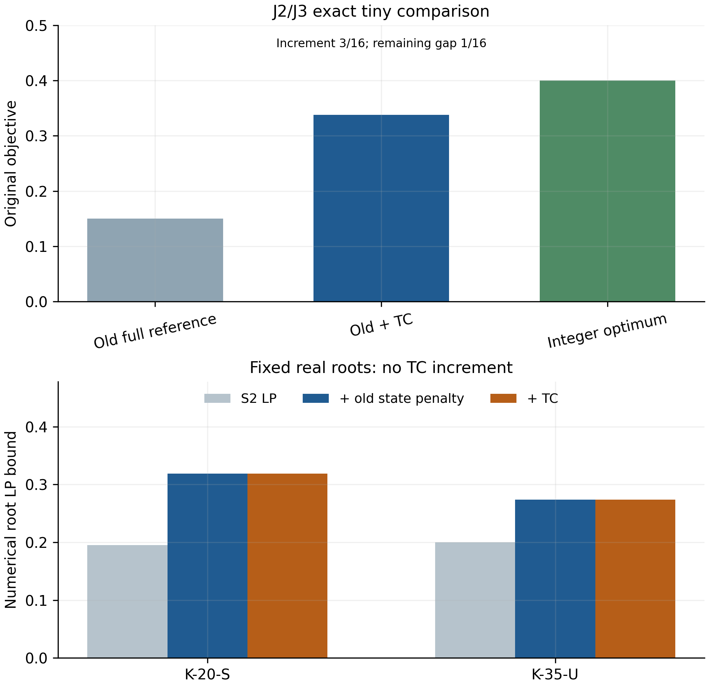

# Supplement: complete observations, mathematical comparisons and reproducibility

The current tables contain every registered position. C means a performance-eligible qualified certificate; O means open; UEV means evidence outside formal performance eligibility. OPEN runs have null certificate times. Detailed full-precision arrays, physical operations, raw lifecycle/model evidence and source identities accompany the CSV/JSON authorities. Prior evidence below keeps its original version and denominators.

## Reading and source map

- **Physical model, shared states and conditional information.** See Appendices A.1–A.9 and A.11 for exact constraints and proofs, and S167.3 for the local and canonical diagnostics. [Mathematical companion](mathematical_analysis.md) · [Conditional diagnostics](#s1673-conditional-representation-diagnostics) · [Implementation names](#s1674-historical-implementation-identity-navigation)
- **Complete methods and solver Seeds.** The breadth endpoints, paid controls and later six-input Seed cohort accompany §§4.2–4.3. [Breadth endpoints](#breadth-complete-two-sided-endpoints) · [Seed cohort and clocks](#round164-completed-finite-solver-seed-evidence) · [Saved-target availability](#all-pre-frozen-feasible-target-availability-intervals)
- **Positive-objective 50-station endpoints.** S171 gives the six inputs, all twelve arms, both gaps, physical/Native distinction, costs and interval activity behind Table 6. [50-station panel](#s171-positive-objective-50-station-configurations)
- **Mechanism and startup boundaries.** S167.2 reports matched row and full/root controls. S168 gives restricted-route-family intervals. Tables S166.1 and S170.6 preserve complete paired results for the compact-support and fixed reweighting candidates. [Controller contrasts](#s1672-detailed-am-mechanism-and-earlier-seed-interpretation) · [Route-family targets](#s168-complete-route-family-target-attainability) · [Compact-support table](#same-build-compact-support-endpoints) · [Paid initialization table](#matched-initialization-endpoints-by-role-and-seed)
- **Route time and weights.** Physical decomposition, two-sided resource gains and continuous regret bounds accompany §5. [Resource run endpoints](#positive-resource-gi-tbc-operating-points) · [Sampled weights](#objective-weights-all-methods-and-decompositions) · [Continuous bounds](#continuous-weight-archive-and-two-sided-resource-value)

The [current manuscript](manuscript.pdf) contains the six main sections and Appendices A–B. [Source manifest](../unified_exact_round172/source_manifest.json) · [Document build](../unified_exact_round172/document_build.json)

## Current detailed panel tables

Complete panel observations accompany the compact question-led main text. Shared defaults retain their actual position identities.

## Breadth: complete two-sided endpoints

| Input | P: U / L | PS: U / L | GI-TBC: U / L |
|---|---|---|---|
| K-15-S | 0.592265 / 0.527663 | 0.592265 / 0.520583 | 0.592265 / 0.592265 |
| X-15-B | 0 / 0 | 0 / 0 | 0 / 0 |
| UC-B20-B | 0.577333 / 0.577333 | 0.577333 / 0.577333 | 0.577333 / 0.577333 |
| K-20-S | 0.727702 / 0.541868 | 0.775213 / 0.541233 | 0.716807 / 0.705356 |
| K-35-U | 0.664747 / 0.335556 | 0.767457 / 0.331922 | 0.692854 / 0.565766 |
| X-35-B | 0 / 0 | 0 / 0 | 0 / 0 |
| N-B15-B | 0.250494 / 0.250494 | 0.250494 / 0.250494 | 0.250494 / 0.250494 |
| N-X15-S | 0.628986 / 0.628986 | 0.628986 / 0.628986 | 0.628986 / 0.628986 |
| N-C20-U | 0.248551 / 0.217719 | 0.252309 / 0.214733 | 0.245505 / 0.245505 |
| N-X20-B | 0 / 0 | 0 / 0 | 0 / 0 |
| N-B35-S | 0.844874 / 0.371908 | 0.486013 / 0.373343 | 0.450292 / 0.389311 |
| N-C35-B | 0 / 0 | 0 / 0 | 0 / 0 |

## Positive-resource GI-TBC operating points

| Configuration | G / \(P_{\mathrm{avg}}\) / S | Returned units | Max duration / T | Status |
|---|---|---|---|---|
| R-B20-S-T1 | 0.216444 /0.264291 /17.2599 | 0 | 0.999851 | C |
| R-B20-S-T2 | 0.0819181 /0.116555 /17.4317 | 0 | 0.999816 | C |
| R-X20-S-T1 | 0.314652 /0.330673 /14.5762 | 1 | 0.999834 | C |
| R-X20-S-T2 | 0.206001 /0.228795 /15.7226 | 0 | 0.997641 | C |
| R-B35-S-T1 | 0.285367 /0.30615 /29.2099 | 2 | 0.994109 | open |
| R-B35-S-T2 | 0.181545 /0.163098 /29.8127 | 3 | 0.996291 | open |
| R-X35-S-T1 | 0.268135 /0.324055 /28.7591 | 1 | 0.999456 | open |
| R-X35-S-T2 | 0.18255 /0.220722 /28.2238 | 0 | 0.998568 | open |

## Objective weights: all methods and decompositions

| Configuration | \(\rho\) | Method | G / \(P_{\mathrm{avg}}\) | U / L | Certificate |
|---|---|---|---|---|---|
| R-B20-S-T1 | 1 | P | 0.239416 / 0.300668 | 0.540085 / 0.358158 | open |
| R-B20-S-T1 | 1 | PS | 0.222348 / 0.264291 | 0.486639 / 0.365324 | open |
| R-B20-S-T1 | 1 | GI-TBC | 0.216444 / 0.264291 | 0.480735 / 0.480735 | C |
| R-X35-S-T2 | 1 | PS | 0.194085 / 0.210482 | 0.404567 / 0.203817 | open |
| R-X35-S-T2 | 1 | GI-TBC | 0.18255 / 0.220722 | 0.403272 / 0.210887 | open |
| R-X35-S-T2 | 1 | P | 0.205654 / 0.284863 | 0.490517 / 0.201288 | open |
| R-B20-S-T1 | 0.5 | P | 0.223002 / 0.314774 | 0.380389 / 0.229542 | open |
| R-B20-S-T1 | 0.5 | PS | 0.213456 / 0.268003 | 0.347458 / 0.240479 | open |
| R-B20-S-T1 | 0.5 | GI-TBC | 0.213456 / 0.268003 | 0.347458 / 0.331864 | open |
| R-B20-S-T1 | 2 | P | 0.232861 / 0.262064 | 0.756988 / 0.610312 | open |
| R-B20-S-T1 | 2 | PS | 0.217549 / 0.263549 | 0.744646 / 0.616106 | open |
| R-B20-S-T1 | 2 | GI-TBC | 0.217549 / 0.263549 | 0.744646 / 0.744646 | C |
| R-X35-S-T2 | 0.5 | PS | 0.136611 / 0.242041 | 0.257631 / 0.108019 | open |
| R-X35-S-T2 | 0.5 | GI-TBC | 0.137132 / 0.237386 | 0.255825 / 0.122332 | open |
| R-X35-S-T2 | 0.5 | P | 0.141354 / 0.239248 | 0.260978 / 0.108223 | open |
| R-X35-S-T2 | 2 | PS | 0.198468 / 0.206712 | 0.611892 / 0.363572 | open |
| R-X35-S-T2 | 2 | GI-TBC | 0.148459 / 0.188047 | 0.524553 / 0.388438 | open |
| R-X35-S-T2 | 2 | P | 0.203202 / 0.20862 | 0.620443 / 0.36178 | open |

## Limited Seed 1: complete main triplets

| Role | Method | Status | Own \(T_{\mathrm{cert}}\) (s) | U / L | Production (s) |
|---|---|---|---|---|---|
| K-15-S | P | open | n/a | 0.592265 /0.529115 | 571.412 |
| K-15-S | PS | open | n/a | 0.592265 /0.53228 | 571.362 |
| K-15-S | GI-TBC | C | 115.444 | 0.592265 /0.592265 | 115.444 |
| R-B20-S-T1 | P | open | n/a | 0.493224 /0.354626 | 1171.09 |
| R-B20-S-T1 | PS | open | n/a | 0.480735 /0.367482 | 1171.18 |
| R-B20-S-T1 | GI-TBC | C | 656.734 | 0.480735 /0.480735 | 656.734 |
| UC-B20-B | P | C | 314.513 | 0.577333 /0.577333 | 314.513 |
| UC-B20-B | PS | C | 125.391 | 0.577333 /0.577333 | 125.391 |
| UC-B20-B | GI-TBC | C | 4.0999 | 0.577333 /0.577333 | 4.0999 |
| K-35-U | P | open | n/a | 0.758852 /0.330574 | 2371.17 |
| K-35-U | PS | open | n/a | 0.712648 /0.335095 | 2371.03 |
| K-35-U | GI-TBC | open | n/a | 0.668358 /0.55478 | 2371 |

## Limited Seed 1 AM observations

**Seed 1 limited AM repeat**

| Role | \(\tau_{\mathrm{AM}}\) | Max gate score | Actions | Production (s) |
|---|---|---|---|---|
| K-15-S | 0.04 | 0.000356687 | native-target:1, exact-close:1 | 114.938 |
| K-15-S | 0.08 | 0.000356687 | native-target:1, exact-close:1 | 115.444 |
| K-15-S | 0.16 | 0.000356687 | native-target:1, exact-close:1 | 115.503 |
| UC-B20-B | 0.04 | 0.00031863 | split:3, native-target:1, exact-close:1 | 4.08256 |
| UC-B20-B | 0.08 | 0.00031863 | split:3, native-target:1, exact-close:1 | 4.0999 |
| UC-B20-B | 0.16 | 0.00031863 | split:3, native-target:1, exact-close:1 | 4.0657 |

## Seed 0 main mechanism comparison

| Contrast | Role | Root LP optimum | Production (s) | Status |
|---|---|---|---|---|
| GI-TBC | K-15-S | 0.167137 | 112.769 | C |
| GI-TBC-R | K-15-S | 0.167137 | 112.649 | C |
| minus A/B | K-15-S | 0.167016 | 128.325 | C |
| minus \(C_R\) | K-15-S | 0.167137 | 75.1064 | C |
| minus \(C_G\) | K-15-S | 0.167137 | 143.15 | C |
| GI-TBC | UC-B20-B | 0.479076 | 4.14897 | C |
| GI-TBC-R | UC-B20-B | 0.479076 | 1.87206 | C |
| minus A/B | UC-B20-B | 0.479076 | 4.18619 | C |
| minus \(C_R\) | UC-B20-B | 0.479076 | 4.91775 | C |
| minus \(C_G\) | UC-B20-B | 0.479076 | 3.34912 | C |
| GI-TBC | K-20-S | 0.195149 | 1172.19 | open |
| GI-TBC-R | K-20-S | 0.195149 | 1172.22 | open |
| minus A/B | K-20-S | 0.193825 | 1172.12 | open |
| minus \(C_R\) | K-20-S | 0.195149 | 1171.91 | open |
| minus \(C_G\) | K-20-S | 0.195149 | 1171.96 | open |
| GI-TBC | K-35-U | 0.200178 | 2371.15 | open |
| GI-TBC-R | K-35-U | 0.200178 | 2370.99 | open |
| minus A/B | K-35-U | 0.200178 | 2372.38 | open |
| minus \(C_R\) | K-35-U | 0.200178 | 2370.97 | open |
| minus \(C_G\) | K-35-U | 0.200178 | 2370.98 | open |

## Seed 1 limited mechanism repeat

| Contrast | Role | Root LP optimum | Production (s) | Status |
|---|---|---|---|---|
| GI-TBC | K-15-S | 0.167137 | 115.444 | C |
| GI-TBC-R | K-15-S | 0.167137 | 113.58 | C |
| minus A/B | K-15-S | 0.167016 | 93.6997 | C |
| minus \(C_R\) | K-15-S | 0.167137 | 132.475 | C |
| minus \(C_G\) | K-15-S | 0.167137 | 99.6006 | C |
| GI-TBC | UC-B20-B | 0.479076 | 4.0999 | C |
| GI-TBC-R | UC-B20-B | 0.479076 | 1.95408 | C |
| minus A/B | UC-B20-B | 0.479076 | 4.46646 | C |
| minus \(C_R\) | UC-B20-B | 0.479076 | 4.60284 | C |
| minus \(C_G\) | UC-B20-B | 0.479076 | 2.95877 | C |

| Position / study | Input / Seed | Method | Status | U | L | Production / verification / total s |
|---|---|---|---|---|---|---|
| 1 /B1 | K-15-S /0 | P | O | 0.592265 | 0.527663 | 571.702 /142.568 /714.27 |
| 2 /B1 | K-15-S /0 | PS | O | 0.592265 | 0.520583 | 571.245 /2.27522 /573.52 |
| 3 /B1 | K-15-S /0 | GI-TBC | C | 0.592265 | 0.592265 | 112.769 /3.77037 /116.54 |
| 4 /B1 | X-15-B /0 | PS | C | 0 | 0 | 2.46104 /0.365936 /2.82698 |
| 5 /B1 | X-15-B /0 | GI-TBC | C | 0 | 0 | 2.55662 /0.645774 /3.2024 |
| 6 /B1 | X-15-B /0 | P | C | 0 | 0 | 7.0233 /0.248991 /7.2723 |
| 7 /B1 | UC-B20-B /0 | GI-TBC | C | 0.577333 | 0.577333 | 4.14897 /2.347 /6.49597 |
| 8 /B1 | UC-B20-B /0 | P | C | 0.577333 | 0.577333 | 315.403 /1.24106 /316.644 |
| 9 /B1 | UC-B20-B /0 | PS | C | 0.577333 | 0.577333 | 236.091 /1.30849 /237.399 |
| 10 /B1 | K-20-S /0 | P | O | 0.727702 | 0.541868 | 1171.16 /1.44439 /1172.61 |
| 11 /B1 | K-20-S /0 | PS | O | 0.775213 | 0.541233 | 1171.21 /1.5361 /1172.74 |
| 12 /B1 | K-20-S /0 | GI-TBC | O | 0.716807 | 0.705356 | 1172.19 /61.1438 /1233.33 |
| 13 /B1 | K-35-U /0 | PS | O | 0.767457 | 0.331922 | 2371 /1.72964 /2372.73 |
| 14 /B1 | K-35-U /0 | GI-TBC | O | 0.692854 | 0.565766 | 2371.15 /3.80005 /2374.95 |
| 15 /B1 | K-35-U /0 | P | O | 0.664747 | 0.335556 | 2371.06 /0.722418 /2371.78 |
| 16 /B1 | X-35-B /0 | GI-TBC | C | 0 | 0 | 17.9046 /3.63609 /21.5407 |
| 17 /B1 | X-35-B /0 | P | C | 0 | 0 | 158.585 /0.596178 /159.181 |
| 18 /B1 | X-35-B /0 | PS | C | 0 | 0 | 7.45014 /1.38966 /8.8398 |
| 19 /B1 | N-B15-B /0 | P | C | 0.250494 | 0.250494 | 279.663 /1.67388 /281.337 |
| 20 /B1 | N-B15-B /0 | PS | C | 0.250494 | 0.250494 | 306.307 /1.67192 /307.979 |
| 21 /B1 | N-B15-B /0 | GI-TBC | C | 0.250494 | 0.250494 | 24.0684 /0.790358 /24.8587 |
| 22 /B1 | N-X15-S /0 | PS | C | 0.628986 | 0.628986 | 401.931 /3.09583 /405.027 |
| 23 /B1 | N-X15-S /0 | GI-TBC | C | 0.628986 | 0.628986 | 10.2683 /0.739441 /11.0077 |
| 24 /B1 | N-X15-S /0 | P | C | 0.628986 | 0.628986 | 538.867 /3.46182 /542.329 |
| 25 /B1 | N-C20-U /0 | GI-TBC | C | 0.245505 | 0.245505 | 265.529 /4.06871 /269.598 |
| 26 /B1 | N-C20-U /0 | P | O | 0.248551 | 0.217719 | 1171.18 /1.83559 /1173.01 |
| 27 /B1 | N-C20-U /0 | PS | O | 0.252309 | 0.214733 | 1171.14 /11.7494 /1182.89 |
| 28 /B1 | N-X20-B /0 | P | C | 0 | 0 | 24.0892 /0.306578 /24.3958 |
| 29 /B1 | N-X20-B /0 | PS | C | 0 | 0 | 6.08515 /0.486901 /6.57205 |
| 30 /B1 | N-X20-B /0 | GI-TBC | C | 0 | 0 | 7.45537 /1.0786 /8.53397 |
| 31 /B1 | N-B35-S /0 | PS | O | 0.486013 | 0.373343 | 2371.01 /1.74441 /2372.76 |
| 32 /B1 | N-B35-S /0 | GI-TBC | O | 0.450292 | 0.389311 | 2370.98 /3.84726 /2374.82 |
| 33 /B1 | N-B35-S /0 | P | O | 0.844874 | 0.371908 | 2371.11 /0.661396 /2371.77 |
| 34 /B1 | N-C35-B /0 | GI-TBC | C | 0 | 0 | 59.6234 /3.71224 /63.3357 |
| 35 /B1 | N-C35-B /0 | P | C | 0 | 0 | 397.807 /0.653354 /398.461 |
| 36 /B1 | N-C35-B /0 | PS | C | 0 | 0 | 154.668 /1.42879 /156.097 |
| 37 /B2 | R-B20-S-T1 /0 | P | O | 0.540085 | 0.358158 | 1171.18 /0.980204 /1172.16 |
| 38 /B2 | R-B20-S-T1 /0 | PS | O | 0.486639 | 0.365324 | 1171.29 /1.3497 /1172.64 |
| 39 /B2 | R-B20-S-T1 /0 | GI-TBC | C | 0.480735 | 0.480735 | 784.143 /18.1789 /802.322 |
| 40 /B2 | R-B20-S-T2 /0 | PS | O | 0.208465 | 0.146203 | 1171.14 /1.19298 /1172.33 |
| 41 /B2 | R-B20-S-T2 /0 | GI-TBC | C | 0.198473 | 0.198473 | 538.603 /5.73802 /544.341 |
| 42 /B2 | R-B20-S-T2 /0 | P | O | 0.269095 | 0.141262 | 1171.19 /0.766113 /1171.96 |
| 43 /B2 | R-X20-S-T1 /0 | GI-TBC | C | 0.645325 | 0.645325 | 20.5065 /1.08205 /21.5885 |
| 44 /B2 | R-X20-S-T1 /0 | P | O | 0.645325 | 0.589197 | 1171.57 /5.00163 /1176.57 |
| 45 /B2 | R-X20-S-T1 /0 | PS | O | 0.645325 | 0.590359 | 1171.69 /4.9291 /1176.62 |
| 46 /B2 | R-X20-S-T2 /0 | P | O | 0.476731 | 0.291101 | 1171.1 /0.410932 /1171.51 |
| 47 /B2 | R-X20-S-T2 /0 | PS | O | 0.51972 | 0.28447 | 1171.18 /0.839506 /1172.02 |
| 48 /B2 | R-X20-S-T2 /0 | GI-TBC | C | 0.434796 | 0.434796 | 337.305 /2.72864 /340.034 |
| 49 /B2 | R-B35-S-T1 /0 | PS | O | 0.631765 | 0.334519 | 2371.04 /1.73506 /2372.77 |
| 50 /B2 | R-B35-S-T1 /0 | GI-TBC | O | 0.591518 | 0.455904 | 2376.07 /5.60112 /2381.67 |
| 51 /B2 | R-B35-S-T1 /0 | P | O | 0.606311 | 0.337002 | 2372.2 /0.733367 /2372.93 |
| 52 /B2 | R-B35-S-T2 /0 | GI-TBC | O | 0.344643 | 0.218986 | 2371.04 /3.76611 /2374.8 |
| 53 /B2 | R-B35-S-T2 /0 | P | O | 0.471637 | 0.154376 | 2371.07 /0.692204 /2371.77 |
| 54 /B2 | R-B35-S-T2 /0 | PS | O | 0.438291 | 0.155416 | 2371.03 /1.71384 /2372.75 |
| 55 /B2 | R-X35-S-T1 /0 | P | O | 0.655713 | 0.296009 | 2371.09 /0.694498 /2371.79 |
| 56 /B2 | R-X35-S-T1 /0 | PS | O | 0.593231 | 0.298839 | 2371.01 /4.60794 /2375.62 |
| 57 /B2 | R-X35-S-T1 /0 | GI-TBC | O | 0.59219 | 0.463358 | 2379.12 /3.67396 /2382.79 |
| 58 /B2 | R-X35-S-T2 /0 | PS | O | 0.404567 | 0.203817 | 2370.99 /1.72903 /2372.71 |
| 59 /B2 | R-X35-S-T2 /0 | GI-TBC | O | 0.403272 | 0.210887 | 2371.09 /3.72914 /2374.82 |
| 60 /B2 | R-X35-S-T2 /0 | P | O | 0.490517 | 0.201288 | 2371.02 /0.664748 /2371.68 |
| 61 /B3 | R-B20-S-T1-rho0.5 /0 | P | O | 0.380389 | 0.229542 | 1171.17 /0.87512 /1172.05 |
| 62 /B3 | R-B20-S-T1-rho0.5 /0 | PS | O | 0.347458 | 0.240479 | 1171.16 /1.17614 /1172.33 |
| 63 /B3 | R-B20-S-T1-rho0.5 /0 | GI-TBC | O | 0.347458 | 0.331864 | 1171.29 /5.89166 /1177.18 |
| 64 /B3 | R-B20-S-T1-rho2 /0 | P | O | 0.756988 | 0.610312 | 1171.15 /1.29992 /1172.45 |
| 65 /B3 | R-B20-S-T1-rho2 /0 | PS | O | 0.744646 | 0.616106 | 1171.34 /1.7534 /1173.1 |
| 66 /B3 | R-B20-S-T1-rho2 /0 | GI-TBC | C | 0.744646 | 0.744646 | 309.113 /8.59128 /317.704 |
| 67 /B3 | R-X35-S-T2-rho0.5 /0 | PS | O | 0.257631 | 0.108019 | 2371.05 /1.73565 /2372.78 |
| 68 /B3 | R-X35-S-T2-rho0.5 /0 | GI-TBC | O | 0.255825 | 0.122332 | 2371.1 /3.68103 /2374.78 |
| 69 /B3 | R-X35-S-T2-rho0.5 /0 | P | O | 0.260978 | 0.108223 | 2371.1 /0.679667 /2371.78 |
| 70 /B3 | R-X35-S-T2-rho2 /0 | PS | O | 0.611892 | 0.363572 | 2371.03 /1.71701 /2372.74 |
| 71 /B3 | R-X35-S-T2-rho2 /0 | GI-TBC | O | 0.524553 | 0.388438 | 2370.96 /3.7818 /2374.74 |
| 72 /B3 | R-X35-S-T2-rho2 /0 | P | O | 0.620443 | 0.36178 | 2371.09 /0.700077 /2371.79 |
| 73 /C1 | K-15-S /0 | AM .04 | C | 0.592265 | 0.592265 | 113.062 /3.77321 /116.835 |
| 74 /C1 | K-15-S /0 | AM .16 | C | 0.592265 | 0.592265 | 113.315 /3.74081 /117.056 |
| 75 /C1 | K-20-S /0 | AM .04 | O | 0.716807 | 0.705366 | 1172.26 /61.3126 /1233.57 |
| 76 /C1 | K-20-S /0 | AM .16 | O | 0.716807 | 0.705386 | 1172.26 /62.835 /1235.09 |
| 77 /C1 | UC-B20-B /0 | AM .04 | C | 0.577333 | 0.577333 | 4.21966 /2.27593 /6.49559 |
| 78 /C1 | UC-B20-B /0 | AM .16 | C | 0.577333 | 0.577333 | 4.08117 /2.26691 /6.34809 |
| 79 /C1 | K-35-U /0 | AM .04 | O | 0.692854 | 0.565893 | 2371.02 /3.76777 /2374.79 |
| 80 /C1 | K-35-U /0 | AM .16 | O | 0.692854 | 0.566106 | 2371.03 /3.79054 /2374.82 |
| 81 /C2 | K-15-S /0 | GI-TBC-R | C | 0.592265 | 0.592265 | 112.649 /3.34597 /115.995 |
| 82 /C2 | K-15-S /0 | minus A/B | C | 0.592265 | 0.592265 | 128.325 /3.61312 /131.938 |
| 83 /C2 | K-15-S /0 | minus \(C_R\) | C | 0.592265 | 0.592265 | 75.1064 /2.39997 /77.5064 |
| 84 /C2 | K-15-S /0 | minus \(C_G\) | C | 0.592265 | 0.592265 | 143.15 /4.47363 /147.624 |
| 85 /C2 | UC-B20-B /0 | minus A/B | C | 0.577333 | 0.577333 | 4.18619 /2.24829 /6.43448 |
| 86 /C2 | UC-B20-B /0 | minus \(C_R\) | C | 0.577333 | 0.577333 | 4.91775 /2.28857 /7.20632 |
| 87 /C2 | UC-B20-B /0 | minus \(C_G\) | C | 0.577333 | 0.577333 | 3.34912 /1.70325 /5.05237 |
| 88 /C2 | UC-B20-B /0 | GI-TBC-R | C | 0.577333 | 0.577333 | 1.87206 /0.407894 /2.27996 |
| 89 /C2 | K-20-S /0 | minus \(C_R\) | O | 0.716807 | 0.703444 | 1171.91 /36.6745 /1208.59 |
| 90 /C2 | K-20-S /0 | minus \(C_G\) | O | 0.716807 | 0.705296 | 1171.96 /43.4998 /1215.46 |
| 91 /C2 | K-20-S /0 | GI-TBC-R | O | 0.716807 | 0.706405 | 1172.22 /61.8919 /1234.12 |
| 92 /C2 | K-20-S /0 | minus A/B | O | 0.716807 | 0.704128 | 1172.12 /41.7358 /1213.86 |
| 93 /C2 | K-35-U /0 | minus \(C_G\) | O | 0.666262 | 0.55098 | 2370.98 /2.63835 /2373.62 |
| 94 /C2 | K-35-U /0 | GI-TBC-R | O | 0.692854 | 0.566106 | 2370.99 /6.52797 /2377.52 |
| 95 /C2 | K-35-U /0 | minus A/B | O | 0.654639 | 0.564355 | 2372.38 /3.79162 /2376.17 |
| 96 /C2 | K-35-U /0 | minus \(C_R\) | O | 0.689763 | 0.536996 | 2370.97 /3.56291 /2374.53 |
| 97 /D2-main | K-15-S /1 | P | O | 0.592265 | 0.529115 | 571.412 /3.04329 /574.455 |
| 98 /D2-main | K-15-S /1 | PS | O | 0.592265 | 0.53228 | 571.362 /3.10724 /574.469 |
| 99 /D2-main | K-15-S /1 | GI-TBC | C | 0.592265 | 0.592265 | 115.444 /4.17556 /119.62 |
| 100 /D2-main | UC-B20-B /1 | PS | C | 0.577333 | 0.577333 | 125.391 /1.15372 /126.545 |
| 101 /D2-main | UC-B20-B /1 | GI-TBC | C | 0.577333 | 0.577333 | 4.0999 /2.28866 /6.38856 |
| 102 /D2-main | UC-B20-B /1 | P | C | 0.577333 | 0.577333 | 314.513 /1.42972 /315.943 |
| 103 /D2-main | R-B20-S-T1 /1 | GI-TBC | C | 0.480735 | 0.480735 | 656.734 /19.5677 /676.302 |
| 104 /D2-main | R-B20-S-T1 /1 | P | O | 0.493224 | 0.354626 | 1171.09 /0.941944 /1172.03 |
| 105 /D2-main | R-B20-S-T1 /1 | PS | O | 0.480735 | 0.367482 | 1171.18 /1.33337 /1172.51 |
| 106 /D2-main | K-35-U /1 | P | O | 0.758852 | 0.330574 | 2371.17 /0.731285 /2371.91 |
| 107 /D2-main | K-35-U /1 | PS | O | 0.712648 | 0.335095 | 2371.03 /1.7395 /2372.77 |
| 108 /D2-main | K-35-U /1 | GI-TBC | O | 0.668358 | 0.55478 | 2371 /3.76418 /2374.76 |
| 109 /D2-AM | K-15-S /1 | AM .04 | C | 0.592265 | 0.592265 | 114.938 /4.23062 /119.169 |
| 110 /D2-AM | K-15-S /1 | AM .16 | C | 0.592265 | 0.592265 | 115.503 /4.18745 /119.691 |
| 115 /D2-AM | UC-B20-B /1 | AM .04 | C | 0.577333 | 0.577333 | 4.08256 /2.29383 /6.37639 |
| 116 /D2-AM | UC-B20-B /1 | AM .16 | C | 0.577333 | 0.577333 | 4.0657 /2.28894 /6.35465 |
| 111 /D2-mechanism | K-15-S /1 | GI-TBC-R | C | 0.592265 | 0.592265 | 113.58 /3.78707 /117.367 |
| 112 /D2-mechanism | K-15-S /1 | minus A/B | C | 0.592265 | 0.592265 | 93.6997 /2.95424 /96.654 |
| 113 /D2-mechanism | K-15-S /1 | minus \(C_R\) | C | 0.592265 | 0.592265 | 132.475 /4.49508 /136.97 |
| 114 /D2-mechanism | K-15-S /1 | minus \(C_G\) | C | 0.592265 | 0.592265 | 99.6006 /2.39181 /101.992 |
| 117 /D2-mechanism | UC-B20-B /1 | GI-TBC-R | C | 0.577333 | 0.577333 | 1.95408 /0.416184 /2.37026 |
| 118 /D2-mechanism | UC-B20-B /1 | minus A/B | C | 0.577333 | 0.577333 | 4.46646 /2.28714 /6.7536 |
| 119 /D2-mechanism | UC-B20-B /1 | minus \(C_R\) | C | 0.577333 | 0.577333 | 4.60284 /2.24667 /6.8495 |
| 120 /D2-mechanism | UC-B20-B /1 | minus \(C_G\) | C | 0.577333 | 0.577333 | 2.95877 /1.70396 /4.66273 |

## Historical breadth/resource study: detailed interpretation

All 120 registered method observations appear above. The original
[fixed report](https://github.com/yifanXovo/TailoredExact/blob/de01e8fb27a954d031abac5fe99442d6c8d29d44/results/unified_exact_round137/final_report.md)
retains the study's timing, native-effort, action and eligibility diagnostics.
The current main text integrates its conclusions with later evidence without
pooling the study denominators.

## Preserved historical supplement (R135 observations retained; headings nested and figure links pinned)

### Supplement: complete evidence and formulation analysis

This supplement retains complete numerical observations and separates evidence versions. C means a qualified certificate; O means open. No open cap is substituted for a certification time. Displayed bounds are original-objective values; gap is signed U-L. Full-precision CSV/JSON files and finite raw carriers are the numerical authorities.

#### S1. R134 final implementation: every method position

| Position / problem | Seed / repeat | method | proof | U | L | production seconds |
|---|---|---|---|---|---|---|
| C01 SM-B10-B | 0 / 1 | P | native/outer | 0.5358910752996684 | 0.53589107529966828 | 1.641208466491662 |
| C02 SM-B10-B | 0 / 1 | S2 | native/outer | 0.5358910752996684 | 0.5358910752996684 | 0.85733476874884218 |
| C03 SM-B10-B | 0 / 2 | S2 | native/outer | 0.5358910752996684 | 0.5358910752996684 | 0.7744989802595228 |
| C04 SM-B10-B | 0 / 2 | P | native/outer | 0.5358910752996684 | 0.53589107529966828 | 1.0408740653656423 |
| C05 SM-B10-B | 1 / 1 | S2 | native/outer | 0.5358910752996684 | 0.5358910752996684 | 0.80483507376629859 |
| C06 SM-B10-B | 1 / 1 | P | native/outer | 0.5358910752996684 | 0.5358910752996684 | 1.0432951427064836 |
| C07 SM-B10-B | 1 / 2 | P | native/outer | 0.5358910752996684 | 0.5358910752996684 | 1.0162093546241522 |
| C08 SM-B10-B | 1 / 2 | S2 | native/outer | 0.5358910752996684 | 0.5358910752996684 | 0.77312812907621264 |
| C09 K-15-S | 0 / 1 | P | O | 0.59226488225608254 | 0.52741476565912426 | 571.09011773474049 |
| C10 K-15-S | 0 / 1 | S2 | native/outer | 0.59226488225608254 | 0.59226487923851112 | 112.93495272356085 |
| C11 K-15-S | 0 / 1 | PS | O | 0.59226488225608254 | 0.52021552438678098 | 571.01766042027157 |
| C12 K-15-S | 1 / 1 | PS | O | 0.59226488225608254 | 0.53187261241580452 | 571.17800757987425 |
| C13 K-15-S | 1 / 1 | S2 | native/outer | 0.59226488225608254 | 0.59226488225605578 | 115.02057574014179 |
| C14 K-15-S | 1 / 1 | P | O | 0.59226488225608254 | 0.52890061340465544 | 571.12909410567954 |
| C15 UC-B20-B | 0 / 1 | P | native/outer | 0.57733306997029277 | 0.57733306997029266 | 319.06004932010546 |
| C16 UC-B20-B | 0 / 1 | S2 | native/outer | 0.57733306997029277 | 0.57733306997029255 | 3.9657152621075511 |
| C17 UC-B20-B | 1 / 1 | S2 | native/outer | 0.57733306997029277 | 0.57733306997029255 | 3.8206901535158977 |
| C18 UC-B20-B | 1 / 1 | P | native/outer | 0.57733306997029277 | 0.57733306997029232 | 318.37744219752494 |
| C19 K-35-U | 0 / 1 | P | O | 0.66474660181829859 | 0.33550123769342638 | 2370.8627517689019 |
| C20 K-35-U | 0 / 1 | S2 | O | 0.69285435863131362 | 0.56494150394342635 | 2370.941779125249 |
| C21 K-35-U | 1 / 1 | S2 | O | 0.66835825474454524 | 0.55427196382355215 | 2370.7849446644541 |
| C22 K-35-U | 1 / 1 | P | O | 0.75885159764783316 | 0.33054832396382849 | 2370.8440815587528 |
| C23 X-35-U | 0 / 1 | P | O | 0.016264564336372848 | 6.9388939039072284e-18 | 2370.8640295162331 |
| C24 X-35-U | 0 / 1 | S2 | independent zero | 0 | 0 | 120.2566853313474 |
| C25 X-35-U | 1 / 1 | S2 | independent zero | 0 | 0 | 452.84144015004858 |
| C26 X-35-U | 1 / 1 | P | independent zero | 0 | 0 | 2064.9493677320424 |
| C27 X-35-B | 0 / 1 | P | independent zero | 0 | 0 | 157.95417694339994 |
| C28 X-35-B | 0 / 1 | PS | independent zero | 0 | 0 | 7.2505462232511491 |
| C29 X-35-B | 0 / 1 | S2 | independent zero | 0 | 0 | 17.606032623560168 |
| C30 X-35-B | 1 / 1 | S2 | independent zero | 0 | 0 | 18.27744961460121 |
| C31 X-35-B | 1 / 1 | PS | independent zero | 0 | 0 | 7.1957794689806178 |
| C32 X-35-B | 1 / 1 | P | independent zero | 0 | 0 | 50.150547508616 |

#### S2. R134 complete cost and paired outcomes

| Position | production | postverification | total | certification |
|---|---|---|---|---|
| C01 | 1.641208466491662 | 46.645632400061004 | 48.286840866552666 | 1.641208466491662 |
| C02 | 0.85733476874884218 | 0.23014050000347197 | 1.0874752687523142 | 0.85733476874884218 |
| C03 | 0.7744989802595228 | 0.22661289991810918 | 1.001111880177632 | 0.7744989802595228 |
| C04 | 1.0408740653656423 | 0.2392841000109911 | 1.2801581653766334 | 1.0408740653656423 |
| C05 | 0.80483507376629859 | 0.22692279994953424 | 1.0317578737158328 | 0.80483507376629859 |
| C06 | 1.0432951427064836 | 0.22571640007663518 | 1.2690115427831188 | 1.0432951427064836 |
| C07 | 1.0162093546241522 | 0.23388549999799579 | 1.250094854622148 | 1.0162093546241522 |
| C08 | 0.77312812907621264 | 0.22831899998709559 | 1.0014471290633082 | 0.77312812907621264 |
| C09 | 571.09011773474049 | 2.4273113000672311 | 573.51742903480772 | - |
| C10 | 112.93495272356085 | 3.7583510000258684 | 116.69330372358672 | 112.93495272356085 |
| C11 | 571.01766042027157 | 2.2171896999934688 | 573.23485012026504 | - |
| C12 | 571.17800757987425 | 3.1282583000138402 | 574.30626587988809 | - |
| C13 | 115.02057574014179 | 4.0986800999380648 | 119.11925584007986 | 115.02057574014179 |
| C14 | 571.12909410567954 | 2.9784281000029296 | 574.10752220568247 | - |
| C15 | 319.06004932010546 | 1.2434149000328034 | 320.30346422013827 | 319.06004932010546 |
| C16 | 3.9657152621075511 | 2.202236800105311 | 6.1679520622128621 | 3.9657152621075511 |
| C17 | 3.8206901535158977 | 2.2351581000257283 | 6.055848253541626 | 3.8206901535158977 |
| C18 | 318.37744219752494 | 1.4310659999027848 | 319.80850819742773 | 318.37744219752494 |
| C19 | 2370.8627517689019 | 0.7067805000115186 | 2371.5695322689135 | - |
| C20 | 2370.941779125249 | 3.6650486000580713 | 2374.6068277253071 | - |
| C21 | 2370.7849446644541 | 3.6163409999571741 | 2374.4012856644113 | - |
| C22 | 2370.8440815587528 | 0.71036210004240274 | 2371.5544436587952 | - |
| C23 | 2370.8640295162331 | 0.59006960003171116 | 2371.4540991162648 | - |
| C24 | 120.2566853313474 | 3.4503352000610903 | 123.70702053140849 | 120.2566853313474 |
| C25 | 452.84144015004858 | 3.4633971999865025 | 456.30483735003509 | 452.84144015004858 |
| C26 | 2064.9493677320424 | 0.59091300005093217 | 2065.5402807320934 | 2064.9493677320424 |
| C27 | 157.95417694339994 | 0.59015209996141493 | 158.54432904336136 | 157.95417694339994 |
| C28 | 7.2505462232511491 | 1.3739650999195874 | 8.6245113231707364 | 7.2505462232511491 |
| C29 | 17.606032623560168 | 3.5490938000148162 | 21.155126423574984 | 17.606032623560168 |
| C30 | 18.27744961460121 | 3.5100391999585554 | 21.787488814559765 | 18.27744961460121 |
| C31 | 7.1957794689806178 | 1.3705275000538677 | 8.5663069690344855 | 7.1957794689806178 |
| C32 | 50.150547508616 | 0.58718589995987713 | 50.737733408575878 | 50.150547508616 |

| Problem / Seed / repeat | comparison | class | direction | substantive | S2/control cert seconds |
|---|---|---|---|---|---|
| SM-B10-B / 0 / 1 | S2/P | BOTH_CERTIFIED | Win | False | 0.85733476874884218 / 1.641208466491662 |
| SM-B10-B / 0 / 2 | S2/P | BOTH_CERTIFIED | Win | False | 0.7744989802595228 / 1.0408740653656423 |
| SM-B10-B / 1 / 1 | S2/P | BOTH_CERTIFIED | Win | False | 0.80483507376629859 / 1.0432951427064836 |
| SM-B10-B / 1 / 2 | S2/P | BOTH_CERTIFIED | Win | False | 0.77312812907621264 / 1.0162093546241522 |
| K-15-S / 0 / 1 | S2/P | LEFT_ONLY_CERTIFIED | Win | - | 112.93495272356085 / - |
| K-15-S / 0 / 1 | S2/PS | LEFT_ONLY_CERTIFIED | Win | - | 112.93495272356085 / - |
| K-15-S / 1 / 1 | S2/P | LEFT_ONLY_CERTIFIED | Win | - | 115.02057574014179 / - |
| K-15-S / 1 / 1 | S2/PS | LEFT_ONLY_CERTIFIED | Win | - | 115.02057574014179 / - |
| UC-B20-B / 0 / 1 | S2/P | BOTH_CERTIFIED | Win | True | 3.9657152621075511 / 319.06004932010546 |
| UC-B20-B / 1 / 1 | S2/P | BOTH_CERTIFIED | Win | True | 3.8206901535158977 / 318.37744219752494 |
| K-35-U / 0 / 1 | S2/P | BOTH_OPEN | UNDETERMINED | - | - / - |
| K-35-U / 1 / 1 | S2/P | BOTH_OPEN | UNDETERMINED | - | - / - |
| X-35-U / 0 / 1 | S2/P | LEFT_ONLY_CERTIFIED | Win | - | 120.2566853313474 / - |
| X-35-U / 1 / 1 | S2/P | BOTH_CERTIFIED | Win | True | 452.84144015004858 / 2064.9493677320424 |
| X-35-B / 0 / 1 | S2/P | BOTH_CERTIFIED | Win | True | 17.606032623560168 / 157.95417694339994 |
| X-35-B / 0 / 1 | S2/PS | BOTH_CERTIFIED | Lose | True | 17.606032623560168 / 7.2505462232511491 |
| X-35-B / 1 / 1 | S2/P | BOTH_CERTIFIED | Win | True | 18.27744961460121 / 50.150547508616 |
| X-35-B / 1 / 1 | S2/PS | BOTH_CERTIFIED | Lose | True | 18.27744961460121 / 7.1957794689806178 |

Every adverse direction is retained. In particular X-35-B favors independently paid-start compact at both Seeds. R134 C01 had one failed postreader metadata access, repaired read-only using the same sealed native run. Its real verification delay remains in the costs. Native-source rejection remains visible even when an independent zero argument certifies the original problem.

#### S3. Six within-instance weight points

| Problem | lambda | effective rho | G | P average | F | U-L | certificate |
|---|---|---|---|---|---|---|---|
| K-15-S | 0.074999999999999997 | 0.71050282499999995 | 0.20236968415399592 | 0.27670203678631405 | 0.39896726297392598 | 5.5511151231257827e-16 | True |
| K-15-S | 0.14999999999999999 | 1.4210056499999999 | 0.22214662764652537 | 0.26046219774675566 | 0.59226488225608254 | 3.017571414964948e-09 | True |
| K-15-S | 0.29999999999999999 | 2.8420112999999998 | 0.22543269240189592 | 0.25858836875043245 | 0.96034375843919173 | 2.2204460492503131e-16 | True |
| UC-B20-B | 0.074999999999999997 | 0.88724999999999998 | 0.17083306997029268 | 0.22907861369399835 | 0.37408306997029273 | 1.1102230246251565e-16 | True |
| UC-B20-B | 0.14999999999999999 | 1.7745 | 0.17083306997029268 | 0.22907861369399835 | 0.57733306997029277 | 2.2204460492503131e-16 | True |
| UC-B20-B | 0.29999999999999999 | 3.5489999999999999 | 0.17083306997029268 | 0.22907861369399835 | 0.98383306997029274 | 4.4408920985006262e-16 | True |

The same-feasible-set relations use accepted original-objective errors. Station inventories, target-under/equal/over counts, every vehicle operation, returns, prefix peaks and durations remain in the fixed R134 operations tables. No new weight run is added here.

#### S4. AP: preregistration, every entered position and stage decision

The plan fixes seven inputs, 16 pairs and 32 arms: ten first-stage arms with 8,760 cap-seconds and 22 conditional arms with 14,760 cap-seconds. The two methods use the same PE and complete S2 algorithm; only the AP flag differs. Seeds, repeat orders, caps and inputs are fixed in experiment_plan.json and both matrix manifests before results. D13 uses the original physical input and T=3,600; historical subinterval times are not new whole-method controls.

Both preregistered stages were entered and all 32 positions completed, giving 16 matched pairs across seven known structural/protection inputs. The first-stage decision used all ten sealed positions and their original-objective endpoint signal. No position, Seed, order or cap was replaced after observing outcomes. The plan retained 8,760 plus 14,760 cap-seconds; actual costs are reported separately. Every ordinary adverse and open observation remains in the evidence.

| Position / problem | Seed / repeat | variant | C/O | U | L | U-L | production |
|---|---|---|---|---|---|---|---|
| C01 SM-B10-B | 0 / 1 | S2 | C | 0.5358910752996684 | 0.5358910752996684 | 0 | 1.1886323710205033 |
| C02 SM-B10-B | 0 / 1 | AP | C | 0.5358910752996684 | 0.5358910752996684 | 0 | 0.81220612581819296 |
| C03 SM-B10-B | 0 / 2 | AP | C | 0.5358910752996684 | 0.5358910752996684 | 0 | 0.82246625667903572 |
| C04 SM-B10-B | 0 / 2 | S2 | C | 0.5358910752996684 | 0.5358910752996684 | 0 | 0.86343272833619267 |
| C05 K-20-S | 0 / 1 | S2 | O | 0.7168065462777502 | 0.70532595601069703 | 0.01148059026705317 | 1171.9802716831909 |
| C06 K-20-S | 0 / 1 | AP | O | 0.7168065462777502 | 0.70613521607543916 | 0.010671330202311036 | 1172.0158158859704 |
| C07 K-35-U | 0 / 1 | AP | O | 0.65367124566222801 | 0.55891060264955894 | 0.094760643012669066 | 2370.8042844543234 |
| C08 K-35-U | 0 / 1 | S2 | O | 0.69285435863131362 | 0.56597614196525814 | 0.12687821666605548 | 2370.7419885438867 |
| C09 R55-D13 | 0 / 1 | S2 | O | 2.4434031919431991 | 2.3928286548136919 | 0.050574537129507213 | 570.91426332644187 |
| C10 R55-D13 | 0 / 1 | AP | O | 2.4434031919431991 | 2.3932844224266034 | 0.050118769516595663 | 570.77328741503879 |
| D01 K-20-S | 1 / 1 | AP | O | 0.7168065462777502 | 0.70622720213382739 | 0.010579344143922809 | 1171.9176525182556 |
| D02 K-20-S | 1 / 1 | S2 | O | 0.7168065462777502 | 0.70163548467172332 | 0.015171061606026881 | 1171.7550542864483 |
| D03 K-35-U | 1 / 1 | S2 | O | 0.66835825474454524 | 0.55479973409307148 | 0.11355852065147376 | 2370.8416610131972 |
| D04 K-35-U | 1 / 1 | AP | O | 0.65083560829350728 | 0.54039985993809458 | 0.1104357483554127 | 2370.9208790343255 |
| D05 R55-D13 | 1 / 1 | AP | O | 2.4434031919431991 | 2.3913419209507909 | 0.052061270992408204 | 570.78703252295963 |
| D06 R55-D13 | 1 / 1 | S2 | O | 2.4434031919431991 | 2.3976671263450426 | 0.045736065598156461 | 570.72953421249986 |
| D07 K-15-S | 0 / 1 | S2 | C | 0.59226488225608254 | 0.59226487923851112 | 3.017571414964948e-09 | 112.11311539378949 |
| D08 K-15-S | 0 / 1 | AP | C | 0.59226488225608254 | 0.59226488225608176 | 7.7715611723760958e-16 | 149.30963609972969 |
| D09 K-15-S | 1 / 1 | AP | C | 0.59226488225608254 | 0.5922648817120082 | 5.4407434113556974e-10 | 115.3093625260517 |
| D10 K-15-S | 1 / 1 | S2 | C | 0.59226488225608254 | 0.59226488225605578 | 2.6756374893466273e-14 | 113.85029233922251 |
| D11 UC-B20-B | 0 / 1 | AP | C | 0.57733306997029277 | 0.57733306997029255 | 2.2204460492503131e-16 | 4.2052002120763063 |
| D12 UC-B20-B | 0 / 1 | S2 | C | 0.57733306997029277 | 0.57733306997029255 | 2.2204460492503131e-16 | 3.9309600652195513 |
| D13 UC-B20-B | 1 / 1 | S2 | C | 0.57733306997029277 | 0.57733306997029255 | 2.2204460492503131e-16 | 3.8680739323608577 |
| D14 UC-B20-B | 1 / 1 | AP | C | 0.57733306997029277 | 0.57733306997029255 | 2.2204460492503131e-16 | 3.7955262111499906 |
| D15 X-35-B | 0 / 1 | S2 | C | 0 | 0 | 0 | 17.588701438158751 |
| D16 X-35-B | 0 / 1 | AP | C | 0 | 0 | 0 | 79.973826370202005 |
| D17 X-35-B | 1 / 1 | AP | C | 0 | 0 | 0 | 17.462860916741192 |
| D18 X-35-B | 1 / 1 | S2 | C | 0 | 0 | 0 | 18.17769737704657 |
| D19 SM-B10-B | 1 / 1 | AP | C | 0.5358910752996684 | 0.5358910752996684 | 0 | 0.75498839397914708 |
| D20 SM-B10-B | 1 / 1 | S2 | C | 0.5358910752996684 | 0.5358910752996684 | 0 | 0.78381483652628958 |
| D21 SM-B10-B | 1 / 2 | S2 | C | 0.5358910752996684 | 0.5358910752996684 | 0 | 0.79964613285847008 |
| D22 SM-B10-B | 1 / 2 | AP | C | 0.5358910752996684 | 0.5358910752996684 | 0 | 0.73793506622314453 |

| Position | postverification | total | Work | nodes | root LP / child LP / MIP seconds | splits / target MIP |
|---|---|---|---|---|---|---|
| C01 | 0.23790239996742457 | 1.4265347709879279 | 0.001649863829585708 | 0 | 0.0019998550415039062 / 0 / 0 | 0 / 0 |
| C02 | 0.22853970003779978 | 1.0407458258559927 | 0.0017657299770903112 | 0 | 0 / 0 / 0 | 0 / 0 |
| C03 | 0.2378315000096336 | 1.0602977566886693 | 0.0017657299770903112 | 0 | 0 / 0 / 0 | 0 / 0 |
| C04 | 0.22937770001590252 | 1.0928104283520952 | 0.001649863829585708 | 0 | 0.015000104904174805 / 0 / 0 | 0 / 0 |
| C05 | 60.423933499958366 | 1232.4042051831493 | 1896.8192958982581 | 447343 | 0.14299988746643066 / 0.18899989128112793 / 1168.3129999637604 | 0 / 1 |
| C06 | 56.829639199888334 | 1228.8454550858587 | 1892.1217870426697 | 476720 | 0.16300010681152344 / 0.28900027275085449 / 1168.194000005722 | 0 / 1 |
| C07 | 3.8639760999940336 | 2374.6682605543174 | 5076.7423280942048 | 17193 | 1.122999906539917 / 2.6200001239776611 / 2361.6570000648499 | 0 / 1 |
| C08 | 3.7957102998625487 | 2374.5376988437492 | 5054.4645485643805 | 18947 | 0.34099984169006348 / 0.62799978256225586 / 2364.6040000915527 | 0 / 0 |
| C09 | 1.4910454999189824 | 572.40530882636085 | 1100.7673530820177 | 11576 | 0.1790001392364502 / 0.45600008964538574 / 567.91100001335144 | 0 / 1 |
| C10 | 2.786274200072512 | 573.55956161511131 | 1110.5574094420792 | 12542 | 0.43900012969970703 / 0.96100020408630371 / 566.06600022315979 | 0 / 1 |
| D01 | 49.690950999967754 | 1221.6086035182234 | 1921.7233406654721 | 432818 | 0.19799995422363281 / 0.29600000381469727 / 1168.1399998664856 | 0 / 1 |
| D02 | 33.353537099901587 | 1205.1085913863499 | 1870.0397909870678 | 415820 | 0.13199996948242188 / 0.20500016212463379 / 1168.3039999008179 | 0 / 1 |
| D03 | 3.7409735999535769 | 2374.5826346131507 | 5131.3076361812091 | 18687 | 0.26100015640258789 / 0.5820000171661377 / 2364.694000005722 | 0 / 0 |
| D04 | 3.857093800092116 | 2374.7779728344176 | 4953.3913802080924 | 14623 | 1.3500001430511475 / 2.7909996509552002 / 2361.2439999580383 | 0 / 1 |
| D05 | 1.5338510000146925 | 572.32088352297433 | 1109.4166988624229 | 14028 | 0.21399998664855957 / 0.43800020217895508 / 567.91499996185303 | 0 / 1 |
| D06 | 1.4879322000779212 | 572.21746641257778 | 1074.0487198346189 | 13351 | 0.22099995613098145 / 0.43699979782104492 / 567.91799998283386 | 0 / 1 |
| D07 | 3.7371036999393255 | 115.85021909372881 | 160.92570304225362 | 48701 | 0.075999975204467773 / 0.11799979209899902 / 110.15899991989136 | 0 / 1 |
| D08 | 5.2864341998938471 | 154.59607029962353 | 213.66192380677913 | 60497 | 0.095999956130981445 / 0.11999988555908203 / 147.07299995422363 | 0 / 1 |
| D09 | 3.8546991001348943 | 119.16406162618659 | 168.88984742515481 | 46417 | 0.10400009155273438 / 0.1099998950958252 / 113.25999999046326 | 0 / 1 |
| D10 | 4.1318171001039445 | 117.98210943932645 | 161.82766985129314 | 42579 | 0.067000150680541992 / 0.10400009155273438 / 111.87599992752075 | 0 / 1 |
| D11 | 2.2673618998378515 | 6.4725621119141579 | 1.1774715972799443 | 3 | 0.016999959945678711 / 0.11599969863891602 / 0.73299980163574219 | 3 / 0 |
| D12 | 2.2735852000769228 | 6.2045452652964741 | 0.95944409397319008 | 2 | 0.016000032424926758 / 0.1400001049041748 / 0.46899986267089844 | 3 / 1 |
| D13 | 2.2916634001303464 | 6.1597373324912041 | 0.87248001358904614 | 2 | 0.012000083923339844 / 0.1249997615814209 / 0.43299984931945801 | 3 / 1 |
| D14 | 2.2529705001506954 | 6.048496711300686 | 0.75580222891487325 | 1 | 0.0279998779296875 / 0.094000101089477539 / 0.39599990844726562 | 3 / 0 |
| D15 | 3.6484022999648005 | 21.237103738123551 | 27.013716007565041 | 1 | 0.40000009536743164 / 0.76199984550476074 / 10.740000009536743 | 0 / 0 |
| D16 | 3.6017611999996006 | 83.575587570201606 | 158.19580568150334 | 681 | 0.50300002098083496 / 0.9869999885559082 / 72.766999959945679 | 0 / 0 |
| D17 | 3.5902072000317276 | 21.05306811677292 | 27.308861932152244 | 1 | 0.59899997711181641 / 0.94499993324279785 / 10.259999990463257 | 0 / 0 |
| D18 | 3.5936797000467777 | 21.771377077093348 | 27.83272701221463 | 3 | 0.36799979209899902 / 0.6400001049041748 / 11.496999979019165 | 0 / 0 |
| D19 | 0.22548640007153153 | 0.98047479405067861 | 0.0017657299770903112 | 0 | 0.0020000934600830078 / 0 / 0 | 0 / 0 |
| D20 | 0.22919840016402304 | 1.0130132366903126 | 0.001649863829585708 | 0 | 0.0020000934600830078 / 0 / 0 | 0 / 0 |
| D21 | 0.22986229998059571 | 1.0295084328390658 | 0.001649863829585708 | 0 | 0 / 0 / 0 | 0 / 0 |
| D22 | 0.23277380014769733 | 0.97070886637084186 | 0.0017657299770903112 | 0 | 0 / 0 / 0 | 0 / 0 |

| Problem / Seed / repeat | class | AP-S2 cert seconds | AP-S2 U | AP-S2 L | AP-S2 gap |
|---|---|---|---|---|---|
| SM-B10-B / 0 / 1 | BOTH_CERTIFIED | -0.37642624520231038 | 0 | 0 | 0 |
| SM-B10-B / 0 / 2 | BOTH_CERTIFIED | -0.040966471657156944 | 0 | 0 | 0 |
| K-20-S / 0 / 1 | BOTH_OPEN | - | 0 | 0.00080926006474213441 | -0.00080926006474213441 |
| K-35-U / 0 / 1 | BOTH_OPEN | - | -0.039183112969085609 | -0.0070655393156991986 | -0.032117573653386411 |
| R55-D13 / 0 / 1 | BOTH_OPEN | - | 0 | 0.00045576761291155066 | -0.00045576761291155066 |
| K-20-S / 1 / 1 | BOTH_OPEN | - | 0 | 0.0045917174621040724 | -0.0045917174621040724 |
| K-35-U / 1 / 1 | BOTH_OPEN | - | -0.01752264645103796 | -0.014399874154976899 | -0.0031227722960610604 |
| R55-D13 / 1 / 1 | BOTH_OPEN | - | 0 | -0.0063252053942517428 | 0.0063252053942517428 |
| K-15-S / 0 / 1 | BOTH_CERTIFIED | 37.196520705940202 | 0 | 3.0175706378088307e-09 | -3.0175706378088307e-09 |
| K-15-S / 1 / 1 | BOTH_CERTIFIED | 1.4590701868291944 | 0 | -5.4404758476067627e-10 | 5.4404758476067627e-10 |
| UC-B20-B / 0 / 1 | BOTH_CERTIFIED | 0.27424014685675502 | 0 | 0 | 0 |
| UC-B20-B / 1 / 1 | BOTH_CERTIFIED | -0.072547721210867167 | 0 | 0 | 0 |
| X-35-B / 0 / 1 | BOTH_CERTIFIED | 62.385124932043254 | 0 | 0 | 0 |
| X-35-B / 1 / 1 | BOTH_CERTIFIED | -0.71483646030537784 | 0 | 0 | 0 |
| SM-B10-B / 1 / 1 | BOTH_CERTIFIED | -0.028826442547142506 | 0 | 0 | 0 |
| SM-B10-B / 1 / 2 | BOTH_CERTIFIED | -0.061711066635325551 | 0 | 0 | 0 |

All 32 preregistered positions completed, with 10/16 certificates for each method. K-20-S remains open with the same U at both Seeds; AP reduces the gaps by about 7% and 30%. K-35-U also remains open: AP improves U at both Seeds, but its qualified L is weaker at both. Its gaps are smaller by about 25% and 2.8%, so the result is a primal/dual trade-off rather than endpoint dominance or faster proof. On the original D13 input both methods remain open at the same U. AP slightly narrows the Seed0 gap but widens the Seed1 gap by about 14%. This is mixed protection evidence, despite the absence of a new certificate loss.

Among the ten both-certified pairs, AP has no substantive time advantage and two substantive adverse differences: K-15-S Seed0 takes 149.31 seconds versus 112.11 for S2, and X-35-B Seed0 takes 79.97 versus 17.59. Their Seed1 differences are small. UC-B20-B remains certified in about four seconds on both sides, and micro repetitions have small absolute differences. Most of the two slowdowns lies in native MIP time, accompanied by higher Work and node counts; LP setup is a small part of the added cost. Complete production, postverification and total clocks, every endpoint and the exposed root/child/MIP costs are retained in Supplement S4.

AP retains the intended numerical root strengthening and improves some complete-search endpoints, but it does not improve certification coverage or establish a reliable complete-time advantage. The substantial Seed0 slowdowns and mixed D13 protection outcome do not justify replacing the accepted S2 method. We retain AP as a default-off research option and keep S2 as the supported main algorithm. The projection result explains retained state information under its stated premises; it does not guarantee a faster native search.

#### S5. Two incremental AP LPs

| Root | S2 reused | IND reused | AP new | AP-IND | AP construction / LP seconds | rows / columns / nonzeros |
|---|---|---|---|---|---|---|
| K-20-S | 0.19514915244120534 | 0.31875854261558056 | 0.31875854261558051 | -5.5511151231257827e-17 | 0.001338499947451055 / 0.1659998893737793 | 6638 / 3096 / 38737 |
| K-35-U | 0.20017766194929548 | 0.27385768132726535 | 0.27385768132726473 | -6.106226635438361e-16 | 0.0012525999918580055 / 1.4159998893737793 | 23625 / 10007 / 164059 |

| Root | AP slack | primal row violation | bound violation | dual violation | max row residual |
|---|---|---|---|---|---|
| K-20-S | -6.2796989830360417e-16 | 0 | 0 | 4.5796699765787707e-16 | 7.2759576141834259e-12 |
| K-35-U | 7.8062556418956319e-17 | 0 | 0 | 2.0781125155552253e-07 | 1.4551915228366852e-11 |

Each LP adds only the production-audited AP row to the inherited domain, frees all integer types and reoptimizes all auxiliaries. The old S2/IND optima are reused. No new integer solve, cutoff search or TC variation enters this fixed-root comparison. The construction column times Gurobipy row insertion and update; total model export and process costs remain in the qualification and fee records. All production C++ construction is included in the complete-method clocks. Saved physical Start checks are retained. Native OPTIMAL and residuals are numerical observations, not rational optimality proofs.

#### S6. AP validity, projection and the tested VD-J antecedent

The accepted production reference is R134 S2 / ms2, including its own complete H, shared M-B inventory/service representation, VD-P, pair support, controller and proof rules. AP is a default-off research row. It is not a restoration of the older VD-J formulation.

##### 1. State mixing and validity

On a legal finite support, let \(s_{iy}\ge0\), \(\sum_y s_{iy}=1\), and \(r_i=\sum_y\rho_{iy}s_{iy}\). In the ideal model \(\rho_{iy}=y/D_i\). Define

\[
\phi_i=\sum_y|\rho_{iy}-1|s_{iy},\quad
a_i^+=\sum_y(\rho_{iy}-1)_+s_{iy},\quad
a_i^-=\sum_y(1-\rho_{iy})_+s_{iy}.
\]

Then \(\phi_i=a_i^++a_i^-\), \(r_i-1=a_i^+-a_i^-\), and

\[
\phi_i-|r_i-1|=2\min(a_i^+,a_i^-)\ge0.
\]

This is a finite convexity/Jensen calculation, not a new general theorem. The difference is zero on one-sided state mass. It measures cancellation at a given mixture, not the objective change after reoptimization. The saved base-point diagnostics reported cancellation at 20/20 K-20-S stations and 31/35 K-35-U stations; after IND, significant cancellation was reported at 0/20 and 3/35. These are reused point diagnostics, distinct from the full reoptimized objective values.

Write \(P_e=\sum_i\omega_i e_i\) and \(\Phi=\sum_i\omega_i\phi_i\), with nonnegative weights. The stationwise inequalities IND, \(e_i\ge\phi_i\), imply the single AP row \(P_e\ge\Phi\). Every integer physical fleet has an objective-preserving extension: select its integer inventory state and set \(e_i=|Y_i/D_i-1|\). Thus AP does not remove physical fleets or alter their original objective.

##### 2. A conditional projection result

Let \(x\) include every variable except \(e\). On a fixed legal domain assume:

1. Outside its own local lower and upper bounds (including the two absolute-value inequalities), \(e\) occurs in constraints and the objective only through \(P_e\).
2. Each state penalty is at least every applicable local lower bound and at most the actual finite local upper bound \(M_i\).

Then the original model plus AP and the original model plus IND have identical projections onto \((x,P_e)\).

**Proof.** IND implies AP. For an AP point define \(C=\sum_i\omega_i(M_i-\phi_i)\). Original upper bounds and AP give \(0\le P_e-\Phi\le C\). If \(C>0\), set

\[
t=(P_e-\Phi)/C,\qquad e'_i=\phi_i+t(M_i-\phi_i).
\]

Now \(0\le t\le1\), \(\phi_i\le e'_i\le M_i\), and \(\sum_i\omega_i e'_i=P_e\). All original local lower bounds hold by assumption; every other row and the objective sees the same \(x,P_e\). If \(C=0\), AP and upper bounds give \(P_e=\Phi\), so set \(e'_i=\phi_i\). Zero weights are harmless in both cases. This constructs the IND extension. \(\square\)

The conclusion concerns a projection, not each \(e_i\) coordinate, and not the VD-J equalities. Independent products \(T_{SP,i}\simeq Se_i\), nonaggregate uses of individual \(e_i\), or incompatible local bounds invalidate this proof. Aggregate \(W_{SP}\simeq SP_e\) is compatible because the construction preserves \(P_e\).

##### 3. Actual domains and implementation boundary

Pure parsing of both inherited roots finds seven global P-type rows and only local absolute-value/cutoff bounds for the other uses of \(e\). No individual \(T_{SP,i}\) product is active. Their ideal state supports are compatible with the cutoff bounds.

The actual ratio row loads the binary64 coefficient \(c_i=1/D_i\). AP uses \(|c_i y-1|\) with the same binary64 weights. Correctly rounded fma evaluates \(c_i y-1\) once; moving its absolute value one representable step toward zero supplies a lower bound. Multiplication by the weight and a second step toward zero preserve a lower bound on the exact weighted coefficient. RHS terms at most \(10^{-12}\) may be omitted, which only weakens the row. AP coefficients are printed with full binary64 round-trip precision; the legacy near-one abbreviation is bypassed only for this new row. Construction takes place once while building each model, never as a node audit.

The mathematical theorem describes the ideal expression. In the loaded matrix, separately rounded P coefficients need not be exactly collinear as rational numbers. In K-20-S four local state-deviation maxima exceed the old local \(e_i\le1\) bound by about \(0.56\) to \(1.11\times10^{-16}\); K-35-U has no such exception. These do not justify claiming strict rational projection equality for the loaded matrix. The two incremental LPs instead confirm the intended numerical equality under the unchanged policy. No old bound, tolerance, product expression or certificate rule is rewritten.

Default-off exports are byte-identical to the inherited R134 matrices. AP exports differ only by the added row; bounds, types, objective and all other rows remain unchanged. All 990 state coefficients in the two roots pass an independent exact-Fraction downward check. The known complete physical startup fleets have valid selected-state extensions satisfying AP within the existing row tolerance. Every new production Start is additionally checked by the established full mapping/row audit, which includes AP. Existing native model reuse is per leaf and requires the identical canonical-model fingerprint; a changed fingerprint cannot silently reuse a model. Child domains are emitted through the same writer, and LP-to-MIP reuse retains AP while restoring the original variable types.

##### 4. R55 is a tested adverse antecedent

At fixed commit 06b4c0634cbb85d3440be88511c736dd3282fdc9, VD-J added stationwise joint ratio and penalty equalities to VD-P. It entered root, pilot and development. The complete R55 stages contain 108 root rows, 32 pilot rows and 42 development rows across candidates; these are not counts of distinct VD-J instances.

The original D13 input is reference/hard_stress/V20_M3/high_imbalance_seed3201.txt, SHA256 ce60fd4e74ad23174be2d4a08ca6e52c0043cee22f3c9b17153b9e8bbcfdbe42. In the old 300-second L0.1.0 subinterval comparison, VD-P certifies with Work 370.2633658; VD-J has no certificate, gap about 0.00772747 and Work 562.3032609. Stronger root bounds did not produce a faster MIP. Only the subsequent penalty-cover DP branch had zero live rows because its prerequisite failed.

R135 uses that same physical input with its original 3,600-second route horizon and the current complete S2 method. Its 600-second whole-method cap is distinct from the historical 300-second subinterval cap. New S2/AP whole-method results are compared only to each other. The later shared service representation and one-row lower bound distinguish AP from VD-J but do not predict its performance.

##### 5. Finite decision

Exactly two new continuous LPs compare AP to reused S2/IND values. The whole-method plan freezes 10 first-stage arms (8,760 cap-seconds) and 22 conditional remaining arms (14,760 cap-seconds), totaling 32 arms, 16 pairs and 23,520 cap-seconds. The hard new-computation ceiling is 28,800 seconds. Stage entry is decided by certification, complete time or original-objective endpoints, never by root bounds, Work or nodes alone. All entered adverse and open observations remain in the reports.

#### S7. Retained threshold-count research

##### 6.1 Construction and validity

Let the legal finite supports \(\mathcal Y_i\) contain every physical stock in the applicable domain, including all donors and receivers. Put \(m_i=\min\mathcal Y_i\) and \(R=B-\sum_i m_i\). If \(R<0\), this inventory domain is empty. Otherwise sort the distinct allowed positive ratios as \(0=t_0<t_1<\cdots<t_L\), let \(\Delta_\ell=t_\ell-t_{\ell-1}\), and define \(K_\ell=\#\{i:Y_i/D_i\ge t_\ell\}\).

**Proposition 3 (threshold identities and TC).** At integer inventory points,

\[
S=\sum_\ell\Delta_\ell K_\ell,\qquad
A=\sum_\ell\Delta_\ell K_\ell(n-K_\ell).
\]

For each threshold, count stations already above it at \(m_i\). For every other station that can reach it, find the smallest actual allowed state \(a_{i\ell}\) above it, with incremental inventory cost \(a_{i\ell}-m_i>0\). Let \(u_\ell\) be the forced count plus the largest number of the cheapest increments that fit \(R\). Then the following single aggregate row is valid:

\[
\sum_{i<j}H_{ij}\ge
\sum_\ell\Delta_\ell(n-u_\ell)
\sum_i\sum_{y\in\mathcal Y_i:\,y/D_i\ge t_\ell}s_{iy}.
\tag{TC}
\]

**Proof.** A station contributes its ratio's height to the first sum. For a pair, the threshold levels between its two ratios contribute exactly their absolute difference; at a level there are \(K_\ell(n-K_\ell)\) high/low pairs. Any active set pays at least its forced baseline plus the specified minimum increments, hence \(K_\ell\le u_\ell\). Therefore \(K_\ell(n-K_\ell)\ge(n-u_\ell)K_\ell\). Sum over thresholds, use \(\sum H\ge A\), and linearly extend the integer inequality through the state selectors. \(\square\)

Here \(H_{ij}\) is a ratio-difference epigraph variable, not the startup \(H\). The right side can be preaggregated to \(\sum_{i,y}c_{iy}s_{iy}\), without new variables or a new combinatorial DP. Construction uses \(O(Ln\log n)\) threshold-count work plus state lookup/coefficient accumulation on explicit supports. This is not an input-bit-complexity claim for binary-encoded capacities. A leaf-specific support gives a leaf-specific row and cannot be moved outside its valid domain. At \(S=0\) its right side is zero.

The integer identity does not identify fractional threshold counts computed from LP state marginals with the threshold counts of the mean inventory ratios. Heterogeneous targets are allowed. For a strict comparison on a loaded matrix, the construction uses the exact rational interpretation of its ratio coefficient \(r_i=\widehat c_iY_i\) and state ratio \(\widehat c_i y\), rather than mixing independently rounded ideal ratios. Nonnegative state variables permit downward rounding of the aggregate TC and old state-penalty coefficients. Exact threshold decisions, loaded coefficients and actual written values are retained.

The threshold/CDF representation is an established way to express Gini dispersion [@yitzhakiSchechtman2013]. The sorted-increment count is a knapsack cardinality bound; Yu and Ahmed use such budget-derived cardinality information in concave epigraph formulations [@yuAhmed2017]. The chord bound is elementary. Our claim concerns their specified inventory-state combination and the comparisons below, rather than first discovery of these tools or a completed literature priority claim.

##### 6.2 Strict increment on two complete tiny references

J2 and J3 have four stations, unit targets and weights, stock states \(0,1,2\), budget \(B=3\), and actual \(g\)-interval \([0,3/4]\). Their full common reference includes current S2 rows, complete per-vehicle service hulls, theta consistency, all tiny station-event ranks, cutset rows and complete fleet-pair service marginals. We additionally retain the old state-penalty lower bound and complete R88 pairwise CDF/product controls. This explicitly named reference is not the closure of every historical oracle.

The two threshold counts are bounded by 3 and 1, so TC is

\[
\sum_{i<j}H_{ij}\ge\sum_i(s_{i1}+4s_{i2}).
\]

Mix the four real fleets with inventories \((0,1,1,1),(1,0,1,1),(1,1,0,1),(1,1,1,0)\) equally. Their route, load, owner, theta and state extensions give \(s_{i0}=1/4,s_{i1}=3/4,s_{i2}=0\), \(Y_i=r_i=3/4\), \(e_i=1/4\). With \(g=q=Z=H=W=0\), this is a complete old-reference feasible point with objective \(\widehat\lambda\), the exact loaded binary64 value of .15. The old state penalty and complete CDF controls still hold. Sparse CDF and q-CDF prefix variables take their actual cumulative values; only their pairwise absolute-difference auxiliaries are zero.

More explicitly, define the state and product prefixes at stock threshold \(h\) as \(\sum_{y\le h}s_{iy}\) and \(\sum_{y\le h}q_{iy}\). At \(h=0,1\), their two-value vectors are \((1/4,1)\) and \((0,g)\) at every station, both for the old point and the attaining new point below. Every between-station difference of either prefix is therefore zero. The retained pairwise CDF/product controls admit zero absolute-difference auxiliaries; their cumulative prefix variables themselves keep these stated values. The explicit extension and actual old formulas are checked in the supporting mathematical record.

Put \(a=\sum_i s_{i1}\), \(b=\sum_i s_{i2}\). The stock budget gives \(a+2b\le3\), and the old penalty gives \(P\ge4-a\). From VD-P,
\(\sum_iZ_i\le4g+\beta b\), with \(\beta=3/4\le1\). TC and the numerator row imply \(a+4b\le4\sum_i Z_i\), hence \(g\ge a/16\). Since \(\widehat\lambda>1/16\) and \(a\le3\),

\[
F_{LP}\ge a/16+\widehat\lambda(4-a)\ge\widehat\lambda+3/16.
\]

Keep the balanced mixture and set \(g=q_{i1}=Z_i=3/16\), \(q_{i0}=q_{i2}=0\) and \(H_{ij}=1/2\). This attains the bound: both TC sides are 3. Complete exact rational checks pass all 583 actual rows and 284 variable bounds for J2, and all 583 rows and 298 bounds for J3; the old state-penalty and R88 CDF extensions also pass. These are actual-matrix checks plus explicit algebraic extensions, rather than a claim to have reexported every old control into one new native matrix.

The complete integer universe has optimum \(1/4+\widehat\lambda\). Thus the new exact LP value is \(\widehat\lambda+3/16\approx.3375\), its increment is \(3/16\), and the remaining gap is \(1/16\). It closes 75% of the old 1/4 gap. The conclusion uses these actual intervals and supports; it is not a full-size performance guarantee.

The retained pairwise CDF controls see identical station marginals and give no positive numerator floor at the old point. TC uses the all-station stock budget to exclude that zero numerator. Its gain supplies missing objective information even though the service mixture already has a complete joint physical extension. This explains the strict tiny result without implying that the same row must bind a real-root LP optimum.

##### 6.3 Historical mechanisms and real-root value

State-weighted penalty was already present in R55's VD-J proposal. Its strict-improver penalty-budget covers and DP have a different premise; failure of a prerequisite gate did not prove them ineffective. R88 couples pairwise CDF/product marginals, R98 theta links vehicle and stock marginals, and R101/R103 use ranks/Hall and independent single-vehicle support. Those tiny common-reference structures are retained where specified. The older inventory DP, R118 stock-deficit/greedy penalty floor and R120 scalar \(g\)-envelope also remain separate references. R114 supplies the nonnegative/source rule, not the positive stock-deficit theorem. The supplement maps the exact read sources and the limited comparisons; no claim of dominance over all historical DP or joint closures is made.

The real-root comparison uses K-20-S/Seed0 and K-35-U/Seed0, with identical input, inventory support, interval and cutoff at all three layers: current S2 continuous LP, that LP plus the old state-penalty lower bound, and the latter plus TC. Non-comparison auxiliaries reoptimize freely. It uses no new integer solve or favorable-cutoff search, and does not rebuild every old oracle.

Both fixed root domains completed the three prescribed LP layers. K-20-S gives L0=0.1951491524, Lold=0.3187585426, Lold+TC=0.3187585426, with TC increment 0. K-35-U gives L0=0.2001776619, Lold=0.2738576813, Lold+TC=0.2738576813, with TC increment -1.665334537e-16. These are floating-point LP observations with recorded primal/dual quality and added-row residuals; the tiny result above is an exact rational theorem. No reliable positive TC increment is established on these real roots. The present exploration stops with the exact tiny result and this negative real-root evidence; it does not expand the root or Seed set.

**Table S7.1. Identical root domain at three relaxation layers. Times are native LP seconds; all non-comparison auxiliaries are free.**

| Problem | L0 | Lold | Lold+TC | TC increment | U / remaining gap | LP seconds 0 / old / TC |
|---|---|---|---|---|---|---|
| K-20-S | 0.195149152 | 0.318758543 | 0.318758543 | 0 | 0.716807 / 0.398048 | 0.131 / 0.165 / 0.175 |
| K-35-U | 0.200177662 | 0.273857681 | 0.273857681 | -1.665335e-16 | 0.692854 / 0.418997 | 0.322 / 1.122 / 0.876 |

#### S8. Source provenance

The experimental coordinates/capacities, generated operational fields and solver outcomes have separate origins. No field is described as observed demand unless its source actually provides it.

| Source | Actual archived authority | Coordinates and capacities | Generated fields and experimental use |
|---|---|---|---|
| CITI | R57 source_station_table.csv, SHA256 9f9aad24e61d661971c24c6f5ec78a69081edf01ffc433563e52a70b2eaca2d0 | Row-aligned 443-entry local capacity and UTM18N coordinate lists from the sibling Hybrid GA project; one zero-capacity row remains in the source but is ineligible for service subsets | K-15-S/K-20-S and earlier CITI roles; positive targets, initial inventory, weights, centroid depot, horizons and fleets follow recorded recipes |
| CABI | Official station_information response captured 12 October 2026 05:32:01 UTC, SHA256 d4e664c3ecb8c580e95d39541555be9cf592666a515cb854a857fb1d117ff0b8; 865 station rows | R116 request receipt, row decisions and source_station_table.csv; EPSG:4326 to EPSG:32618, metre coordinates rounded to .001 | K-35-U, UC-B20-B, SM-B10-B and other CABI roles; operating fields are synthetic, not the feed's live availability |
| DIVVY Chicago | Official station_information snapshot captured 23 October 2026 14:54:37 UTC, SHA256 abec7e9a784c78b55c1d1f19bd4e49fd4776f87bf9b56fc48b2f2b107b9f2324 | 2,076 raw/2,062 qualified rows; EPSG:4326 to EPSG:32616, .001-metre rounding; missing/conflicting/virtual records handled by frozen rules | X roles including X-35-B; same generated inventory/target/weight mechanism on a third geographic source |
| R55 D13 | Original high_imbalance_seed3201.txt, SHA256 ce60fd4e74ad23174be2d4a08ca6e52c0043cee22f3c9b17153b9e8bbcfdbe42 | Deterministic three-cluster synthetic metric construction, seed 3201 | Entirely synthetic capacities/inventories/targets/weights; 20 stations, three Q=30 vehicles, T=3,600 seconds; retained historical adverse-input role |

The CITI capacity and coordinate files have SHA256 92ca9b05e66d1425bbc801be2dd9c0776b1a9707e62a60b821d941aa98625ae1 and c5fd892cc82e07332d4796edb0527182d9c60883acc9b87a5410dab569f990d1. They contain no station IDs. Canonical identity is the zero-based source row; companion station names/IDs are annotations and do not re-pair coordinate/capacity rows. Their original download URL/date and the provenance of this earlier 443-row selection are not present in the inspected source record. Those are the specific remaining CITI author checks; the later CABI and Divvy acquisitions have actual request receipts.

The CABI original endpoint is https://gbfs.lyft.com/gbfs/2.3/dca-cabi/en/station_information.json. Divvy discovery uses https://gbfs.divvybikes.com/gbfs/2.3/gbfs.json and its recorded station_information member. Source rows require finite valid coordinates, a unique station ID when the source supplies one, nonvirtual physical status and integer capacity between 1 and 99. Identical duplicate records can be coalesced; conflicting duplicates are excluded. Snapshots and row decisions fix the actual results independently of later live-feed changes.

Selections use frozen hash-derived seeds, source-row tie breaking, compact nearest-station or regional farthest-first rules, and recorded exposure exclusions. A per-input selection record lists every source row. The landscape record links its source hash and selection to positive synthetic targets, initial stocks and generated weights. Targets follow the recorded capacity-fill rule; shortage/balance/surplus totals and local adjustments follow deterministic recipes. Current generated weights are max(0.1,(D_i/max_j D_j)^2), rounded to six decimals, with maximum 1; they are not sum-normalized. The legacy D13 weight construction retains its original file rather than adopting this later rule.

Depots are artificial centroids with parser compatibility placeholders. The fleet starts empty regardless of the depot's placeholder inventory. Serialized planar metre coordinates determine Euclidean travel time at 1.5 m/s; per-unit pickup/drop handling is 60 seconds. Horizons and fleets are experiment design parameters. The min_ratio field is compatibility metadata, not a service-floor constraint. No trip history or dynamic demand is used.

Public source material is attributed through the providers' system-data and license links and is used within the noncommercial research study. This round adds no standalone provider dataset and redistributes no private author manuscript. Published input derivatives and previously archived sources retain their fixed-commit records.

Machine-readable source and input hashes for the seven registered R135 roles are in the [historical input provenance](../unified_exact_round135/input_provenance.json). Full historical source metadata remains pinned to the recorded R57/R116/R132 commits; no complete old campaign is restored.

#### S9. Source access and specific literature differences

The model and decoder descend from the available HGA-TGBC author draft,
*Equity-aware Bike Repositioning in Station-based Bike-sharing Systems*.
The locally available May 2026 file was rechecked and matches the earlier
inspected identity; it is not asserted to be the latest version. Private text
is not redistributed. The bibliography attributes the actual available draft.

The targeted [primary-source review](../unified_exact_round165/literature_review.md)
records the formal Gupte §2.1 read, Köppe's author-version §2 read, inherited
BRP model comparisons and access boundaries. McCormick/convexity tools remain
standard background. The paper's single-product projection and state-penalty
arguments are proved directly.

Qiao et al.'s publisher-indexed abstract/highlights describe task-duration
fairness and coordinated inter-/intra-zone echelons. Caggiani et al.'s official
institutional abstract describes availability/state-of-charge Gini, zonal
targets, relocation and battery swapping with microsimulation. These read
locations support the different equity objects stated in §1.1. Complete
formulation relations are unknown: no equivalence, strict separation,
dominance or priority claim is inferred. The openly listed Caggiani VoR could
not be read: web content-size failure and one normal direct-download HTTP403
are recorded without a paywall diagnosis or configuration change.

The original CITI capture URL/date and station IDs remain unavailable. Archived
row identity, coordinates/capacity and frozen selection bind the inputs;
CABI/Divvy have their actual acquisition receipts. Current live feeds are
provider references, not replacements for historical snapshots.

#### S10. Historical evidence and finite reproduction

R132 breadth retains 17/24 S2, 9/24 P and 4/12 PS qualified certificates under its original policy. R133 retains fourteen exposed qualification positions and its four-pair old/new bridge. R134 retains S2 12/14, P 9/14 and PS 2/4 across 32 method positions. These layers are neither pooled as independent input samples nor relabelled by later source policies. Full older tables remain at their fixed commits, including the [R134 scientific evidence](https://github.com/yifanXovo/TailoredExact/tree/29adc14cf2089442298b409ba2bc06963e77bc14/results/unified_exact_round134), and the R132/R133 citations recorded there.

Current reproduction replays all entered R135 positions and the two AP root coefficient/residual records from exact source-byte and raw carriers. It invokes no Optimize, compiler or vendor DLL. Historical whole campaigns and unentered conditional positions are not reconstructed. Source/PE/DLL/input identity, all ordinary outcomes, failed attempts and measured costs remain separate from the authorship and journal-format checks required before actual submission.

#### S11. Maintained historical controls and equivalent-expression proofs

MD-R version 1 is a research ablation, not another proposed algorithm. Historical supplement [the R130 historical account](https://github.com/yifanXovo/TailoredExact/blob/39043b15b3cceae2cab14a3fbaec39e2b16339ce/results/unified_exact_round130/manuscript.md) Section 6.8 and the root contract define its same-H inclusive domain, semantic shortcut omission, mandatory actual own-Start pre-LP check, one LP plus one integer MIP, fixed cutoff and complete native optimal-root return obligation. It retains the physical and signed numerical evidence policy. TIME_LIMIT/INTERRUPTED may yield a qualified open endpoint with null T_cert; a near-equal bound alone cannot satisfy its missing optimal-return obligation. Its extra checks and complete costs are paid. These control-specific guards leave the frozen ordinary procedure and the historical evidence in this appendix unchanged.

##### B.13 Uniform support candidate confirmation (Round129)

Round129 changes no production source, H, model generator, numerical policy or controller. It reuses original E2 modes mb/ms2/p. The sole candidate MS2 suppresses triple support for every input while retaining pairs, ordered supply and the shared enumeration order/cap. The five fixed candidate rules and thirty complete paid observations are in [the R130 historical account](https://github.com/yifanXovo/TailoredExact/blob/39043b15b3cceae2cab14a3fbaec39e2b16339ce/results/unified_exact_round130/manuscript.md) Section 6.9. At the R129 selection stage, MS2 was the proposed candidate and full M-B was the then-current frozen method. That historical distinction and all tables remain; R130 adopted S2/MS2 as the sole paper method, unchanged through Round132. The independent finite review and public recovery are evidence checks, not new native solves or rational proofs of all matrices.

##### B.14 Historical pair-support adoption and attribution controls

The sole paper method retains the historical E2 `ms2` identity, called S2. Historical E3 retains that version's source behavior and adds the off-by-default unique `s2-root` identity plus PS parameter evidence readback. E2 is retained unchanged. PS reuses the full original-compact mapper/validator; S2R reuses R128 inclusive-root semantics with triple emission disabled. Historical supplement [the R130 historical account](https://github.com/yifanXovo/TailoredExact/blob/39043b15b3cceae2cab14a3fbaec39e2b16339ce/results/unified_exact_round130/manuscript.md) Section 6.10 states the paid workflows, exact cutoff complement, nonzero LP/MIP obligations, source/return/coverage requirements, actual exposure and attribution limits. No individual cut, H, threshold or native parameter is optimized here. The passed R129 candidate selection is not rerun.

\clearpage

##### Appendix C. Equivalent-expression proofs and actual-model conditions

##### C.3. Projection of the three geometry row families

Delete only H-spread, variable-\(S\) centering and fixed-\(S\) centering. Keep all \(H\) absolute-value lower bounds, individual bounds, total cap/floor, original Gini epigraph, scalar/SP estimators, cutoff, real domains and domain-generation rules. For \(n\ge2\) the ideal three families are

\[
(n-1)H_{ij}\le n\beta S,\quad
\pm(n-1)(r_i-r_j)\le n\beta S,\quad
\pm(r_i-r_j)\le \frac{n\beta\bar S}{n-1}.
\]

Let \(H_\Sigma=\sum_{i<j}H_{ij}\). The retained original epigraph is \(H_\Sigma\le n\sum_i Z_i/D_i\). Nonnegative states and \(q_{iy}\le\beta s_{iy}\) give \(Z_i\le\beta Y_i\), hence \(H_\Sigma\le n\beta S\). Triangle inequalities give \(A\ge(n-1)|r_i-r_j|\): for each third station \(t\), \(|r_i-r_t|+|r_t-r_j|\ge|r_i-r_j|\), together with the pair itself; unused pair distances are nonnegative. Thus both centering families follow from the retained inequalities and \(S\le\bar S\).

##### Root interval

When \(\alpha=0\), replace every \(H_{ij}\) by \(|r_i-r_j|\). This decreases the sum, respects its upper bounds and all individual upper bounds under the audited conditions, and the floor reduces to nonnegativity. The new \(H\) satisfies H-spread and leaves all non-\(H\) variables and the objective unchanged. Reverse inclusion follows by adding constraints. Thus projecting away all \(H\) gives equal LP sets and equal ideal LP objective values. Because \(H\) is continuous, the same extension preserves any remaining integer restrictions.

##### Positive lower endpoint

Assume \(0\le\alpha\le\beta\), \(r_i\ge0\), \(S\le\bar S\); individual \(H\) upper bounds \(U_{ij}=c_i+c_j\) with \(c_i\ge0\) and \(r_i\le c_i\); and outside the deleted families \(H\) appears only in absolute lower bounds, individual bounds, a total floor/cap and other uniform total upper bounds. It has zero objective coefficient and no additional individual positive lower bounds or nonuniform linear uses.

Fix every non-\(H\) variable in a feasible point of the deletion model. Put \(d_{ij}=|r_i-r_j|\), \(A=\sum_{i<j}d_{ij}\), \(L=n\alpha S\) and \(t=n\beta S/(n-1)\). Let \(B\) be the smallest retained total upper bound, including the implied \(n\beta S\). Feasibility gives

\[
T^*=\max(A,L)\le\min\left(B,\sum_{i<j}U_{ij}\right).
\]

The triangle argument gives \(d_{ij}\le t\). Set \(U'_{ij}=\min(c_i+c_j,t)\). For \(C=\sum_i c_i>0\), the function \(f(\mathbf c)=\sum_{i<j}\min(c_i+c_j,t)\) is concave on the nonnegative simplex of sum \(C\). With \(e_i^{\rm unit}\) denoting the standard unit vector, write \(\mathbf c=\sum_i(c_i/C)C e_i^{\rm unit}\). Concavity gives

\[
\sum_{i<j}U'_{ij}=f(\mathbf c)\ge(n-1)\min(C,t)
=\min\left(\sum_{i<j}U_{ij},n\beta S\right)\ge T^*.
\]

If \(\sum_{i<j}U'_{ij}>A\), set

\[
\theta=\frac{T^*-A}{\sum_{i<j}U'_{ij}-A},\qquad
H'_{ij}=d_{ij}+\theta(U'_{ij}-d_{ij}).
\]

Then \(0\le\theta\le1\); every individual bound and spread bound holds, \(\sum_{i<j}H'_{ij}=T^*\le B\), and the floor holds. The centering rows already follow without \(H\). All non-\(H\) variables and their objective remain unchanged. If the denominator vanishes, \(T^*=A\) and \(H'=d\) suffices. If \(C=0\), all \(c,r,S,A,L\) vanish and \(H'=0\). If \(S=0\), nonnegative ratios vanish and \(H'=0\). For \(n=1\) none of these three families is generated. This proves both projected inclusions, including the nonzero-floor case in which setting \(H=d\) alone can fail.

##### Actual-model application and numerical boundary

The current shared canonical factory generates the named three families, and the frozen paper profile disables local/subset nonuniform \(H\) uses. The Cplex writer sets \(H\) upper bounds to \(\operatorname{fl}(C_i/D_i+C_j/D_j)\), with zero objective coefficients. The independent reviewer inspected an actual saved S12 S2R matrix: 66 \(H\) bounds, five uniform full-\(H\) rows and 198 individual-\(H\) rows. \(W\) appears in five rows, as required below. This is a canonical-model result, not a theorem about arbitrary native node cuts.

The exact additive upper-bound hypothesis concerns real algebra. In the saved S12 matrix, 41 of 66 serialized \(H\) bounds differ from the exact rational sum of the two serialized \(r\) upper bounds at roughly \(10^{-16}\). Therefore the ideal theorem is not asserted as strict rational equality for every serialized floating matrix. Necessary actual coefficient/domain checks and extension residuals accompany the research comparisons. In that frozen R132 expression study the production S2 bytes were unchanged and no hidden outward correction was applied. The later candidate's explicit inclusive-cutoff repair has a separate identity and is not attributed to expression deletion. Equal projections do not imply identical presolve, native cuts, search paths or elapsed time, and do not make the entire \(C_G\) package redundant.

##### C.4. Exact elimination of W, including its real bounds

In the active shared model \(W=W_{\rm SP}\) is continuous, has zero objective coefficient and is used by four MC rows, one SP cutoff and its own box. No other use is present in the qualified canonical scope. Preserve all \(W\)-free original rows, variable types and bounds, particularly \(g+\lambda P\le c\), which a cross-multiplied row cannot replace at \(S=0\).

For actual \(W\) bounds \(w_l,w_u\) and MC parameters \(s_l,s_u,p_l,p_u\), define

\[
L_0=w_l,\quad L_1=s_lP+p_lS-s_lp_l,\quad
L_2=s_uP+p_uS-s_up_u,
\]
\[
U_0=w_u,\quad U_1=s_uP+p_lS-s_up_l,\quad
U_2=s_lP+p_uS-s_lp_u.
\]

The original system is \(L_j\le W\le U_k\) and \(H_\Sigma+n\lambda W\le ncS\). For \(\lambda>0\), its complete projection is all nine compatibility rows \(L_j\le U_k\) and all three lower-cutoff rows \(H_\Sigma+n\lambda L_j\le ncS\). Necessity is immediate. Conversely, \(W=\max_jL_j\) satisfies every upper bound and the SP cutoff, proving sufficiency. This is standard one-variable Fourier-Motzkin elimination applied to this formulation, not a new linearization theorem or an exact continuous product identity.

Only after proving the same explicit nonnegative rectangle \(0\le s_l\le S\le s_u\), \(0\le p_l\le P\le p_u\), and that the actual \(W\) box is no tighter than the product box, may compatibility and box rows be removed. The true product \(SP\) is then an extension for MC feasibility. Since \(L_1-s_lp_l=s_l(P-p_l)+p_l(S-s_l)\ge0\) and \(w_l\le s_lp_l\), the constant lower plane is dominated. The two lower-plane cutoffs then suffice, with \(W=\max(L_1,L_2)\). Current inflated \(e\) can violate the tight physical \(P\) upper estimate; that estimate cannot simply be assumed to bound the whole epigraph.

For positive width \(s_u>s_l\), MC lower/upper pairings imply \(P\ge p_l\) and \(P\le p_u\) after cancellation. These consequences must survive projection. For example, \(s_l=1,s_u=2,p_l=0,p_u=1,S=1,P=2,H_\Sigma=0\) and sufficiently large \(c\) satisfy both lower-plane cutoffs, but \(L_2=3>U_2=2\), so no original \(W\) exists. Two cutoffs alone would incorrectly enlarge the domain.

When \(S\) is fixed, derive compatibility directly rather than dividing by its width. At \(S=0\), \(W=0\) need not imply \(P\le p_u\). The full pair system handles that case without adding an unauthorized \(P\) bound. When \(\lambda=0\), retain \(H_\Sigma\le ncS\) and every \(W\)-feasibility compatibility row; removing the whole block would again change its projection. Zero-width \(P\) and simultaneous degeneracy are also covered by the pair construction.

##### Implemented research expression

The research writer reads the actual shared canonical row coefficients, normalizes their senses, includes the exact actual \(W\) box, and combines every lower/upper pair. There are three lower rows and four upper rows including the SP row: 12 projected rows. It retains even constant or duplicate compatibility rows. All remaining original rows, objective, bounds and integer types stay intact; only the \(W\) column and its rows are replaced. Its physical Start is mapped to the remaining actual columns and validated before use.

The independent checker reconstructs these combinations with exact rational arithmetic on source binary64 coefficients. It separately bounds the output coefficient-serialization residual over actual remaining-variable bounds. The candidate binary64 output is qualified as numerically consistent, not asserted to equal the exact rational projected matrix. `C_matrix_wording_addendum.json` makes this distinction explicit. Four saved interval/input configurations have equal canonical all-continuous LP objectives within the inherited \(10^{-7}\) policy. These finite observations check implementation and numerical behavior; they do not replace the general projection proof.

##### C.5. Qualification and relation to costs

The research default-off writer and original E3 produce identical complete canonical LP bytes on the qualified small and medium fixtures, at a root interval and a positive lower endpoint. Actual S12 CLI runs bridge original E3 to research default-off, and validate independent H and full Start submission for both candidates. Each uses the legal inclusive-root LP then restored-integer MIP workflow. Default-off equivalence is a semantic/matrix bridge; the two executable byte strings are different and are never described as identical.

All 24 admitted C workflows are now sealed. Geometry deletion gives 2 Win, 4 Lose and 2 UNDETERMINED; full W projection gives 3 Win, 3 Lose and 2 UNDETERMINED against the same-build inclusive-root baseline. All 16 candidate/baseline comparisons have identical complete realized H, matching root intervals/cutoffs and actual native exposure. The continuous root objectives agree within the original numerical policy, while Work/nodes and complete costs vary in both directions. This supports mixed expression costs, not a stronger ideal relaxation or automatic production replacement. D remains the original frozen algorithm and its measurements do not come from this research build.

## Round163 structural-stage evidence and prospective protocol

The original R132/R134/R137 observations above retain their measured versions,
Seeds, budgets and denominators. They are not concatenated with Round163 as
independent samples. The frozen B/E+/P comparison has six new configurations,
18 separately paid arms, one Gurobi Seed and no result-dependent redraw or
candidate switch. It is prospective confirmation on archived-source station
data with synthetic inventories/targets/weights, not new cities or independent
observed-demand validation. All six become exposed after this study.

The [fixed recipe](../unified_exact_round163/source_recipe.json),
[six-input identities](../unified_exact_round163/input_manifest.json),
[source overlap disclosure](../unified_exact_round163/source_overlap.json) and
[18 complete commands](../unified_exact_round163/matrix_frozen.json) preserve
the pre-performance protocol. The [stage synthesis](../unified_exact_round163/structural_synthesis.md)
gives the inherited-conclusion/evidence/new-increment/inference-boundary table;
its [source map](../unified_exact_round163/historical_source_map.json) binds all
25 directly read files to fixed commits and byte hashes. The expanded
[mathematical analysis](mathematical_analysis.md) states the actual helper
epigraph objective, nested-domain premises, coverage/cutoff contracts and gap
identity. No previous producer or full historical raw carrier is replayed.

The three methods share the actually hashed R162 complete_v2 C++ executable
and Gurobi 13.0.2. E+ additionally invokes the unchanged historical Python
RN16384 inventory helper on its own canonical root; its mixed implementation
and complete paid cost are explicit. Every arm has one production deadline.
The ordinary C++ methods, helper, stable profiles, complete physical objective,
loaded-return convention and numerical qualification remain fixed.
The final tables and algorithm choice are appended only after all 18 arms
and their original-objective audits close.

## Round163 completed configuration evidence

All six first-valid inputs and all 18 qualified endpoints are retained. The [complete table](../unified_exact_round163/reports/complete.csv), [binary64 endpoints](../unified_exact_round163/reports/complete_arms.json), [three comparisons](../unified_exact_round163/reports/comparisons.csv) and [helper/fee interpretation](../unified_exact_round163/final_report.md) give the full denominator, original gap policy, T_cert/T_produce/T_verify/T_total, actual Native Work/nodes, own-H and helper costs. [Stage choice](../unified_exact_round163/decision.json), [closed fees](../unified_exact_round163/cost_report.json) and [science identities](../unified_exact_round163/science_identity.json) separate the paper algorithm, frozen research implementation and released main.

Retain uniform GI-TBC/B as the paper's main algorithm. Keep uniform E+ as a separately named, limited proof enhancement, with its genuine X35 gain and earlier qualified R154/R156 gains preserved. This complete panel does not justify replacing B as the main recommendation; the current broad-promotion attempt ends here. No per-input best-of-B/E+ method or released-default change is made.

Both B and E+ certify 3/6 configurations, versus cold P 1/6. B/E+ have identical verified physical U on all six. E+ raises X35's final qualified L from B's .3949882559151472 to .42319954961578576 at U=.45747531701601785; the original relative gap falls from 13.659110945800548% to 7.492375244155952%. The other five final proof endpoints are equal. E+'s X35 raw search L is .39492875817006656, slightly below B's; the improvement is the separate qualified proof source, not an improved raw AM/Native bound. No additional certificate or primal improvement is observed.

The three both-certified E+/B paid T_cert ratios are 1.130665945756784, 1.3357446355323432 and 1.0515856109492556. The absolute increases are about 26.10 s, 1.70 s and 6.18 s on C20, B20 and X20. Only C20 meets the existing substantive scale max(10 s, 10% of the faster time); the two other numerical directions remain recorded as nonmaterial. E+ pays 256.7365551 helper seconds inside the original deadlines. Aggregate audit-inclusive T_total is 7506.416129835416 s for E+ and 7451.303745185491 s for B, a 55.112384649924934 s increase; helper time is already included. The genuine X35 proof gain and all equal physical upper endpoints make uniform E+ a reasonable alternative when proof information is prioritized. The paper's choice of B balances certificate count, paid time and both endpoints; it is not a dominance theorem or a requirement that every input improve.

B and E+ each have lower U than P on three configurations, higher U on C35-U, and equal U on two. Each has substantively higher proof L than P on five configurations and equal qualified endpoints on the remaining certified B20 case. On C35-U, P's U=.09331934374779818 is strictly better than B/E+'s .12956638965196035, while B/E+ have stronger L; this opposition is retained. The one joint-CERT B/P or E+/P time ratio conditions on B20 alone. No full-panel time superiority or universal P-GRB dominance is inferred from a single Seed.

C20, B20 and X20 finish with search L beyond their qualified inventory value uppers. C35's inventory result is numerically near zero, not an exact-zero physical proof. B35 and X35 prices stop at RN16384 with widths .014387103336740467 and .02295563610060769. B35's returned floor is below final search L but its inventory upper is above it; X35's floor contributes to the final proof while its price remains unresolved. Old R156's small same-domain remainder therefore cannot be generalized to these new prices. No larger capacity, alternate price, Seed or candidate is tried.

The [master-table receipt](../unified_exact_round163/main_table_update.json) appends only verified B/P pairs to the existing CSV copies; E+ is separately labelled throughout. The [final report](../unified_exact_round163/final_report.md) and [delivery/recovery status](../unified_exact_round163/RESUME.md) link independent review identities and the bounded new-only public recovery. Original source-row overlaps and retrospective master-table reconciliation are disclosed without changing the frozen generation or selecting on outcomes.

Maintained body, appendices, mathematical companion, bibliography and figures are the current sources. The manuscript and supplement PDFs are regenerated by the current component-only build; the Git history retains the earlier snapshots.

## Research navigation for saved C35 skeletons

The former main-body §7.1 diagnostic work list is retained in
[research navigation](../unified_exact_round164/research_navigation.md).
It reconciles the existing complete R96 fixed-ownership/relative-order
quantity object, parent containment and full physical/epigraph qualifications.
No such restricted model, route oracle, feedback candidate or new producer
is executed in the solver-Seed confirmation. The known feasible P target,
an unserved-station penalty floor and an inventory-only target vector do not
by themselves determine the complete saved-skeleton optimum. R62/R96/R97/R160
retain their original positive, mixed and adverse evidence.

## Round164 completed finite solver-Seed evidence

All 24 registered new B/P positions complete at Seeds1/2, keyed on input,
Seed, method and actual repeat1. Twelve new pairs and six qualified historical
Seed0 pairs form six within-input groups. The
[complete full-precision evidence tables](../unified_exact_round164/reports/seed_evidence.md)
report all 36 own-run physical U, raw/qualified search L, final proof L,
original gaps, certificate states, paid clocks, own-H and Native effort.
The [new 24-arm CSV](../unified_exact_round164/reports/complete.csv),
[paired differences](../unified_exact_round164/reports/three_seed_comparisons.json),
[within-input summaries](../unified_exact_round164/reports/within_configuration.json)
and [finite report](../unified_exact_round164/final_report.md) retain every
OPEN observation and both endpoint directions. No E+ floor is included in B.

Historical Seed0 reuses the same input/physical/method/PE/DLL/deadline and
numerical contracts. Its selected original physical fleets and all Native
Seed settings are reread; live OS module/affinity records and original native
CPU/Windows/Gurobi headers match both new Seeds. The
[reuse qualification](../unified_exact_round164/Seed0_reuse_qualification.json)
does not assert identical incidental OS load or statistical exchangeability.
The [identity audit](../unified_exact_round164/science_identity.json) binds
all 24 fresh serial lifecycles and independently paid fixed-seed H.

### Descriptive within-input summaries

The medians and ranges below summarize three differences, not a new feasible
solution, proof endpoint or independent sample. Full binary64 values and
tolerance-qualified signs remain in the linked machine reports.

| Input | Median ΔU [minimum, maximum] | Median ΔL [minimum, maximum] |
| --- | --- | --- |
| R163-C20-S | 0 [-0.05927392759, 0] | 0.0336984584 [0.03104637585, 0.03941157974] |
| R163-B20-B | 0 [0, 0] | 3.885780586e-16 [5.551115123e-17, 2.090346785e-10] |
| R163-X20-S | -0.01320013964 [-0.01721348367, -0.01320013964] | 0.1948245442 [0.1860979754, 0.1974955465] |
| R163-C35-U | -0.03868051945 [-0.05019444614, 0.0362470459] | 0.01155073068 [0.009334377692, 0.01347433456] |
| R163-B35-S | -0.1017159773 [-0.1329600072, -0.05496270236] | 0.004752414016 [0.004661458116, 0.006254594054] |
| R163-X35-S | -0.06178785267 [-0.08405536348, -0.06065282897] | 0.04442013349 [0.03201682389, 0.04660158524] |

### Joint-CERT paid time intersection

The intersection is exactly B20, 1/6 inputs at each Seed (three within-input
pairs overall). Every listed difference exceeds its 10 s substantive scale.
OPEN observations supply no convergence time and are not removed to infer
a full-panel acceleration.

| Seed | B20 B T_cert | B20 P T_cert | ΔT=B−P /s | B/P | Substantive scale /s |
| --- | --- | --- | --- | --- | --- |
| 0 | 5.058292441 | 235.8555019 | -230.7972095 | 0.02144657385 | 10 |
| 1 | 4.963643252 | 303.0333761 | -298.0697328 | 0.01637985662 | 10 |
| 2 | 5.277052939 | 266.8005886 | -261.5235357 | 0.01977901536 | 10 |

### Offline saved-feasible targets and clocks

The [six targets](../unified_exact_round164/primal_targets_frozen.json) were
frozen before any new Optimize from min(two historical qualified physical U).
They enter no argv, Start, cutoff or stop. The
[all-36 records](../unified_exact_round164/reports/primal_target_arrival.json)
apply one rule to every input/method/Seed. Each saved journal fleet is
physically replayed. Its conservative paid upper is the observed availability
plus T_produce minus the matching supervisor wrapper duration, including
prelaunch. The global earliest-save lower is unknown and conservatively zero;
receipt-qualified journal availability has a separately recorded lower bound.
Other full-fleet emitters may precede a journal receipt, so these are not exact
first-find times. Endpoint-only records would supply producer-close uppers;
no attainment observed is right-censored at that run's own producer close.
The [source clock contract](../unified_exact_round164/target_clock_contract.json)
binds the original C++ receipt order and matching supervisor time origin.

### Bounded C35 witness explanation

All C35 H values equal .17449020363402973 with the same fixed H seed, each
recomputed and paid. The six final fleets decompose as follows.

| Seed | Method | G | Weighted penalty | Physical U |
| --- | --- | --- | --- | --- |
| 0 | P | 0.04494124627 | 0.04837809748 | 0.09331934375 |
| 0 | B | 0.06783155406 | 0.06173483559 | 0.1295663897 |
| 1 | P | 0.07730507608 | 0.08031923652 | 0.1576243126 |
| 1 | B | 0.05218209886 | 0.05524776759 | 0.1074298665 |
| 2 | B | 0.05487223551 | 0.05321170099 | 0.1080839365 |
| 2 | P | 0.08498104579 | 0.06178341015 | 0.1467644559 |

The [saved-fleet synthesis](../unified_exact_round164/structural_synthesis.json)
retains routes, operations, travel/handling times, prefix peaks, loaded returns
and native improvement events. In the Seed0 B/P comparison, 26 common stations
change vehicle ownership, 15 common stations change service amount/direction
and 15 co-served pairs reverse relative order. None of those reversals occurs
among stations keeping the same vehicle label; the broader co-served comparison
records simultaneous owner/order changes and does not isolate an order effect.

The unserved station18 contributes .011402553447730399, below P's known feasible
objective. Setting all other saved visited stocks to target gives the inventory
objective .03359254619609878, but route0 peaks at32 against capacity20 and all
three route times exceed10800 s (12501.7845/11130.8908/10939.8293 s). This point
is infeasible, not a restricted-domain optimum or proof that every legal
quantity choice fails. No R96 restricted MIP, route oracle or feedback producer
is executed. Earlier R62/R96/R97/R160 evidence retains its actual mixed scope.

### Reproduction and maintained format

The immutable numeric source is `b93a8a01ff1b7f3cbee67807be3ac6591db4767f`; original instance metadata
remains the fixed R163 manifest. The
[historical member map](../unified_exact_round164/historical_member_access.json)
and [source map](../unified_exact_round164/historical_source_map.json) bind
finite old reads by commit/member/SHA. The
[execution dispositions](../unified_exact_round164/execution_dispositions.json)
retain a prelaunch-only idle-screen failure and an analysis-only overstrong
order assertion; no healthy formal producer is repeated. The
[cost report](../unified_exact_round164/cost_report.json) pays nonoverlapping
outer processes and final independent review without adding nested Native/H
counters. Main CSV reconciliation, real review identities and publication/
new-only recovery are linked from the final report.

## All pre-frozen feasible-target availability intervals

These are the original 36 `primal_target_arrival` records, displayed at six
significant digits in seconds on each run's paid clock. An interval is a
conservative saved-witness availability window, with unknown earliest-find
lower bound zero. Censoring is at that run's producer close; it means no
qualifying target attainment was observed. Targets were frozen from Seed0
feasible endpoints and entered no Start, cutoff or online stop. The full
[original JSON](../unified_exact_round164/reports/primal_target_arrival.json)
retains full precision, receipt-specific availability bounds and provenance.

| Configuration | Method | Frozen u_ref | Seed 0 (s) | Seed 1 (s) | Seed 2 (s) |
|---|---|---|---|---|---|
| R163-C20-S | B | 0.1912805923 | [0, 94.4044] | [0, 109.373] | [0, 143.294] |
| R163-C20-S | P | 0.1912805923 | [0, 786.721] | [0, 1010.22] | censored at 1171.52 |
| R163-B20-B | B | 0.4232321817 | [0, 4.94829] | [0, 4.82264] | [0, 5.21405] |
| R163-B20-B | P | 0.4232321817 | [0, 52.7465] | [0, 13.1894] | [0, 15.0346] |
| R163-X20-S | B | 0.4477476266 | [0, 89.1714] | [0, 74.6706] | [0, 86.9072] |
| R163-X20-S | P | 0.4477476266 | censored at 1171.33 | censored at 1171.46 | censored at 1171.39 |
| R163-C35-U | B | 0.09331934375 | censored at 2371.45 | censored at 2372.83 | censored at 2371.35 |
| R163-C35-U | P | 0.09331934375 | [0, 1835.36] | censored at 2371.29 | censored at 2371.44 |
| R163-B35-S | B | 0.1942903111 | [0, 2127.48] | [0, 742.865] | [0, 121.471] |
| R163-B35-S | P | 0.1942903111 | censored at 2371.41 | censored at 2371.36 | censored at 2371.37 |
| R163-X35-S | B | 0.457475317 | [0, 2023.1] | censored at 2371.32 | censored at 2371.26 |
| R163-X35-S | P | 0.457475317 | censored at 2371.38 | censored at 2371.28 | censored at 2371.29 |

## Round166 compact representation and certified decisions

The new study changes the common inventory representation while retaining
the complete GI-TBC/B algorithm, own H, physical rows, e epigraph and native
parameters. Its mathematical object and exactness conditions appear in
Appendix A.9; the full constructive proof, counterexamples and symbolic
size formulas are in [compression_theory.md](../unified_exact_round166/compression_theory.md).
It uses standard disjunction and product tools. C166 is default off and is
never relabelled as B. Historical measurements retain their original source
and executable identities.

### Qualification and actual matrix sizes

The C++ qualification has 96 actual Optimize calls within 539.080771 s:
64 local fixed-objective LPs, 16 paired full-model LPs, 8 boundary/tiny calls
and 8 nonzero complete-controller calls. Independent zero controllers,
finite exact enumeration, algebra and export/readers add zero calls. The
nonzero tiny optimum has inventory(1,1), one unit returned loaded, objective
.15 and an interior non-breakpoint donor stock. Complete semantic Starts,
LP-to-MIP type recovery, original rows/objective and incompatible-mode
rejection are checked. Two reader failures retain their healthy raw runs;
only the readers are repaired. The diagnostic and formal costs are separate.

The eight LP pairs below use identical offline fixture incumbents/cutoffs
within each pair. These fixtures enter no formal startup. "Build" is the
qualification driver's pre-native pipeline from input/parent parsing and
physical verification through writing the canonical model, not an isolated
writer microbenchmark. Counts describe the emitted full model, before
solver cuts; binary counts are the declared integer model types before
relaxing the qualification LP.

| Scope | B LP | C166−B LP | B cols / C166 | B binary / C166 | B rows / C166 | B nnz / C166 | Build B / C166 (s) |
|---|---|---|---|---|---|---|---|
| B20-B_child | 0.363828253 | -1.11e-16 | 2488 / 2482 | 1067 / 1006 | 6049 / 6513 | 34844 / 35652 | 0.23669 / 0.24327 |
| B20-B_root | 0.348892816 | 0 | 2488 / 2482 | 1067 / 1006 | 6049 / 6513 | 34844 / 35652 | 0.23974 / 0.24281 |
| B35-S_root | 0.107859114 | 1.388e-17 | 10629 / 9615 | 4840 / 4167 | 24234 / 24175 | 168063 / 165766 | 1.1698 / 1.1263 |
| C20-S_child | 0.117746373 | 0 | 3142 / 2596 | 1394 / 1021 | 6683 / 6682 | 38618 / 37443 | 0.29408 / 0.25216 |
| C20-S_root | 0.117746373 | 9.714e-17 | 3142 / 2596 | 1394 / 1021 | 6683 / 6682 | 38618 / 37443 | 0.2626 / 0.25748 |
| C35-U_root | 0 | 0 | 10937 / 9643 | 4994 / 4174 | 24542 / 24238 | 169324 / 165977 | 1.1904 / 1.1262 |
| X20-S_root | 0.165608579 | 0 | 2692 / 2534 | 1169 / 998 | 6233 / 6505 | 36686 / 36848 | 0.2502 / 0.24696 |
| X35-S_root | 0.303344279 | -3.331e-16 | 9445 / 9381 | 4248 / 4087 | 23050 / 23541 | 163163 / 163909 | 1.1361 / 1.1075 |

### All twelve complete endpoints and costs

The order was frozen before the first launch and alternates the first
method by input, independently of historical performance. All twelve
positions finish with qualified numerical endpoints. T_cert is empty for
OPEN; T_produce and T_verify retain their original meanings. Same-input
own-H semantic and fleet hashes agree, with each run paying independently.

| Position / input | Method | State | U | L | Signed U−L | T_cert (s) | T_produce (s) | T_verify (s) | Native calls |
|---|---|---|---|---|---|---|---|---|---|
| 1 / C20-S | B | CERT | 0.191280592283 | 0.191280592283 | -7.49401e-16 | 210.4145 | 210.4145 | 1.919934 | 4 |
| 2 / C20-S | C166 | OPEN | 0.191280592283 | 0.186598049377 | 0.00468254 | — | 1171.439 | 4.675597 | 4 |
| 3 / B20-B | C166 | CERT | 0.423232181694 | 0.423232181694 | 5.55112e-17 | 5.6612237 | 5.6612237 | 1.623963 | 9 |
| 4 / B20-B | B | CERT | 0.423232181694 | 0.423232181694 | 1.55431e-15 | 5.0964422 | 5.0964422 | 1.415442 | 9 |
| 5 / X20-S | B | CERT | 0.447747626586 | 0.447747626586 | 1.29341e-14 | 125.29992 | 125.29992 | 1.254961 | 5 |
| 6 / X20-S | C166 | CERT | 0.447747626586 | 0.447747626586 | 6.66134e-16 | 544.90213 | 544.90213 | 5.691091 | 5 |
| 7 / C35-U | C166 | OPEN | 0.121043269985 | 0.0142065407051 | 0.106837 | — | 2371.2042 | 2.929806 | 4 |
| 8 / C35-U | B | OPEN | 0.129566389652 | 0.0198375028211 | 0.109729 | — | 2371.2838 | 2.734756 | 4 |
| 9 / B35-S | B | OPEN | 0.194290311109 | 0.120234002584 | 0.0740563 | — | 2371.1024 | 4.471638 | 4 |
| 10 / B35-S | C166 | OPEN | 0.179289626799 | 0.116053251034 | 0.0632364 | — | 2372.2253 | 2.864775 | 4 |
| 11 / X35-S | C166 | OPEN | 0.475871152751 | 0.386699748937 | 0.0891714 | — | 2371.0992 | 2.940782 | 5 |
| 12 / X35-S | B | OPEN | 0.457475317016 | 0.394988255915 | 0.0624871 | — | 2371.1383 | 4.403796 | 5 |

The next table is explanatory accounting inside those same paid clocks.
"Writer" and "read" are accumulated canonical writer and native model-read
seconds over the actual reached path, whose number of models can change.
Runtime, Work and nodes sum returned native calls. These nested quantities
are never added to T_produce/T_verify as extra scientific fees.

| Input | Method | H (s) | Writer (s) | Read (s) | Native Runtime (s) | Native Work | Native nodes |
|---|---|---|---|---|---|---|---|
| C20-S | B | 1.55034 | 0.7682781 | 0.0403299 | 206.681 | 356.904567 | 21388 |
| C20-S | C166 | 1.55008 | 0.7223505 | 0.0371658 | 1167.525 | 2213.987822 | 82766 |
| B20-B | C166 | 0.0227025 | 1.663858 | 0.0849502 | 2.39100027 | 3.417206761 | 293 |
| B20-B | B | 0.0227777 | 1.615594 | 0.0823967 | 1.92199969 | 2.524354742 | 160 |
| X20-S | B | 0.237089 | 0.7213828 | 0.0366268 | 122.891 | 220.9640238 | 8842 |
| X20-S | C166 | 0.208752 | 0.7238595 | 0.037919 | 542.289 | 992.2140895 | 66425 |
| C35-U | C166 | 10.2317 | 3.279759 | 0.159748 | 2355.681 | 4844.834749 | 2312 |
| C35-U | B | 9.85137 | 3.284695 | 0.158911 | 2356.053 | 5584.923796 | 6616 |
| B35-S | B | 9.47853 | 3.311271 | 0.158117 | 2356.459 | 5920.218137 | 2659 |
| B35-S | C166 | 9.48554 | 3.164148 | 0.152466 | 2356.616 | 5457.014587 | 2318 |
| X35-S | C166 | 0.980233 | 3.146774 | 0.1509 | 2365.076 | 5948.871843 | 7752 |
| X35-S | B | 0.984681 | 3.134779 | 0.150354 | 2365.102 | 5733.542928 | 3404 |

The first continuous canonical LP below is distinct from the first Native
MIP root after integer presolve. The latter is transcribed at the log's
printed precision and is not used as a qualified global bound. Its presolved
size/relaxation can differ between integer encodings with the same original
continuous projection. An absent root line is retained as absent. AM actions
are the actual decision sequence, not a claim that equal configured policy
must realize equal paths.

| Input | Method | First raw LP | First MIP root (log) | Presolved rows / cols / nnz | AM sequence |
|---|---|---|---|---|---|
| C20-S | B | 0.117746373 | 0.1177464 | 5299 / 3120 / 38475 | exact-close |
| C20-S | C166 | 0.117746373 | 0.1189427 | 5288 / 2574 / 37594 | exact-close |
| B20-B | C166 | 0.3488928157 | 0.3917953 | 1679 / 802 / 8884 | native-target, exact-close |
| B20-B | B | 0.3488928157 | 0.4033865 | 1642 / 899 / 10523 | native-target, exact-close |
| X20-S | B | 0.1656085786 | 0.1656086 | 4938 / 2536 / 32997 | native-target, exact-close |
| X20-S | C166 | 0.1656085786 | 0.1721899 | 5061 / 2364 / 32296 | native-target, exact-close |
| C35-U | C166 | 0 | 0 | 19968 / 9608 / 213700 | exact-close |
| C35-U | B | 0 | 0 | 20146 / 10906 / 239293 | exact-close |
| B35-S | B | 0.1078591136 | 0.1078591 | 19976 / 10564 / 234200 | exact-close |
| B35-S | C166 | 0.1078591136 | 0.1078591 | 19916 / 9538 / 203858 | exact-close |
| X35-S | C166 | 0.3029770882 | 0.3029806 | 19358 / 9131 / 183454 | native-target, exact-close |
| X35-S | B | 0.3029770882 | 0.3030105 | 19127 / 9228 / 188212 | native-target, exact-close |

There are 2 joint-CERT pairs. Their C166/B time ratios
are B20-B: 1.1108 (below the substantive scale); X20-S: 4.3488 (substantive). The other pairs carry no certificate-time ratio. Aggregate
T_produce is 7454.335378 s for B and
8836.531014 s for C166; separate T_verify is
16.200527 s and20.726015 s.
The fresh-wrapper outer total is 16328.458215 s;
its small management difference from summed produce/verify remains charged.
Reservations of 25200 s and watchdog settings are not reported as consumed costs.

### Same-build compact-support endpoints

**Table S166.1. Same-build complete B/compact-support comparison on the six exposed inputs.** Entries give qualified state and physical U / global L. The last column is paid production seconds. Certificate time is defined only for CERT. The individual endpoints and independent verification costs appear above.

| Input | B: state; U / L | C166: state; U / L | Paid production B / C166 (s) |
|---|---|---|---|
| C20-S | CERT; 0.191280592 / 0.191280592 | OPEN; 0.191280592 / 0.186598049 | 210.415 / 1171.44 |
| B20-B | CERT; 0.423232182 / 0.423232182 | CERT; 0.423232182 / 0.423232182 | 5.09644 / 5.66122 |
| X20-S | CERT; 0.447747627 / 0.447747627 | CERT; 0.447747627 / 0.447747627 | 125.3 / 544.902 |
| C35-U | OPEN; 0.12956639 / 0.0198375028 | OPEN; 0.12104327 / 0.0142065407 | 2371.28 / 2371.2 |
| B35-S | OPEN; 0.194290311 / 0.120234003 | OPEN; 0.179289627 / 0.116053251 | 2371.1 / 2372.23 |
| X35-S | OPEN; 0.457475317 / 0.394988256 | OPEN; 0.475871153 / 0.386699749 | 2371.14 / 2371.1 |

### Continuous-weight archive and two-sided resource value

All 50 complete fleet records are recovered and physically checked: 32 weight
observations and 24 resource observations with six shared records. The
four families preserve the exact physical domain and normalized weight
vector. Every source owner, dominated fleet, original objective and clock
remains available. Archive improvement is offline and supplies no free
formal Start, bound or cutoff. Main Section 5.2 and Appendix A.10 explain
the concavity/finite-intersection argument and safety margins.

| Family | Actual covered rho (display) | Runs / distinct lines / supported | Max archive regret upper | Best fixed-plan regret upper |
|---|---|---|---|---|
| R134:K-15-S | 0.710502825 to 2.8420113 | 8 / 3 / 3 | 0.00235628186320 | 0.00823859197838 |
| R134:UC-B20-B | 0.88725 to 3.549 | 6 / 1 / 1 | 0.000000100001000329 | 0.000000100001000329 |
| R137:R-B20-S-T1 | 0.5 to 2 | 9 / 7 / 3 | 0.0155942686044 | 0.0155942686044 |
| R137:R-X35-S-T2 | 0.5 to 2 | 9 / 9 / 1 | 0.136115161565 | 0.136115161565 |

The parameter regret bounds above are rounded upward. The resource intervals below use qualified global lowers reduced by 1e-7 and exact feasible objectives increased by 1e-12, then round endpoints outward to ten decimal places. Width is the displayed interval width; exact rational arithmetic and original source endpoints remain in the machine-readable data.

| Pair / T1→T2 (s) | Safe improvement lower | Safe improvement upper | Displayed width |
|---|---|---|---|
| R-B20-S / 3300→5100 | 0.2822618761 | 0.2822620892 | 0.0000002131 |
| R-X20-S / 4800→7200 | 0.2105292995 | 0.2105295021 | 0.0000002026 |
| R-B35-S / 4800→7200 | 0.1112611656 | 0.3725317852 | 0.2612706196 |
| R-X35-S / 4200→6300 | 0.0600858983 | 0.3813035291 | 0.3212176308 |

| Pair | Pickup units | Drop units | Loaded return units | Final station inventory |
|---|---|---|---|---|
| R-B20-S | 30→43 | 30→43 | 0→0 | 143→143 |
| R-X20-S | 16→22 | 15→22 | 1→0 | 64→65 |
| R-B35-S | 41→60 | 39→57 | 2→3 | 234→233 |
| R-X35-S | 29→42 | 28→42 | 1→0 | 145→146 |

All four larger-horizon witnesses improve both G and normalized penalty.
B35's returned stock rises from 2 to 3 while X35 falls from 1 to 0. More pickup and a lower
objective therefore do not imply less loaded return. Full route-level
travel/handling/unloading, prefix loads, inventory distribution and duration
utilization remain in the complete archive. These are physical descriptions,
not proofs of a binding optimal time constraint or causal mechanism.

The existing high-weight X35 fleet has feasible objective.3365058164688021
at the original unit-weight coordinate, versus.40327199886285475 for the old
unit-weight fleet, a known feasible improvement.06676618239405259. This
changes no historical incumbent or certificate clock. The broad X35
continuous quality band remains an explicit limitation.

## S167.1 Navigation after manuscript consolidation

The main text is now organized by claims. Complete per-role AM and mechanism observations remain under “Seed 0 main mechanism comparison”, “Seed 1 limited mechanism repeat” and the retained detailed interpretation below. Three-Seed individual endpoints, joint-CERT costs and saved-target availability remain under “Round164 completed finite solver-Seed evidence” and “All pre-frozen feasible-target availability intervals”. All twelve B/C166 endpoints, qualification sizes and nested costs remain under “Round166 compact representation and certified decisions”. Appendix A.11 contains the conditional representation proof. The new offline diagnostics below are independent of complete-method performance records.

## S167.2 Detailed AM, mechanism and earlier Seed interpretation

### Earlier four-role second-Seed interpretation

**Retained table M7. Certificates in the four preselected second-Seed configurations.**

| Method | Selected Seed 0 certificates /4 | Seed 1 certificates /4 |
|---|---|---|
| P | 1 | 1 |
| PS | 1 | 1 |
| GI-TBC | 3 | 3 |

These four configurations were selected before the current results. Their Seed 1 observations remain distinct from the full main Seed 0 panel and do not replace an unfavorable first observation. Same Seed is a common setting for different models, not a shared random trajectory, and two Seeds do not estimate a runtime distribution. Complete H remains part of the defined algorithm configuration with its own fixed seed; the AM/mechanism repeat blocks use the corresponding actual Seed 1 baselines.

K-15-S retains the same certificate pattern in the limited repeat: only GI-TBC certifies, in 112.769 / 115.444 s at Seed 0 / Seed 1, a nonmaterial complete-cost difference under the declared rule. All six runs attain the same verified feasible objective, but each compact run retains its own open proof status. Finite dual progress is less stable in direction: Seed 0 cold P / paid-start PS end at L=0.527663/0.520583, whereas Seed 1 ends at 0.529115/0.53228. Thus the compact dual ordering reverses even while feasible objectives and this role-specific certificate pattern agree. This finite observation does not establish a distribution or an eventual proof-time ranking.

UC-B20-B also retains its certificate pattern, with all three methods certifying at both Seeds. GI-TBC takes 4.14897/4.0999 s and cold P 315.403/314.513 s, respectively; their cross-Seed differences are below the substantive rule. Paid-start PS changes from 236.091 to 125.391 s. This descriptive change exceeds that rule while the GI-TBC advantage over both compact controls persists in this role. Complete own H and matched within-Seed trace/fleet identities are retained; unchanged certification status does not make every complete runtime stable. Two Seeds still supply finite checks rather than a distribution or a best-Seed selection.

R-B20-S-T1 preserves own certification only for GI-TBC, whose certificate cost changes from 784.143 to 656.734 s, a substantive descriptive shift under the stated rule. At Seed 1, paid-start PS reaches the same feasible U=0.480735, but retains its own lower endpoint 0.367482 and remains open. Cold P improves its feasible objective from 0.540085 to 0.493224 while its lower bound falls from 0.358158 to 0.354626. The complete-method certificate pattern therefore coexists with material time variation and opposed cross-Seed endpoint changes. These are finite matched observations; the Seed 0 panel remains the primary evidence, and no certificate is transferred to a compact run.

K-35-U remains open for every method at both Seeds. At Seed 1, GI-TBC has U/L=0.668358/0.55478, compared with P 0.758852/0.330574 and PS 0.712648/0.335095. GI-TBC improves both endpoints over both controls within Seed 1, whereas Seed 0 retains the better P feasible objective and stronger GI-TBC lower bound. GI-TBC also improves its own U from 0.692854 to 0.668358 across Seeds while L falls from 0.565766 to 0.55478. A smaller signed gap therefore does not make both of its own endpoints better. The compact comparison reverses in both endpoints: P is better than PS at Seed 0, while PS is better than P at Seed 1. No open certificate time is supplied, and the adverse Seed 0 observations are retained.

### AM rule and experimental interpretation

For finite valid child LP evidence, the actual controller uses

\[
\begin{aligned}
\Delta&=\max\{U-b,\max(\epsilon, 10^{-12})\},\\
v_j&=\operatorname{clip}_{[0,1]}((\ell_j-b)/\Delta),\qquad j=0,1,\\
\eta&=\min(v_0,v_1),\qquad
\mu=(v_0+v_1)/2,\qquad S_{\mathrm{AM}}=\eta\mu.
\end{aligned}
\]

The actual eligibility conditions, score tolerance, terminal decisions and
target continuation remain unchanged. An infeasible child invokes logical
coverage handling independently of this finite-score threshold. Missing or
invalid evidence cannot justify a split. A run without a finite gate exposure
does not test threshold sensitivity. Depth 8 and minimum width 1e-4 are fixed.
The preserved AM construction and threshold-validation evidence in the supplement supports the default .08; the bounded current study
compares .04/.08/.16 without per-instance selection.

The research control sets the actual first-class split threshold after presets; the implementation mapping and readback checks are specified in Appendix B.1.
Offline replay can describe different actions at observed states, but cannot
reuse the original post-divergence trajectory as a runtime counterfactual.
The score estimates gap-normalized two-sided bound improvement, not remaining
complete proof cost.

The Seed 0 AM comparison contains eight additional positions and twelve views after sharing the four matching default runs. The Seed 1 AM block contains four additional positions and six views, using its two independently measured Seed 1 defaults.

**Retained table M11. Observed Seed 0 AM score gates, actions and complete production cost.**

**Seed 0 main AM comparison**

| Role | \(\tau_{\mathrm{AM}}\) | Max gate score | Actions | Production (s) |
|---|---|---|---|---|
| K-15-S | 0.04 | 0.000356687 | native-target:1, exact-close:1 | 113.062 |
| K-15-S | 0.08 | 0.000356687 | native-target:1, exact-close:1 | 112.769 |
| K-15-S | 0.16 | 0.000356687 | native-target:1, exact-close:1 | 113.315 |
| UC-B20-B | 0.04 | 0.00031863 | split:3, native-target:1, exact-close:1 | 4.21966 |
| UC-B20-B | 0.08 | 0.00031863 | split:3, native-target:1, exact-close:1 | 4.14897 |
| UC-B20-B | 0.16 | 0.00031863 | split:3, native-target:1, exact-close:1 | 4.08117 |
| K-20-S | 0.04 | 0.000478466 | native-target:1, exact-close:1 | 1172.26 |
| K-20-S | 0.08 | 0.000478466 | native-target:1, exact-close:1 | 1172.19 |
| K-20-S | 0.16 | 0.000478466 | native-target:1, exact-close:1 | 1172.26 |
| K-35-U | 0.04 | n/a | exact-close:1 | 2371.02 |
| K-35-U | 0.08 | n/a | exact-close:1 | 2371.15 |
| K-35-U | 0.16 | n/a | exact-close:1 | 2371.03 |

Scores in this table summarize finite score gates only; all-child and finite-score ledgers are joined by decision sequence. Separate classes retain no-strict-improvement terminal, logical one/both-child infeasibility and other actions, including runs without a child decision exposure. Logical infeasibility has no finite score/margin and is independent of tau. Different thresholds need not create different actions, and no split was forced for table coverage.

K-15-S illustrates finite threshold exposure with a wide negative margin. Each Seed 0 run has one finite gate with normalized score 0.000356687; tolerance-adjusted margins at tau=.04/.08/.16 are -0.0396431 / -0.0796431 / -0.159643. All select native-target, followed by a separately classified no-strict-improvement exact-close terminal. All three qualify certificates in 113.062 / 112.769 / 113.315 s, respectively; their 0.545396 s spread is below the declared substantive-difference rule. This finite comparison reports the three actual complete runs and their observed gates; it does not establish sensitivity on other configurations.

UC-B20-B separates logical splitting from the finite score test. Each threshold run records three one-child-infeasible splits with no finite score or margin; those actions are independent of tau. The subsequent finite gate has score 0.00031863 and selects native-target at all three thresholds. Qualified certificate times are 4.21966 / 4.14897 / 4.08117 s in the same threshold order, with no substantive time difference. The split counts therefore do not establish that a finite AM score crossed a threshold.

All three K-20-S runs remain open at U=0.716807, with qualified L in [0.705356,0.705386]. The observed finite gate score is 0.000478466, below the tested thresholds. The later exact-close label names a scheduled exact solve; it does not mean that a qualified certificate was completed. These capped endpoints and unchanged finite-gate choices do not establish a general threshold ranking.

K-35-U reaches a finite no-strict-child-improvement terminal before a threshold comparison in each run. The paired child observations are present, but no finite score gate is exposed; the near-zero terminal score is not counted as a threshold test. All three remain open at U=0.692854, with L in [0.565766,0.566106]. This is distinct from both a logical-infeasibility split and a run with no recorded child decision.

Each tested threshold therefore yields two qualified certificates among the same four Seed 0 roles. The observed finite gates of K-15-S, K-20-S and UC-B20-B remain well below the smallest tested threshold; K-35-U stops at the separate no-strict-improvement test. These finite observations provide no basis for replacing the accepted \(\tau_{\mathrm{AM}}=.08\), while leaving sensitivity at unvisited states outside the claim. The limited Seed 1 checks remain separately identified.

The limited Seed 1 AM repeat preserves these reached action classes on both selected roles: one finite native-target gate and one no-strict terminal, plus three logical splits on UC-B20-B. All six observations certify, with no substantive within-role time difference across the three thresholds. Their finite scores remain below .04 with negative margins; the repeat does not test unvisited near-threshold states.

Across the eighteen AM views, all 51 recorded eligibility evaluations are reconstructible and none rejects depth 8 or width 1e-4. Across all 58 current outer-controller runs, the 125 recorded evaluations likewise contain no such rejection. These are checks of recorded guards, not proof that no unrecorded attempt occurred or that the limits are irrelevant elsewhere.

### Conditional mechanism results

The Seed 0 mechanism comparison adds sixteen positions to four shared defaults, giving twenty views. The separately reported Seed 1 block adds eight positions to its two actual Seed 1 defaults, giving ten views. Root values below are observed complete LP optima, while the final search bounds discussed in the text are different quantities.

**Retained table M12. Observed Seed 0 initial LP optima for the conditional mechanism controls.**

| Role | Full | Root only | Minus A/B | Minus \(C_R\) | Minus \(C_G\) |
|---|---|---|---|---|---|
| K-15-S | 0.167137 | 0.167137 | 0.167016 | 0.167137 | 0.167137 |
| UC-B20-B | 0.479076 | 0.479076 | 0.479076 | 0.479076 | 0.479076 |
| K-20-S | 0.195149 | 0.195149 | 0.193825 | 0.195149 | 0.195149 |
| K-35-U | 0.200178 | 0.200178 | 0.200178 | 0.200178 | 0.200178 |

The entries are observed initial LP optima, with n/a for an unexposed complete point. Numerical deletion attribution also requires the paired domain, objective, cutoff and own-H checks in the supplement. Full per-variant complete clocks, returned effort counters and limited Seed 1 observations are retained there.

All 24 paired root comparisons meet the saved common-domain/objective/cutoff and complete-own-H conditions. A/B deletion lowers the initial optimum by 0.000121173 on K-15-S and 0.00132415 on K-20-S. No initial objective increment above tolerance 1e-7 is observed for either resource-group or geometry/objective-group retention on the four Seed 0 roles; the selected Seed 1 roots reproduce these patterns. Equal initial optimal objective values do not establish that retained rows are slack, inactive or redundant; the optimal face and later search can change. Final lower-bound changes cannot be relabelled as initial-root increments.

K-15-S exposes mixed conditional complete-method effects. All five methods qualify their own certificates at the same objective. The full method takes 112.769 s; deleting A/B or \(C_G\) takes 128.325 / 143.15 s, respectively, while deleting \(C_R\) takes 75.1064 s. Those three differences are substantive under the declared rule, including the deletion advantage for \(C_R\). GI-TBC-R takes 112.649 s, a nonmaterial difference from the full method. These contrasts retain the rest of the representation and complete own H, so their directions are conditional rather than additive component shares.

**Retained table M13. Conditional Seed 0 construction cost and returned solver effort on K-15-S.**

| K-15-S variant | Canonical generation (s) | Explicit LP Runtime (s) | MIP Runtime sum (s) | Work sum | Native B&B nodes sum |
|---|---|---|---|---|---|
| GI-TBC | 0.414438 | 0.196 | 110.549 | 160.926 | 48701 |
| GI-TBC-R | 0.14161 | 0.0600002 | 110.807 | 160.157 | 48700 |
| minus A/B | 0.413122 | 0.16 | 126.181 | 186.183 | 55424 |
| minus \(C_R\) | 0.391302 | 0.178 | 73.048 | 109.31 | 29036 |
| minus \(C_G\) | 0.271173 | 0.169 | 141.108 | 204.7 | 68560 |

The K-15-S \(C_R\) deletion reversal is accompanied by a change mainly inside native MIP search: summed returned MIP Runtime falls from 110.549 to 73.048 s, Work from 160.926 to 109.31, and summed native B&B nodes from 48701 to 29036. The cumulative canonical-generation timer differs by only 0.0231363 s. Conversely, \(C_G\) deletion reduces timed canonical generation to 0.271173 s but increases returned MIP Runtime to 141.108 s and the complete certificate cost. These matched conditional observations separate artifact-generation cost from the native search that follows. They do not identify an additive causal share or a net controller overhead. The diagnostics are nested inside production; explicit LP counts omit internal MIP relaxations, target-MIP families are included in the MIP sum, Work is not seconds, and node sums are per-call native counters rather than unique nodes of the outer interval tree. The full cost tables and actual phase statuses are retained in the supplement.

The preselected Seed 1 mechanism repeat reverses all three K-15-S row-deletion time directions. Full GI-TBC certifies in 115.444 s, versus 93.6997/132.475/99.6006 s after A/B, resource-group and geometry/objective-group deletion. Each difference is substantive: A/B and geometry/objective deletion are now faster, while resource-group deletion is slower. The corresponding returned MIP Runtime sums are 113.257 s for full and 91.513/130.239/97.652 s after deletion. The same initial-root pattern, independently paid H and recorded action classes coexist with these reversed native search costs. Root-only takes 113.58 s, a nonmaterial difference. The two Seeds therefore support conditional mixed effects, not a stable runtime ranking or an additive component share.

All five UC-B20-B methods qualify certificates between 1.87206 and 4.91775 s. Every pairwise difference is below the ten-second absolute floor, so this tiny case supplies no substantive complete-cost ranking. The logical split activity reported above and the net benefit of the whole outer package are assessed separately; visible outer actions alone do not determine a full-method speed advantage.

The \(C_R\) result differs on K-20-S. Both runs remain open at the same verified U=0.716807, while the full method has qualified L=0.705356 versus 0.703444 after deletion. Thus the deletion advantage in K-15-S certificate cost coexists with better finite-budget dual progress for the full method on K-20-S. These are final-endpoint observations at matched complete caps; root-LP attribution additionally requires its own matched-scope evidence.

The whole K-20-S contrast also retains an adverse endpoint for the full controller: GI-TBC-R has the same U and final qualified L=0.706405, above the full method's 0.705356. A/B and \(C_G\) deletion end at L=0.704128/0.705296. All five runs remain open. These are final qualified bounds from search under the registered budget; numerical root-LP optima require their separate matched-scope evidence. No certificate-time ranking follows. Row strengthening and outer scheduling therefore have distinct conditional interpretations.

**Retained table M14. Opposed Seed 0 open endpoints in the K-35-U mechanism panel.**

| K-35-U variant | Own feasible U | Qualified final L | Status |
|---|---|---|---|
| GI-TBC | 0.692854 | 0.565766 | open |
| GI-TBC-R | 0.692854 | 0.566106 | open |
| minus A/B | 0.654639 | 0.564355 | open |
| minus \(C_R\) | 0.689763 | 0.536996 | open |
| minus \(C_G\) | 0.666262 | 0.55098 | open |

K-35-U exposes an opposed-endpoint result for \(C_G\) deletion. The full method reports U/L=0.692854/0.565766, versus 0.666262/0.55098 after deletion. The deleted model finds a better feasible objective, while the full method retains the stronger qualified final lower bound. A smaller signed gap after deletion therefore does not establish endpoint dominance. Both ledgers record one no-strict-improvement exact-close action under the same outer policy; the native searches remain separate and both runs remain open. No certificate-time comparison is assigned.

A/B deletion also has opposed endpoints on K-35-U: its verified own U/L=0.654639/0.564355 improves the feasible objective by 0.0382155, while the full method retains L higher by 0.00141073. Both runs remain open. Thus the full-method certificate advantage of A/B on K-15-S and its higher final bound on K-20-S coexist with a better K-35-U feasible objective after deletion. A smaller deletion gap does not combine these distinct endpoint directions into dominance, and no instance-specific setting is selected.

\(C_R\) deletion has U/L=0.689763/0.536996 on this larger role. All three row-group deletions therefore improve the saved feasible objective while weakening the qualified final lower endpoint relative to the full formulation. This repeated within-role primal/dual opposition is retained alongside the easier certificate-cost advantages and the K-15-S \(C_R\) reversal. It does not justify an instance-specific setting or a complete-proof-time ordering.

The legal root-only comparison also retains a higher final lower endpoint on K-35-U: GI-TBC-R reports U/L=0.692854/0.566106, at the same U as the full method and a final L higher by 0.000340054. Both runs remain open under the matched complete cap. Together with K-20-S, these selected hard-role observations show no full-controller endpoint advantage over root-only at the saved Seed 0 endpoints. They do not compare initial root-LP optima or establish an eventual proof-time ordering; the remaining mechanism and limited Seed 1 findings retain their separate scopes.

Across these four preselected Seed 0 roles, no substantive full-over-root certificate-cost advantage is observed: the two easier roles certify with nonmaterial differences, while both harder roles remain open and root-only has the same U with slightly higher final L. The strengthened root already suffices for the two easier certificates in this panel. Thus visible outer activity and the strong integrated GI-TBC results relative to compact controls do not assign a separate incremental speed advantage to the outer package here. The accepted post-R130 attribution history remains relevant with its own version and cases; the current limited Seed 1 repeats are reported separately.

The row-deletion controls keep the configured outer policy fixed, but can change its reached states and realized actions. On K-15-S and K-20-S, A/B deletion records only a no-strict-improvement terminal, while full, \(C_R\)-deleted and \(C_G\)-deleted runs each also record one finite native-target gate. On UC-B20-B, each of the four outer variants records three logical-infeasibility splits, one finite gate and one terminal. On K-35-U, each records only the no-strict terminal; root-only has no child-AM record on any role. The complete Seed 0 mechanism observations therefore contain ten finite gates, sixteen terminals and twelve logical splits. These counts describe reached decisions, not independent instances. Conditional formulation effects include any induced control-path change; identical configured policy is not identical realized scheduling or native search.

The saved initial domain/objective/cutoff and independently paid H determine which numerical roots may be compared; the full paired report flags their actual matches. Root values require an observed OPTIMAL LP; n/a means no complete applicable point was exposed. The ideal deletion relation is not a runtime theorem. Work/nodes, LP/MIP time, model-construction cost, complete own H and outer actions accompany these conditional contrasts; no additive allocation of total speed-up is made. Depth 8 / minimum width 1e-4 remain fixed. Recorded eligibility rows are joined to retained scheduler-epoch geometry; a source-rejection reset or missing leaf makes the reconstruction unknown. Eligible child work may stop before its ledger row, so missing records do not prove no attempted test. The depth guard short-circuits the width check; a width that would also reject after depth failure is not counted as another causal trigger. Zero-width proofs without recorded guard evaluations are not counted as width-limit triggers. Final materialized-leaf and decision-parent/probed-child depths are distinct observations. The full-versus-variant results and exposure limits are interpreted in the stage decision and supplement.

\clearpage

## S167.3 Conditional representation diagnostics

The offline C++ prototype leaves B/C166 production code and defaults frozen. All eight frames retain R166's exact inputs, domain, cutoff and original objective; all stations use the chosen representation. The selected largest-domain station, lowest-index tie, receives F1/F2's prescribed absolute-digit masks. These scopes are not claimed to be visited Native nodes.

The [frozen manifest](../unified_exact_round167/diagnostic_manifest.json), [all 88 positions](../unified_exact_round167/positions.csv) and [raw qualification](../unified_exact_round167/qualification.json) retain exact models, masks, dimensions and costs. All 72 canonical positions are OPTIMAL, with no infeasible, failed, reused or unexecuted position. All three levels are nondegenerate. The table gives 24 qualified raw-LP triples.

Retain uniform B and keep C166/D167 default off. D167 preserves the conditional object, but modest gains and larger matrices give limited immediate motivation for complete integration. A future comparison needs an acceptable implementation and independently paid complete-method evidence.

| Frame | F | Fixed [h,a] | Legal stocks | R_abs L | C166 L | D167 L | D167-C166 |
|---|---|---|---|---|---|---|---|
| R163-C20-S_root | 0 | [] | 37 | 0.117746373027 | 0.117746373027 | 0.117746373027 | 1.110223e-16 |
| R163-C20-S_root | 1 | [[0,0]] | 19 | 0.117746373027 | 0.117746373027 | 0.117746373027 | 0 |
| R163-C20-S_root | 2 | [[0,0],[1,0]] | 10 | 0.117746373027 | 0.117746373027 | 0.117746373027 | -9.714451e-17 |
| R163-B20-B_root | 0 | [] | 17 | 0.348892815712 | 0.348892815712 | 0.348892815712 | 0 |
| R163-B20-B_root | 1 | [[0,0]] | 9 | 0.348892815712 | 0.348892815712 | 0.348892815712 | 0 |
| R163-B20-B_root | 2 | [[0,0],[1,0]] | 5 | 0.348892815712 | 0.348892815712 | 0.348892815712 | 0 |
| R163-X20-S_root | 0 | [] | 20 | 0.165608578638 | 0.165608578638 | 0.165608578638 | 1.110223e-16 |
| R163-X20-S_root | 1 | [[0,1]] | 10 | 0.165608578638 | 0.165608578638 | 0.165608578638 | 0 |
| R163-X20-S_root | 2 | [[0,1],[1,0]] | 5 | 0.165967067638 | 0.165608578638 | 0.165967067638 | 0.000358489 |
| R163-C35-U_root | 0 | [] | 46 | 0 | 0 | 0 | 0 |
| R163-C35-U_root | 1 | [[0,0]] | 23 | 0 | 0 | 0 | 0 |
| R163-C35-U_root | 2 | [[0,0],[1,0]] | 12 | 0 | 0 | 0 | 0 |
| R163-B35-S_root | 0 | [] | 41 | 0.107859113575 | 0.107859113575 | 0.107859113575 | -1.110223e-16 |
| R163-B35-S_root | 1 | [[0,0]] | 20 | 0.107866042615 | 0.107859113575 | 0.107866042615 | 6.929039e-06 |
| R163-B35-S_root | 2 | [[0,0],[1,0]] | 10 | 0.107879924693 | 0.107859113575 | 0.107879924693 | 2.081112e-05 |
| R163-X35-S_root | 0 | [] | 16 | 0.303344279335 | 0.303344279335 | 0.303344279335 | -2.220446e-16 |
| R163-X35-S_root | 1 | [[0,1]] | 8 | 0.303344279335 | 0.303344279335 | 0.303344279335 | -7.21645e-16 |
| R163-X35-S_root | 2 | [[0,1],[1,0]] | 4 | 0.303556107524 | 0.303556107524 | 0.303556107524 | 2.220446e-16 |
| R163-C20-S_child | 0 | [] | 37 | 0.117746373027 | 0.117746373027 | 0.117746373027 | -8.326673e-17 |
| R163-C20-S_child | 1 | [[0,0]] | 19 | 0.117746373027 | 0.117746373027 | 0.117746373027 | 9.714451e-17 |
| R163-C20-S_child | 2 | [[0,0],[1,0]] | 10 | 0.117746373027 | 0.117746373027 | 0.117746373027 | 1.249001e-16 |
| R163-B20-B_child | 0 | [] | 17 | 0.363828253427 | 0.363828253427 | 0.363828253427 | 5.551115e-17 |
| R163-B20-B_child | 1 | [[0,0]] | 9 | 0.363828253427 | 0.363828253427 | 0.363828253427 | 0 |
| R163-B20-B_child | 2 | [[0,0],[1,0]] | 5 | 0.363828253427 | 0.363828253427 | 0.363828253427 | -5.551115e-17 |

D167/R_abs maximum absolute difference is 2.22e-16. Their unconditioned physical LP objectives match C166; among sixteen partial conditions, only X20 root F2 and B35 root F1/F2 have increments above 1e-7. The other thirteen conditions show no increment at that scale. This is stronger conditional information, without a full-domain certificate or full-algorithm runtime implication.

| Frame | Columns R/C/D | Binaries R/C/D | Rows R/C/D | Nonzeros R/C/D |
|---|---|---|---|---|
| R163-C20-S_root | 3344 / 2596 / 4216 | 1021 / 1021 / 1021 | 6885 / 6682 / 8991 | 40850 / 37443 / 42772 |
| R163-B20-B_root | 2660 / 2482 / 3234 | 1006 / 1006 / 1006 | 6221 / 6513 / 7419 | 35578 / 35652 / 37525 |
| R163-X20-S_root | 2848 / 2534 / 3646 | 998 / 998 / 998 | 6389 / 6505 / 8085 | 37728 / 36848 / 40267 |
| R163-C35-U_root | 11305 / 9643 / 12749 | 4174 / 4174 / 4174 | 24910 / 24238 / 28656 | 174420 / 165977 / 176623 |
| R163-B35-S_root | 10983 / 9615 / 12397 | 4167 / 4167 / 4167 | 24588 / 24175 / 28122 | 172205 / 165766 / 174904 |
| R163-X35-S_root | 9639 / 9381 / 10565 | 4087 / 4087 / 4087 | 23244 / 23541 / 25174 | 164169 / 163909 / 167189 |
| R163-C20-S_child | 3344 / 2596 / 4216 | 1021 / 1021 / 1021 | 6885 / 6682 / 8991 | 40850 / 37443 / 42772 |
| R163-B20-B_child | 2660 / 2482 / 3234 | 1006 / 1006 / 1006 | 6221 / 6513 / 7419 | 35578 / 35652 / 37525 |

The fixed graph has logarithmic asymptotic size, but its constants make every tested D167 matrix larger than R_abs in columns and rows. The graph itself is compiled directly from interval bounds; the current standalone driver obtains its common physical block through a temporary one-hot B canonical carrier, so end-to-end preparation and intermediate storage retain linear state-count costs. No logarithmic writer-time or peak-memory claim is made. Nonzero counts also increase here. F1/F2 add one/two fixed-bit equality rows. The per-station graph sizes, exact model file bytes, build time and every Native Runtime/Work counter are in the complete positions and raw models. Tiny LP times are diagnostics; no full-method speed ratio is reported.

| Local position | Objective | R_abs | C166 | D167 |
|---|---|---|---|---|
| L1 | min M | 1 | 0 | 1 |
| L2 | min V | 1 | 0 | 1 |
| L3 | min M | 1 | 0 | 1 |
| L4 | min M | 1 | 0 | 1 |

L1 is D=0..4,b=2,g in [0,1/2],bit0=1; L2 adds g=1/4 and minimizes visits. L3 is D=0..8,b=4,g in [1/8,1/2],bit0=1,bit1=0. L4 uses the L1 domain with fixed g=1/4. All twelve solve positions qualify. In addition, C++ solver-free checks cover nine selected domains, 489 partial conditions, empty/all-fixed codes, fixed and narrow g, path mappings and int-capacity bit boundaries. Complete actual-row/bound/type/objective Start checks include fixed positive and narrow positive g with a loaded return, without more Optimize calls.

The four tiny physical MIPs use R_abs/D167 on the inherited nonzero internal-stock instance and its S=0 fixed-inventory path. R_abs state weights are continuous and its delta bits integer; D167 uses its same conserved path/code block. Original physical integer types remain. The independent C++ oracle enumerates inventories and route orders under empty departure, capacity three, sixty-second pickup/drop and T=360s. It gives optimum .15 at stock (1,1), with one unit returned and 240s handling. The S=0 path fixes stock (0,0), gives objective .3 and returns three units. All four native optima agree with those physical results, and LP-to-MIP type restoration is checked without auxiliary solves. The old independent-zero controller proof is reused as unchanged evidence rather than rerun.

There are exactly 88 actual serial Optimize calls: 72 canonical LP, 12 local LP and four tiny MIP, leaving all eight reserved repair slots unused. Two summary-reader issues, a canonical-only mask field on local rows and overwritten local CSV position IDs, were repaired read-only after healthy producers, with zero solver reruns. The pre-Optimize source boundary repair and prepared-source/PE identity are retained separately from the final measured driver. Recorded C++ subprocess outer fees sum to 126.261657s and Native Runtime sums to 31.346999s, nested inside those fees. Conservative management-inclusive window and independent offline-check costs are recorded in the final cost report. No 96-call or 3600s cap is reported as consumed work.

## S167.4 Historical implementation identity navigation

The representation names in §2 and the corresponding implementation identities are:

| Scientific object | Implementation or historical label |
|---|---|
| Enumerated shared inventory, product and service block of B | VD-P with the movement/visit links A/B and the adopted pair-only GI-TBC/S2 configuration (ms2) |
| Compact support block with its separate absolute-stock product layer | C166 |
| Enumerated enhanced hull with the same absolute digits | R_abs |
| Two-flow interval DAG on the absolute inventory digits | D167 |
| Earlier logarithmic encoding using the offset from the lower stock bound | LOG, with code of \(y-l\) |

The archived-source three-Seed cohort used measured C++ `e920b92e199e825ec89a2932f701861ff158e0d4` and PE SHA-256 `fa7283b0ad3e54dc47315ea3d5987a0aaf8daefe58048beb3dae4be76642be93`. E+ is an independently paid variant outside B. [Archived-source method freeze](../unified_exact_round164/method_freeze.json) · [Measured identities](../unified_exact_round164/science_identity.json)

The historical R135 S2/AP study used \(\lambda=.15\); its method and input identities also distinguish it from the R134 confirmation and weight runs. [R135 manifest](https://github.com/yifanXovo/TailoredExact/blob/25800aa6b51bf7607b51e5df14a10a5ca4571889/results/unified_exact_round135/candidate_manifest.json) · [First-stage commands](https://github.com/yifanXovo/TailoredExact/blob/25800aa6b51bf7607b51e5df14a10a5ca4571889/results/unified_exact_round135/C_matrix_frozen.json) · [Conditional-stage commands](https://github.com/yifanXovo/TailoredExact/blob/25800aa6b51bf7607b51e5df14a10a5ca4571889/results/unified_exact_round135/D_matrix_frozen.json)

Appendix A transcribes the frozen model and gives its numerical boundary in A.7. Historical E3 source-line pointers belong to snapshot `355eefd2be3fe5651195681faf7b3a63ee4032f8` [@frozenImplementation]. B.1 specifies the active entry. The candidate manifest and source-byte capsule bind the separate breadth/resource study. [Frozen E3 snapshot](https://github.com/yifanXovo/TailoredExact/tree/355eefd2be3fe5651195681faf7b3a63ee4032f8) · [Breadth/resource manifest](candidate_manifest.json) · [Historical source capsule](source_publication.json) · [Current document build](../unified_exact_round172/document_build.json)

The VD-P preset overrides the legacy interval policy with `round55-vd-p`, retaining the exclusion of exhaustive subset duration. The frozen MSYS2 UCRT64 g++ SHA-256 is `8cd0aa578687e4182532222c8734439b3f34ac78b6ce23cba1071c5838025fc1`. Library shuffle and equivalent-key sorting follow that implementation.

## S168 Complete route-family target attainability

A saved route skeleton defines a complete restricted physical domain. In the order family, every station retains its original owner and relative order but may receive any legal integer stock, reverse service direction or be deleted at zero service. The owner family permits every reordering at the original owner. The eligible family permits every original vehicle assignment and order within the old service set E. Outside E stocks remain initial. Empty departures, every prefix capacity, actual skip-arc travel, mathematical T and paid loaded returns are preserved. All vehicles share the original global objective. The parent is feasible in every family and no target cutoff or old Gini/stock contraction is imposed. This inherits the earlier complete fixed-order diagnostic rather than claiming a new loading mechanism.

Targets are the physically recomputed minima of exactly the six R163/R164 B/P final fleets at Seeds0/1/2 per input: C35-U 0.0933193437477984, B35-S 0.16774635158845597, X35-S 0.45747531701601757. These are attained archive values, not proven optima. All comparisons use theta=tau+1e-7. Binary64 recomputation differs from the historical displayed values only in the last floating digits.

**Table S168. Complete restricted positions and propagated intervals.** Nine parents belong to three physical inputs. Lower endpoints are rounded downward and physical uppers upward to six decimals; full raw and safe values, family hashes, provenance and per-position costs are in the machine-readable results. A restricted L is never an original-problem global lower.

| Input | Parent Seed | Family | Safe L | Physical U | Verdict |
|---|---|---|---|---|---|
| C35-U | 0 | order | 0.097021 | 0.129567 | EXCLUDED |
| C35-U | 0 | owner | 0.093398 | 0.115129 | EXCLUDED |
| C35-U | 0 | eligible | 0.000000 | 0.115129 | UNKNOWN |
| C35-U | 1 | order | 0.093404 | 0.107430 | EXCLUDED |
| C35-U | 2 | order | 0.093726 | 0.108084 | EXCLUDED |
| B35-S | 0 | order | 0.168358 | 0.194291 | EXCLUDED |
| B35-S | 1 | order | 0.000000 | 0.167747 | HIT |
| B35-S | 2 | order | 0.167748 | 0.174277 | EXCLUDED |
| X35-S | 0 | order | 0.000000 | 0.457476 | HIT |
| X35-S | 1 | order | 0.457562 | 0.467187 | EXCLUDED |
| X35-S | 2 | order | 0.457488 | 0.460271 | EXCLUDED |

The two HITs are existing B35 Seed1 and X35 Seed0 target witnesses, so they require no Optimize. Every other order domain is excluded at the declared threshold. For C35 Seed0, arbitrary reorder with original owner is also excluded, even though a new feasible owner fleet lowers F from 0.12956638965196043 to 0.11512886899258191. It changes six stocks, deletes 35 and reorders two cars; its G and P changes are -0.0090241919415 and -0.0489075357143. It has no direction flip or owner change. The eligible domain inherits this owner fleet as a tighter upper than its own returned 0.12724407070237156. Its raw bound 0.033592546196099075 is retained, but the available incumbent residual 7.9123969e-7 fails the pre-frozen 1e-7 qualification gate. Hence its safe L is only the independent nonnegative-objective floor 0 and the verdict remains UNKNOWN. The Native feasibility parameter was not tightened or rerun.

The C35 exclusion proves an owner-or-service-set disjunction for this parent: any full target-reaching fleet must change an old served owner or activate a station outside old E. Old E omits 18, where the historical P target serves pickup 8. That P fleet is not in old eligible, but its existence does not prove 18 is necessary or that owner release alone suffices. The larger domain has no qualified exclusion/HIT separation. Superset lower bounds may strengthen subsets, and subset feasible witnesses may strengthen supersets; raw solver values are preserved separately and are not artificially made monotone.

X35 Seed1 and Seed2 nevertheless obtain smaller fixed-order improvements, about 0.001264100 and 0.000396874. Their respective G changes are -0.00300575452/-0.00329963147, while P increases 0.01875/0.03125. Four/two stock changes, with unchanged service sets, signs and owners, describe these witnesses. They do not contradict exclusion of the better target or identify a Native causal mechanism. Complete per-station changes and each route's travel, handling, terminal/prefix loads and duration are retained in the fleet record.

Six tiny MIPs agree with independent complete C++ enumeration on two four-station instances; separate exact-fraction readback confirms candidate and feasible counts. Larger-domain structural witnesses are embedded into actual model rows. Smaller domains reject the absent owner columns or reverse-order arcs; their unmapped sentinel is not a row residual. The S=0 cross-owner fleet maps to eligible. Nine substantive MIPs, each with one cumulative 300s quota, use Threads1/Seed0 and requested zero gaps. Evidence stops avoid continuing after an accepted HIT or exclusion. Total new Optimize calls are 15, with four unused qualification repairs. Native Runtime is 436.8279996s, nested within the recorded enclosing diagnostic cost. These are offline conditional queries, not complete GI-TBC/P samples, algorithm speedups or nine independent inputs.

The research choice is to reject a quantity-only continuation for these target deficits and close expansion of this conditional-MIP set. No new complete mechanism is recommended: the remaining broad query does not identify one sufficient action, and fixed-route optimization, finite block exchange and joint bounded-block reconstruction already have historical precedents. No extra time, Seed, input or complete-method pilot follows. B remains the uniform default; C166/D167 remain off.

Full [family theory](../unified_exact_round168/route_family_theory.md), [all results](../unified_exact_round168/route_family_results.csv), [frozen targets](../unified_exact_round168/target_manifest.json), [fleet changes](../unified_exact_round168/fleet_changes.json), [costs](../unified_exact_round168/cost_report.json) and [research decision](../unified_exact_round168/research_decision.md) give the scope and evidence. The [current R168 document manifest](../unified_exact_round168/source_manifest.json) binds this revision.

## S169 Paid objective-diversified initialization against matched multistart

The inputs and H seeds were fixed before the screen. The first six known roles alone trigger the complete panel. H-only shares one newly produced base diagnostically; complete B/M/C independently pay for 1/3/3 H calls and never import diagnostic or historical Starts. Search weights are half/double the fixed original lambda, and every transferred fleet is checked and evaluated at that original lambda. Earlier aggregation/local-search methods [@paquete2003two] provide direct prior art.

**Table S169.1. All seven H screens.** Raw 17-digit G/P/F and every path, seed and workload are retained in the linked study CSV.

| Input | B = M | C | Delta restart | Delta weight | C source |
|---|---|---|---|---|---|
| R163-C20-S | 0.308606527 | 0.290033684 | 0 | 0.0185728424 | C_s1 |
| R163-B20-B | 0.432879833 | 0.432879833 | 0 | 0 | base |
| R163-X20-S | 0.526814662 | 0.526814662 | 0 | 0 | base |
| R163-C35-U | 0.174490204 | 0.155165425 | 0 | 0.0193247782 | C_s2 |
| R163-B35-S | 0.219720788 | 0.206739099 | 0 | 0.0129816883 | C_s2 |
| R163-X35-S | 0.600869281 | 0.507998809 | 0 | 0.0928704721 | C_s1 |
| R-X35-S-T2 | 0.424649845 | 0.421582331 | 0 | 0.00306751417 | C_s2 |

**Table S169.2. Diagnostic H path/pool expenses in seconds.** Base is shared here; these sums are not three measured solver runs.

| Input | B path s | M pool s | C pool s |
|---|---|---|---|
| R163-C20-S | 0.3187117 | 0.9481819 | 1.0111096 |
| R163-B20-B | 0.0101949 | 0.032899 | 0.0367087 |
| R163-X20-S | 0.0570205 | 0.1722087 | 0.1557842 |
| R163-C35-U | 2.1659543 | 6.2874452 | 6.0328559 |
| R163-B35-S | 2.0091297 | 5.45301 | 5.5383201 |
| R163-X35-S | 0.2391247 | 0.6897255 | 0.680967 |
| R-X35-S-T2 | 0.297282 | 1.1416044 | 1.0545664 |

**Table S169.3. All eighteen paid endpoints and process times.** CERT clocks apply only to qualified closed coverage. OPEN clocks are endpoints. Raw signed numerical gaps are retained in the machine table.

| Input / arm | Initial U | True U | Qualified L | Rel. gap | State | Process s |
|---|---|---|---|---|---|---|
| R163-C20-S/B | 0.308606527 | 0.191280592 | 0.191280592 | 0 | CERT | 211.482422 |
| R163-C20-S/M | 0.308606527 | 0.191280592 | 0.191280592 | 0 | CERT | 211.051953 |
| R163-C20-S/C | 0.290033684 | 0.191280592 | 0.191280592 | 0 | CERT | 219.511791 |
| R163-B20-B/M | 0.432879833 | 0.423232182 | 0.423232182 | 3.67248121e-15 | CERT | 2.8423432 |
| R163-B20-B/C | 0.432879833 | 0.423232182 | 0.423232182 | 3.67248121e-15 | CERT | 2.8194487 |
| R163-B20-B/B | 0.432879833 | 0.423232182 | 0.423232182 | 3.67248121e-15 | CERT | 2.8507301 |
| R163-X20-S/C | 0.526814662 | 0.447747627 | 0.447747627 | 2.8887028e-14 | CERT | 124.765733 |
| R163-X20-S/B | 0.526814662 | 0.447747627 | 0.447747627 | 2.8887028e-14 | CERT | 124.536118 |
| R163-X20-S/M | 0.526814662 | 0.447747627 | 0.447747627 | 2.8887028e-14 | CERT | 124.726282 |
| R163-C35-U/B | 0.174490204 | 0.148022963 | 0.0171203442 | 0.884339944 | OPEN | 594.154072 |
| R163-C35-U/M | 0.174490204 | 0.148022963 | 0.0171203442 | 0.884339944 | OPEN | 594.154811 |
| R163-C35-U/C | 0.155165425 | 0.120201245 | 0.0154270846 | 0.8716562 | OPEN | 594.151882 |
| R163-B35-S/M | 0.219720788 | 0.219720788 | 0.118652175 | 0.459986575 | OPEN | 594.137531 |
| R163-B35-S/C | 0.206739099 | 0.187861163 | 0.118864869 | 0.367272795 | OPEN | 594.186056 |
| R163-B35-S/B | 0.219720788 | 0.219720788 | 0.118652175 | 0.459986575 | OPEN | 594.141429 |
| R163-X35-S/C | 0.507998809 | 0.466514935 | 0.351182946 | 0.247220357 | OPEN | 594.150589 |
| R163-X35-S/B | 0.600869281 | 0.518363903 | 0.35763243 | 0.310074586 | OPEN | 594.137995 |
| R163-X35-S/M | 0.600869281 | 0.511546413 | 0.35763243 | 0.300879801 | OPEN | 594.146067 |

**Table S169.4. All eighteen actual H/model/Native expenses.** Counts are actual Optimize calls, not process counts. Native and H are nested within the process totals; post-return independent audits are separately recorded.

| Input / arm | H s | Build s | LP / MIP | Native s | Work | Nodes |
|---|---|---|---|---|---|---|
| R163-C20-S/B | 0.3333626 | 0.2453869 | 3 / 1 | 210.609 | 356.904567 | 21388 |
| R163-C20-S/M | 0.9526118 | 0.2760809 | 3 / 1 | 209.559 | 356.904567 | 21388 |
| R163-C20-S/C | 1.0246987 | 0.2520883 | 3 / 1 | 217.967 | 361.544687 | 25631 |
| R163-B20-B/M | 0.0311666 | 0.5180858 | 7 / 2 | 1.96099997 | 2.52435474 | 160 |
| R163-B20-B/C | 0.0356623 | 0.5299503 | 7 / 2 | 1.89899969 | 2.52435474 | 160 |
| R163-B20-B/B | 0.0095249 | 0.5254682 | 7 / 2 | 1.98600006 | 2.52435474 | 160 |
| R163-X20-S/C | 0.168697 | 0.2319255 | 3 / 2 | 124.106 | 220.964024 | 8842 |
| R163-X20-S/B | 0.0546172 | 0.2330952 | 3 / 2 | 123.997 | 220.964024 | 8842 |
| R163-X20-S/M | 0.163555 | 0.22953 | 3 / 2 | 124.076 | 220.964024 | 8842 |
| R163-C35-U/B | 2.1463582 | 1.037485 | 3 / 1 | 590.53 | 1316.24398 | 621 |
| R163-C35-U/M | 6.3750957 | 1.0585371 | 3 / 1 | 586.267 | 1304.52589 | 620 |
| R163-C35-U/C | 5.9617828 | 1.0494073 | 3 / 1 | 586.664 | 1324.37591 | 664 |
| R163-B35-S/M | 5.4083157 | 1.032466 | 3 / 1 | 587.254 | 1319.21008 | 534 |
| R163-B35-S/C | 5.6236217 | 1.0394798 | 3 / 1 | 587.072 | 1309.00557 | 544 |
| R163-B35-S/B | 2.0038263 | 1.0273832 | 3 / 1 | 590.684 | 1329.65564 | 535 |
| R163-X35-S/C | 0.6332578 | 1.0098484 | 3 / 2 | 592.035 | 1387.55054 | 948 |
| R163-X35-S/B | 0.2207683 | 1.0464369 | 3 / 2 | 592.416 | 1404.70239 | 941 |
| R163-X35-S/M | 0.6354323 | 0.9675659 | 3 / 2 | 592.081 | 1437.53053 | 949 |

The full fixed record, raw carrier/member map, exact source/PE/DLL, qualifications, structural comparisons and decision are in [the Round169 report](https://github.com/yifanXovo/TailoredExact/blob/codex/round169-primal-reweight/results/unified_exact_round169/final_report.md). All six current inputs are exposed and only Native Seed 0 is measured. No new P run is made, and M/C are excluded from the GI-TBC master CSV.

## S170 Fixed paid initialization and matched cold controls

Four already exposed original problems are selected from R169's three n35
positive signals and C20 proof-cost protection. All positions use the same
measured PE, Threads=1, a 600 s shared process cap and 6 s shutdown margin.
Native Seeds 1/2 were exposed previously; they are finite search trajectories,
not independent physical or H-randomness samples. M/P occur on n35 Seed 1
only. B remains default; C166/D167/C169 remain off. The R169 Seed 0 study in
S169 has separate identity and C20's different 300 s cap.

**Table S170.1. All 22 qualified original-objective endpoints.** Initial U is
the arm's own selected complete-H original F; P is cold. Gap is a percentage.
Process seconds are T_cert_process only for CERT and censored endpoints for
OPEN. Exact signed gaps and binary64 values remain in the machine table.

| Run: role/Seed/arm | Initial U | True U | Qualified L | Gap % | State | Process s |
|---|---|---|---|---|---|---|
| C20/1/B | 0.308606527 | 0.191280592 | 0.191280592 | 5.80415928e-14 | CERT | 369.447218 |
| C20/1/C | 0.290033684 | 0.191280592 | 0.191280592 | 1.45103982e-14 | CERT | 371.873503 |
| C35/1/M | 0.174490204 | 0.111923531 | 0.0144529703 | 87.0867456 | OPEN | 594.158615 |
| C35/1/P | - | 0.246549891 | 0.00482444178 | 98.0432189 | OPEN | 594.163482 |
| C35/1/C | 0.155165425 | 0.153146346 | 0.015482253 | 89.8905502 | OPEN | 594.152694 |
| C35/1/B | 0.174490204 | 0.111923531 | 0.0144932971 | 87.0507149 | OPEN | 594.154837 |
| B35/1/C | 0.206739099 | 0.168556839 | 0.117812883 | 30.1049523 | OPEN | 594.166508 |
| B35/1/B | 0.219720788 | 0.208920932 | 0.118979021 | 43.0506938 | OPEN | 594.144157 |
| B35/1/P | - | 0.318124373 | 0.114075087 | 64.1413557 | OPEN | 594.153555 |
| B35/1/M | 0.219720788 | 0.208920932 | 0.118979021 | 43.0506938 | OPEN | 594.195893 |
| X35/1/P | - | 0.59934739 | 0.348077713 | 41.9238795 | OPEN | 594.131993 |
| X35/1/M | 0.600869281 | 0.48006348 | 0.360940606 | 24.8139839 | OPEN | 594.149126 |
| X35/1/B | 0.600869281 | 0.48006348 | 0.361009691 | 24.7995931 | OPEN | 594.137334 |
| X35/1/C | 0.507998809 | 0.472051986 | 0.350651729 | 25.7175609 | OPEN | 594.162849 |
| C20/2/C | 0.290033684 | 0.191280592 | 0.191280592 | 1.88635177e-13 | CERT | 436.063731 |
| C20/2/B | 0.308606527 | 0.191280592 | 0.191280592 | 0 | CERT | 327.315304 |
| C35/2/B | 0.174490204 | 0.115716279 | 0.0152415452 | 86.8285212 | OPEN | 594.15773 |
| C35/2/C | 0.155165425 | 0.120416911 | 0.015694611 | 86.9664395 | OPEN | 594.163563 |
| B35/2/C | 0.206739099 | 0.192502133 | 0.119373562 | 37.9884469 | OPEN | 594.152581 |
| B35/2/B | 0.219720788 | 0.174276652 | 0.118325669 | 32.1046926 | OPEN | 594.188498 |
| X35/2/B | 0.600869281 | 0.468815116 | 0.367730114 | 21.5618051 | OPEN | 594.13988 |
| X35/2/C | 0.507998809 | 0.473422951 | 0.366820155 | 22.5174541 | OPEN | 594.136661 |

**Table S170.2. All 22 paid H/model/Native/audit expenses.** Build is the
reported tailored C++ build timer; P has no separate measured build timer.
Native/H/build overlap the process total. Audit is independent post-return
reading, reported separately from certification; its full process and any
reader failures are accounted for in the cost report.

| Run | H s | Build s | LP/MIP | Native s | Work | Nodes | Audit s |
|---|---|---|---|---|---|---|---|
| C20/1/B | 0.3535513 | 0.2894667 | 3/1 | 368.186 | 631.079806 | 25760 | 3.2452306 |
| C20/1/C | 1.1064294 | 0.2611721 | 3/1 | 370.198 | 609.086808 | 39907 | 3.8820087 |
| C35/1/M | 6.3581985 | 1.0512529 | 3/1 | 586.302 | 1280.14344 | 2575 | 2.9204799 |
| C35/1/P | 0 | - | 0/1 | 593.857 | 1174.9079 | 2184 | 0.4582029 |
| C35/1/C | 6.0139552 | 1.0994509 | 3/1 | 586.576 | 1313.04853 | 744 | 2.9999746 |
| C35/1/B | 2.1643979 | 1.0605453 | 3/1 | 590.481 | 1293.55752 | 2578 | 3.0694006 |
| B35/1/C | 5.5875145 | 1.107171 | 3/1 | 586.988 | 1179.88179 | 596 | 3.0181859 |
| B35/1/B | 2.051676 | 1.0900337 | 3/1 | 590.563 | 1315.81979 | 544 | 2.9254627 |
| B35/1/P | 0 | - | 0/1 | 593.838 | 1093.00631 | 2358 | 0.4444943 |
| B35/1/M | 5.447834 | 1.0622845 | 3/1 | 587.225 | 1307.14424 | 543 | 2.928657 |
| X35/1/P | 0 | - | 0/1 | 593.855 | 1077.15702 | 3128 | 0.4121599 |
| X35/1/M | 0.6392296 | 1.008222 | 3/2 | 591.999 | 1403.55909 | 1129 | 2.7676375 |
| X35/1/B | 0.2140562 | 0.984185 | 3/2 | 592.491 | 1478.55098 | 1292 | 2.7671971 |
| X35/1/C | 0.610448 | 0.9937934 | 3/2 | 592.051 | 1398.77901 | 918 | 2.6725049 |
| C20/2/C | 0.9721825 | 0.2441089 | 3/1 | 434.539 | 816.914298 | 32177 | 2.5381646 |
| C20/2/B | 0.3157041 | 0.2683379 | 3/1 | 326.451 | 592.525276 | 33959 | 3.4003759 |
| C35/2/B | 2.0635811 | 1.0106143 | 3/1 | 590.651 | 1388.13394 | 587 | 2.823561 |
| C35/2/C | 5.7763287 | 1.0046958 | 3/1 | 586.928 | 1374.13074 | 629 | 2.8306516 |
| B35/2/C | 5.3519032 | 0.997044 | 3/1 | 587.338 | 1369.95974 | 567 | 2.7671983 |
| B35/2/B | 1.9179995 | 0.9962902 | 3/1 | 590.843 | 1358.82407 | 563 | 2.8462917 |
| X35/2/B | 0.212356 | 1.0093577 | 3/2 | 592.409 | 1461.70636 | 1115 | 2.7221719 |
| X35/2/C | 0.6138078 | 0.9617886 | 3/2 | 592.105 | 1454.87316 | 1152 | 2.6906884 |

**Table S170.3. C/B paired differences on both Native Seeds.** U differences
and percentages use B as reference; lower and absolute gap differences remain
separate. Joint-CERT process time ratio is absent for OPEN pairs.

| Role/Seed | Delta U (%) | Delta L | Delta abs. gap | C/B T_cert |
|---|---|---|---|---|
| C20/1 | 0 (0%) | 8.32667268e-17 | -8.32667268e-17 | 1.00656734 |
| C35/1 | 0.0412228152 (36.8312319%) | 0.000988955844 | 0.0402338594 | - |
| B35/1 | -0.0403640928 (-19.3202723%) | -0.00116613826 | -0.0391979546 | - |
| X35/1 | -0.00801149435 (-1.66884062%) | -0.0103579619 | 0.00234646755 | - |
| C20/2 | 0 (0%) | -4.16333634e-16 | 3.60822483e-16 | 1.33224364 |
| C35/2 | 0.00470063266 (4.06220518%) | 0.000453065878 | 0.00424756679 | - |
| B35/2 | 0.0182254805 (10.4577866%) | 0.00104789344 | 0.017177587 | - |
| X35/2 | 0.00460783503 (0.982868272%) | -0.000909958933 | 0.00551779396 | - |

**Table S170.4. Seed 1 mechanism and benchmark comparisons.** Each difference
is the first arm minus the named reference. B/P updates the default-method
evidence. C/P is candidate-only and uses no across-arm endpoint splicing.
There are no M/P Seed 2 observations.

| Role | Comparison | Delta U | Delta U % | Delta L | Delta abs. gap |
|---|---|---|---|---|---|
| C35 | C/M | 0.0412228152 | 36.8312319 | 0.0010292827 | 0.0401935325 |
| B35 | C/M | -0.0403640928 | -19.3202723 | -0.00116613826 | -0.0391979546 |
| X35 | C/M | -0.00801149435 | -1.66884062 | -0.0102888768 | 0.00227738246 |
| C35 | B/P | -0.13462636 | -54.6041044 | 0.00966885535 | -0.144295215 |
| B35 | B/P | -0.109203442 | -34.3272791 | 0.00490393378 | -0.114107375 |
| X35 | B/P | -0.11928391 | -19.902299 | 0.0129319781 | -0.132215888 |
| C35 | C/P | -0.0934035444 | -37.8842368 | 0.0106578112 | -0.104061356 |
| B35 | C/P | -0.149567534 | -47.0154276 | 0.00373779552 | -0.15330533 |
| X35 | C/P | -0.127295404 | -21.239002 | 0.00257401622 | -0.12986942 |

**Table S170.5. Independently paid Seed 1 initialization decomposition.**
Delta restart = F_B-F_M; Delta weight = F_M-F_C. Equal finite call counts
do not imply equal actual H work or equal remaining Native time.

| Role | B initial U | M initial U | C initial U | Delta restart | Delta weight |
|---|---|---|---|---|---|
| C35 | 0.174490204 | 0.174490204 | 0.155165425 | 0 | 0.0193247782 |
| B35 | 0.219720788 | 0.219720788 | 0.206739099 | 0 | 0.0129816883 |
| X35 | 0.600869281 | 0.600869281 | 0.507998809 | 0 | 0.0928704721 |

C35 has U_C/U_B=0.153146346/0.111923531 at Seed 1 and 0.120416911/0.115716279 at Seed 2: U worsens by 36.83% and 4.06%, despite qualified L rising by 0.000988956 and 0.000453066. B35 Seed 1 improves U from 0.208920932 to 0.168556839 and absolute gap from 0.089941911 to 0.050743956, while L falls from 0.118979021 to 0.117812883. At Seed 2 B35 instead worsens U from 0.174276652 to 0.192502133 and gap from 0.055950983 to 0.073128570, although L rises by 0.001047893. X35 Seed 1 lowers U by 1.67% but loses 0.010357962 in L, increasing absolute gap; Seed 2 worsens both U and L. Thus two of six n35 U differences favor C and four favor B at the frozen materiality scale; this is a descriptive count, not statistical inference. C20 B/C certificate process times are 369.447218/371.873503 s at Seed 1 and 327.315304/436.063731 s at Seed 2, with the same qualified original optimum 0.191280592. Its observed C proof-cost regression persists and becomes substantial at Seed 2.

At Seed 1, M retains exactly B's selected original initial U and final U on all three n35 roles, with the same base fleet and first actual model. Delta_restart is zero; Delta_weight is 0.0193247782, 0.0129816883 and 0.0928704721 for C35/B35/X35. C's paid final U is nevertheless 36.83% worse than M on C35, 19.32% better on B35 and 1.67% better on X35. The two Seed 1 primal gains therefore go beyond the observed original-weight restarts, but do not survive as consistent Seed 1/2 C/B gains. Equal extra-H call counts do not imply equal work or equal remaining Native time; M's small C35/X35 lower differences and its Work/nodes are retained.

All three new strictly matched Seed 1 B/P pairs favor B in U, qualified L and absolute/relative gap, with no new certificate. C35 B/P is U 0.111923531/0.246549891 and L 0.014493297/0.004824442; B35 is U 0.208920932/0.318124373 and L 0.118979021/0.114075087; X35 is U 0.480063480/0.599347390 and L 0.361009691/0.348077713. B's U reductions relative to P are 54.60%, 34.33% and 19.90%. These are three new same-budget run-pair advantage observations on already exposed physical inputs, not three new physical instances, population wins or certificate-speed comparisons.

Separately, C also has lower U, higher qualified L and smaller gaps than the same three cold P runs: C/P U reductions are 37.88%, 47.02% and 21.24% on C35/B35/X35. C adds a better Seed 1 U than B on B35 and X35, at weaker L, but loses to B on C35. B already improves all those P endpoints. C/P therefore supplies bounded candidate endpoint evidence, not a promotion of C, a new certificate or extra default-method B/P wins. No M/P Seed 2 cells exist and no historical long-cap P is borrowed.

The two additional Native Seeds did not confirm the fixed C169 recipe as a complete-method improvement. The paid complete-H initialization and B35/X35 Seed 1 primal gains remain local findings alongside the adverse U/L/gap and C20 timing results. B/GI-TBC remains uniform. C166, D167 and C169 remain off.

The fixed materiality scale max(1e-6, 0.001 max(abs(U_reference), 1e-12)) is
descriptive, not significance or a qualification rule. Complete H includes
joint construction, 24 random orders, the constructed 25th seed, interroute
decoded descent and R83 physical closure. Each extra path starts from the
original input. Only original-target reverified fleet/UB/Start enters the
unchanged exact layer; no foreign lower, cutoff, domain, tree or certificate
is transferred. Inclusion of base guarantees initialization, not terminal
dominance. Full path/control/parameter/fleet/Start/coverage and cost evidence
is available in [the fixed confirmation report](https://github.com/yifanXovo/TailoredExact/blob/codex/round170-reweight-confirmation/results/unified_exact_round170/final_report.md)
and its separate comparison CSVs. Global first-hit timing is unobserved.

### Matched initialization endpoints by role and Seed

**Table S170.6. Fixed paid confirmation at 600 s.** Cells give original U / qualified global L. C after an endpoint marks CERT. The other observed cells are OPEN. A dash denotes an unmeasured position. Only the three 35-station Seed 1 rows include M and P.

| Role/Seed | B: U/L | C: U/L | M: U/L | P: U/L |
|---|---|---|---|---|
| C20/1 | 0.191281/0.191281 C | 0.191281/0.191281 C | - | - |
| C20/2 | 0.191281/0.191281 C | 0.191281/0.191281 C | - | - |
| C35/1 | 0.111924/0.0144933 | 0.153146/0.0154823 | 0.111924/0.014453 | 0.24655/0.00482444 |
| C35/2 | 0.115716/0.0152415 | 0.120417/0.0156946 | - | - |
| B35/1 | 0.208921/0.118979 | 0.168557/0.117813 | 0.208921/0.118979 | 0.318124/0.114075 |
| B35/2 | 0.174277/0.118326 | 0.192502/0.119374 | - | - |
| X35/1 | 0.480063/0.36101 | 0.472052/0.350652 | 0.480063/0.360941 | 0.599347/0.348078 |
| X35/2 | 0.468815/0.36773 | 0.473423/0.36682 | - | - |

## S171 Positive-objective 50-station configurations

The precommitted generation draws one compact and one regional 50-station
selection per archive, with four original hash/farthest anchors and a
nearest-100 regional pool. The selections within a source are disjoint.
CITI and CABI use UTM 18N and Divvy uses UTM 16N. Archive coordinates and
capacities support the spatial cases. Depot, stock, targets and weights
have synthetic or transformed values. The unchanged shortage generator,
serialized bytes, original row mapping and historical identity scope are
in the input ledger. The vehicles have capacities 20, 25 and 30. The original
problem uses empty departures, at most one nonzero directed service per station,
prefix capacity, loaded return and paid unloading, with speed 1.5 m/s
and pickup and drop each 60 s/unit.

Each input uses \(T=T_1\) under §4.1 and \(\lambda=1/\Omega\). The positive floors below follow from the serialized shortfall and weights via §2.1. They characterize the design. B and P use their frozen online bound sources. Input horizons and the 1,200 s complete-process cap are distinct.

The six newly tested configurations extend the direct frozen B evidence. Earlier V50 observations used K1/P or M-B/ENS and matching compact controls. The V100 observations belong to the earlier M-B/ENS material. The protocols, budgets and method identities remain attached to their original results. [Historical scope and input identity](../unified_exact_round171/research_design.md)

**Table S171.1. Input-derived settings and positivity.**

| Configuration | Archive / geometry | T (s) | Omega | lambda | Shortfall | F floor (approx.) |
| --- | --- | --- | --- | --- | --- | --- |
| R171-C50-S-C | CITI compact | 7500 | 12.047404 | 0.083005434199766193 | 91 | 0.07187562 |
| R171-C50-S-R | CITI regional | 7500 | 10.253124 | 0.097531249987808599 | 81 | 0.07900031 |
| R171-B50-S-C | CABI compact | 6900 | 24.319435 | 0.041119376334195268 | 50 | 0.05711019 |
| R171-B50-S-R | CABI regional | 18600 | 23.881938 | 0.041872648693753414 | 50 | 0.05815640 |
| R171-X50-S-C | Divvy compact | 5100 | 6.644443 | 0.15050170495856463 | 50 | 0.10451497 |
| R171-X50-S-R | Divvy regional | 5700 | 17.603125 | 0.056808095153559383 | 50 | 0.13314397 |

Each block is run serially at Native Seed 0 and one thread, alternating
B then P and P then B. B pays for complete own H with seed 20260626
before exact search. P uses the original compact model and zero user
starts, retaining Gurobi's default heuristics. Each P Optimize matches
its own zero-Optimize reference. Each B publishes model, own Start,
Native log and proof coverage readbacks. The C++ budget starts at
process entry and allocates each actual Optimize the remaining work
window. The 6 s shutdown allowance is part of the cap. The registered descriptive scale for pair differences in \(U,L\) and absolute gap is \(\max\{10^{-6},\,0.001\max(|U_P|,10^{-12})\}\).
[Input and provenance ledger](../unified_exact_round171/input_manifest.json) ·
[Matrix](../unified_exact_round171/matrix_frozen.json)

**Table S171.2. All 12 qualified arm endpoints and external clocks.**

| Run | State | Own H F | Final U | Qualified L | Signed U-L | Gap % | Cert. s | Process s | Audit s |
| --- | --- | --- | --- | --- | --- | --- | --- | --- | --- |
| 01 / B | OPEN | 0.567418 | 0.536923 | 0.356919 | 0.18000333 | 33.53 | — | 1194.641 | 6.337 |
| 02 / P | OPEN | — | 0.523772 | 0.291331 | 0.23244038 | 44.38 | — | 1194.088 | 0.727 |
| 03 / P | OPEN | — | 0.574631 | 0.312450 | 0.26218106 | 45.63 | — | 1194.091 | 0.642 |
| 04 / B | OPEN | 0.565174 | 0.541165 | 0.355390 | 0.18577515 | 34.33 | — | 1194.076 | 13.491 |
| 05 / B | OPEN | 0.671872 | 0.653336 | 0.416792 | 0.23654450 | 36.21 | — | 1194.112 | 5.575 |
| 06 / P | OPEN | — | 0.705181 | 0.343940 | 0.36124065 | 51.23 | — | 1194.086 | 0.583 |
| 07 / P | OPEN | — | 0.608779 | 0.186291 | 0.42248823 | 69.40 | — | 1194.107 | 0.618 |
| 08 / B | OPEN | 0.599446 | 0.572824 | 0.378424 | 0.19440016 | 33.94 | — | 1194.098 | 5.570 |
| 09 / B | OPEN | 0.740072 | 0.660495 | 0.436240 | 0.22425509 | 33.95 | — | 1194.101 | 12.169 |
| 10 / P | OPEN | — | 0.729345 | 0.284463 | 0.44488203 | 61.00 | — | 1194.086 | 0.619 |
| 11 / P | OPEN | — | 0.920095 | 0.445402 | 0.47469299 | 51.59 | — | 1194.098 | 0.549 |
| 12 / B | OPEN | 0.872595 | 0.843694 | 0.551354 | 0.29234004 | 34.65 | — | 1194.086 | 5.544 |

The process clock owns preparation, H, build, Start mapping, all
Native calls and runtime validation. T_cert is the outer process clock
of the qualified CERT arm. Independent post-return audit is separate.
Run labels give the frozen matrix position and arm. The two consecutive
positions for each configuration follow the order in Table S171.1.
The complete ledger carries the full run ID.
The signed U-L retains numerical sign, while the display percentage uses
the nonnegative gap convention. Missing values are shown with a dash.

For CABI compact (R171-B50-S-C), cold P reports Native ObjVal 0.7052461487625141. Independent physical evaluation of the same run's final fleet gives U = 0.7051805516925163, a difference of about 6.56e-05. The fleet agrees with the original-problem journal witness. The incumbent consistency flag is false, and the full-model lower source is qualified at L = 0.34393989756135385. Table 6 uses the physical U and this L for the OPEN comparison.

**Table S171.3. Recorded work inside the paid clocks.**

| Run | Rows | Cols | H s | Build s | First launch s | LP s | MIP s | After Native s | Work | Nodes |
| --- | --- | --- | --- | --- | --- | --- | --- | --- | --- | --- |
| 01 / B | 47811 | 20511 | 1.407 | 2.582 | 2.347 | 14.659 | 1174.948 | 0.042 | 3213.7 | 613 |
| 02 / P | 27605 | 10504 | 0.000 | — | 0.269 | 0.000 | 1193.738 | 0.036 | 2700.7 | 3110 |
| 03 / P | 27596 | 10498 | 0.000 | — | 0.269 | 0.000 | 1193.740 | 0.045 | 2820.2 | 1318 |
| 04 / B | 47681 | 20381 | 0.952 | 5.152 | 1.848 | 43.745 | 1142.793 | 0.025 | 3654.3 | 231 |
| 05 / B | 46681 | 19381 | 0.246 | 2.539 | 1.117 | 25.792 | 1164.837 | 0.048 | 3363.0 | 525 |
| 06 / P | 27494 | 10430 | 0.000 | — | 0.258 | 0.000 | 1193.747 | 0.040 | 2819.8 | 3538 |
| 07 / P | 27473 | 10416 | 0.000 | — | 0.271 | 0.000 | 1193.747 | 0.052 | 2922.9 | 2034 |
| 08 / B | 46456 | 19141 | 0.196 | 2.405 | 1.023 | 5.108 | 1185.719 | 0.051 | 2934.9 | 1302 |
| 09 / B | 46133 | 18833 | 0.188 | 4.834 | 1.025 | 37.991 | 1149.751 | 0.050 | 2974.2 | 689 |
| 10 / P | 27314 | 10310 | 0.000 | — | 0.258 | 0.000 | 1193.756 | 0.037 | 2736.9 | 3234 |
| 11 / P | 27224 | 10250 | 0.000 | — | 0.260 | 0.000 | 1193.759 | 0.042 | 2939.5 | 4996 |
| 12 / B | 45613 | 18301 | 0.105 | 2.387 | 0.921 | 12.810 | 1178.082 | 0.043 | 3061.5 | 1020 |

Rows and columns refer to the first actual Optimize model. B build
seconds are summed over recorded canonical model construction. For P,
first launch includes preparation, export, environment, import and model
validation together. The post-Native interval begins at the raw final
Optimize-return publication in the C++ journal. It includes subsequent
checked-evidence publication and process finalization. The machine table
retains the later qualified tail and the two disjoint intervals.
Costs are nested in the process clock. The producer clocks sum to 14329.67 s. The 6 own H calls took 3.09 s, and 40 Optimize calls (24 LP and 16 MIP) recorded 14298.72 Native s. The six zero-Optimize references took 9.19 s including static checks. Successful independent post-return readers cost 52.42 s (52.42 s across all reader attempts).

**Table S171.4. Interval activity on the six B arms.**

| Configuration | Initial root L | Final L | Root/child LPs | Root/child LP s | Accepted / declined | Peak leaves | Target MIPs / requeues |
| --- | --- | --- | --- | --- | --- | --- | --- |
| C50-S-C | 0.219183 | 0.356919 | 1/2 | 4.92/9.74 | 0/1 | 1 | 1/1 |
| C50-S-R | 0.187737 | 0.355390 | 2/4 | 19.39/24.36 | 0/1 | 1 | 1/1 |
| B50-S-C | 0.142990 | 0.416792 | 1/2 | 13.37/12.42 | 0/1 | 1 | 0/0 |
| B50-S-R | 0.180074 | 0.378424 | 1/2 | 1.86/3.24 | 0/1 | 1 | 0/0 |
| X50-S-C | 0.162144 | 0.436240 | 2/4 | 13.70/24.29 | 0/1 | 1 | 1/1 |
| X50-S-R | 0.376139 | 0.551354 | 1/2 | 4.98/7.83 | 0/1 | 1 | 1/1 |

Root L reaches the original problem only with an eligible returned LP,
qualified cutoff complement and complete improving-Gini root scope.
The configuration IDs in this activity table omit the R171 prefix.
Descendant LP counts include probes. Coverage leaves are unreplaced
intervals and can be discharged. The six declined splits are the recorded counter total. The AM ledger has ten decision rows, including four decisions revisited after continuation. It records zero accepted splits and four child-target parent MIP requeues. These observations
leave the independent performance effect of external interval treatment
unresolved.
[Full costs](../unified_exact_round171/cost_report.json) ·
[Activity ledger](../unified_exact_round171/activity.json) ·
[Arm and audit identities](../unified_exact_round171/complete_arms.json)
