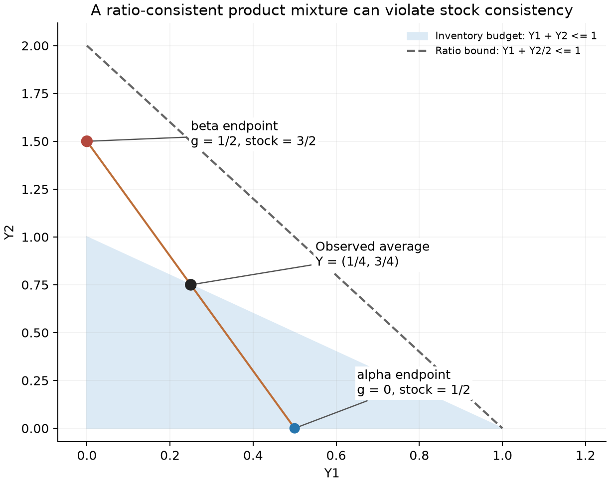
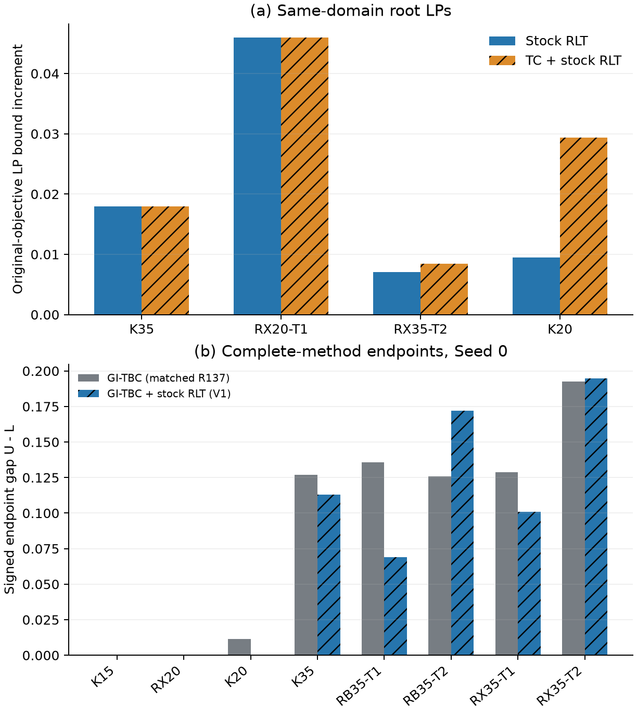
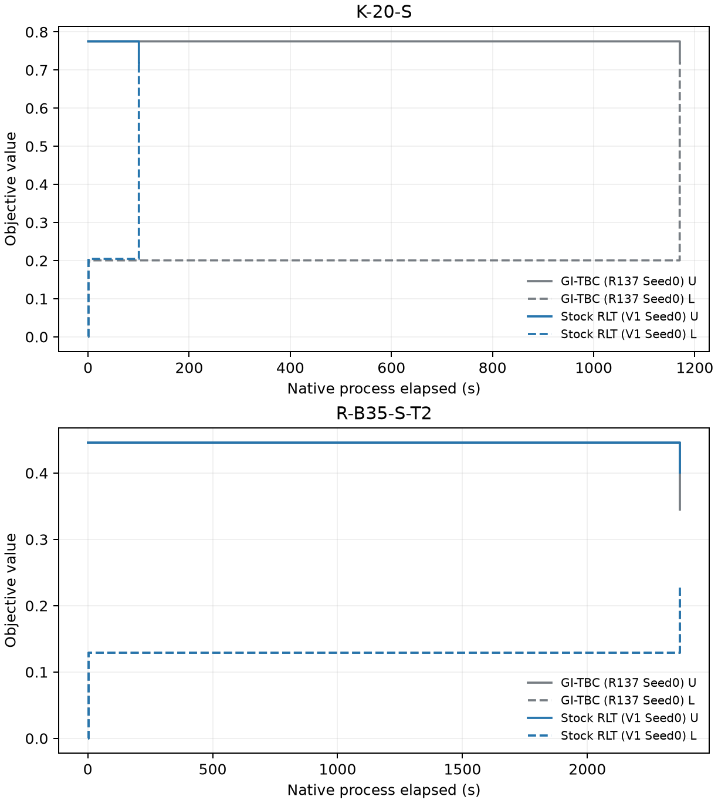

# Shared-product consistency with global inventory budgets in GI-TBC

Round138 research increment, 29 October 2026. This separately reviewable section extends the accepted Round137 manuscript. The complete Round137 paper and historical experiment identities remain intact. It combines a selected continuous-block hull result, exact tiny witnesses, same-domain real LPs and complete-method evidence.

This study extends the accepted Round137 GI-TBC formulation. It retains empty
departure, loaded return with unloading time, unique nonzero one-way service,
prefix vehicle capacity, complete own H, pair-only support, AM .08 and AP off.
The new production switch is default-off and adds four rows with no variables.
The new information is global resource consistency of already shared products.
It is not a new general convexification principle.

## 1. Physical units and valid inventory bounds

All following sums exclude the depot, whose serialized stock may be 50000.
Let \(B=\sum_i b_i\), \(\tau=\sum_iY_i\) and let \(R_k\) be the load
returned by vehicle \(k\). Empty departures and conservation give

\[
\tau=B-\sum_kR_k,\qquad 0\le R_k\le Q_k,\qquad
B^-:=\max(0,B-\sum_kQ_k)\le\tau\le B.
\]

Deliveries free space for subsequent pickups, so cumulative pickups need not
be bounded by a vehicle's capacity. No such invalid bound is introduced.
Targets and objective weights may be heterogeneous, with \(D_i>0\),
\(\omega_i\ge0\), and \(\lambda\ge0\). Write
\(r_i=Y_i/D_i\), \(S=\sum_i r_i\), \(A=\sum_{i<j}|r_i-r_j|\) and
\(P=\sum_i\omega_i|r_i-1|\). The physical objective is
\(F=G_{\rm true}+\lambda P\), with \(G_{\rm true}=A/(nS)\) when \(S>0\)
and zero otherwise. The model's \(g\) is an epigraph variable and need not equal
\(G_{\rm true}\) at every native integer completion.

On a model's actual interval \([\alpha,\beta]\), VD-P uses

\[
\sum_y s_{iy}=1,\quad Y_i=\sum_yys_{iy},\quad
\alpha s_{iy}\le q_{iy}\le\beta s_{iy},\quad
\sum_yq_{iy}=g,\quad Z_i=\sum_y yq_{iy}.
\]

Integer selectors imply \(Z_i=gY_i\). Relaxed station mixtures do not impose
all products of global budgets with \(g\). Crucially, \(Z_i\) is an inventory
product, not \(gY_i/D_i\). The existing Gini row is
\(H_\Sigma:=\sum_{i<j}H_{ij}\le n\sum_i Z_i/D_i\).

## 2. Four inventory RLT inequalities

For any valid row \(a^\top Y\le b\), multiply its slack by \(g-\alpha\)
and \(\beta-g\), both nonnegative, then substitute the existing products:

\[
a^\top Z\le\alpha a^\top Y+b(g-\alpha),\qquad
a^\top Z\ge\beta a^\top Y+b(g-\beta).
\]

With \(J=\sum_iZ_i\), the physical inventory bounds yield

\[
\begin{aligned}
J&\ge\alpha\tau+B^-g-\alpha B^-,\\
J&\ge\beta\tau+Bg-\beta B,\\
J&\le\beta\tau+B^-g-\beta B^-,\\
J&\le\alpha\tau+Bg-\alpha B.
\end{aligned}
\]

At \(\alpha=0\), the last row is \(J\le Bg\). These inequalities are valid
for every exact product completion, including a nonminimal epigraph \(g\),
heterogeneous targets/weights/capacities, loaded return, zero total inventory,
zero \(g\), and a collapsed interval. The implementation uses the current
writer's actual \(g\) bounds. It neither treats a cutoff as a global physical
fact nor silently substitutes a stronger local stock budget.

All variable coefficients in the four new rows are emitted at max_digits10, bypassing the legacy
near-zero and near-one coefficient filters. Only the new multiplied right
sides are rounded outward by one ULP: upward for upper rows, downward for lower
rows. Exact Fraction checks confirm their directions. No general tolerance or
native proof policy changes.

Actual native coefficient readback subsequently exposed an additional transport
boundary: Gurobi omitted the negative Y coefficients in the test with
\(\alpha=10^{-13}\), despite their full-precision LP text. Small matrix
coefficients can be treated as zero by the native optimizer
[@GurobiNumericR138]. Deleting these negative terms from an upper row could
strengthen it unsafely; feasibility tolerance is not a validity argument.
The separately identified V2 writer therefore scales only a new row whose
nonzero slope has magnitude below \(10^{-12}\). It uses the smallest positive
power of two that raises that slope to at least \(10^{-12}\), multiplying
every coefficient and the already outward RHS by the same finite `ldexp`.
Binary power-of-two multiplication is exact here, so normalization recovers
the original stored coefficients and outward RHS. Nonfinite transport is
rejected. The \(10^{-13}\) test uses factors 16, 1, 1, 16; all seven native
coefficient/RHS readbacks pass after this fix.

All 33 used STOCK calls in the primary V1 study, representing 25 unique
model matrices, have positive interval endpoints at least
0.21232492258182034. Their scaling factor is one, and actual native readback
confirms every intended new coefficient and RHS. The 20 same-domain LPs also
avoid the changed branch. Primary V1 data keep their original source/PE
identity. V2 is separately built and registered for the limited Seed1
confirmation and delivered research entry; this build change is disclosed.
The failure, exact source carrier, zero-Optimize bridge and independently
reviewed replacement registration are retained under `repair/` and
`qualification/`.

## 3. Continuous selected-resource product hull

Let \(\mathcal P=\{s\ge0:\sum_y s_{iy}=1,\ As\le b\}\), and let
\(\mathcal X=\{(s,g,q):s\in\mathcal P,\ \alpha\le g\le\beta,\ q=gs\}\).
Retain \(s\in\mathcal P\), the full station VD-P constraints (including
\(\sum_yq_{iy}=g\)), and impose for
**every row defining the selected resource block**

\[
Aq\le\alpha As+b(g-\alpha),\qquad
Aq\ge\beta As+b(g-\beta).
\]

The resulting formulation is \(\operatorname{conv}(\mathcal X)\). Necessity
follows from the slack products. For sufficiency, when \(\alpha<g<\beta\), set

\[
s^\beta=\frac{q-\alpha s}{g-\alpha},\qquad
s^\alpha=\frac{\beta s-q}{\beta-g},\qquad
t=\frac{g-\alpha}{\beta-\alpha}.
\]

The local bounds make the two vectors nonnegative; their station sums are one.
The resource product inequalities give \(As^\alpha\le b\) and
\(As^\beta\le b\). Direct substitution yields

\[
(s,g,q)=(1-t)(s^\alpha,\alpha,\alpha s^\alpha)
             +t(s^\beta,\beta,\beta s^\beta).
\]

At an endpoint, the nonnegative differences in each station sum to zero, giving
the exact endpoint product. If \(\alpha=\beta\), local bounds already enforce
\(q=\alpha s\). Additional equalities require their product equalities, or
both corresponding inequality products.

This is the standard RLT/two-endpoint disjunctive construction, consistent with
Adams and Sherali's linearization framework, the Sherali-Adams RLT monograph,
and Balas's disjunctive hull theory [@AdamsSherali1990R138; @SheraliAdams1999R138;
@Balas1998R138]. The four stock rows give this conclusion only for the
continuous block defined by station simplices and the selected stock budget.
They do not describe the full integer inventory, route or original-objective
epigraph hull. Omitting products of other resource rows does not preserve the
stronger all-row hull conclusion.

## 4. Strictly complementary information with TC in the original J2/J3 reference

Keep the original joint fleet mixture, theta, event ranks, cutsets, old state
penalty and declared R88 CDF/product controls free. Here \(n=4\), \(B=3\),
\(D_i=\omega_i=1\), states are 0/1/2, and \(g\in[0,3/4]\). Let
\(a=\sum_i s_{i1}\), \(b_2=\sum_i s_{i2}\), so \(\tau=a+2b_2\le3\).
The inherited TC row is \(H_\Sigma\ge a+4b_2\ge\tau\). Thus

\[
\tau\le H_\Sigma\le4J\le12g,\qquad
F\ge\tau/12+\lambda(4-\tau)
\ge\min\{4\lambda,1/4+\lambda\}.
\]

The saved original binary64 coefficient is exactly
\(\widehat\lambda=5404319552844595/36028797018963968>1/12\). At this
coefficient and this reference only, the four optimal LP values are

| Original reference | Optimal objective |
|---|---|
| Reference | \(\widehat\lambda\) |
| Reference + stock RLT | \(\widehat\lambda\) |
| Reference + TC | \(\widehat\lambda+3/16\) |
| Reference + TC + stock RLT | \(\widehat\lambda+1/4=F^*_{IP}\) |

For the third cell, the old local product bound gives
\(J\le4g+(3/4)b_2\); TC then implies \(g\ge a/16\). The retained state
penalty gives \(P\ge4-a\). Since \(a\le3\) and
\(\widehat\lambda>1/16\), the lower bound is
\(\widehat\lambda+3/16\). Its old attaining point has \(g=3/16\),
\(J=3/4\), violating \(J\le3g=9/16\).

The zero-g old mixture still attains the first two cells. For the fourth cell,
use the existing equal mixture of four legal fleets whose final inventories
are permutations of (0,1,1,1). Each station has
\(s_0=1/4,s_1=3/4,s_2=0\). Set \(g=1/4\), \(q_0=1/16,q_1=3/16\),
\(Z_i=3/16\), \(H_{ij}=1/2\), \(e_i=1/4\). Full exact replay checks every
one of the original 583 matrix rows, all 284/298 variable bounds, the state
penalty, and R88 B1/B2 extensions. A saved matching integer fleet supplies the
upper bound. Existing zero-inventory loaded-return fleets also pass full
exact replay and the stock rows; the variable-inventory/zero case was not
removed. No unchanged historical enumeration was repeated and no solver was
needed for these proofs. See math/exact.json and independent review records.

The old zero-g point satisfies stock RLT and violates TC by 3; the old TC
attaining point satisfies TC and violates the stock upper row by 3/16. Thus
neither information family implies the other on this retained full reference.

The third cell is not claimed for arbitrary lambda. The result proves a
specific complementarity of count and resource products. It does not by itself
justify adding TC to the complete current algorithm.

## 5. GS, heterogeneous targets, AP and earlier station products

The historical structural-cut and structural-policy studies already implemented
independent aggregate \(W_{GS}\approx gS\), its four McCormick rows and
\(H_\Sigma\le nW_{GS}\), and tested fixed subproblems. With equal targets
and tight \(S\le B/D\), that construction also closes the tiny TC gap.
The tiny closure therefore does not show superiority over historical GS.

The new distinction is consistency of the same \(Z/q\) variables in the stock
normal \(\sum Y_i\), as distinct from the ratio normal \(\sum Y_i/D_i\).
For a pure product witness, take two stations with \(D=(1,2)\), states 0/1/2,
\(B=1\), \(g\in[0,1/2]\), \(g=1/4\), and

\[
s_1=(3/4,1/4,0),\quad q_1=(1/4,0,0),\qquad
s_2=(5/8,0,3/8),\quad q_2=(1/16,0,3/16).
\]

The local VD-P constraints hold, \(Y=(1/4,3/4)\), \(Z=(0,3/8)\),
\(S=5/8\), and shared \(W=\sum_iZ_i/D_i=3/16\). This satisfies all four
aggregate McCormick rows on \([0,1/2]\times[0,1]\), but violates
\(\sum Z_i\le Bg\) by \(1/8\). It is a product-block separation, not a
claimed complete BRP/TC extension. Real-root objective gains require the actual
same-domain reoptimizations reported separately.

The new GS controls use the same saved domain, a proved fractional-inventory
knapsack upper bound on S, no reverse-H inequality, no S buckets and no
controller change. Independent W and shared W controls are named separately.

**Conditional relation for the present GS controls.** Suppose
\(S(s)=c^\top s\) has bounds \(S_l\le S(s)\le S_u\) valid for the
selected continuous stock polytope \(\mathcal P\) of Section 3, and write
\(W_{\rm shared}=c^\top q\). The endpoint decomposition gives

\[
W_{\rm shared}-\alpha S=(g-\alpha)S(s^\beta),\qquad
\beta S-W_{\rm shared}=(\beta-g)S(s^\alpha).
\]

Bounding both endpoint S values between \(S_l,S_u\) yields the four
aggregate McCormick inequalities. Endpoint and collapsed intervals use the
exact product relation already established. With identical common base rows,
and retaining \(H_\Sigma\le nW_{\rm shared}\), this proves the conditional
inclusions in the original variable space

\[
\mathcal F_{\rm stock}\subseteq\mathcal F_{\rm shared\ GS}
\subseteq\operatorname{proj}_{\rm original}
             (\mathcal F_{\rm independent\ GS}).
\]

For the second inclusion choose the independent aggregate variable equal to
the shared one; it has zero objective coefficient and no additional unrelated
constraints in this control. The present fractional-inventory-knapsack upper
bounds use the same visible supports, stock upper bound and ratio coefficients,
so they are valid for this \(\mathcal P\); \(S_l=0\) is valid by nonnegativity.
The additional lower stock bound only tightens \(\mathcal P\). Thus the
corollary applies to these ideal mathematical controls. Equal optimal values
on K35 do not turn either inclusion into equality of feasible regions.

The displayed heterogeneous witness shows that shared GS does not imply stock
in the pure product block. It does not establish strict inclusion after all
BRP/TC rows are added. If an S bound uses route, cutoff or other information
outside the selected stock \(\mathcal P\), the premise must be proved anew;
this is not dominance over arbitrary historical GS architectures. Actual
outward/native floating-point matrices remain supported by their numerical
comparisons and readback, rather than being relabeled exact symbolic dominance
certificates. This corollary needs no new solve or change to the full candidate.

R55 MC4 and VD-P concern station boxes/state hulls; they are not the missing
global budget products. R132-133 already distinguish service-coordinate
strictness from objective gains. R135 AP/IND addresses state-penalty
cancellation under its stated projection assumptions and retains its accepted
mixed/negative complete-method history. AP remains off here. None of these
historical results is relabelled as a new independent validation sample.

## 6. Extension boundary

A selected additional physical resource row can be treated by the same two
slack products, using its existing state expression in s and q. For example,
\(C(s)=\sum_{i,y}(b_i-y)_+s_{iy}\) equals total pickups at an integer shared
state completion. With unloading on return, handling time is
\((t_p+t_d)C\), so \((t_p+t_d)C\le mT\) is necessary. This does not cap
cumulative pickups by Q. Such a row is an optional separate exploration;
the primary full comparison changes only the four stated inventory rows.

The saved stock-enhanced LP optima were also inspected without a new solver
call. None of the four violates these two handling-budget product rows. This
does not prove them redundant when the handling cap is tighter than B. When
\(c=mT/(t_p+t_d)\ge B\), however, redundancy in the local VD-P block follows
directly from \(0\le(b_i-y)_+\le b_i\):
\(C(q)-\alpha C(s)\le B(g-\alpha)\le c(g-\alpha)\), and
\(\beta C(s)-C(q)\le B(\beta-g)\le c(\beta-g)\).
The RX20 and RX35-T2 inspected domains satisfy this sufficient condition.
The four saved GS optimum vectors additionally satisfy the product rows for
a tighter safe fractional-knapsack lower S bound; their new-row residuals
were recomputed exactly from the stored binary64 values. These are existing
numerical optimum witnesses, not new exact rational LP certificates. The
record is reports/offline_products.json, with zero new Optimize and no newly
invented Seed. Neither check changes the primary full candidate.

## 7. Saved points and real same-domain LP reoptimization

The three motivating points are actual saved R137 roots, rather than new Round138 experiments. K-20-S is an additional known control. Inventory products are unscaled and depot stock is excluded. Integral Y does not imply integral selectors: the K35 saved point has 78 fractional station selectors.

| Saved root | Auxiliary g | True G at saved Y | J - Bg |
|---|---|---|---|
| K-35-U | 0.0386392 | 0.0714063 | 8.30742 |
| R-X20-S-T1 | 0.100713 | 0.175199 | 6.54633 |
| R-X35-S-T2 | 0.033366 | 0.0892857 | 7.30714 |
| K-20-S | 0.022097 | 0.046519 | 4.7315 |

All new LPs retain the exact stored input, physical horizon, lambda, supports, interval, native cutoff and original rows. Noncomparison auxiliaries reoptimize freely; AP is off. Every solve uses explicit Seed0, one thread and Gurobi13.0.2. The two resource lambdas are the original double values, not .15. Point violation is not objective-bound gain. The table uses the newly reoptimized base in each delta.

| Root | Base L | Stock L | TC L | TC + stock L |
|---|---|---|---|---|
| K-35-U | 0.200178 | 0.218089 | 0.200178 | 0.218089 |
| R-X20-S-T1 | 0.331594 | 0.377558 | 0.332136 | 0.377558 |
| R-X35-S-T2 | 0.1861 | 0.193136 | 0.1861 | 0.194522 |
| K-20-S | 0.195149 | 0.20459 | 0.202625 | 0.224542 |

| Root | Stock delta L | Stock gap at common U | TC + stock delta L |
|---|---|---|---|
| K-35-U | 0.0179111 | 0.549368 | 0.0179111 |
| R-X20-S-T1 | 0.0459632 | 0.375496 | 0.0459632 |
| R-X35-S-T2 | 0.00703632 | 0.231514 | 0.00842207 |
| K-20-S | 0.00944129 | 0.570622 | 0.0293929 |

The stock rows improve all four root objectives. TC provides additional information on some roots, but the primary complete candidate deliberately contains only the minimum four inventory rows. The numerical LP optima and quality/residual checks are not exact rational optimality certificates.

| Root | Base L | Independent GS L | Shared GS L | Stock L |
|---|---|---|---|---|
| K-35-U | 0.200178 | 0.218089 | 0.218089 | 0.218089 |
| R-X20-S-T1 | 0.331594 | 0.364502 | 0.364502 | 0.377558 |

On RX20 the physical stock direction gives a stronger original-objective bound than either lawful ratio aggregate control in this domain. The equal K35 objective values do not imply equal feasible regions: the optima use different J values. These observations do not generalize to dominance over all historical GS variants. Full-precision authorities are reports/LP.csv and each root result/vector.

The conditional inclusion proved above explains the ideal ordering for these particular GS bounds: stock is contained in shared GS, which is contained in the projection of independent GS when S bounds are valid for the same continuous stock polytope. The actual numerical LP comparisons remain separate evidence; neither equal objectives nor rounded solver matrices establish exact polytope equality.

## 8. Complete algorithm comparison

The primary panel has eight physical/objective configurations on six base inputs and sixteen nominal method positions. Eight accepted R137 GI-TBC baselines are reused only after checking the exact PE, input, physical parameters, lambda, Seed0, cap, single-thread runtime/affinity and complete-cost policy. A contemporaneous frozen-PE K15 bridge is additionally reported; it never replaces the earlier baseline by whichever time is better. All candidate runs independently pay complete own H, construction, validation, search and proof. No solution, bound, tree or Start is transferred across methods, seeds or weights.

The primary STOCK measurements use V1 source 83928377336a860acf78f684d1723a5040467bb5 and its frozen PE. The subsequent tiny-coefficient native-readback repair is V2 source 04506fa613446d2ef2bd19794f778909422c51fd with a separately retained PE. All primary used model scopes have exactly unchanged new rows under V2, as established by the finite matrix/native bridge. The primary measurements are not relabeled as V2 runs. The limited Seed1 STOCK runs and delivered research entry use V2; their purpose includes confirming this repaired build.

| Configuration | Stations / vehicles | Physical T (s) | Lambda | Compute cap (s) |
|---|---|---|---|---|
| K-15-S | 15 / 2 | 3600 | 0.15 | 600 |
| R-X20-S-T1 | 20 / 2 | 4800 | 0.126761 | 1200 |
| K-20-S | 20 / 2 | 5400 | 0.15 | 1200 |
| K-35-U | 35 / 3 | 10800 | 0.15 | 2400 |
| R-B35-S-T1 | 35 / 3 | 4800 | 0.0551253 | 2400 |
| R-B35-S-T2 | 35 / 3 | 7200 | 0.0551253 | 2400 |
| R-X35-S-T1 | 35 / 3 | 4200 | 0.075405 | 2400 |
| R-X35-S-T2 | 35 / 3 | 6300 | 0.075405 | 2400 |

T1/T2 pairs share an input and exact objective weights but have different physical horizons. The resource roles retain rho = 1 and lambda = 1/Omega. Displayed lambda is rounded only for reading; the input/launch manifests retain the actual binary64 values. Compute caps are separate from physical T.

| Configuration | Base U | Stock U | Base L | Stock L |
|---|---|---|---|---|
| K-15-S | 0.592265 | 0.592265 | 0.592265 | 0.592265 |
| R-X20-S-T1 | 0.645325 | 0.645325 | 0.645325 | 0.645325 |
| K-20-S | 0.716807 | 0.716807 | 0.705356 | 0.716807 |
| K-35-U | 0.692854 | 0.669596 | 0.565766 | 0.556777 |
| R-B35-S-T1 | 0.591518 | 0.569975 | 0.455904 | 0.500843 |
| R-B35-S-T2 | 0.344643 | 0.4012 | 0.218986 | 0.229182 |
| R-X35-S-T1 | 0.59219 | 0.592026 | 0.463358 | 0.491023 |
| R-X35-S-T2 | 0.403272 | 0.409855 | 0.210887 | 0.21498 |

| Configuration | Base certificate s | Stock certificate s | Base relative gap | Stock relative gap |
|---|---|---|---|---|
| K-15-S | 112.769 | 33.8182 | 5.09497e-09 | 3.16797e-14 |
| R-X20-S-T1 | 20.5065 | 15.3405 | 3.44082e-16 | 1.89245e-15 |
| K-20-S | open | 101.635 | 0.0159747 | 1.08419e-14 |
| K-35-U | open | open | 0.183428 | 0.168488 |
| R-B35-S-T1 | open | open | 0.229264 | 0.12129 |
| R-B35-S-T2 | open | open | 0.3646 | 0.42876 |
| R-X35-S-T1 | open | open | 0.217552 | 0.170605 |
| R-X35-S-T2 | open | open | 0.47706 | 0.475473 |

Open certificate times are null in the data and displayed as open. Lower relative gap is not used to hide an opposed U or L endpoint. Both-certificate time differences are called substantive only when the absolute difference is at least max(10 s, 10% of the smaller time). The complete production clock includes online work and seal; subsequent pure verification has its own clock.

| Configuration | Base production s | Stock production s | Base verify s | Stock verify s |
|---|---|---|---|---|
| K-15-S | 112.769 | 33.8182 | 3.77037 | 1.11169 |
| R-X20-S-T1 | 20.5065 | 15.3405 | 1.08205 | 1.15297 |
| K-20-S | 1172.19 | 101.635 | 61.1438 | 2.82429 |
| K-35-U | 2371.15 | 2371.07 | 3.80005 | 4.06451 |
| R-B35-S-T1 | 2376.07 | 2371.09 | 5.60112 | 4.06613 |
| R-B35-S-T2 | 2371.04 | 2371.13 | 3.76611 | 4.04091 |
| R-X35-S-T1 | 2379.12 | 2374.79 | 3.67396 | 3.73333 |
| R-X35-S-T2 | 2371.09 | 2371.14 | 3.72914 | 3.69698 |

Production, verification and their recorded total remain separate fields in pairs.csv. No postproduction verification time is silently folded into, or substituted for, the formal certificate clock.

| Configuration | Method | True G | P avg | S |
|---|---|---|---|---|
| K-15-S | BASE | 0.222147 | 0.260462 | 13.2022 |
| K-15-S | STOCK | 0.222147 | 0.260462 | 13.2022 |
| R-X20-S-T1 | BASE | 0.314652 | 0.330673 | 14.5762 |
| R-X20-S-T1 | STOCK | 0.314652 | 0.330673 | 14.5762 |
| K-20-S | BASE | 0.204111 | 0.302141 | 17.0768 |
| K-20-S | STOCK | 0.204111 | 0.302141 | 17.0768 |
| K-35-U | BASE | 0.186937 | 0.224772 | 37.3401 |
| K-35-U | STOCK | 0.187643 | 0.214125 | 36.1583 |
| R-B35-S-T1 | BASE | 0.285367 | 0.30615 | 29.2099 |
| R-B35-S-T1 | STOCK | 0.273848 | 0.296128 | 29.777 |
| R-B35-S-T2 | BASE | 0.181545 | 0.163098 | 29.8127 |
| R-B35-S-T2 | STOCK | 0.200289 | 0.200911 | 28.9512 |
| R-X35-S-T1 | BASE | 0.268135 | 0.324055 | 28.7591 |
| R-X35-S-T1 | STOCK | 0.271695 | 0.320331 | 28.5687 |
| R-X35-S-T2 | BASE | 0.18255 | 0.220722 | 28.2238 |
| R-X35-S-T2 | STOCK | 0.190995 | 0.218861 | 27.7583 |

| Control | Method | T produce s | T cert s | U | L |
|---|---|---|---|---|---|
| K-15-S | BASE | 122.579 | 122.579 | 0.592265 | 0.592265 |
| SM-B10-B | BASE | 1.13214 | 1.13214 | 0.535891 | 0.535891 |
| SM-B10-B | STOCK | 1.04893 | 1.04893 | 0.535891 | 0.535891 |

The K15 bridge first encountered a postreader version-adapter error after normal sealed native completion. Its original failure and fee are preserved. Independently reviewed strict modern lifecycle handling repaired only verification; the native run was not repeated. The producer, completion and postverification clocks retain their distinct definitions.

Its recorded T_verify is 342.185 seconds and spans the postreader repair interval. It is an elapsed closeout clock; fee receipts separately meter actual reader-process wall time. This interval is not substituted for native computation or a new baseline solve.

The primary certificate count is 2/8 for matched GI-TBC and 3/8 for stock RLT. K15 certifies in 33.818227 seconds versus 112.769303 seconds, a substantive difference under the declared rule; the separate contemporaneous BASE bridge takes 122.579382 seconds. RX20 certifies in 15.340479 versus 20.506462 seconds, below the ten-second substantive threshold. K20 adds a certificate in 101.635385 seconds while its baseline remains open at cap1200; no baseline convergence time or capped time ratio is invented. All five n35 primary configurations remain open. RB35-T1 and RX35-T1 improve both U and L, with the RX35-T1 improvement mostly in L. K35 improves U but loses L. RB35-T2 improves L but materially worsens U and both gap measures. RX35-T2 improves L but worsens U and signed gap, even though its relative gap is slightly smaller. The component table shows that RB35-T2 worsens both true G and P_avg; RX35-T2 improves P_avg but its G increase is larger. No endpoint is hidden by a preferred gap measure. Both micro controls certify in about one second; their small time difference gives no substantive overhead conclusion.

### 8.1 Limited second Seed

The limited second Seed was selected after all eleven new Seed0 positions and the complete eight-configuration comparison were sealed. K-20-S tests the main certificate benefit: stock certifies in 101.63538490096107 seconds while matched GI-TBC remains open at its 1200-second cap. R-B35-S-T2 tests the largest observed U regression: stock U rises by 0.05655759224710244 and the signed gap worsens from 0.12565667598847344 to 0.172018618174727 despite a higher L. K35 and RX35-T2 opposed endpoints remain in the primary table; they are not replaced or discarded. This is conditional finite confirmation, not a new independent sample or a runtime-distribution estimate. Both methods start fresh, pay their full own H and other costs, use Gurobi Seed1 with H seed20260626, and retain the original physical parameters and caps. Before any Seed1 Optimize, actual native coefficient readback exposed a tiny-slope LP-reader transport defect. All primary scopes were natively bridged and unaffected. STOCK Seed1 therefore uses the separately registered V2 exact power-of-two transport build; this is disclosed as a build confirmation as well as a limited second Seed, not a pure Seed-only change. The original unused registration/gate is retained under repair/seed1_pre_coefficient_fix.

| Configuration | Method | Seed | Certificate s | U | L |
|---|---|---|---|---|---|
| K-20-S | BASE | 1 | open | 0.716807 | 0.701669 |
| K-20-S | STOCK | 1 | 90.2348 | 0.716807 | 0.716807 |
| R-B35-S-T2 | STOCK | 1 | open | 0.322245 | 0.231139 |
| R-B35-S-T2 | BASE | 1 | open | 0.359554 | 0.218146 |

K20 retains the selected certificate benefit: BASE remains open at its 1200-second cap, whereas V2 STOCK certifies in 90.234798 seconds at U=0.716806546278. For RB35-T2, Seed1 STOCK U=0.322244841747 is better than BASE U=0.359553680417; STOCK L=0.231139449096 is better than BASE L=0.218146224605. The respective signed gaps are 0.091105392651 and 0.141407455812. These observations complement the adverse primary Seed0 result rather than replacing it. STOCK uses the separately disclosed V2 repair build; all primary model scopes were exactly/native bridged with scale one. This finite conditional check does not estimate a runtime distribution or establish independent validation.

### 8.2 What the complete data establish

The mathematical budget-product gap and all four real same-domain LP increments are established. Those increments sometimes yield complete proof benefits, particularly on K20 and K15, but they do not order finite-budget primal/dual endpoints on the resource-constrained n35 roles. The selected second Seed retains the K20 certificate benefit and reverses the RB35-T2 U direction. The known panel and selected second Seed support a focused research conclusion, not universal dominance, a new unseen benchmark claim, or an additive allocation of runtime benefit.

\clearpage

## 9. Stage decision and next question

Keep GI-TBC+stock-RLT research-only. The continuous-block explanation, real-root improvements and repeated K20 certificate benefit justify retaining the uniform four-row mechanism for further study. The primary upper-bound regressions on two resource configurations and K35 lower-bound regression leave insufficient evidence for a default promotion. Preserve the accepted GI-TBC entry/profile/PE and expose the repaired V2 only through its separate explicit research entry. This decision does not require every role to win; it reflects the size and practical relevance of the observed opposed endpoints.

The next informative question is whether the four inventory rows in the target MIP delay verified incumbent discovery even when their LP bounds improve. A minimal screen is one Seed0 BASE/STOCK target-MIP pair on the same saved initial RB35-T2 interval, exact objective/cutoff and physical input, with no imported Start and at most 120 seconds each. Record first own physically verified improvement and supported L. Label it a fixed-subproblem diagnostic; do not backfill it into the completed full runs. Only if that screen supports the mechanism should a separately named uniform LP-bound-only placement of stock RLT receive a small complete pilot. This directly tests a primal/dual placement question without another AM grid or broad Seed repetition.

## 10. Evidence and scope

New charged experiment computation is 18214.684111 seconds out of 86400. Nested H/LP/MIP/Work is not added twice. Reused complete baselines carry their original cost in the comparison and incur no fictitious new fee. Metered ordinary build, pure audit and delivery processes are separate. Optional work not executed is explained in the stage report.

The source/PE, exact input and command bindings, complete entered run list, finite carriers, local semantic checks and public byte-read receipt are separate authorities. No full public semantic PASS is inferred from byte recovery. The accepted R137 recovery limitation is unchanged. This known research panel is not an independent unseen validation set.

