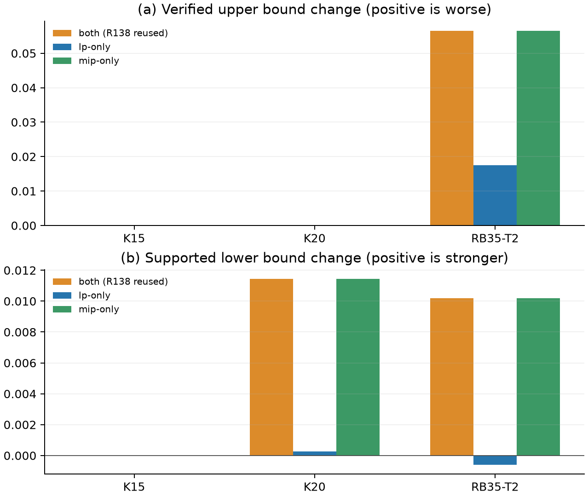
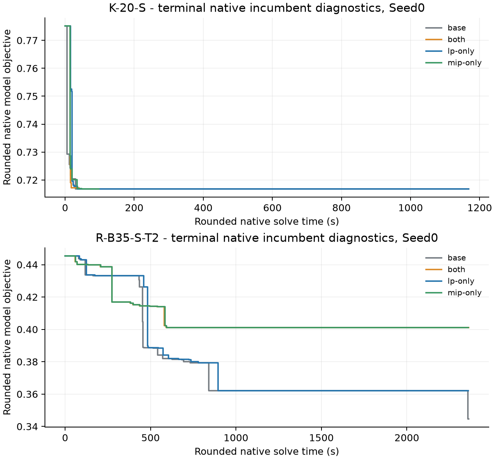

# Where inventory-product consistency belongs in GI-TBC

Round139 research increment, 29 October 2026 (Asia/Shanghai). This independent section extends the complete Round137 manuscript and Round138 resource-product increment. The inherited experiments keep their original source, PE and scientific identities. The study concerns uniform placement across explicit LP control and native MIP search.

## 1. Mathematical and algorithmic scope

Round139 extends the accepted Round138 resource-product study. Its object is
the location of four valid rows, not a new RLT construction or a claim that
LP strength orders complete algorithm performance. The stable method remains
Round137 GI-TBC. The legacy Round138 switch continues to mean both locations.

Let \(D\) specify an actual inventory-support domain, a Gini interval
\([\alpha,\beta]\), physical parameters and the original objective.
\(X_D\) denotes its integer feasible completions, \(R_D\) the continuous
formulation, and \(C_D\) the four inventory RLT rows
using these exact endpoints. At integer selectors the product variables satisfy
\(Z_i = gY_i\); applying the shared inventory sum bounds to that common factor gives
the valid rows. This argument does not require auxiliary g to equal the true
Gini of \(Y\). Thus

\[
X_D\subseteq R_D\cap C_D\subseteq R_D,\qquad X_D\cap C_D=X_D,
\quad L_D^{base}\le L_D^{stock}\le z_D^*.
\]

The continuous-domain and integer-domain claims remain those of Round138;
they are not strengthened to unspecified projected polytopes here. The four
uniform placements 00/base, 11/both, 10/LP-only and 01/MIP-only all preserve
integer feasibility and the original objective. An outer LP strengthened with
stock rows and a native MIP without those rows is exact under the same proof
policy. The converse is also exact. “Outer LP” means explicit controller
relaxations; a native MIP includes its own root LP and search relaxations.

The paid model often includes \(f\le c\). Its returned lower bound
\(\ell_{D,c}\) belongs to that restricted domain.
Decomposing \(D\) into \(f\le c\) and \(f\ge c\) gives

\[
L_D^{LP}=\min\{\ell_{D,c},c\}.
\]

If the improvement domain is infeasible, its contribution is \(+\infty\) and the
complement supplies \(c\). The existing R120/R134 evidence and numerical policies
qualify this bound; changing placement neither relaxes their residual limits
nor invents a new certificate. Valid same-domain evidence combines as

\[
L_D=\max\{L_D^{LP},L_D^{MIP},L_D^{inherited}\}.
\]

A bound whose source domain contains the target domain can be inherited by
the target. A child cannot supply a parent bound without a complete cover.
The frontier takes the minimum of its valid obligations and cutoff complements.
An external LP contribution stays distinct from a native MIP returned bound.
The implementation retains the unchanged NativeEvidenceJournal qualification
path and complete-frontier ledger.

For finite feasible children, current AM uses

\[
d=\max\{U-L_p,\epsilon\},\qquad
r_i=\operatorname{clip}_{[0,1]}\left(\frac{L_i-L_p}{d}\right),
\]
\[
\eta=\min(r_l,r_r),\qquad \mu=\frac{r_l+r_r}{2},\qquad
S_{\mathrm{AM}}=\eta\mu .
\]

It first checks a strict improvement in the weakest child. Without one, the
parent enters exact-close; the threshold comparison is reached only afterwards.
Even with nonnegative strengthening deltas at parent and children,

\[
(L_i+\Delta_i)-(L_p+\Delta_p)
 =(L_i-L_p)+(\Delta_i-\Delta_p).
\]

Consequently stronger LPs need not raise the marginal child gain, AM score, or
frequency of splits/targets. The denominator also changes. This is a property
of the existing controller and its formulation input, not a new general AM
theorem. K20 supplies an actual example:

| Formulation | \(L_p\) | \(L_l\) | \(L_r\) | First action |
|---|---:|---:|---:|---|
| BASE | .195149152441 | .196078259949 | .540770654572 | native-target |
| BOTH | .204590439178 | .204590439178 | .540770654572 | exact-close |

BASE has \(S_{\mathrm{AM}}\approx .00047847\); BOTH takes exact-close at
the preceding no-strict test. The threshold remains \(.08\) in every comparison.

Asymmetric placement requires a real matrix transition. Round139 verifies the
old immutable artifact, discards the retained native model, and rebuilds using
the unchanged V2 writer with the declared role. A fresh path/SHA/signature
identifies the matrix. Same-domain LP evidence and its original SHA remain;
cutoff-epoch changes keep the existing invalidation policy. Integer requests
are intercepted before native scope construction, so both target and terminal
consume the declared matrix. Model rebuild and lost reuse are paid complete
method costs. No basis/tree transfer across changed matrices is claimed.

Four-grid interventions expose joint changes to control and native execution.
They do not provide an additive decomposition of runtime. Earlier solver state,
Start processing and rebuild differences remain part of each complete method.
Open certificate time is null. Rounded native incumbent logs are diagnostic
model objectives, not independently validated intermediate physical upper
bounds; controller trace publication time is not solver discovery time.

Independent preflight: review/preflight.md. Actual qualification, registered
positions and complete outcome summaries are reported separately. No statement
here presumes a winning placement or licenses instance-specific dispatch.

The implementation follows the limited artifact-replacement lesson of R120:
the paid LP retains its original bytes and a later matrix receives a fresh
identity. It does not activate R119 proof contraction or R120 proof-derived
disjunctive rows. R63's
MIP-only time-resource rows used a different lifecycle, including fresh reads
to prevent row leakage; those rows were not stock placement. Round139 discards
on a genuine LP/MIP matrix change and retains target-to-terminal reuse if the
MIP matrix and cutoff epoch remain unchanged. R137's s2-root suppresses outer
probing and is not an LP-only stock formulation. Ordinary GS, AP/IND, handling
products and AM threshold grids keep their accepted historical identities;
none is silently mixed into this placement intervention.

The RLT rows are standard reformulation-linearization tools [@AdamsSherali1990R138; @SheraliAdams1999R138]. Round138 supplies the problem-specific shared-stock analysis and accepted witnesses. Round139 contributes a controlled placement study and its implementation/proof interface, without renaming this standard construction.

| Placement | Outer explicit LP | Native MIP, including internal LPs |
|---|---|---|
| BASE / 00 | base | base |
| BOTH / 11 | stock | stock |
| LP-only / 10 | stock | base |
| MIP-only / 01 | base | stock |

All methods keep complete own H (seed 20260626), M-B/VD-P, pair-only support, AM .08, depth 8, minimum width 1e-4 and AP/TC off. Solver calls use explicit Gurobi Seed0 unless a registered limited Seed1 repeat is shown, one thread, the same 13.0.2 DLL and affinity mask 4. No instance identity, size-specific placement or elapsed-time algorithm switch is used.

## 2. Actual inherited calls and matrix controls

| Role | Method | LP / target / terminal calls | Initial H | Common matrix |
|---|---|---|---|---|
| K-20-S | BASE | 3 / 1 / 1 | same | same after four rows |
| K-20-S | BOTH | 3 / 0 / 1 | same | same after four rows |
| R-B35-S-T2 | BASE | 3 / 0 / 1 | same | same after four rows |
| R-B35-S-T2 | BOTH | 3 / 0 / 1 | same | same after four rows |
| K-15-S | BASE | 3 / 1 / 1 | same | same after four rows |
| K-15-S | BOTH | 3 / 0 / 1 | same | same after four rows |
| K-35-U | BASE | 3 / 0 / 1 | same | same after four rows |
| K-35-U | BOTH | 3 / 0 / 1 | same | same after four rows |

The root and both probed child matrices are identical in variable order, types, bounds, objective and common row multiplicities after removing the four stock rows. This includes K20 and RB35-T2. H cannot explain their opposite changes. K20 BASE target consumes about .33 s and supplies no new solution; its later terminal log retains a previous-solve Start. BOTH bypasses that target. The approximately 100 s versus cap1200 result cannot be attributed to saving .33 s of direct target time. RB35-T2 has direct terminal calls in both methods, and their incumbent traces cross repeatedly.

Native incumbent lines are rounded model objectives on their own diagnostic clock. All saved witness vectors from selected K20/RB35-T2 runs are independently replayed in reports/native_trajectories_and_witnesses.json; actual source/call fields distinguish MIPSOL vectors from H, before-call and final vectors. Same-call numerical matching to a rounded log objective is approximate and does not establish unique vector identity or exact discovery timestamps. Other-call numerical coincidences are listed separately. Controller publication/qualification after native return is not discovery time.

## 3. Registered finite comparison

The panel has eight physical/objective configurations on six base inputs; T1/T2 are shared-input horizons. Three declared behavior roles form the placement pilot. All sixteen accepted BASE/BOTH Seed0 reference positions are reused after identity checks. The new 00/11 small qualification preserves the historical canonical SHA; measured R138 primary BOTH remains V1, with the accepted V2 matrix/native bridge. New placements use the unchanged V2 writer and a separately frozen Round139 PE. The qualification cap90 runs do not enter performance counts.

| Configuration | Stations / vehicles | Physical T (s) | Objective / cap (s) |
|---|---|---|---|
| K-15-S | 15 / 2 | 3600 | lambda=.15 / 600 |
| R-X20-S-T1 | 20 / 2 | 4800 | rho=1 / 1200 |
| K-20-S | 20 / 2 | 5400 | lambda=.15 / 1200 |
| K-35-U | 35 / 3 | 10800 | lambda=.15 / 2400 |
| R-B35-S-T1 | 35 / 3 | 4800 | rho=1 / 2400 |
| R-B35-S-T2 | 35 / 3 | 7200 | rho=1 / 2400 |
| R-X35-S-T1 | 35 / 3 | 4200 | rho=1 / 2400 |
| R-X35-S-T2 | 35 / 3 | 6300 | rho=1 / 2400 |

Resource weights preserve the original binary64 lambda = 1/Omega, rather than .15. Each new complete method independently pays H, model construction/reconstruction, online checks, native solve and proof. It imports no other method/Seed/diagnostic solution, bound, Start or tree.

### 3.1 Three-role placement results, Seed0

| Role | Placement | Verified U | Supported L | Certificate (s) |
|---|---|---|---|---|
| K-15-S | base | 0.5922649 | 0.5922649 | 112.7693 |
| K-15-S | both | 0.5922649 | 0.5922649 | 33.81823 |
| K-15-S | lp-only | 0.5922649 | 0.5922649 | 122.0785 |
| K-15-S | mip-only | 0.5922649 | 0.5922649 | 34.69753 |
| K-20-S | base | 0.7168065 | 0.7053558 | open |
| K-20-S | both | 0.7168065 | 0.7168065 | 101.6354 |
| K-20-S | lp-only | 0.7168065 | 0.7056255 | open |
| K-20-S | mip-only | 0.7168065 | 0.7168065 | 100.7069 |
| R-B35-S-T2 | base | 0.3446426 | 0.2189859 | open |
| R-B35-S-T2 | both | 0.4012002 | 0.2291816 | open |
| R-B35-S-T2 | lp-only | 0.3621368 | 0.2183926 | open |
| R-B35-S-T2 | mip-only | 0.4012002 | 0.2291816 | open |

Open certificate times are null, not imputed caps. Both-certificate differences are substantive only if absolute time differs by at least max(10 s, 10% of the smaller time). Raw T_produce/T_cert/T_verify/T_total, signed gaps and relative gaps remain in reports/new_arms.csv and reports/reused_arms.csv. Opposed U and L changes are reported separately.

LP-only takes immediate exact-close on all three roles, as BOTH does. K15 certifies in 122.078543 s: it loses BOTH's 33.818227 s speed but differs from BASE 112.769303 s by only 9.309240 s, below the 11.276930 s substantive threshold. K20 remains open at cap1200 despite the stronger outer LP and exact-close. RB35-T2 partially recovers U relative to BOTH (.362136827 vs .401200218), but is worse than BASE (.344642626), and its L (.218392595) is below both BASE (.218985950) and BOTH (.229181600). It does not combine their advantages. MIP-only certifies K15/K20 in 34.697528/100.706893 s, with no substantive difference from BOTH. RB35-T2 exactly reproduces BOTH's U and L. Neither asymmetric placement supplies a useful complete-method improvement over the existing choices.

### 3.2 Control and execution paths

| Role | Placement | AM action sequence | LP / target / terminal | Native reuse by call |
|---|---|---|---|---|
| K-15-S | lp-only | exact-close | 3 / 0 / 1 | [0, 0, 0, 0] |
| K-20-S | lp-only | exact-close | 3 / 0 / 1 | [0, 0, 0, 0] |
| R-B35-S-T2 | lp-only | exact-close | 3 / 0 / 1 | [0, 0, 0, 0] |
| K-15-S | mip-only | native-target -> exact-close | 3 / 1 / 1 | [0, 0, 0, 0, 1] |
| K-20-S | mip-only | native-target -> exact-close | 3 / 1 / 1 | [0, 0, 0, 0, 1] |
| R-B35-S-T2 | mip-only | exact-close | 3 / 0 / 1 | [0, 0, 0, 0] |

The LP-only transition explicitly discards the stock LP model before loading the base integer matrix. MIP-only discards the base LP model before loading stock; later target-to-terminal reuse is retained when the matrix and epoch stay unchanged. The loss of reuse and explicit rebuild are part of each complete method. These comparisons are interventions on whole execution paths, not additive causal allocations of runtime.

K20 MIP-only initially has the BASE LP bounds and native-target action. Its stock native target returns a qualified parent bound about .204825779, above the cached left LP bound .196078260; the next AM evaluation consequently takes exact-close. Its complete certificate time is about 100.71 s, close to BOTH at 101.64 s despite their different first actions. LP-only keeps the stronger outer LP and immediate exact-close, but remains open. Native-side placement retains this proof benefit in the finite comparison while outer-LP-only does not; this does not assign exact time shares to rows, reuse or Start state.

### 3.3 Uniform extension and limited Seed1

D3 uses the already complete, comparable eight-configuration BOTH panel rather than running five unmotivated new asymmetric positions. The remaining five roles have only inherited BASE/BOTH results. The new asymmetric configurations remain research controls, with no eight-role performance claim. This is a result-selected stopping decision on the known panel, not an unseen validation set. D4 introduces no new Seed1 solves: the retained BOTH candidate already has matching accepted paired BASE/BOTH Seed1 on K20 and RB35-T2. Those old results remain separately labelled context; neither LP-only nor MIP-only is represented as having Seed1 evidence. E adds no TC pilot: placement now answers the main question, and the accepted root TC+stock synergy alone does not establish additional practical value.

| Configuration | Placement | U | L | Signed U-L |
|---|---|---|---|---|
| K-15-S | base | 0.5922649 | 0.5922649 | 3.017571e-09 |
| K-15-S | both | 0.5922649 | 0.5922649 | 1.876277e-14 |
| R-X20-S-T1 | base | 0.645325 | 0.645325 | 2.220446e-16 |
| R-X20-S-T1 | both | 0.645325 | 0.645325 | 1.221245e-15 |
| K-20-S | base | 0.7168065 | 0.7053558 | 0.01145075 |
| K-20-S | both | 0.7168065 | 0.7168065 | 7.771561e-15 |
| K-35-U | base | 0.6928544 | 0.5657657 | 0.1270887 |
| K-35-U | both | 0.6695956 | 0.5567769 | 0.1128187 |
| R-B35-S-T1 | base | 0.5915176 | 0.4559039 | 0.1356137 |
| R-B35-S-T1 | both | 0.5699751 | 0.500843 | 0.06913212 |
| R-B35-S-T2 | base | 0.3446426 | 0.2189859 | 0.1256567 |
| R-B35-S-T2 | both | 0.4012002 | 0.2291816 | 0.1720186 |
| R-X35-S-T1 | base | 0.5921904 | 0.463358 | 0.1288325 |
| R-X35-S-T1 | both | 0.5920261 | 0.4910233 | 0.1010028 |
| R-X35-S-T2 | base | 0.403272 | 0.210887 | 0.192385 |
| R-X35-S-T2 | both | 0.4098555 | 0.2149802 | 0.1948753 |

Inherited R138 result-selected limited paired Seed1 on K20 and RB35-T2; this round makes no new Seed1 measurement and no Seed1 claim for either asymmetric placement.

| Role | Placement | Seed | U | L | Certificate (s) |
|---|---|---|---|---|---|
| K-20-S | base (R138) | 1 | 0.7168065 | 0.7016685 | open |
| K-20-S | both (R138 V2) | 1 | 0.7168065 | 0.7168065 | 90.2348 |
| R-B35-S-T2 | both (R138 V2) | 1 | 0.3222448 | 0.2311394 | open |
| R-B35-S-T2 | base (R138) | 1 | 0.3595537 | 0.2181462 | open |

The old K20 proof gain persists on Seed1 (BOTH 90.234798 s; BASE open). The old RB35-T2 U direction reverses: BASE .359553680 versus BOTH .322244842. These separately preserved V2/Seed1 results describe known search sensitivity, do not replace adverse primary Seed0, and are not a distribution estimate or independent holdout.

## 4. Research decision and contribution

Keep the stable Round137 GI-TBC entry unchanged. Retain the existing uniform BOTH formulation as research-only, and stop expanding the two asymmetric placements in this round. Native-only placement preserves the main K15/K20 proof gains but does not reduce the important RB35-T2 upper-bound regression. LP-only does not preserve those proof gains and does not improve both RB35-T2 endpoints over the stable baseline. There is no basis here to promote a new placement or to select placement by instance or size.

The study separates formulation strength, controller decisions and complete performance. Stronger explicit LPs can erase marginal child improvement and change AM from native-target to exact-close. Conversely, MIP-only initially uses the BASE LP and target action, then stock native bounds change the next parent-relative decision. In this finite panel, the main proof gains survive with native-side strengthening but not with outer-LP-only strengthening. Rebuild, retained-model and Start histories are part of each intervention; the four cells do not allocate additive causal runtime shares. The RB35-T2 regression remains a native-search/placement boundary, not an initial-H quality difference or a universal first-solution delay.

The remaining algorithmic question is how a uniform valid resource expression can preserve native proof progress without degrading incumbent quality. A focused future experiment could control the paid pre-native model state on the same terminal matrix and Start, or test one structurally motivated resource expression. It should keep separate identities and costs. The present evidence does not call for an AM grid, more general stability auditing, or another numerical/platform repair.

## 5. Cost, evidence and scope

New charged experiment computation is 6371.821016 s (1.769950 h), within 57,600 s. Native complete runs and qualification/failures are charged once at their outer process; nested H/LP/MIP/Work are not added again. Historical references retain their original comparison clocks without fictitious new charges. Measured builds, PDF/public I/O and pure audits are reported separately; unmetered human reading is not assigned invented precision.

The first source commit triggered automatic Git maintenance, which was stopped before formal timed runs. The affected cap90 qualification times are not performance samples. Subsequent Git commands disable automatic maintenance locally per invocation. Three subsecond qualification-runner/runtime launch failures are retained; they performed no Optimize and did not replace any solve.

Independent preflight, actual qualification and batch admission are in review/. Source/PE/input/config/Seed, actual matrix and call identities, all entered ordinary adverse/open outcomes, finite carriers, local semantic checks and public byte/member readability have distinct receipts. A public byte check does not imply a fresh solver replay. The known selected panel and result-selected Seed1 are not independent unseen validation sets. The stable R137 entry and R138 research entry remain independently usable.

