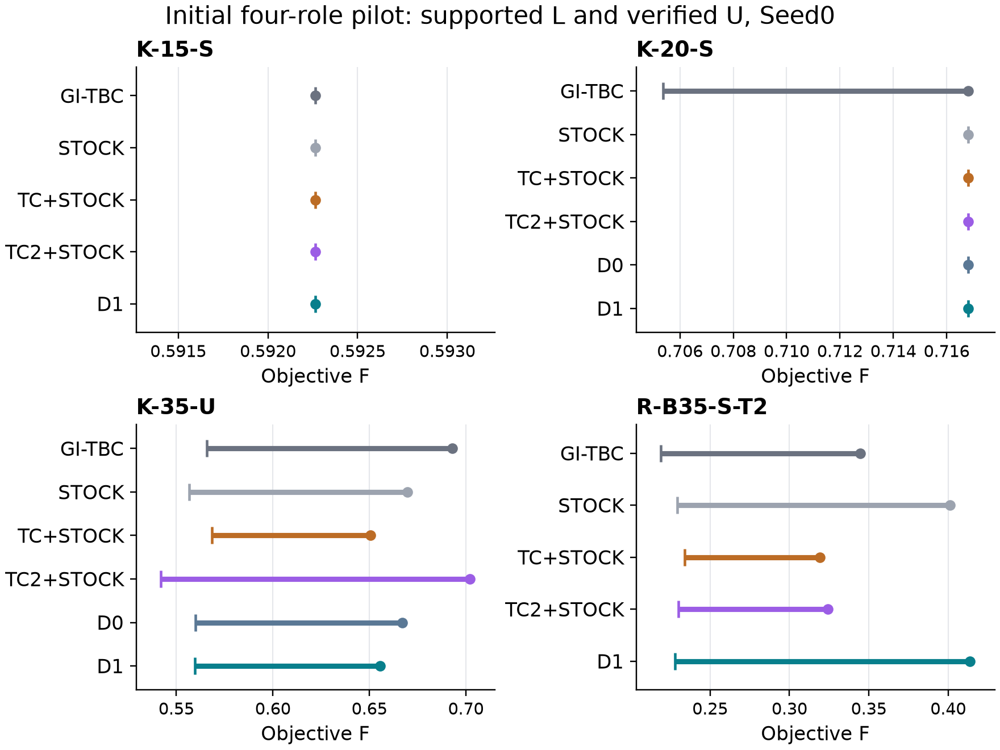

# Conditional objective bounds from physical threshold counts

Round141 independent research appendix, 30 October 2026. This section extends
the maintained Round137 inventory-Gini routing manuscript and the
Round138-Round140 research increments. The complete model, physical objective
and stable GI-TBC method are retained. The study asks whether a station-count
axis supplies information beyond the original Gini axis, and whether qualified
conditional information improves a complete method. It is a finite study of
known research configurations, not an independent validation set.

## 1. Integer count domains and conditional numerator chords

Only stations are counted. For actual finite inventory support
\(\mathcal Y_i\), let \(\sum_y s_{iy}=1\),
\(Y_i=\sum_y y s_{iy}\), and \(r_i=c_iY_i\). The positive distinct supported
ratios form \(0=t_0<t_1<\cdots<t_M\), with
\(\Delta_j=t_j-t_{j-1}\). Define

\[
 K_j=\sum_i\sum_{y:c_iy\ge t_j}s_{iy},\qquad
 A=\sum_{i<l}|r_i-r_l|.
\]

For integer selectors, each threshold separates exactly
\(K_j(n-K_j)\) station pairs. Summing their threshold lengths proves

\[
 A=\sum_j\Delta_jK_j(n-K_j).
\]

```{=latex}
\Needspace{7\baselineskip}
```

Round140 obtains valid integer ranges \(\ell_j\le K_j\le u_j\) from actual
supports and the physical inventory budgets
\(\max\{0,B-\sum_kQ_k\}\le\sum_iY_i\le B\).
For the inherited numerator epigraph \(H_\Sigma\), TC2 retains the old TC row
and adds the concave chord

\[
 H_\Sigma\ge\sum_j\Delta_j[(n-\ell_j-u_j)K_j+\ell_ju_j].
\]

The remainder of one term is
\((K_j-\ell_j)(u_j-K_j)\). It measures chord slack, not complete-model
objective error. Choose \(\ell_j\le m<u_j\) and partition a physical parent
domain into \(D_0=D\cap\{K_j\le m\}\) and
\(D_1=D\cap\{K_j\ge m+1\}\). Integer counts make this a mutually exclusive
complete cover. The sides are not two Gini intervals.

Nested threshold counts imply the zero-Optimize propagation

\[
 D_0:\ u_h'\leftarrow\min(u_h,m)\ (h\ge j),\qquad
 D_1:\ \ell_h'\leftarrow\max(\ell_h,m+1)\ (h\le j).
\]

Each restricted model appends the resulting conditional TC2 aggregate.
Parent TC and TC2 remain. Integer-valid ranges need not already constrain
every fractional parent point, so replacement would not justify unconditional
LP dominance. Incompatible intervals are not clipped into a valid range.
If \(d=u_j-\ell_j\) and \(m=\ell_j+\lfloor d/2\rfloor\), each child width
is at most \(\lfloor d/2\rfloor\). The selected term's continuous worst
remainder decreases from \(\Delta_jd^2/4\) to at most
\(\Delta_jd^2/16\). This is not a fourfold BRP bound or speed theorem.

## 2. Qualified side floors and a scalar disjunction

Suppose a qualified relaxation of side \(D_i\), intersected with the
improvement cutoff \(F\le c_i\), gives lower bound \(\lambda_i\). Use
\(\beta_i\le\min\{\lambda_i,c_i\}\), with the inherited fixed numerical
margin and downward arithmetic. A physical solution below the cutoff has a
legal extension to this model; one above the cutoff already has
\(F\ge c_i\). This proves the floor on the entire corresponding physical
side within its source support/domain. Qualified infeasibility below the
cutoff may supply its conservative cutoff floor. It does not prove that the
whole physical side is empty, delete that side, or fix a binary. Unqualified
returns do not supply new floors. An incomplete pair keeps ordinary valid
parent information unless a source rejection requires the existing fail-closed
disposition. The complete count-cover floor is \(\min\{\beta_0,\beta_1\}\).

One binary \(b\) links the physical count to the two sides:

\[
 K_j\le m+(u_j-m)b,\qquad
 K_j\ge\ell_j+(m+1-\ell_j)b.
\]

The complete linear objective, including ObjCon, receives

\[
 \mathrm{D1}:\quad F\ge\beta_0+(\beta_1-\beta_0)b.
\]

D0 independently pays the same selection and proofs and keeps both links
and the binary, replacing only this row by
\(F\ge\min\{\beta_0,\beta_1\}\). Each physical integer improvement solution
in the source support/domain chooses its unique side from inventory \(Y\), not from a virtual auxiliary
Gini value. Both signs of the floor difference and nonzero ObjCon receive
directed endpoint guards. The serialized endpoints do not exceed the
qualified floors; outward rounding can weaken the ideal scalar formula.

For fixed \(K\in[\ell,u]\), feasible fractional binary values satisfy

\[
 \max\{0,(K-m)/(u-m)\}\le b\le
 \min\{1,(K-\ell)/(m+1-\ell)\}.
\]

When \(\beta_1\ge\beta_0\), eliminating \(b\) gives
\(F\ge\beta_0\) and
\(F\ge\beta_0+(\beta_1-\beta_0)(K-m)/(u-m)\).
In the reverse case it gives \(F\ge\beta_1\) and
\(F\ge\beta_1+(\beta_0-\beta_1)(m+1-K)/(m+1-\ell)\).
Together with the count interval, these describe the convex hull of the two
scalar interval epigraphs \([\ell,m]\times[\beta_0,\infty)\) and
\([m+1,u]\times[\beta_1,\infty)\). This is a standard disjunctive device
[@Balas1998R138], not the full BRP hull.

For \((\ell,u,m,\beta_0,\beta_1)=(0,4,1,0,2)\), the scalar point
\((K,F,b)=(2,0,1/3)\) satisfies D0 and violates D1. The point
\((2,1,1/2)\) satisfies continuous D1 but admits no binary D1 extension.
These are scalar witnesses only. A chosen-b violation is not a projection
separation test; all feasible fractional binary values must be considered.

## 3. Matched continuous evidence

Five saved-point scores reproduce the supplied goal without new Optimize.
Three domains enter 39 new continuous solves: three parent controls, 24
plain/conditional count children, six common-source D0/D1 roots and six fully
rebuilt Gini-midpoint children. All use explicit Seed0, one thread and serial
timing. Ordinary MPS is serialized, hashed and read back before Optimize.
These are numerical LP optima, not rational certificates or Native MIP root
bounds. Offline diagnostic sources never enter a complete method.

K35's physical threshold is \(\frac{9700060735874915}{9007199254740992}\); the other
two use \(\frac{18014398509481983}{18014398509481984}\). The latter is close to one but
cannot be replaced by decimal one. Count/D0/D1 comparisons fix the source
objective, support, Gini interval and actual serialized cutoff. The Gini
comparison instead verifies an identical full parent, then rebuilds its
actual restricted children, including their support and product rows.

The threshold maximizes the weighted chord remainder; the smaller physical
threshold breaks a tie. Explicit count-range violations precede that score.
Balanced and LP-floor pivots are compared. LP-floor has the stronger
conditional cover in all three domains and is frozen as the uniform online
rule. Online scoring uses long double; threshold membership and dyadic
coefficient arithmetic are exact. It is not an exact-rational online score
ordering claim. The following first table uses raw optimal values.

| Role | Parent L | Plain LP-floor cover | Conditional balanced | Conditional LP-floor |
| --- | --- | --- | --- | --- |
| K35 | 0.226044051 | 0.226044226 | 0.235747225 | 0.240140105 |
| RB35-T2 | 0.135449235 | 0.135463277 | 0.142324212 | 0.146301753 |
| K20 | 0.234821878 | 0.23483382 | 0.251586407 | 0.255556703 |

A balanced plain side retains the saved parent optimum. K35's plain differences at roughly 1e-7 are numerical scale, not substantive gains. The LP-floor integer gap can give small plain gains on RB/K20, while conditional chords produce the larger increments. All qualified covers below use the same conservative floor policy.

| Role | Count conditional cover | Gini midpoint cover | Difference |
| --- | --- | --- | --- |
| K35 | 0.240140005 | 0.227601298 | 0.0125387073 |
| RB35-T2 | 0.146301653 | 0.135641398 | 0.010660255 |
| K20 | 0.255556603 | 0.235396129 | 0.0201604738 |

This establishes finite new count-axis information beyond the matched midpoint, not dominance over every Gini pivot or domain. D0 and D1 next use exactly the same two qualified side floors.

| Role | beta0 | beta1 | D0 optimum | D1 optimum | Projection violation |
| --- | --- | --- | --- | --- | --- |
| K35 | 0.241539846 | 0.240140005 | 0.240140005 | 0.240140005 | 0 |
| RB35-T2 | 0.146301653 | 0.150566842 | 0.146301653 | 0.146301653 | 0.000804724405 |
| K20 | 0.255556603 | 0.268192485 | 0.255556603 | 0.255556603 | 0.00266927223 |

D1 separates two actual D0 optima after minimizing over fractional b, but admits other points with the same objective; no reoptimized common-root objective gain is observed. Both floors are already below the carrier's observed Native early bounds (approximately .44698 for K20, .15862 for RB35-T2, and .26602 for K35). That limits expected direct bound value, without proving global redundancy across different Native paths. The cover/projection evidence and small probe cost justify the finite pilot.

## 4. Complete methods and attribution

The uniform carrier is BOTH stock + old TC + TC2. Every new method pays complete own H (seed20260626), normal root/lookahead, construction, two count proofs, validation and Native search. Gurobi Seed0 is explicit for primary solves; any limited Seed1 keeps its registered identity. Threads1, affinity4, M-B/VD-P, pair-only, AM=.08, depth8, minimum width1e-4 and AP off remain common. K roles retain lambda=.15; resource roles retain rho=1 and the frozen binary64 lambda=1/Omega. Physical T is separate from experimental cap.

| Role | Stations / vehicles | Physical T s | lambda | Cap s |
| --- | --- | --- | --- | --- |
| K20 | 20 / 2 | 5400 | 0.15 | 1200 |
| K35 | 35 / 3 | 10800 | 0.15 | 2400 |
| K15 | 15 / 2 | 3600 | 0.15 | 600 |
| RB35-T2 | 35 / 3 | 7200 | 0.0551252752 | 2400 |

The four D1 Seed0 roles retain two qualified certificates, K15 and K20, versus one for stable GI-TBC on these roles. STOCK, old TC+STOCK and TC2+STOCK already retain both proofs. K15 D1 produces its certificate in 32.3593 seconds (37.0207 total), compared with stock's 33.8182 (34.9299 total). K20 D1 closes in 93.5356 seconds (102.5815 total), compared with stock's 101.6354 (104.4597 total). Both differences against stock are below the inherited substantive threshold. K35 D1 ends at U/L=.655549726/.559530134: a substantial repair over TC2, but a stronger incumbent and weaker bound than stable GI-TBC; old TC+STOCK remains better at both ends. RB35-T2 D1 ends at .413773275/.227918419, worse at both ends than stock, TC2 and old TC+STOCK. Its U is about 20.1% worse than stable GI-TBC despite a stronger L. All formal positions are independently paid complete methods under the registered caps; open T_cert remains null.

| Role | Method | Seed | Verified U | Supported L | T_cert s |
| --- | --- | --- | --- | --- | --- |
| K15 | GI-TBC | 0 | 0.592264882 | 0.592264879 | 112.769303 |
| K15 | STOCK | 0 | 0.592264882 | 0.592264882 | 33.8182265 |
| K15 | TC+STOCK | 0 | 0.592264882 | 0.59226488 | 45.2425381 |
| K15 | TC2+STOCK | 0 | 0.592264882 | 0.592264882 | 36.1332107 |
| K15 | D1 | 0 | 0.592264882 | 0.592264882 | 32.3593347 |
| K20 | GI-TBC | 0 | 0.716806546 | 0.705355793 | open |
| K20 | STOCK | 0 | 0.716806546 | 0.716806546 | 101.635385 |
| K20 | TC+STOCK | 0 | 0.716806546 | 0.716806546 | 135.696813 |
| K20 | TC2+STOCK | 0 | 0.716806546 | 0.716806546 | 115.019623 |
| K20 | D0 | 0 | 0.716806546 | 0.716806546 | 117.225005 |
| K20 | D1 | 0 | 0.716806546 | 0.716806546 | 93.5355741 |
| K35 | GI-TBC | 0 | 0.692854359 | 0.565765681 | open |
| K35 | STOCK | 0 | 0.669595569 | 0.556776898 | open |
| K35 | TC+STOCK | 0 | 0.650438712 | 0.568288526 | open |
| K35 | TC2+STOCK | 0 | 0.702148613 | 0.541970377 | open |
| K35 | D0 | 0 | 0.667178614 | 0.5598416 | open |
| K35 | D1 | 0 | 0.655549726 | 0.559530134 | open |
| RB35-T2 | GI-TBC | 0 | 0.344642626 | 0.21898595 | open |
| RB35-T2 | STOCK | 0 | 0.401200218 | 0.2291816 | open |
| RB35-T2 | TC+STOCK | 0 | 0.319080493 | 0.233927262 | open |
| RB35-T2 | TC2+STOCK | 0 | 0.324275718 | 0.229904209 | open |
| RB35-T2 | D1 | 0 | 0.413773275 | 0.227918419 | open |

Open certificate times remain null; no cap is imputed as convergence. Historical references preserve actual original source/PE and complete clocks, pinned to accepted R140 science and its dependencies. They are not same-PE causal interventions. The actual panel and missing TC2 cells are not enlarged by inference. Both-certificate timing uses the inherited substantive threshold max(10 s, 10% of the smaller clock).

The same-PE K20 comparison isolates a useful conditional-floor effect: D1 saves 23.6894 production seconds and 24.7674 total seconds versus independently paid D0, with the same U and effectively identical certificate L. Its terminal Work/nodes are 137.2465/18588 versus D0's 173.2820/28554. K35 D1 improves D0's U by .011628889 but loses .000311467 in L, a real small bound regression; neither dominates. Their cap-limited producer clocks are effectively equal. D0 itself already improves TC2's K35 U by .0349700 and L by .0178712, so the whole carrier repair cannot be credited to the conditional delta. Exact root/probe identities, floors and first integer matrices except the verified floor row match in both pairs. No RB D0 was entered: its adverse whole-method result is not attributed causally to the conditional delta.

| Role | D1-D0 U | D1-D0 L | D1-D0 produce s | D1-D0 total s |
| --- | --- | --- | --- | --- |
| K20 | 0 | 1.66533454e-15 | -23.6894309 | -24.7673724 |
| K35 | -0.0116288886 | -0.000311466832 | -0.00239847181 | 0.036445328 |

For exposed pairs, root/probe matrices and floors match exactly. The actual first integer models are also identical after removing only the verified objective-floor row. This distinguishes D1's conditional value from D0's count links/common floor, while D0 versus TC2 measures their combined change.

All six formal methods actually select once, obtain both qualified count LPs and install the valid pair. There is no actual outer Gini split. D1 probe totals are about .323 seconds for K15, .594 for K20, 3.128 for K35 and 4.775 for RB35-T2, including construction/solve/qualification. The complete producer clocks pay these costs. The standalone D1/D0 common-root objectives coincide, even though the written fractional-b projection separates actual D0 optima on K20 and RB. Both side floors lie below the carrier's observed Native early bounds. The evidence therefore supports changed feasible geometry and search paths, without an additional root LP optimum, a general redundancy theorem, a claim that Native branches on b, or an additive allocation of runtime to a row. K35 D1 uses slightly less terminal Work but more nodes than D0; it is not a universal search-effort improvement. The small probe cost does not by itself explain the important RB endpoint regression.

| Role | Mode/Seed | Produce s | Verify s | Total s | Relative gap |
| --- | --- | --- | --- | --- | --- |
| K15 | D1/0 | 32.3593347 | 4.6613453 | 37.02068 | 3.74907599e-15 |
| K20 | D0/0 | 117.225005 | 10.1238641 | 127.348869 | 2.47815376e-15 |
| K20 | D1/0 | 93.5355741 | 9.0459226 | 102.581497 | 1.5488461e-16 |
| K35 | D0/0 | 2371.13384 | 14.8301903 | 2385.96403 | 0.160881976 |
| K35 | D1/0 | 2371.13144 | 14.8690341 | 2386.00048 | 0.146471867 |
| RB35-T2 | D1/0 | 2371.05613 | 13.5478036 | 2384.60394 | 0.449170758 |

These are every new formal position; cap90 qualifications are separate. Full-precision U/L, signed gaps, Native returned ObjVal/ObjBoundC versus external merged L, root/probe/target/terminal times, Work, nodes and controls remain in the CSV/JSON authorities. Later independent reviews and supplemental chain checks are separate costs. Rounded logs do not establish exact physical-incumbent discovery clocks.



## 5. Implementation scope, history and decision

One root selection uses formal selector fields from the already required LP, not an observational CSV or extra duplicate Optimize. The two canonical count requests are independent local proofs, not scheduler children. Count settings survive parameter readback; independently verified final inventory determines witness side. A single side never becomes global/Gini-cover evidence. Source rejection invalidates dependent use under the inherited fail-closed policy. Later artifacts may inherit the pair only with the same input, contained Gini interval, nonexpanded cutoff and supported-inventory subsets, remapping the frozen physical threshold. Start b is computed from physical inventory. Original probe types are restored then each probe is immediately discarded. Default BranchPriority remains zero, without a custom branching callback or unobserved branching-on-b claim.

Finite tests cover both signs, nonzero ObjCon, both physical Start sides, same/opposite-side witnesses, source revocation, invalid scope, default-off reset, one contained successor and actual Native row/type reads. The first cap90 v5 producer failed the required disposable-probe type-restoration lifecycle check; raw/cost are retained outside performance. V6 fixes that lifecycle, followed by two healthy qualifications. Pure-reader corrections never rerun a sealed healthy producer. The controlled hybrid production build and final targeted repair retain their actual source/PE lineage.

R50/R51 studied variable-family priorities and sparse probing; R62 used single-station thresholds, R88 two-site CDF envelopes, and R120-R122 already used one-binary Gini-axis objective floors with mixed outcomes. The distinction here is an all-station physical count axis, integer gap, nested propagation and conditional numerator chord. McCormick/RLT and disjunctive constructions remain standard tools [@mccormick1976; @AdamsSherali1990R138; @Balas1998R138].

The supplied same-objective R138 K35 numerical return-bound witness supersedes R140's prior priority suggestion. It has R'=(6.306613194,5.773547225,18.919839581), satisfies both stated return upper bounds with about 1.82e-12 maximum residual, and retains its full packet identity in the mathematical note. This is neither a general heterogeneous-vehicle symmetry theorem nor a rational optimality certificate, and is not a new Round141 Optimize or repeated replay. No return-product full benchmark is opened.

Independent result-based selection requires no further experiments. The remaining four D1 configurations are not entered after the important RB regression and lack of material new stock proof-clock value. An RB D0 could supply local attribution, but is not required to change the current D1 adoption/stop decision; no such attribution is claimed. Existing D0 results do not consistently dominate D1 and give no basis for the one allowed uniform D0 adjustment. No decision-changing Seed1 pair is identified, and no favorable-Seed search is opened. The optional count-to-inventory tightening is left untested here as a future source-strength question, rather than forced into a second candidate. The full potential universe remains eight configurations on six base inputs; the entered D1 pilot uses four existing inputs, not eight new instances. Stopping is based on completed full windows and independent review, not budget exhaustion.

Retain the uniform root-count D1 entry as research-only and stop further full expansion. The integer cover, nested conditional chords and scoped floor transport are valid and produce new matched LP information. Complete-method evidence is mixed: the conditional floor helps K20 relative to D0 and improves K35's incumbent, but adds no certificate over the TC2 carrier, gives no substantive proof-clock improvement over accepted stock on the two small roles, and materially regresses RB35-T2. Stable R137 GI-TBC remains the default; D0 is an attribution control, not a replacement uniform candidate. This is a finite negative adoption decision, not a claim that every count disjunction or future stronger proof must fail.

The one useful follow-up is whether a count-implied total-inventory tightening can cheaply strengthen the two conditional source floors beyond the carrier's early Native bounds. Derive and test it first on matched saved LP domains, retaining parent rows and the same physical threshold/support scope, before considering another complete panel. The current weak floors and unchanged D1-over-D0 LP optimum do not justify a branching-priority, Seed or placement grid.

## 6. Cost and reproducibility

New charged experimental computation is 7610.444692 s (2.114012 h), within 36000 s. Qualification and failed experimental attempts count. Complete experimental outers including postverification are also checked against the ceiling; builds, pure analysis, documents and public I/O are separately measured. Nested H/LP/MIP/Work is not charged twice. Old references keep their original clocks with zero new Optimize. Interactive reading/editing receives no invented precision.

The source/PE/DLL, inputs, configurations, exact physical/objective parameters, canonical matrices and helper identities are bound by manifests and frozen batches. Stable R137 and the R138-R140 entry/profile bytes remain unchanged. The separate count-proof switch defaults off. Local scientific validation, once-only new-carrier public byte/member readability and final Draft-PR/cleanup receipts are distinct facts. Public reading performs no Optimize, build or commercial Native load. All new assets remain under ExactEBRP-work; original user content and old rounds are protected.
