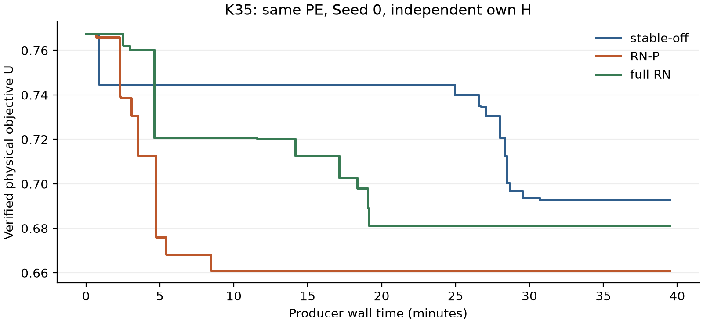
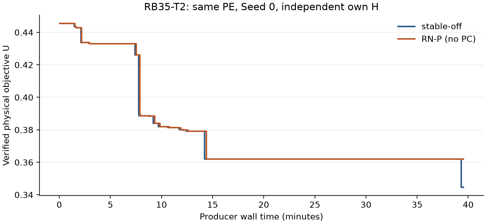

# Round144: RN information projected into original selectors and G

The decision is **RESEARCH_ONLY**. One full RN-block dual box projection retains essentially all measured matched-root RN gain without persistent RN columns. The four-role same-PE core panel remains mixed: K35 has useful incumbent/gap gains with a weaker supported lower bound, RX20 proves the same optimum slightly sooner, K20 has no new row or search benefit, and RB35 has an important adverse complete endpoint. The K35 same-PE full-RN bridge confirms a useful representation result, without establishing broad stable-method superiority.

Stable R137 GI-TBC, its paper entry/profile and earlier research entries remain
available. The RN-P binary flag defaults off; its separate research launcher
explicitly selects this candidate. This is
a finite representation-cost experiment, not a claim that normalized Gini
information or root compression is universally fast.

## Information retained by one original-variable row

| Role | BASE objective | RN objective | Compiled PC objective | RN gain retained |
| --- | --- | --- | --- | --- |
| K-35-U | 0.200177661949 | 0.228090496924 | 0.228090496924 | 1 |
| R-X20-S-T1 | 0.331594316287 | 0.389761616211 | 0.389761616211 | 1 |

Displayed table values are rounded. The actual compiled interval writer loses only
3.83026943496e-15 and
1.36557432029e-14 in matched root objectives.
K35 removes 1170 persistent RN columns/2340 RN rows; RX20-T1 removes 354/708.
Each useful compact model adds one selector/G row and no new columns. All old
matrix rows, objective and penalty, cutoff, supports and G domain are retained.
The two RN source LPs newly save optimal source Pi/RC/basis; the other two
primary LPs reoptimize their matched compact models. R143's raw did not
contain those complete dual attributes. Two additional
compact optimizations qualify the actual C++ coefficients after Native transport.

The single saved actual RX20 upper AM-lookahead child has inherited-PC and
full-RN objectives both 0.588107599905.
Only its RN comparison is newly optimized; the compact optimization is reused
from the sealed health qualifier. There are seven new standalone LP solves in
total. This one no-loss child does not establish full-tree equality.

Box support and original-box coefficient compensation establish validity for
actual binary64 multipliers, including residual extension coefficients and
tiny-term deletion. Independent Fraction checks and actual Native readback
verify the final rows. Exact same-root optimal-value preservation requires
exact optimal primal/dual solutions, the same P and objective. It is the
standard dual-aggregation principle already present in R104; it is neither a
new theorem nor the complete RN projection. R104 ACTIVE's full regression and
its 4349 auxiliary LPs / 3644 DPs per ACTIVE/SHADOW remain prior negative evidence.

## Structural content and scalar floors

On the declared three-station fixed-selector continuous Gini/stock/count/product
cross-section, the RN optimum for objective g+p, with independent p>=0, is
exactly 5/12. The old point g=1/3, p=1/12 satisfies that matched scalar floor;
the selector/G Rank-PC still excludes it by 1/4. Exact old-row feasibility,
the RN lower proof and an attaining extension are retained in the local witness.
This strictly distinguishes the two on that declared local block. There is
no claimed exact separating point for the complete routing P, no universal
floor dominance and no use of floating primal ObjVal as a paid proof floor.
The six saved-point Rank-PC violations were finitely reconstructed without
Optimize and agree with the goal's displayed decimals. Different legal
station subgradients give their own certificate identities and sparsities;
they are not represented as byte-identical to the absent supplemental ZIP.

## Complete same-PE results

| Role / method | U | Supported L | Relative gap | Certificate |
| --- | --- | --- | --- | --- |
| K-20-S / OFF | 0.716806546278 | 0.705363448597 | 0.0159639971768 | False |
| K-20-S / RNP | 0.716806546278 | 0.705346769145 | 0.015987266288 | False |
| K-35-U / OFF | 0.692854358631 | 0.558227874949 | 0.194307045926 | False |
| K-35-U / RNP | 0.660923637174 | 0.545412294185 | 0.174772600784 | False |
| K-35-U / RN | 0.681258498381 | 0.542931774252 | 0.203045869458 | False |
| R-X20-S-T1 / OFF | 0.645325030386 | 0.645325030386 | 3.44081810669e-16 | True |
| R-X20-S-T1 / RNP | 0.645325030386 | 0.645325030386 | 2.70104221375e-14 | True |
| R-B35-S-T2 / OFF | 0.344642625592 | 0.218985949603 | 0.364599926584 | False |
| R-B35-S-T2 / RNP | 0.362136826572 | 0.218895658669 | 0.395544328533 | False |

| Role / method | T_produce | T_cert | T_verify | T_total |
| --- | --- | --- | --- | --- |
| K-20-S / OFF | 1172.37793 |  | 286.738826 | 1459.11676 |
| K-20-S / RNP | 1173.51913 |  | 61.6877434 | 1235.20687 |
| K-35-U / OFF | 2371.08262 |  | 3.9850276 | 2375.06765 |
| K-35-U / RNP | 2371.13836 |  | 5.1892433 | 2376.3276 |
| K-35-U / RN | 2371.02396 |  | 7.7170262 | 2378.74099 |
| R-X20-S-T1 / OFF | 20.6335916 | 20.6335916 | 1.1063039 | 21.7398955 |
| R-X20-S-T1 / RNP | 18.9138269 | 18.9138269 | 1.4015167 | 20.3153436 |
| R-B35-S-T2 / OFF | 2370.99042 |  | 3.8214044 | 2374.81183 |
| R-B35-S-T2 / RNP | 2371.02124 |  | 5.1370398 | 2376.15828 |

Times are seconds. Open T_cert entries are intentionally empty. T_produce
includes each run's own H, the once-root source where applicable, row
construction, formal solves and in-process checks. T_verify contains all
mandatory sealed-raw postverification; T_total is their actual complete clock.
Same-role pairs verify equal physical inputs/fleets, H semantics and H fleet,
source/PE, Seed and full cap. Native return ObjBoundC and the external merged
supported L remain separate fields in reports/new_arms.csv; signed U-L is
retained without clipping. No historical fleet, point or bound is injected.

| Role / method | Presolved columns | Terminal nodes | Terminal Work | Source prep s |
| --- | --- | --- | --- | --- |
| K-20-S / OFF | 2884 | 450091 | 1907.09124 | 0 |
| K-20-S / RNP | 2884 | 448888 | 1901.88085 | 0.4785896 |
| K-35-U / OFF | 7647 | 17076 | 4724.21697 | 0 |
| K-35-U / RNP | 7647 | 14826 | 4843.21752 | 1.7341766 |
| K-35-U / RN | 8803 | 11386 | 5336.40045 | 0 |
| R-X20-S-T1 / OFF | 1369 | 2621 | 29.5418052 | 0 |
| R-X20-S-T1 / RNP | 1369 | 2079 | 26.060295 | 0.3132779 |
| R-B35-S-T2 / OFF | 9994 | 6707 | 5793.33201 | 0 |
| R-B35-S-T2 / RNP | 9994 | 6705 | 5744.80916 | 2.3387603 |

Nodes, Work, simplex, presolved size, AM decisions and trajectories describe
the observed searches. Fewer nodes or equal LP roots alone do not establish
complete benefit, and Work/node is not a causal measurement of column cost.

K35 RN-P improves physical U by 4.6086% and relative gap by 1.9534 percentage points versus OFF, while supported L falls 2.2958%. Its presolved columns remain 7647, root simplex iterations fall from 5188 to 3794, and the printed root-after-cuts bound rises from .42856 to .44959. Terminal Work nevertheless rises 2.5189%; this is useful mixed complete evidence, not a monotone bound or speed improvement.

RX20-T1 proves the same .6453250303858205 physical objective in both methods. RN-P producer/certificate time is lower by 1.7198 seconds and complete time by 1.4246 seconds. This small measured benefit is retained without a general timing claim.

K20 and RB35 both produce the exact tautology 0<=0, so the uniform rule emits no PC. Their once-source preparation costs are .4785896 and 2.3387603 seconds. K20 has identical U, a lower L by 1.66795e-5, and producer time higher by 1.1412 seconds. Its actual pure verification times are 286.7388 seconds OFF and 61.6877 seconds RN-P, giving RN-P a 223.9099-second lower observed T_total. These clocks remain unchanged; no structural search acceleration is inferred on a no-PC role. RB35 RN-P has U worse by 5.0760%, L lower by 9.02909e-5 and gap worse by 3.0944 percentage points. The verified trajectories largely coincide before OFF's late incumbent improvement; this important adverse candidate endpoint is preserved, with no claimed structural cause or proof of global RN redundancy.

The actual same-PE K35 full-RN bridge has U=.6812584983808189, L=.5429317742515352 and gap=.20304586945785152. RN-P improves its U by 2.9849%, L by .4569% and gap by 2.8273 percentage points. RN-P removes 1170 formal RN columns; presolved columns fall from 8803 to 7647, root simplex iterations from 22953 to 3794, and terminal Work from 5336.4005 to 4843.2175, despite more nodes (14826 versus 11386). RN-P T_produce is .1144 seconds higher and T_total 2.4134 seconds lower, mainly through verification. These are complete capped-window endpoint and representation observations, not a causal isolation of column count or an earlier proof. Root-after-cuts bounds .44900 and .44959 show the RN information is not immediately erased by Native cuts.

The figure uses postqualified committed physical witnesses and their effective
availability on each producer wall clock. It does not relabel Native log time
as T_produce or T_total. Full supported L, signed gaps and complete verification
costs remain in the tables and full-precision reports.

RB35-T2 emits no PC: its formal model and own-H identity match OFF. The
adverse endpoint remains part of the complete candidate's evidence. This
verified trajectory records the late OFF improvement; it establishes no
structural cause or general redundancy of RN.

## Implementation, qualification and limits

RN-P obtains one production-capped RN continuous source after the run's own H
and initial root are known. Actual mixed row directions and scaling are
checked. The source's types are restored and its handle explicitly discarded;
formal models use distinct canonical hashes, original integer columns and
unchanged Start mapping. Only compatible narrower input/G/cutoff/support
domains inherit the PC. All source calls remain in Native quality, lifecycle
and cost audits; they are excluded from formal controller-bound reconstruction.
A zero RN dual block is a uniformly omitted tautology. Nonpositive proved
denominator bounds uniformly omit the source. Every complete run clears its
source/cache state; no instance/size/time-specific rule is introduced.

The initial K20 qualifier failed on a zero aggregate before durable dual
serialization. A second K20 producer exposed the disposable source's missing
integer-restoration lifecycle count; it remains unqualified. V5 restores the
source types before disposal. RX20's active-PC health producer then passed;
reader-only formal/source ledger separation was recovered from sealed raw,
without repeating Optimize. All failed producers/readers and costs remain.
Delayed health-verification latency is retained but is not a performance cell.
The complete-run/qualification ledgers contain
55 observed Native Optimize calls,
all returned; 7 belong to
the two unqualified attempts. These counts include once-root sources but
exclude the seven separately reported standalone LPs. Reader-only recoveries
perform zero Optimize and retain their actual outer costs.
Compiled mixed-sense/free-equality/sign-repair/signed-box/deletion/reset fixtures,
actual writer/Native rows, physical complete Start, off matrix and scope
rejection checks are preserved. Independent pre-full and final reviews have
separate evidence and identities.

Measured production source is `0b5858544a671722142c8450db9b88c09c9b1c72`; PE SHA256 is
`180126ae1ecf7db892c3fbb92faa73b517d19029e9824f62cd922e0d9e277d7b`. The measured link uses verified inherited object
and archive lineage and newly compiled affected units. CMake explicitly links
the same projection arithmetic library for a clean build. The process and
commercial runtime binaries/licenses are not published.

## Cost, adoption and remaining scope

New experimental outer cost is **14727.425396300
seconds (4.090951499 hours) of 28800 seconds**. Failed qualification/readers,
once-root sources and all mandatory postverification are included. Nested
H/LP/MIP/Work observations are not charged a second time. Build time
(151.550907 seconds), exact offline arithmetic,
paper/PDF work and public I/O are separate. Pure setup/debug waiting is not
invented as extra Native compute; actual delayed qualification T_total remains
visible. All entered formal positions are preserved with their full windows.

The pilot's single mixed K35 endpoint did not stop expansion: all four core roles and the one meaningful K35 RN bridge received their full windows and complete verification. The overall finite panel, including an important RB35 adverse endpoint and no added root information on two roles, does not justify replacing stable R137. Retain the useful original-variable RN projection as a separate default-off research implementation and close this once-root representation experiment. Do not infer that RN or projection can never be useful elsewhere.

No paid-floor control is entered because the present adoption decision and the claimed same-PE representation comparison do not depend on a full-routing structure-versus-scalar performance claim. The exact same-objective fixed-selector local witness establishes the limited structural distinction; no strict full-routing separation, universal floor dominance or production paid-floor benefit is claimed. K15, RX35-T2 and Seed1 remain explicitly unentered. If stable adoption is reconsidered, a paired full Seed1 check of the decisive RB35 adverse role is a priority; a paid-floor active K35 control is useful if that specific structural-performance attribution is sought. Such measurements could change confidence or future direction, but a control grid is not needed to accept the current research-only scope. Unused budget is not allocated merely to use it.

The continuation/delivery record identifies actual Draft PR/base/head, fixed
science, finite carrier/member recovery and post-PR current-round cleanup.
Local scientific acceptance and public byte readability are separate. Retained
new research assets stay under ExactEBRP-work; the original user tree and old rounds are
protected. No merge, force-push, historical deletion, email or submission is made.
