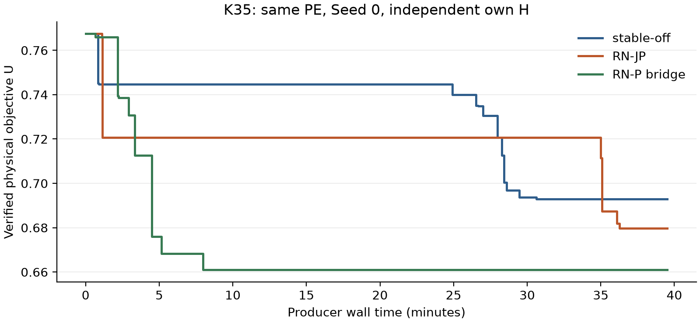
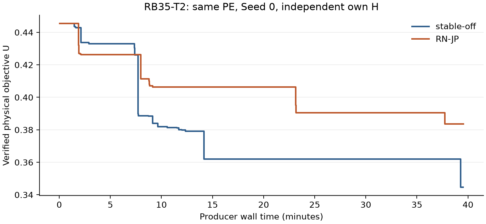

# Shared-factor resource consistency, integer counts and reciprocal normalization

## Scope and computational context

GI-TBC combines a complete primal heuristic with an external interval tree and a strengthened discrete station-state model. Its stable configuration uses M-B/VD-P shared states, pair-only supports, adaptive-mass threshold 0.08, maximum depth 8, minimum interval width \(10^{-4}\), and AP off. The accepted proof policy distinguishes feasible physical plans, supported lower bounds, and a method's own certificate. The 120 registered positions of the finite consolidation study include repeated roles, objectives, mechanisms, and seeds; they are not 120 independent instances. Difficult roles remain open.

The common structural question is consistency of one shared factor across physical resources and discrete station information. Earlier shared-stock constraints already have complete computational value: STOCK reduces the K15 certificate clock from 112.77 to 33.82 seconds, and certifies K20 in 101.64 seconds at Seed 0 and 90.23 seconds at the selected Seed 1, while matched BASE runs remain open at their 1200-second caps. The Seed 1 STOCK build includes the separately disclosed V2 coefficient-transport repair. These results remain algorithmic contributions despite research-only adoption and mixed hard-role endpoints. Placement studies explain why putting useful information in the explicit LP or native MIP can have different complete effects. Conditional-count studies establish real discrete information, but their limited additional complete benefit closes that earlier count-proof branch.

The present study connects threshold-count and physical-stock information to the same reciprocal normalization. It asks, in order, whether the connection is mathematically strict, whether it increases real matched LP objectives beyond strong old information, and whether compact expression improves the complete solver. These are separate evidential questions. Stable GI-TBC and all previous research identities are retained throughout.

## From ordinary resources to reciprocal normalization

Write \(r_i=c_iY_i\), \(S=\sum_i r_i\), and \(A=\sum_{i<j}|r_i-r_j|\). On the positive-denominator domain, the Gini term is \(G=A/(nS)\). Let \(s_{iy}\) select the supported integer stock \(y\) at station \(i\). The ordinary station-product model connects the objective factor \(g\) to resources through products such as \(q_{iy}=g s_{iy}\). The selected continuous shared-stock block has an endpoint convex-hull explanation using standard reformulation-linearization and disjunctive tools [@AdamsSherali1990R145; @SheraliAdams1999R145; @Balas1998R145]. When the stated common bounds are valid for the same selected continuous stock polytope and common base/Gini rows, the projected relation is stock contained in shared GS, itself contained in projected independent GS. This concerns that continuous block, not the full integer routing hull or every historically tightened domain.

Integer information comes from the actual finite ratio support. Order the nonnegative supported levels with \(\theta_0=0\), adding zero if needed, and let \(\Delta_j=\theta_j-\theta_{j-1}>0\). At threshold \(\theta_j\), define
\[
K_j=\sum_{i,y:c_i y\ge\theta_j}s_{iy},\qquad \ell_j\le K_j\le u_j.
\]
At integer selectors, \(A=\sum_j\Delta_j K_j(n-K_j)\). Physical inventory and support bounds give two integer-valid chords:
\[
K_j(n-K_j)\ge(n-u_j)K_j,\qquad
K_j(n-K_j)\ge\ell_j u_j+(n-\ell_j-u_j)K_j.
\]
Their aggregates are the earlier TC and TC2 inequalities.

Reciprocal normalization introduces \(t=1/S\) and \(w_{iy}=t s_{iy}\) at integers, in the classical fractional-programming tradition [@CharnesCooper1962; @Yue2013]. Its continuous source retains all product-box faces, station masses, normalized ratio total, and pair epigraphs, including
\[
Ls_{iy}\le w_{iy}\le Us_{iy},\quad \sum_yw_{iy}=t,\quad
\sum_i c_i\sum_y y w_{iy}=1,\quad
\widehat H:=\sum_{i<j}\widehat h_{ij}\le ng.
\]
Earlier RN experiments give matched original-objective increments beyond TC plus stock, but persistent RN columns impose a complete-search cost. Earlier RN-P compresses a paid RN source into one original-variable row, preserving measured root information and improving K35 incumbent/gap. Root preservation does not establish whole-tree equality or isolate column count as the cause of an endpoint change.

## Connecting counts and physical stock to the same factor

For either integer-valid aggregate \(A\ge b+\sum_{i,y}k_{iy}s_{iy}\), multiplication by positive \(t\) gives
\[
\boxed{\widehat H\ge bt+\sum_{i,y}k_{iy}w_{iy}.}\tag{NC}
\]
Both homogenized TC and TC2 are retained, including the constant times \(t\), negative coefficients, and actual threshold identities. Their difference is
\[
\sum_j\Delta_j\ell_j(u_jt-W_j),\qquad W_j=\sum_{i,y:c_i y\ge\theta_j}w_{iy}.
\]
Fractional \(w/t\) need not obey the integer count upper bounds, so NC2 cannot unconditionally replace NC1. Old TC constraints on the ordinary pair sum do not automatically constrain \(\widehat H,w\).

Let \(\tau=\sum_iY_i\) and \(\widehat\tau=\sum_{i,y}yw_{iy}\). Valid physical bounds \(B^-\le\tau\le B^+\) and \(L\le t\le U\) give four standard products of resource and factor slacks:
\[
\begin{aligned}
\widehat\tau&\ge L\tau+B^-(t-L),&\widehat\tau&\ge U\tau+B^+(t-U),\\
\widehat\tau&\le U\tau+B^-(t-U),&\widehat\tau&\le L\tau+B^+(t-L).
\end{aligned}\tag{TS}
\]
TS constrains endpoint stocks of the reciprocal product used by RN. It differs from old STOCK's \(g\)-based product. Physical stock and ratio total remain distinct for heterogeneous \(c_i\). NC adds two source rows and TS four, with no columns beyond RN. Bounds retain their actual input, support, root, and cutoff scope. Neither construction is a new general convexification principle, and neither uses instance identity or elapsed time.

## Local strictness and the remaining integer-objective gap

For any \(n\ge4\), take \(c_i=1\), support \(\{0,1\}\), stock range \([1,n-1]\), and fixed selectors \(s_{i0}=s_{i1}=1/2\). Let \(O\) contain the declared old VD-P, stock, TC, TC2, Gini, and RN block, with old \(g\)-domain \([0,(n-1)/n]\). The exact local minima are

| Local relaxation | Minimum \(g\) |
| --- | --- |
| \(O\) | \(1/n\) |
| \(O+\mathrm{TS}\) | \(1/n\) |
| \(O+\mathrm{NC}\) | \((3n-2)/(2n^2)\) |
| \(O+\mathrm{NC}+\mathrm{TS}\) | \((3n-4)/(2n(n-1))\) |

Here \(H=\sum_{i<j}h_{ij}\), \(Z_i=\sum_y yq_{iy}\), and \(J=\sum_iZ_i\) since \(c_i=1\). For the lower bounds, old constraints give \(n-1\le H\le nJ\le n(n-1)g\). Normalization gives \(\sum_iw_{i1}=1\), while masses and product boxes imply
\[
t\ge t_N=\frac{3n-2}{2n(n-1)}.
\]
NC2 requires \(ng\ge(n-1)t\). The fourth TS row further gives
\[
1\le\frac{n}{2(n-1)}+(n-1)t-1,\qquad t\ge t_S=\frac{3n-4}{2(n-1)^2}.
\]
For attainment, choose \(w_{i1}=1/n\), \(w_{i0}=t-1/n\), \(q_{i1}=(n-1)/n^2\), \(q_{i0}=g-q_{i1}\), \(J=(n-1)/n\), \(H=n-1\), and ordinary \(h_{ij}=2/n\). Use \(t_N\) without TS and \(t_S\) with TS. Set normalized \(\widehat h_{ij}=0\) without NC and \(\widehat h_{ij}=2t/n\) with NC. These assignments satisfy the remaining declared product faces, stock, mass, normalization, and finite caps. The successive strict increments are \((n-2)/(2n^2)\) and \((n-2)/(2n^2(n-1))\). At \(n=4\), the four values are \(1/4,1/4,5/16,1/3\). The fixed penalty is \(P=n/2\), so adding the original \(\lambda P\) shifts all four optima equally.

This does not describe the full integer objective epigraph. Positive-stock binary points satisfy \(G=(n-\tau)/n\), and the same marginals give \(E[\tau]=n/2\). Their full integer Gini epigraph hull therefore has minimum \(g=1/2\), attained by the equal mixture of the \(2n\) vectors with stock 1 or \(n-1\). This mixture realizes the selectors and ordinary pair differences; it is not claimed to realize every ordinary objective product jointly. The joint relaxation, of order \(3/(2n)\), leaves substantial integer-objective consistency unexpressed. The all-\(n\) result is algebraic and restricted to this local block. It does not imply strictness for a full routing/cutoff instance or dominance over every conditional-count disjunction. No binary-specific patch or full integer epigraph reconstruction is introduced.

## Matched original-objective information

The finite LP stage reuses sealed production-capped RN baselines for K35 and RX20-T1, and adds NC, TS, and their union to each. It also measures K35's strong old carrier \(O_{\rm actual}=\mathrm{RN}+\mathrm{stock}+\mathrm{TC}+\mathrm{TC2}\), its nested joint extension, one former no-PC K20 source, and two transported compact models. There are 11 new standalone LP optimizations. Every comparison preserves the complete original objective, old matrix, finite bounds, cutoff, supports, and \(g\)-interval, with explicit Seed 0, one thread, and serial timing.

| Domain | RN | RN+NC | RN+TS | RN+NC+TS |
| --- | --- | --- | --- | --- |
| K35 | .228090496924 | .234490766730 | .231536862694 | .234508197894 |
| RX20-T1 | .389761616211 | .389761616211 | .396339103751 | .396339103751 |

K35's strong old carrier has objective .229222197461; its nested joint source has .234508197894. The .005286000433 increment exceeds old information's simple coexistence on this matched real domain. Adding old stock/TC/TC2 to the selected joint source gives no further measured K35 objective increment. This is numerical information evidence, not a global dominance theorem. NC and TS each improve K35; their joint exceeds NC alone by .0000174311642. On RX20 the entire .006577487540 measured increment comes from TS. The former no-PC K20 source gains .027659787220, reaching .222808939661. Gini and weighted-penalty components, matrix sizes, quality, activities, and source costs are retained with full precision in the evidence.

Saved-point separation is a different layer. For arbitrary site multipliers \(\lambda_i\), with \(\Gamma=b+\sum_i\lambda_i\), mass equations and product boxes imply
\[
ng\ge\min(L\Gamma,U\Gamma)+\sum_{i,y}\min\{L(k_{iy}-\lambda_i),U(k_{iy}-\lambda_i)\}s_{iy}.\tag{NC-PC}
\]
Positive violation separates an original point from every NC extension, rather than only rejecting one saved extension. Four supplied NC2-PC signals are independently reconstructed with zero Optimize, matching within \(2.5\times10^{-14}\). Binary64 inputs and actual selector masses are exact rationals without normalization. RX20's given signal uses the standalone saved LP point; a different complete-production point has a separately retained positive signal. These ideal-NC certificates differ from production rounded rows, and the same points also violate old TC2. They do not establish a reoptimized objective gain. The strong-carrier comparison resolves that question without injecting historical cuts into fresh complete runs.

## Compact expression and qualified implementation

Relative to formal BASE \(P\), write the complete added source block as \(Ex+Fz\ge d\), with finite \(\ell\le z\le u\). Its explicit list includes every RN row, both NC rows, and all four TS rows. For sign-correct dual multipliers \(\beta\), define \(a=E^T\beta\), \(r=F^T\beta\), and \(b=d^T\beta\). Finite-box elimination gives
\[
a^Tx\ge b-\sum_j\max\{r_j\ell_j,r_ju_j\}.
\]
Validity holds for any lawful multipliers. Exact same-root preservation uses optimal primal/dual solutions, the same old domain and objective, and zero objective on added columns. It is standard LP duality, also used in R104; that earlier negative complete evidence remains in the history. This concerns one root objective, not the whole projection or descendant search.

Actual C++ transport uses outward interval arithmetic and finite-box compensation for coefficient conversion and tiny deletion. Actual compact LP reoptimization loses \(2.7534\times10^{-14}\) on K35 and \(1.7264\times10^{-14}\) on RX20, retaining essentially the full new increment. Formal models add one original-variable row and zero RN columns. Original \(Y\) may remain with \(G\) and selectors. Production uses unchanged R140 downward dyadic NC coefficients; diagnostics use exact rational aggregates with signed-box conversion. Separate oracle and Native readback checks preserve their identities. TS uses physical \(Y\), normalized stock, outward RHS multiplication, and power-of-two scaling. Existing \(\widehat h\le1\) caps remain integer-valid; their pure-RN redundancy argument is not asserted unchanged after NC.

The candidate RN-JP pays for one source after its own complete H and initial root. It restores/discards that source and rebuilds formal BASE plus the PC. Source points, bounds, and handles cannot become formal controller evidence. Only compatible narrower \(g\), cutoff, and support domains inherit the row. All source computation enters quality, lifecycle, and costs. Native audit checks the complete source matrix, including the six new rows; formal models reject persistent RN columns and NC/TS source rows. Independent review, exact fixtures, actual writer readback, and one short complete health test qualify Start, scope rejection, zero projection, default-off behavior, and source isolation before the expensive panel.

## Complete computational evidence and adoption

Four core roles compare RN-JP with stable-off using the same measured executable and explicit Seed 0. Each method pays complete own H, its selected source, formal search, and verification. The physical horizons are 5400 seconds for K20, 10800 for K35, 4800 for RX20-T1 and 7200 for RB35-T2. Compute caps are respectively 1200, 2400, 1200 and 2400 seconds. K roles retain lambda .15; resource roles retain their exact original rho=1, lambda=1/Omega. Threads=1, affinity mask=4 and H seed=20260626 are fixed, and timing is serial. One admitted K35 old RN-P bridge compares compact candidates under the same PE, input, objective, H, seed and budget. This is a known finite research panel, not an independent unseen validation set.

| Role | Method | U | Supported L | Relative gap |
| --- | --- | --- | --- | --- |
| K-20-S | OFF | 0.716806546278 | 0.705360087787 | 0.0159686857629 |
| K-20-S | RNJP | 0.716806546278 | 0.702889298895 | 0.0194156253947 |
| K-35-U | OFF | 0.692854358631 | 0.558286661549 | 0.194222198946 |
| K-35-U | RNJP | 0.679684412741 | 0.541069698488 | 0.203939816266 |
| K-35-U | RNP | 0.660923637174 | 0.550645816146 | 0.166854103598 |
| R-X20-S-T1 | OFF | 0.645325030386 | 0.645325030386 | 3.44081810669e-16 |
| R-X20-S-T1 | RNJP | 0.645325030386 | 0.645325030386 | 3.44081810669e-16 |
| R-B35-S-T2 | OFF | 0.344642625592 | 0.218985949603 | 0.364599926584 |
| R-B35-S-T2 | RNJP | 0.383702514966 | 0.220374791101 | 0.425662375134 |

K35 RN-JP improves U by 1.900825% against contemporaneous OFF, but weakens supported L by 0.0172169630606 and increases relative gap by 0.971762 percentage points. K20 reaches the same U with a weaker supported L; neither method certifies. RX20 certifies the identical objective in both methods, with no material certificate/total-time benefit. RB35 RN-JP U/L is 0.383702514966/0.220374791101, against OFF 0.344642625592/0.218985949603; its signed changes are delta U=0.0390598893744, delta L=0.00138884149749, and delta relative gap=6.106245 percentage points. All adverse endpoints remain authoritative. The source is active on all four roles, so the new resource endpoint is not explained by the predecessor's no-PC prefix finding.

The K35 same-PE old RN-P bridge gives U/L=0.660923637174/0.550645816146 and relative gap 0.166854103598, against RN-JP 0.679684412741/0.541069698488 and 0.203939816266. RN-JP minus RN-P is 0.0187607755676 in U, -0.00957611765793 in supported L, and 3.708571 percentage points in relative gap. Both formal models have zero RN columns and at most one PC. This is a direct finite comparison of the two compact candidates; it is not a causal column-count experiment or a whole-tree preservation test.

| Role | Method | Production s | Certificate s | Verify s | Total s |
| --- | --- | --- | --- | --- | --- |
| K-20-S | OFF | 1172.38914333 | open | 60.4726642 | 1232.86180753 |
| K-20-S | RNJP | 1172.12360281 | open | 40.477744 | 1212.60134681 |
| K-35-U | OFF | 2371.16427748 | open | 4.0596254 | 2375.22390288 |
| K-35-U | RNJP | 2371.08174293 | open | 6.31640919996 | 2377.39815213 |
| K-35-U | RNP | 2371.08247617 | open | 5.1723447002 | 2376.25482087 |
| R-X20-S-T1 | OFF | 21.8844787166 | 21.8844787166 | 1.1695795001 | 23.0540582167 |
| R-X20-S-T1 | RNJP | 21.5459131468 | 21.5459131468 | 1.52576029999 | 23.0716734468 |
| R-B35-S-T2 | OFF | 2371.09047267 | open | 5.2741227001 | 2376.36459537 |
| R-B35-S-T2 | RNJP | 2372.40459783 | open | 6.03109439998 | 2378.43569223 |

Open certificate clocks are null in the data and displayed as open. Verification is separate from production and certification. K20 has no new certificate, so a smaller verification or total clock is not proof acceleration. The small RX20 differences are not substantive speed evidence. Native returned bounds, external merged bounds, signed gaps, physical objective components, presolve sizes, simplex iterations, AM decisions and Work remain separate fields in the full reports.

| Role | Source objective | First formal LP | Observed loss | PC NZ |
| --- | --- | --- | --- | --- |
| K-20-S | 0.222808939661 | 0.222808939661 | 6.96664947952e-15 | 387 |
| K-35-U | 0.234508197894 | 0.234508197894 | 8.46545056277e-15 | 384 |
| R-X20-S-T1 | 0.396339103751 | 0.396339103751 | 1.85962356625e-14 | 50 |
| R-B35-S-T2 | 0.133696446522 | 0.133696446522 | 6.66133814775e-15 | 484 |

The table compares the paid production source with the first formal continuous LP. These numerical losses measure root retention; they do not predict root-after-cuts or full-tree bounds. All formal models contain zero RN columns.

Predecessor RN-P evidence remains visible: its original K35 U improves 4.6086% and relative gap falls 1.9534 percentage points despite weaker L. K20 and RB35 emit no predecessor PC. The supplied raw RB35 audit finds identical formal matrices, H and Start, all 33 RN-P physical witnesses matching the first 33 OFF witnesses, and matching observed clock-free root/positive-node states; OFF alone obtains its final improvement near the wall boundary. This supports an observed same-prefix truncation, not a proof of the unexecuted continuation. At node 6619, about 21 seconds of Native drift exceeds the 2.3388-second source preparation, so the latter does not explain all drift. The adverse endpoint and all fees remain. Similar evidence sizes also do not make K20 verification-clock variation structural acceleration.

## Decision and reproducibility scope

Retain RN-JP as default-off research and stop this once-root joint-expression trial without stable promotion. The local theorem, stronger real joint LP, exact saved-point separation, full-block projection and near-complete root retention are retained results. They have not yielded a sufficiently convincing complete improvement over BASE across the core roles; the single K35 bridge assesses existing compact RN-P. A stronger paid source followed by one root row does not enforce full integer-objective consistency or guarantee useful descendant search. Do not automatically add more thresholds, repeated separation, floor grids, a second route-A panel, or further seeds. Optional K15/RX35 pairs and Seed/floor controls are not entered: the observed mixed/negative complete evidence already resolves adoption of this candidate, and no specific opposing result currently justifies that cost. Unused budget is not a reason to expand. This closure does not erase the earlier STOCK certificates or RN-P K35 computational gains.

The charged new experimental cost is 14485.720243 seconds of 28800 (4.023811 hours). This includes source work, qualification and necessary postverification, without adding nested H, LP, MIP or Work twice. Builds, offline exact arithmetic, paper preparation and bounded public I/O are separate. No second route-A panel, extra Seed, floor or boundary grid is entered. All nine full positions, the short health qualification, all 51 returned complete/qualification Native calls, the 11 standalone LPs, actual row/readback identities and independent reviews remain in the finite evidence package. The measured source/PE identity is distinct from the final scientific and delivery commits. Anonymous public byte/member verification checks delivery integrity without claiming public solver reproduction.
