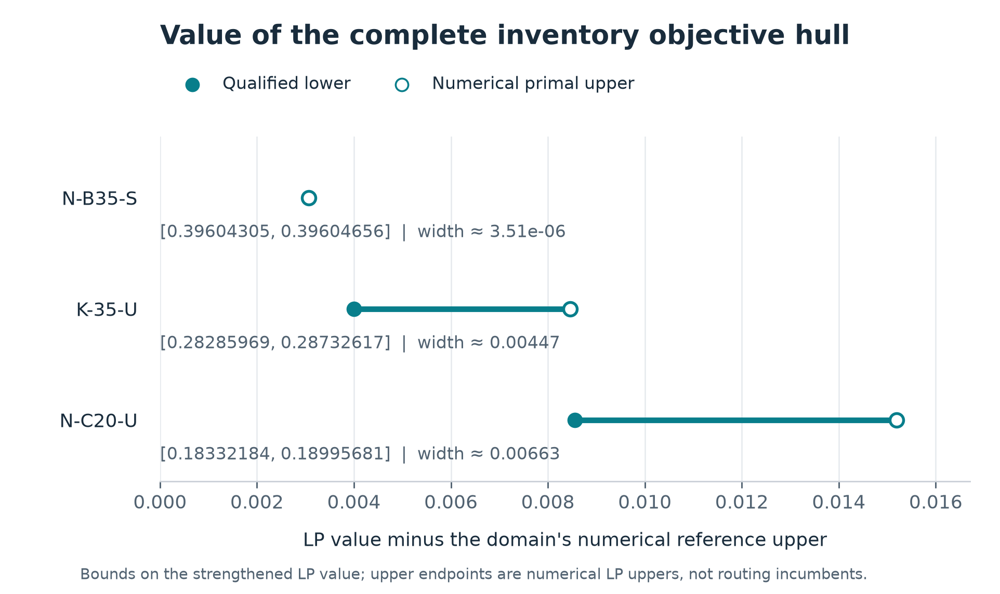

# Round153: coupled integer objective hull and own-root floor

The complete inventory hull has positive value on all three diagnostic
domains. NB35 is tightly bounded; K35 and NC20 retain quantified unresolved
pricing/coupling gaps after targeted deepening. The uniform own-root floor
candidate has mixed complete-search outcomes and remains default OFF.
All experiments and the final numerical audit are closed. The independent
review and actual publication/recovery record are linked in [RESUME](RESUME.md).
Immutable outer receipts remain in `fees/`; partial failed attempts are
reported separately from completed performance.

## Question and scope

R152 established useful joint inventory information and an executable
hard-resource price oracle, but a finite list of separated marginal points
did not quantify the entire objective hull in the original free routing
relaxation. This study restores the relevant historical joint information,
couples the full inventory distribution to the complete routing LP, and
bounds the resulting value. A separate experiment assesses whether the
cheap scalar inventory floor can improve the stable complete method when
each arm constructs and pays for it itself.

The stable method remains R137 GI-TBC. Its entry and profile are unchanged.
Neither an inventory price incumbent nor a restricted-master primal is
a physical routing incumbent. Restricted-master uppers bound the value of
the strengthened LP only. Complete-method U/L/gap and certificate times
have a separate evidence chain.

## Historical reference and structural result

The reference keeps every original route, load, time, objective, cutoff
and auxiliary variable free. It includes the declared AP/GD/stock/count/
common-factor/RN information, both R145 normalized-count inequalities,
all four stock-reciprocal product inequalities, and the union of the old
eight supports, final support and floor. The direct-g comparison transports
the actual finite coefficients. Stored primal/qualified-dual sandwiches
avoid new solves for already redundant additions.

| Domain | Pure B root lower | Old strong RN | Current union/direct-g value |
|---|---:|---:|---:|
| N-B35-S | .3278337721771161 | .38673718656544753 | .392978953518639 |
| K-35-U | .20017766194929548 | .2788356429814587 | .27886445393293 |
| N-C20-U | .04835767607072543 | .17446526778483834 | .174769124713578 |

These are complete free-LP values, not complete-method terminal bounds.
The saved lower and numerical-primal upper are reported separately in the
machine table; tiny inherited numerical order differences are not hidden
by rounding them into exact equalities.

All three reference optima admit a common distribution of legal integer
stocks under the declared numerical qualification. Thus projection alone
explains no material extra root value at these optima. The distribution's
expected Gini is a feasible completion value, not a minimum completion.
No claim about penalty slack absorbing the new information is inferred
from this compatibility test. The final audit's Pe-minus-H observations on
all six reference/selected-upper points have absolute magnitude below
8.54e-13, within floating noise. They do not support a penalty-slack
explanation for the remaining interval.

At fixed state marginals the expected unary penalty is H, so
Theta=H+Gamma. The independent Fraction reconstruction of the heterogeneous
169-row/68-variable example gives H=3/32, Gamma=161/1080 and
Theta=1049/4320. The strengthened historical block attains g=1/9 and
objective59/288, leaving exact gap41/1080. A hard resource constraint
excludes the high/high corner of a two-station marginal support and fixes
the three remaining joint weights. This is a fixed-marginal inventory
separation, not a strict complete-routing example. The old global-floor
gap1/480 does not transfer to this stronger reference.

The complete definitions, proofs, old-source boundaries and classical
decomposition attribution are in [mathematical_analysis.md](mathematical_analysis.md).

## Coupled value and targeted deepening

The complete object uses every original integer state, both hard inventory
totals and the physical Gini cap. Its completion cost is
f(Y)=max(gamma_L,G(Y)), including a separate legal zero stock. A finite
column set supplies a numerical feasible upper on the strengthened LP.
For beta>=0 and all signed marginal potentials, full pricing minimizes
beta*f(Y)-pi.v(Y). The exact original-Q residual support C_Q and true
restricted-column intercept a_K yield the lower
C_Q+min(a_K,L_price), with only one convexity correction. There is no extra
unary penalty term hidden in Gamma pricing and no division by beta.

N-B35-S is already resolved to
[.3960430527066062,.39604655895626023], width3.50625e-6, against the current
reference .392978953518639. A global total-objective floor, transported
through the actual AP coefficients and reoptimized in free Q, nearly
meets the complete feasible master upper. Its targeted offline floor
construction costs6.8012825 seconds. The original degenerate-price attempt
and its owned interrupted pending call are retained; that pending call
contributes cost and no bound.

K35 now has interval [.2828596948801659,.28732616330431715], width
.004466468424151271. Its free-Q envelope of 82 supports reaches
[.2828596948801659,.2828596948801739], establishing a positive increment
over the current reference. The final 1200-second near-optimal-direction
price improved its lower from .06092685437735434 to .07003842216867079,
with unchanged true stock upper .08087030469130901. It cost 1214.6429355
outer seconds and still gives only .27649417078408406 through its fixed
C_Q/a_K certificate, below the accumulated lower. The support transfer
cost 13.3386537 seconds. Its 33882-column pool is unchanged, so no final
primal refresh is needed. The Native bound was still progressing late in
the run; the observation is no material hull-interval improvement, not
a price plateau. About .00636552 further price-lower improvement would
be needed before that fixed certificate first improves the accumulated
lower, and its possible ceiling remains near the numerical upper.

NC20 finishes at [.18332184845553887,.1899568005655939], width
.00663495211005502. Its final 53-support free-Q value is
[.18332184845553887,.18332184845554086]. Renewed midpoint/zero-center
selection on the large pool completed five full prices in 1655.1022630
outer seconds, adding 23 stocks (21 negative relative to their selected
level duals) without changing the accumulated interval. The final beta is
.5589967188352934, D_K=.18663931892059488, price interval
[.0022789119533765285,.014658738526272638] and correction
.012809644903980405. The midpoint band deliberately places D_K below the
RMP optimum; this difference is not automatically numerical error. The
last three stocks had not yet been reoptimized, so one final complete-Q
RMP solve checked all 54210 columns in 32.8080689 outer seconds. Its
optimal, qualified primal .18995680056588857 did not improve the retained
upper. The preceding support transfer cost 9.9434470 seconds.

| Domain | Current reference (numerical) | Coupled value interval | Width | Legal columns | Target met |
|---|---:|---|---:|---:|---|
| N-B35-S | .392978953519 | [.396043052706, .396046558957] | 3.50625e-6 | 575 | yes, 1e-4 |
| K-35-U | .278864453933 | [.282859694880, .287326163305] | .00446647 | 33882 | no, 1e-4 |
| N-C20-U | .174769124714 | [.183321848455, .189956800566] | .00663495 | 54210 | no, 1e-5 |

The interval labels above are rounded outward for display; stored binary64
endpoints and their numerical qualification are in the machine table.
NB35's remaining value is tightly bounded. K35 and NC20 establish positive
same-Q increments but retain material uncertainty. Their endpoint is
supported by distinct long-price, changed-direction, free-support and
large-column probes, including the final master refresh where needed.
The old almost-closed NC20 direction has little direct-certificate
headroom; different near-optimal and refreshed midpoint directions remain
hard to price. No tested variant justifies a general negative conclusion.
Further work would need to improve this global price proof or the choice
and joint effect of directions; repeating a fixed short-direction grid
would not establish the missing hull value. The remaining opportunity is
not claimed exhausted, and available budget is not treated as a minimum
runtime. Independent endpoint reviews and the final numerical audit
determine the accepted finite-stage claim.

The
`reports/scientific_table.csv`, `coupled_iterations.csv`, `pricing_results.csv`
and `research_phases.csv` will preserve all completed phases and unsuccessful
comparisons, not just the best endpoints.

Exhaustive denominator partitions and a zero-Native common-refinement
overlay preserve valid information but did not improve the selected K35
full-price lower in their controlled short comparisons. The historical
R88 cumulative-distribution/OT epigraph was also qualified in normalized
pricing. Both the NC20 120-second and K35 300-second saved-direction probes
returned weaker price lowers, so the ordinary oracle was retained. This
records the formulation's size/search cost on the actual price problems;
it neither revives the parked R89 complete candidate nor establishes a
universal negative result about cumulative formulations.

The separate Lagrangian integer-flow probes passed3744 Cartesian-energy
checks and rejected three altered flow records before use. All16 slices
were evaluated on each fixed direction, in10.8374seconds for NC20 and
13.8004seconds for K35, with64 and73 exact flows respectively. The obtained
lowers remained weaker, so neither the coupled nor complete oracle was
switched. These observations concern the tested denominator/relaxation/
parameter-search configurations, not the best possible cut bound or the
whole family. All newly verified legal stocks remain available as columns.

## Uniform complete-method transfer

The offline scalar opportunity is judged against pure B. The NB35 floor
above and K35 floor [.23294169799100467,.23294474350881117] exceed their
pure-B root lowers. NC20's reusable near-zero inventory upper rules out
this scalar opportunity on its diagnostic domain. These facts select a
mechanism to test; no offline floor, potential, stock pool or another arm's
incumbent is loaded into a complete producer.

The scalar and coupled questions have different answers. A legal inventory
with nearly zero total stock objective prevents a useful positive scalar
floor on that domain. It need not extend to a feasible point of the full
routing model, and it says nothing by itself about the completion cost of
the marginals selected by free Q. Thus NC20's negative scalar opportunity
is consistent with its established positive coupled-value improvement.
Conversely, NB35's nearly closed coupled interval shows that a global
total-objective floor can sometimes capture almost all of this additional
LP information. Neither observation predicts the effect on complete search.

The frozen J rule runs once after its own H, derives its domain from its
own canonical model, applies exact hard-total DP, and then uses the
qualified normalized integer oracle with Seed0/Threads1, NodeLimit4096,
MIPGap0 and original-price absolute Native gap1e-4. The ordinary global
method deadline stops the entire method. No internal k-second switch or
instance-dependent dispatch is present. The sole formal addition is
G+sum(omega_i*e_i)>=qualified_floor. AP and the diagnostic blocks do not
enter the formal routing model. Root information is reused only in
verified descendants of its original domain.

The pre-outcome frozen panel is NB35, K35 and RB35-T1 at2400seconds per
arm, followed by NC20 at1200seconds per arm. Each role has B then J, the
same new PE, its own H seed20260626, Gurobi Seed0/Threads1, original
physical settings and pair-only AM=.08/depth8/minimum width1e-4. RB35-T1
retains lambda=.055125275219827186 and T4800. No role is replaced according
to observed complete outcomes. All eight arms have completed and passed
their inherited endpoint and closeout checks. Each pair has equal own-H
semantic-trace and canonical-fleet hashes, with two separate paid H runs.

| Role | Arm | Physical U | Complete L | T_produce (s) | T_verify (s) | T_cert (s) |
|---|---|---:|---:|---:|---:|---:|
| N-B35-S | B | .450291503263 | .389310601642 | 2371.497344 | 2.765726 | open |
| N-B35-S | J | .460394748354 | .395956408724 | 2371.372241 | 6.677003 | open |
| K-35-U | B | .692854358631 | .565406336084 | 2372.056156 | 2.754693 | open |
| K-35-U | J | .661326795081 | .539723389342 | 2371.396882 | 5.125982 | open |
| RB35-T1 | B | .591517634770 | .455903891252 | 2376.287360 | 2.813188 | open |
| RB35-T1 | J | .616049183898 | .461097372891 | 2371.455771 | 5.091026 | open |
| N-C20-U | B | .245505069182 | .245505069182 | 266.702011 | 3.258861 | 266.702011 |
| N-C20-U | J | .245505069182 | .245505069182 | 267.254185 | 3.998310 | 267.254185 |

The NB35 and RB35 candidates finish with higher lowers but worse physical
uppers and absolute gaps. K35 finishes with a better upper and slightly
smaller absolute gap, but a weaker lower; its relative gap is nearly
unchanged. NC20 gives the same certificate, with J about .552 seconds
slower in producer certificate time. These are mixed results for the
frozen single-seed panel, not evidence for changing the stable default or
for declaring the entire floor family ineffective. The candidate remains
an opt-in research method with its switch OFF by default. The eight outer
receipts total 14801.14538730029 seconds; helper Runtime is already included.
Recorded common-target trajectories are descriptive controller traces,
not independently qualified first-attainment times. Only sealed endpoints
and actual certificate times carry the inherited qualification.

The own-root, global-deadline, deterministic-exit and entry checks are
implementation qualifications, not performance samples. The first failed
ancestor-process qualification is preserved along with its successful
repair. The 120-second own-root qualification's inherited cap metadata
is explicitly distinguished from its actual launch cap; the complete
matrix synchronizes the cap fields.

## Verification, cost and reproducibility

The final finite audit passed in `qualification/final_evidence_v2`.
It independently reconstructs133 C_Q residual certificates from actual
original matrices, replays Q-only bound derivations, checks167 distinct
resolved price evidence records (including23 conditional slice records)
and10 saved-direction refinements, and recomputes
the true restricted-column minima and once-only corrections. All three
selected numerical uppers pass complete-Q, all-marginal, mass and true-f
checks. Three current free-Q support matrices and their dual/primal records
are checked, with four inherited support duals recomputed on matching
current matrices after adding zero multipliers. The audit also checks
three primal-discovery chains and the one final refresh inheritance.
Full-domain qualification checks the parent coverage composition; the
conditional records are not independent whole-domain prices. It makes six
Native model reads and zero Optimize calls. No performance
experiment is rerun. The first final audit failed on relative-path
formatting after102.1130824 seconds, with no completed PASS; its source,
traceback and fee remain. The independently reviewed path repair changes
no mathematical check, and the complete second audit costs118.6914863 seconds.

Every new experiment, failure, own H and necessary verification is charged
once at the outer boundary against115200seconds. Nested LP/MIP Runtime,
Work and helper times are explanatory and are not added again. Compilation
is separate, as are writing and public recovery. Pre-launch source-snapshot
and frozen-identity admission hashing, budget/bookkeeping reads and receipt
formatting outside the outer timer are not separately timed. This is a
measurement gap for those setup/identity checks; the ledger is not a
complete wall-clock total or an estimate of them. It is disclosed rather
than repaired by rerunning a producer. All79 outer receipts are closed,
including the separately accounted builds. The final G1 ledger is
41579.48800390004 seconds (about11.55 hours): research26557.538047899725,
complete arms14801.14538730029 and final verification220.80456870002672.
Compilation is80.10179629991762 seconds separately. Six nonzero exits,
including the deliberate interrupted initial call and the two serialization/
path failures, remain in the ledger. The115200-second allowance is a ceiling,
not a required duration. See `cost_report.json` for every receipt.

The measured production source commit is
36d085cc7012690b8ab38d7ace70f487f54aec7e; PE SHA256 is
44e593db8e3442925ce7dbd7bc16c077e79ab1646c7507b72541d8e697b996f7.
The frozen candidate/helper/matrix manifests bind the complete chain.
Offline research source bytes are preserved per experiment, including
failed versions. The final source manifest distinguishes those versions
from the current review/recovery tools.

Only new evidence enters the current carriers. Old R152 and stable R137
dependencies remain fixed commit/member references;970 old dependencies
are bound by the final audit. The source manifest checks383 distinct frozen
files and preserves62 per-experiment snapshots, with the eight complete
arms bound by their frozen campaign identities and nine build records
identified separately. It does not claim universal source-snapshot coverage.
Publication on the verified base, the English Draft PR, one bounded anonymous
current-evidence recovery and the actual cleanup record are reported in
`publication.json`, `public_restore_receipt.json`, `cleanup_record.json`
and RESUME. These dynamic closeout records are separate from the fixed
science carrier commit. Unique raw, failures, necessary PE/DLL, the active
worktree and old history are retained; zero deletion is permitted.
