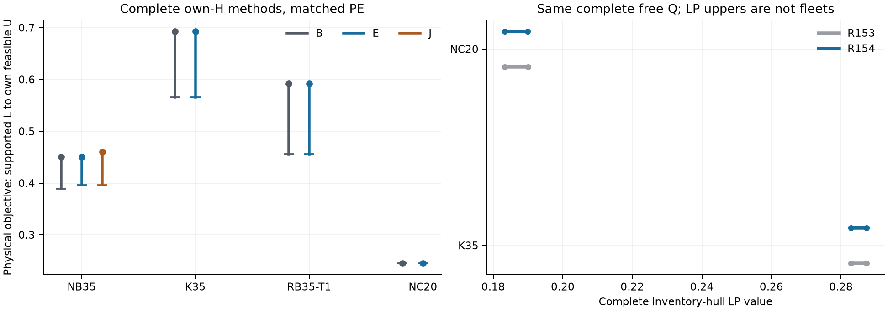

# Round154: target integer prices and independent proof floors

The signed state-product residual is a qualified interruptible pricing oracle.
Its product block is stronger than Cartesian aggregate McCormick, with the
hard-total limitation stated below. Actual signed directions do not establish
a general proof-cost advantage over normalized RN. The complete hull results
and the independently paid complete-method experiment are different objects.
E remains research-only; the stable GI-TBC entry and profile are retained.
In the same-PE NB35 comparison E preserves B's U and improves supported L by
0.006645807; E's U is 0.010103245 below J's.
K35, RB35 and NC20 retain identical B/E endpoint bounds and certificate
statuses. This is finite positive proof-placement evidence with paid costs.

## Complete inventory hull, same original free Q

| Domain | R154 lower | R154 upper | Width | Upper reduction | Columns/supports |
|---|---|---|---|---|---|
| N-B35-S | 0.396043052707 | 0.396046558956 | 0.000003506 | 0.000000000 | 575/9 |
| K-35-U | 0.282859694880 | 0.287326163304 | 0.004466468 | 0.000000000 | 33896/90 |
| N-C20-U | 0.183321848456 | 0.189867703097 | 0.006545855 | 0.000089097 | 54235/63 |

Table entries are rounded for display; the JSON/CSV tables retain the authoritative binary64 values.

The inherited numerical reference values are .39297895351863926 (NB35),
.2788644539329308 (K35) and .17476912471357817 (NC20). Bounds include the
entire original inventory support, hard total and physical Gupper. Every
new stock is validated at its exact declared coefficients. All accumulated
support rows are replayed with every original Q variable free. Qualified
RMP primals evaluate the last added columns; no final refresh obligation
remains. These upper bounds concern the strengthened LP value and are not
physical fleet incumbents. The finite-support LP upper is never substituted
for this full-hull upper. No accuracy target was relaxed beyond1e-4.

## Pricing tasks and targeted deepening

| Direction / phase | Oracle | Target hull | Fresh price lower | True price upper | Proof / rejection |
|---|---|---|---|---|---|
| K35_saved / residual_screen | residual | 0.287226163 | 0.014396099 | 0.080870305 | False / False |
| K35_saved / residual_strong_long | residual_strong | 0.287226163 | 0.068252096 | 0.079668016 | False / True |
| K35_saved / residual_strong_screen | residual_strong | 0.287226163 | 0.011265891 | 0.080870305 | False / False |
| K35_saved / RN_screen | RN | 0.287226163 | 0.042925303 | 0.080870305 | False / False |
| NC20_fresh / residual_screen | residual | 0.189856801 | -0.026668490 | 0.053250572 | False / True |
| NC20_fresh / RN_screen | RN | 0.189856801 | -0.016283876 | 0.055286306 | False / True |
| NC20_updated_midpoint / residual_goal_screen | residual_goal | 0.186594776 | 0.006575571 | 0.050824193 | False / True |
| NC20_updated_midpoint / RN_goal_screen | RN_goal | 0.186594776 | 0.020898279 | 0.053138226 | False / False |

The first K saved near-optimal task had direct room near the inherited RMP
upper. The strengthened3600s price produced raw lower .06825209584795439,
below inherited same-direction .07003842216867079, and a true stock reducing
the individual certificate ceiling to .2861237647323068. This rejects the
old target, so the scheduled identical RN long target was skipped. It is
not a matched-long speed comparison. NC's original fresh direction was also
rejected by a true inventory. These counterexamples supply columns; none
is a full-hull upper or a rejection of the inventory hull itself.

The next stage uses a saved complete RMP upper minus1e-4 as the target,
updates directions against all current stocks and saves every Q certificate
before pricing. A verified original stock below tau terminates that task;
a qualified bound reaching tau proves it. Selection time limits give no
bound. A uniformly applied fallback uses the already optimal current RMP
basic dual and still requires full-Q residual qualification. The failed
initial K selection is preserved, not counted as a pricing result. NC's
updated saved direction also receives a midpoint proof task at hull
.18659477577615025, below its updated true-stock ceiling .18863295659503387.
Its matched goal-directed trials use identical starting stocks, target,
scope, coefficients, platform, Seed0 and Threads1. Long trials are omitted
only after the declared target has already been proved or disproved.
The per-iteration report records outcomes and costs. Prices from different
directions are never concatenated into a monotone convergence trajectory.

## Integer equivalence and attribution

For positive S, R_tau=S(p−tau) equals the maximum of the floor and Gini
residual branches. Complete one-hot products z_iy=S*x_iy, all four binary
product rows and station mass identities give W=S*D at integer states.
Absolute-value epigraphs preserve every legal stock, and beta>=0 prevents
nonminimal auxiliary A from creating a lower true price. q may be negative;
legal zero stock is separate. Beta=0 removes no resource or Gupper row.

The state lift implies all four aggregate McCormick rows on Cartesian
station cost bounds, including signed potentials. The two-station strict
product example and hard-total counterexample in mathematical_analysis.md
state the precise boundary. This is not a complete-Q or RN dominance
theorem. The single stronger model adds conditional denominator bounds,
total-resource products and products using hard-total DP cost bounds.

Written residual coefficients on nonnegative activities are rounded
downward; the physical G cap is outward. The saved guard is in residual
units. A guarded lower ell converts to tau+ell/u when ell>=0 and tau+ell/l
when ell<0. Zero is combined by minimum, whole-domain DP and qualified
same-direction information by maximum. Every MIPSOL stop reevaluates true
resources/G/price. Native status alone is never a certificate. Finite tests
include signed rounding, negative residuals, nonminimal completion and actual
statuses2/11/15 plus unsupported fallback. The23 goal-stop fixtures pass.

The residual identity follows classical fractional parameterization;
McCormick, Dantzig–Wolfe and proof ledgers are established techniques.
See mathematical_analysis.md for primary references, derivations and exact
source/transport rules. Historical PR58, existing SP/cross-multiplication,
R104/139/144/145 and the substantial R153 exploration are explicitly
inherited. The inherited169-row41/1080 example is fixed-marginal, not a new
strict complete-routing witness. Compatible common inventory distributions
already exist at all three reference marginals; incompatibility or observed
unary penalty slack is not the explanation used here.

## Independent complete-method placement experiment

| Role | B U / L | E U / L | E−B absolute gap | E own floor |
|---|---|---|---|---|
| N-B35-S | 0.450291503 / 0.389310602 | 0.450291503 / 0.395956409 | -0.006645807 | 0.395956409 |
| K-35-U | 0.692854359 / 0.565324134 | 0.692854359 / 0.565324134 | +0.000000000 | 0.232941698 |
| R-B35-S-T1 | 0.591517635 / 0.455903891 | 0.591517635 / 0.455903891 | +0.000000000 | 0.142433200 |
| N-C20-U | 0.245505069 / 0.245505069 | 0.245505069 / 0.245505069 | +0.000000000 | 0.000000000 |

All nine arms use the same matched PE and independent own-H (seed20260626),
Gurobi Seed0/Threads1. NB35 B/E/J and K35/RB35 B/E have2400s caps; NC20 B/E
have1200s caps. RB35 retains lambda=.055125275219827186,T=4800. All own-H,
helper, model construction, producer and verification costs use the existing outer
accounting. No cross-arm H, stock, incumbent or historical floor is supplied.
The own-floor producer is unchanged from R153 J (4096 nodes, price absolute
gap1e-4). J writes a formal total-objective floor row. E consumes the same
scoped floor only in the proof scheduler, retaining raw Native/LP/AM search
inputs and no formal floor row. A same-domain formal-model comparison and
first AM records support that placement distinction. They cannot isolate
AM as the sole cause of any U difference. Paid time and legal proof pruning
can change subsequent trajectories.

Covered leaves use max(raw_L,min(U0,floor)); the frontier proof lower is
their minimum. Uncovered leaves retain their original bounds. Source scope,
cutoff complement, complete root coverage and descendant restrictions are
checked. A rejected source retains B information. NB35 same-PE J has
U=0.460394748354, L=0.395956408724; the complete pair/mechanism tables retain
the direct placement comparison. Open arms have no T_cert. Detailed U/L/gap,
T_produce/T_verify/T_total/T_cert are in reports/complete_pairs.json.

## Cost, failures and reproducibility

Current closed outer G1 is 24588.354129s, below144000s;
compilation is separately reported (42.734853s).
No nested Runtime/Work/helper/own-H is charged twice. Necessary final audit
and failed attempts are included. Pure theory, writing and public I/O are
separate. Prelaunch hashes, source snapshots and history bookkeeping are
not fully wall-clocked; this is not a complete elapsed-work accounting.
There are 4 nonzero-exit metered receipts, all preserved with
stderr and source-byte snapshots. They include the initial conditional-S
qualification interpretation, NC ingest path formatting and K stabilization
selection failure, where present. Metadata correction and a pre-restore
writer syntax failure are also retained and never recast as solver evidence.

Production source d834d62c7a1be599867db04a427f1d43dd3631cb matches PE
0d3a94183285cc2794676c717a23dc75a47c872ad48c26d2237dd8634f1a5a01;
DLL9b5fccef82043cc9a0f052d31fa9c12b6d59cec999ad0cc19ca1b68ed6d18a88.
source_manifest.json binds frozen helpers and per-run source bytes. Raw
science/failures and the necessary PE/DLL stay local. New-only public
carriers reference the fixed R153 science/member hashes instead of
repacking its old4.7GB evidence. Fixed-commit anonymous recovery and
post-PR bounded cleanup are recorded separately; no performance rerun is
part of recovery. The temporary PR base is verified again at delivery.

## Finite conclusion and next research decision

Temporarily close this inventory-pricing branch and prioritize the remaining full routing/loading coupling. The data establish neither universal residual dominance nor a
general complete-method advantage for E. The limits of this finite stage
are signed-direction proof hardness, the remaining reported hull intervals,
the four-role single-seed panel and full routing/loading restrictions beyond
inventory completion. Do not launch the same direction/partition/CDF/flow
grid automatically. Any next inventory experiment must identify a new
observed structural bottleneck and a concrete proof/value threshold.

The optional six-hour decision slot was not used. Both the original K target and the updated NC midpoint target were rejected by verified stocks; the completed comparisons already answer the finite proof-placement question. No claim about longer-horizon E performance is made. A new identical price extension has no surviving declared target to prove.

The final audit read 37 Native models and performed zero Optimize calls, covering 29 distinct price records, 3 standalone fixed directions plus 16 saved loop iteration directions, 5 complete-free-Q support replays and all 9 complete arms. Its v2 attempt stopped on the older NC prepare metadata format; the successful v3 directly checked that saved original-pool primal without creating a missing refresh record. Both receipts and their source snapshots remain.

An additional independent last-refresh point check passed for K33896, NC54227 and NC54235 columns. It checked every saved lambda, the actual solution/point identity, saved full-Q primal qualification, true active stocks, mass, marginals and completion; its0.802452s verification fee is included above.

The independent final nonimplementer review covers actual math, matrices,
scope, identities, fees, failures and manuscript claims. Its disposition
and the publication/cleanup readback are in review/ and RESUME.md.
