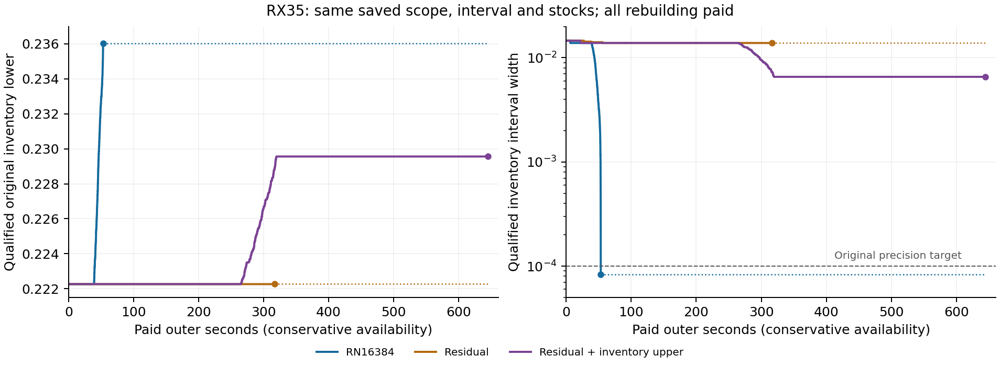

# Round156: fixed inventory certificates and paid complete proof gains

Increasing the unchanged RN producer's uniform capacity is sufficient for
the main RX35 original-objective precision question. A capacity of 16384
closes the matched inventory interval below 1e-4 in 53.111 outer seconds.
The one upper-conditioned product strengthening helps the residual model,
but remains substantially slower and less precise than RN on this scope.
The selected uniform E+ then improves the complete RX35 gap at the same
physical upper, with all extra producer work paid inside its own window.
The other three paired roles preserve their physical uppers and supported
lowers. Stable GI-TBC/B remains the default; E/E+ remain research candidates.

All nine preselected complete arms, the separate reconstruction of eight
actual complete-arm prices, three relocatable residual matrices, and the
fixed-source/member reconciliation have passed. This is a finite one-Seed
historical panel. It does not establish a universal ranking, a new general
fractional-programming theorem, or saturation of the complete inventory hull.

## Fixed original objective and matched oracle evidence

The [derivation](mathematical_analysis.md) uses the exact original beta=1,
d=h, normalization, station supports, hard totals, physical Gini cap and
legal zero branch. Weighted S is not the unweighted inventory total. Signed
centered Native coefficients and negative residual values retain their
existing qualification. All returned inventories are evaluated in original
coordinates. Inventory uppers bound this inventory relaxation and never
become physical route incumbents.

Every matched arm starts from the same saved RX35 scope, interval
[.22226257992032944, .23685400930608239] and checked true stocks. It pays to
rebuild its model; no unsaved branch-and-bound tree is inherited. The old
RN call had stopped at exactly 4096 nodes, Native status 8, while its original
price gap remained open. The new comparison gives RN a meaningful larger
allowance rather than comparing only against that old cap.

| Method | Final lower | Inventory upper | Width | Nodes | Work | Paid outer seconds |
|---|---:|---:|---:|---:|---:|---:|
| RN16384 | .23603837292376867 | .23612171136420015 | .0000833384404314852 | 7593 | 95.559 | 53.1108731 |
| Residual | .22226257992032944 | .23612171136420015 | .013859131443870715 | 16384 | 633.559 | 316.5549227 |
| Residual + inventory upper | .22956027144967478 | .23612171136420015 | .006561439914525374 | 16384 across 2 calls | 1392.379 | 645.0149250 |

Exact records and common-cost positions are in
[oracle_comparison.json](reports/oracle_comparison.json) and
[oracle_common_cost.csv](reports/oracle_common_cost.csv). Nested Native
Runtime/Work are observations, not additional outer fees. Actual producer
construction, DP, matrix readback and solving are paid inside each arm;
separate posthoc scientific validation is charged elsewhere in the ledger.

All non-body overhead is conservatively prepaid when placing callback
events on these curves; these are not invented exact callback wall times.
Dots are completed-arm endpoints. Dotted tails carry a completed interval
forward for comparison and do not represent further solving or expense.

The sole product variant uses H <= U_inv-gamma_L as an outward-relaxed
optimum-preserving restriction. It preserves the optimum of phi, not the
minimum of the residual. Its actual cost range is 12.8618237% of the old
range. The first scaled LP residual improves from -.059993631104487 to
-.047698587400369766, but both guarded LP conversions remain at the same
DP fallback .11636571534741638. The conditioned MIP proves the first
midpoint .22955829461320593, then leaves the second target undecided.
The better true upper does not cross that first target; no actual RX35
counterexample crossing is claimed. Qualification separately exercises the
counterexample branch. The actual costs, cap transport, product rows,
original guard and additional one-sided omission correction are checked
against written matrices and original stocks.

RN already answers the requested approximately 1e-4 precision question.
There is no need to spend a 65536-node tier or the unused 16-hour deepening
capacity merely to exhaust it. The optional dual-line-segment opportunity
was not opened, and no result is claimed for it. The R155 K35/NC20 large
feedback policies are not reopened; their finite unresolved intervals and
classical attribution remain intact in the [history table](history_dedup.md).

## Frozen uniform producer and finite portability check

[candidate_decision.json](candidate_decision.json) is the immutable
pre-panel selection, not a rewritten posthoc decision. E+ runs one RN16384
call after its own exact DP, with the original price absolute gap target,
Seed 0/Threads 1 and the whole-method deadline. It has no 4096-node restart,
instance-name condition, elapsed-time mechanism switch or free fallback.
The old E entry remains RN4096. Only the helper protocol/capacity identity
and logging changed in C++; the R154 proof-only consumer, formal Native
constraints, AM, ordering and splitting are unchanged.

Five from-zero inventory-producer checks use saved legitimate scopes but
no inherited inventory lower, upper or warm stock. They are not free
complete-algorithm runs. RX35 obtains
[.2360521029074557, .23612171136420015] at 10268 nodes in 59.8402121 outer
seconds. NB35/RB35/RX20 naturally stop at 2700/1590/65 nodes and preserve
their prior inventory intervals. The preselected, previously exposed CITI
K20 role retains original V20, M2, Q=[30,30], T5400, lambda=.15 and its first
actual root scope. It remains unresolved at 16384 nodes with
[.21757222003539808, .22041955009535988], costing 25.5644646 outer seconds.
This limitation is retained without replacing the example or adding a K20
complete arm. See [fresh_producers.json](reports/fresh_producers.json).

## Nine independently paid complete arms

All arms use the same rebuilt PE, Gurobi Seed 0/Threads 1, own-H seed 20260626,
original physical inputs/resources/lambda/model T, and paired original AM
settings. Windows are separate from model T. Every arm pays for its own H,
scope and floor; no offline inventory, another arm's H/proof or historical
incumbent is supplied. [complete_arms.json](reports/complete_arms.json)
contains the full unrounded U, raw L, proof L, absolute/relative gaps,
all four requested timing fields, helper costs and identities.

| Role | Method | Window | Physical U | Raw search L | Proof L | Absolute gap | Relative gap |
|---|---|---:|---:|---:|---:|---:|---:|
| RX20 | E |1200|.645325030386|.645325030386|.645325030386|2.22e-16|3.44e-16|
| RX20 | E+|1200|.645325030386|.645325030386|.645325030386|2.22e-16|3.44e-16|
| RB35 | E |2400|.591517634770|.455903891252|.455903891252|.135613743519|.2292640752|
| RB35 | E+|2400|.591517634770|.455903891252|.455903891252|.135613743519|.2292640752|
| NB35 | E |2400|.450291503263|.389293619318|.395956408724|.054335094539|.1206664886|
| NB35 | E+|2400|.450291503263|.389288480581|.395956408724|.054335094539|.1206664886|
| RX35 | B |7200|.299669400736|.214205553889|.214205553889|.085463846847|.2851937723|
| RX35 | E |7200|.299669400736|.214205553889|.222262579920|.077406820816|.2583073902|
| RX35 | E+|7200|.299669400736|.214205553889|.236052102907|.063617297829|.2122916043|

Display values are rounded, not substitute certified bounds. Only the two
RX20 arms certify. The legacy B endpoint omits a separate raw field; its
raw lower is its proof lower. Legacy compatibility metadata
`formal_performance:false` is preserved; the actual sealed closeouts admit
`implementation_qualified`, `evidence_complete`, `native_proof_qualified`
and `performance_eligible`. Raw files are not rewritten to hide that distinction.

| Role/method | T_produce | T_verify | T_total | T_cert | Helper |
|---|---:|---:|---:|---:|---:|
| RX20 E |21.997388|1.890070|23.887457|21.997388|.897244|
| RX20 E+|22.009407|1.906025|23.915432|22.009407|.884422|
| RB35 E |2371.230221|7.573326|2378.803547||9.634175|
| RB35 E+|2376.642088|7.590847|2384.232935||9.670473|
| NB35 E |2371.240421|7.514108|2378.754529||14.499679|
| NB35 E+|2371.230074|7.567513|2378.797587||14.821201|
| RX35 B |7171.249558|2.723695|7173.973253||0|
| RX35 E |7171.398325|7.189051|7178.587376||33.214974|
| RX35 E+|7171.328981|9.046745|7180.375727||60.255877|

Times are seconds; unachieved T_cert is blank/null. Helper costs are already
inside production. The unchanged whole-method shutdown margin explains
why a time-limited producer returns before its declared window; no new
mechanism switches at a component-specific time threshold.

For RX35 E+ versus E, delta U=0, delta proof L=.013789522987126268 and
delta gap=-.013789522987126268. The gap identity is checked exactly to the
declared binary64 tolerance. The actual extra helper cost 27.0409035 seconds
consumes time inside the same window; it is not free because T_produce is
nearly unchanged. E+ T_total is 1.788351207 seconds greater. Relative to B,
E+ gains .02184654901818739 in proof lower at the same physical upper.

The other three E/E+ pairs retain equal physical U and supported L. Their
T_total differences are RX20+.0279746305s, NB35+.0430583316s and
RB35+5.4293881517s. RX20 T_cert is .0120193304s later. NB35's actual raw
search difference of about -5.14e-6 is preserved, even though it does not
change the supported endpoint. This panel shows no broad endpoint-gap
regression and supports the uniform research candidate; it does not
authorize choosing different methods by role or promoting a universal default.

The posthoc remaining opportunity of this same scalar floor is zero on
RB35/RX20, 9.014023257e-5 on NB35 and 6.960845674e-5 on RX35 E+.
RX35 E instead leaves .014591429385752946. These are end-of-run diagnostics,
not future search information supplied to the early helper. The remaining
physical BRP gap is much larger than the further precision opportunity of
this fixed floor. Full inventory coupling and other resource-dependent
proofs remain different questions.

## Corrections, validation, cost and delivery

The [R155 errata](r155_errata.md) records that its level adjustment was
executed and resolved zero levels. All 18 checkpoint states are re-exported
using the actual marker Unix time minus producer t0 Unix time. Only
RX35-B@4800 changes its bound, from .2141444605048453 to
.21414084957658006; U, final endpoints, T_cert and prior fees do not change.
The fast E raw-bound crossing is observed in the batch at 4.255399397 outer
seconds, not an exact Native instant. Long-run checkpoints remain distinct
from independent short-deadline experiments.

Targeted enumeration covers 12 residual cases, legal zero, signed centered
costs, negative q, omitted coefficients and exact preserved-stock lifts.
RN admission v1 covers exact DP exits; v2 additionally exercises the actual
Native path with five callback observations. Actual oracle readback checks
four prices and 29 residual-stock row lifts. Five from-zero checks and all
eight complete-arm RN prices have separate reconstruction. The physical
and chronological complete verifiers are reused without overwriting sealed
evidence. Three base/delta reconstructions also pass the explicit relocation
path contract. These are separate arithmetic/model readers and manual review
by the same agent, not a nonimplementer-agent review.

Four failed metered children remain preserved: `initial_identity_v1`
(unneeded optional K35 input absent from the sparse tree), `fresh_RX35_v1`
and `fresh_RX35_v2` (missing inherited R94 preregistration import; the second
followed an invalid sparse-add option), and `provenance_v1` (the metadata
reader requested an E-only proof ledger for a B arm). The corrected bounded
attempts pass. These are not failed inventory optimizations, and no
performance rerun was used to repair a report or source index.

The complete panel costs **31102.06761580007 outer seconds**. Compilation
costs **36.42399509972893 seconds separately**. The full final charge,
including prototype, failed attempts and necessary final verification, is
in [cost_report.json](cost_report.json) and [cost_summary.md](cost_summary.md).
Only actual closed outer fees are summed; nested H/helper/Runtime/Work are
not added again. The small initial tool-only source/history/workspace setup
gap is disclosed rather than assigned an invented timing. Pure writing,
light administrative bookkeeping and publication I/O are separate. The
figure dependency install uses a new E-work target and leaves the existing
interpreter untouched; its publication-I/O receipt is retained.

Production source is `092bad58d677cd8bef934d91e11d8abff93cba83`.
The measured PE SHA256 is
`e5efe978f33e5c812fc9a0484caaae80696e4197ae27e289b4894d586af9d7e6`;
the unchanged DLL SHA256 is
`9b5fccef82043cc9a0f052d31fa9c12b6d59cec999ad0cc19ca1b68ed6d18a88`.
[source_manifest.json](source_manifest.json) distinguishes current sources,
actual launch snapshots, prebuild helper-manifest bytes and measured
production identity. [reuse_index.json](reuse_index.json) binds 241 actual
dependencies, including 162 inherited Python modules and eight referenced
old carriers, with zero old-carrier downloads/repacking. The figure-only
source revision is included in the passed final provenance readback.

The [paper insertion](manuscript.tex), [scientific review](review/final_scientific_review.md)
and [reproduction instructions](reproducibility.md) support the claims.
Scientific acceptance is distinct from publication. Fixed-science commit,
English Draft PR base/head/Draft readback, one actual anonymous new-only
recovery and bounded post-PR cleanup are recorded in [RESUME](RESUME.md)
and the corresponding publication/recovery/cleanup receipts. Existing user
changes and the original project tree remain protected.
