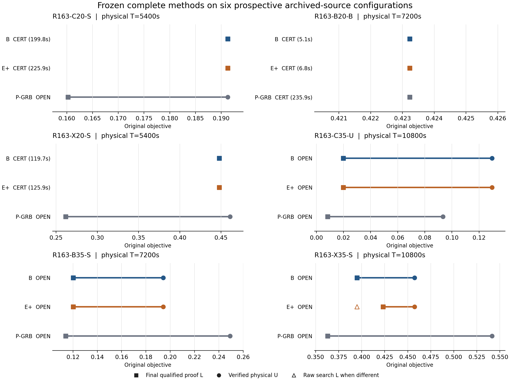

# Round163: frozen complete methods and the research-stage choice

Retain uniform GI-TBC/B as the paper's main algorithm. Keep uniform E+ as a separately named, limited proof enhancement, with its genuine X35 gain and earlier qualified R154/R156 gains preserved. This complete panel does not justify replacing B as the main recommendation; the current broad-promotion attempt ends here. No per-input best-of-B/E+ method or released-default change is made.

Both B and E+ certify 3/6 configurations, versus cold P 1/6. B/E+ have identical verified physical U on all six. E+ raises X35's final qualified L from B's .3949882559151472 to .42319954961578576 at U=.45747531701601785; the original relative gap falls from 13.659110945800548% to 7.492375244155952%. The other five final proof endpoints are equal. E+'s X35 raw search L is .39492875817006656, slightly below B's; the improvement is the separate qualified proof source, not an improved raw AM/Native bound. No additional certificate or primal improvement is observed.

The three both-certified E+/B paid T_cert ratios are 1.130665945756784, 1.3357446355323432 and 1.0515856109492556. E+ pays 256.7365551 helper seconds inside its original deadlines, replacing some Native opportunity on capped runs. Aggregate audit-inclusive T_total is 7506.416129835416 seconds for E+ and 7451.303745185491 for B, a 55.112384649924934-second increase; helper time is not added again. Uniform E+ is a serious alternative when stronger proof information on an OPEN case is valued more than these certificate-time costs: its one material proof gain comes with no U or certificate loss and only about .74% more aggregate cost here. We nevertheless retain B as main under the fixed certificate/paid-time/endpoints criteria: certificate count does not increase, all three joint-CERT paid times worsen, and the final proof benefit occurs on one of six configurations. This is a scoped tradeoff, not a claim that E+ is generally ineffective or that every instance must improve.

B and E+ each have lower U than P on three configurations, higher U on C35-U, and equal U on two. Each has substantively higher proof L than P on five configurations and equal qualified endpoints on the remaining certified B20 case. On C35-U, P's U=.09331934374779818 is strictly better than B/E+'s .12956638965196035, while B/E+ have stronger L; this opposition is retained. The one joint-CERT B/P or E+/P time ratio conditions on B20 alone. No full-panel time superiority or universal P-GRB dominance is inferred from a single Seed.

C20, B20 and X20 finish with search L beyond their qualified inventory value uppers. C35's inventory result is numerically near zero, not an exact-zero physical proof. B35 and X35 prices stop at RN16384 with widths .014387103336740467 and .02295563610060769. B35's returned floor is below final search L but its inventory upper is above it; X35's floor contributes to the final proof while its price remains unresolved. Old R156's small same-domain remainder therefore cannot be generalized to these new prices. No larger capacity, alternate price, Seed or candidate is tried.

The complete denominator is six new configurations and 18 qualified arms. All method results remain in the comparison. These are prospective configurations on archived CITI/CABI/DIVVY sources with synthetic demand fields, one Gurobi Seed, two sizes and three compact/three regional selections. They are not new cities, IID population samples, or a factorial identification of city/size/geometry effects. All six are now exposed.

The recipe, once-only inputs, history-manifest canonical keys and 18 commands were sealed before formal performance. The primary CSV was located and its new IDs checked before the panel; its additional row-to-input reconciliation was inspected after the first arm had begun and completed in the final bounded readback. This ordering deviation is disclosed: that particular crosswalk is not represented as preregistered. It finds no base/configuration collision, does not change the frozen inputs or methods, and triggers no redraw. The retained R57 ephemeral structural-pilot metadata is separately checked and its source-row overlap disclosed.

## Complete physical and proof endpoints

Display values are rounded; the JSON/CSV reports retain authoritative binary64 values and the original signed/near-zero gap qualification. L is the final qualified proof lower, not an unqualified raw Native claim. OPEN T_cert is blank. A cap is not a convergence time.

Under the inherited paid closure policy, a qualified CERT uses its fully paid producer-close T_produce as T_cert. An unobserved first Native witness or hypothetical earlier proof time is not substituted. Required after-the-fact verification and the small reader/exit trailer remain in T_verify and T_total.

The raw reused reader retains historical compatibility labels formal_performance=false and not_holdout=true. Those labels are preserved, not used to classify Round163 novelty. Round163 formal-panel status follows its own committed recipe/input/matrix admission and verified performance_eligible/implementation/evidence flags. All six were new at that freeze and are exposed after this study.

| Configuration | Method | State | Physical U | Raw search L | Proof L | Original gap % | T_cert | T_produce | T_verify | T_total |
|---|---|---|---|---|---|---|---|---|---|---|
| R163-C20-S | P | OPEN | 0.1912805923 | 0.1602342164 | 0.1602342164 | 16.23080286 |  | 1171.564784 | 1.186629386 | 1172.751414 |
| R163-C20-S | B | CERT | 0.1912805923 | 0.1912805923 | 0.1912805923 | -3.917807513e-13 | 199.7793504 | 199.7793504 | 1.897549191 | 201.6768996 |
| R163-C20-S | Eplus | CERT | 0.1912805923 | 0.1912805923 | 0.1912805923 | -3.917807513e-13 | 225.8837082 | 225.8837082 | 3.485269453 | 229.3689776 |
| R163-B20-B | B | CERT | 0.4232321817 | 0.4232321817 | 0.4232321817 | 3.672481209e-13 | 5.058292441 | 5.058292441 | 1.383118243 | 6.441410684 |
| R163-B20-B | Eplus | CERT | 0.4232321817 | 0.4232321817 | 0.4232321817 | 3.672481209e-13 | 6.756586993 | 6.756586993 | 3.685063166 | 10.44165016 |
| R163-B20-B | P | CERT | 0.4232321817 | 0.4232321815 | 0.4232321815 | 4.939043906e-08 | 235.8555019 | 235.8555019 | 0.7849995773 | 236.6405015 |
| R163-X20-S | Eplus | CERT | 0.4477476266 | 0.4477476266 | 0.4477476266 | 2.888702802e-12 | 125.9267332 | 125.9267332 | 2.416886954 | 128.3436201 |
| R163-X20-S | P | OPEN | 0.4609477662 | 0.2616496512 | 0.2616496512 | 43.23659417 |  | 1171.332033 | 0.8293718956 | 1172.161405 |
| R163-X20-S | B | CERT | 0.4477476266 | 0.4477476266 | 0.4477476266 | 2.888702802e-12 | 119.7493879 | 119.7493879 | 1.261174732 | 121.0105626 |
| R163-C35-U | P | OPEN | 0.09331934375 | 0.008286772138 | 0.008286772138 | 91.11998456 |  | 2371.325071 | 0.6815881506 | 2372.006659 |
| R163-C35-U | B | OPEN | 0.1295663897 | 0.01983750282 | 0.01983750282 | 84.6893142 |  | 2371.452325 | 2.753276558 | 2374.205602 |
| R163-C35-U | Eplus | OPEN | 0.1295663897 | 0.01983750282 | 0.01983750282 | 84.6893142 |  | 2371.330749 | 8.92734365 | 2380.258093 |
| R163-B35-S | B | OPEN | 0.1942903111 | 0.1202340026 | 0.1202340026 | 38.11631579 |  | 2371.335443 | 2.6565072 | 2373.991951 |
| R163-B35-S | Eplus | OPEN | 0.1942903111 | 0.1202340026 | 0.1202340026 | 38.11631579 |  | 2371.344547 | 8.127373283 | 2379.47192 |
| R163-B35-S | P | OPEN | 0.2492530135 | 0.1139794085 | 0.1139794085 | 54.2716026 |  | 2371.409644 | 0.6760943858 | 2372.085739 |
| R163-X35-S | Eplus | OPEN | 0.457475317 | 0.3949287582 | 0.4231995496 | 7.492375244 |  | 2371.364481 | 7.167387835 | 2378.531869 |
| R163-X35-S | P | OPEN | 0.5415306805 | 0.362971432 | 0.362971432 | 32.97306227 |  | 2371.378889 | 0.5309301568 | 2371.909819 |
| R163-X35-S | B | OPEN | 0.457475317 | 0.3949882559 | 0.3949882559 | 13.65911095 |  | 2371.322317 | 2.655002846 | 2373.97732 |

## Three complete-method questions

B/P assesses the stable complete package. E+/B assesses the net effect and paid cost of the sole enhancement. E+/P assesses the enhanced complete package. No per-instance best-of-B/E+ method is constructed. B/P gains are not attributed solely to GI splits; the existing P/PS and conditional mechanism controls retain their original identities and denominators.

### B versus P

All-six certificate counts are 3/6 and 1/6. The both-certified time-ratio subset has 1 configurations; the ratios below condition on that intersection. No OPEN observation is dropped to make a full-panel time superiority claim. Single-Seed small timing differences do not establish stable speed advantages.

| Configuration | States | delta U | delta proof L | delta total cost | Paid T_cert ratio (joint CERT only) |
|---|---|---|---|---|---|
| R163-C20-S | CERT/OPEN | 0 | 0.03104637585 | -971.074514 |  |
| R163-B20-B | CERT/CERT | 0 | 2.090346785e-10 | -230.1990908 | 0.02144657385 |
| R163-X20-S | CERT/OPEN | -0.01320013964 | 0.1860979754 | -1051.150843 |  |
| R163-C35-U | OPEN/OPEN | 0.0362470459 | 0.01155073068 | 2.198942572 |  |
| R163-B35-S | OPEN/OPEN | -0.05496270236 | 0.006254594054 | 1.906211803 |  |
| R163-X35-S | OPEN/OPEN | -0.08405536348 | 0.03201682389 | 2.067500996 |  |

### Eplus versus B

All-six certificate counts are 3/6 and 3/6. The both-certified time-ratio subset has 3 configurations; the ratios below condition on that intersection. No OPEN observation is dropped to make a full-panel time superiority claim. Single-Seed small timing differences do not establish stable speed advantages.

| Configuration | States | delta U | delta proof L | delta total cost | Paid T_cert ratio (joint CERT only) |
|---|---|---|---|---|---|
| R163-C20-S | CERT/CERT | 0 | 0 | 27.69207802 | 1.130665946 |
| R163-B20-B | CERT/CERT | 0 | 0 | 4.000239475 | 1.335744636 |
| R163-X20-S | CERT/CERT | 0 | 0 | 7.333057556 | 1.051585611 |
| R163-C35-U | OPEN/OPEN | 0 | 0 | 6.052490926 |  |
| R163-B35-S | OPEN/OPEN | 0 | 0 | 5.479969654 |  |
| R163-X35-S | OPEN/OPEN | 0 | 0.0282112937 | 4.554549015 |  |

### Eplus versus P

All-six certificate counts are 3/6 and 1/6. The both-certified time-ratio subset has 1 configurations; the ratios below condition on that intersection. No OPEN observation is dropped to make a full-panel time superiority claim. Single-Seed small timing differences do not establish stable speed advantages.

| Configuration | States | delta U | delta proof L | delta total cost | Paid T_cert ratio (joint CERT only) |
|---|---|---|---|---|---|
| R163-C20-S | CERT/OPEN | 0 | 0.03104637585 | -943.382436 |  |
| R163-B20-B | CERT/CERT | 0 | 2.090346785e-10 | -226.1988514 | 0.02864714597 |
| R163-X20-S | CERT/OPEN | -0.01320013964 | 0.1860979754 | -1043.817785 |  |
| R163-C35-U | OPEN/OPEN | 0.0362470459 | 0.01155073068 | 8.251433498 |  |
| R163-B35-S | OPEN/OPEN | -0.05496270236 | 0.006254594054 | 7.386181457 |  |
| R163-X35-S | OPEN/OPEN | -0.08405536348 | 0.06022811759 | 6.622050012 |  |

## What the inventory producer actually contributed

| Configuration | Helper paid s | Return on C++ clock s | Floor | Inventory value upper | Price decision | Native price statuses | Price width | Final raw search L | Final proof L | Available mid-proof gain | Endpoint explanation |
|---|---|---|---|---|---|---|---|---|---|---|---|
| R163-C20-S | 26.738666 | 28.7226241 | 0.1368117344 | 0.1369096894 | UNDECIDED | [2] | 9.795497731e-05 | 0.1912805923 | 0.1912805923 | 0.01906536136 | final search lower dominates the inventory value upper at the inherited qualification scale |
| R163-B20-B | 0.6940904 | 1.1084343 | 0.4054847756 | 0.4054869951 | RESOLVED | [2] | 2.219512239e-06 | 0.4232321817 | 0.4232321817 | 0.05659195988 | final search lower dominates the inventory value upper at the inherited qualification scale |
| R163-X20-S | 6.5956633 | 7.2252466 | 0.2100685873 | 0.2101678948 | UNDECIDED | [2] | 9.930744642e-05 | 0.4477476266 | 0.4477476266 | 0.04446000869 | final search lower dominates the inventory value upper at the inherited qualification scale |
| R163-C35-U | 3.249692 | 15.52964315 | 3.999548004e-17 | 6.512277258e-17 | RESOLVED | [2] | 2.512729254e-17 | 0.01983750282 | 0.01983750282 | 3.999548004e-17 | inventory value is numerically near zero at the inherited qualification scale; not an exact-zero physical proof |
| R163-B35-S | 92.232198 | 104.0424991 | 0.1180364538 | 0.1324235572 | UNDECIDED | [8] | 0.01438710334 | 0.1202340026 | 0.1202340026 | 0.01017734027 | final qualified search lower dominates returned floor |
| R163-X35-S | 127.2262454 | 130.0883029 | 0.4231995496 | 0.4461551857 | UNDECIDED | [8] | 0.0229556361 | 0.3949287582 | 0.4231995496 | 0.1202224614 | floor supports final proof lower |

The original helper decision field and optimization status are different observations. Status2 denotes the native optimizer's OPTIMAL return under its original requested tolerances; status8 denotes NODE_LIMIT. The B35 and X35 prices both stop at RN16384, with inventory intervals about .0143871 and .0229556 wide. Their remaining price uncertainty is not the tiny same-scope remainder of the old R156 RX35 study. B35's returned floor is below its final search bound, but its inventory upper is above that search bound, so this result does not prove all further pricing information useless. X35's floor raises final proof L while remaining short of both its own inventory upper and physical U. No capacity increase or second pricing design is tried here.

Helper return placement is reconstructed from the process phase ledger and the actual remaining-deadline/process-duration receipt. The helper executes in its own first canonical-root construction, before the first formal LP Optimize. The unchanged implementation checks its separate proof ledger at outer checkpoints before selection, after solveLp and at final closeout. There is no separate first-application timestamp or continuously updated proof-floor callback trace. A mid-proof gain therefore means qualified available floor information above a logged raw-search bound; it is not claimed as continuous Native adoption, does not rewrite raw AM and cannot backdate a certificate. A tight inventory upper below final search L also limits any further precision benefit from that same scoped scalar floor. Inventory uppers never become physical fleet U. Zero optima, unavailable floors, solved prices and capacity-limited prices retain separate dispositions.

## Native work, startup and complete paid costs

| Configuration | Method | Native Work | Native nodes | Native calls | Startup reported s | Helper process s | Outer scientific fee s |
|---|---|---|---|---|---|---|---|
| R163-C20-S | P | 2387.019174 | 141920 | 1 | 0 | 0 | 1172.766367 |
| R163-C20-S | B | 356.904567 | 21388 | 4 | 1.5350372 | 0 | 201.6994475 |
| R163-C20-S | Eplus | 356.904567 | 21388 | 4 | 1.5517133 | 26.738666 | 229.384192 |
| R163-B20-B | B | 2.524354742 | 160 | 9 | 0.0281099 | 0 | 6.4627405 |
| R163-B20-B | Eplus | 2.524354742 | 160 | 9 | 0.0282148 | 0.6940904 | 10.4578073 |
| R163-B20-B | P | 436.4937292 | 26512 | 1 | 0 | 0 | 236.6692801 |
| R163-X20-S | Eplus | 220.9640238 | 8842 | 5 | 0.2153209 | 6.5956633 | 128.3585813 |
| R163-X20-S | P | 2461.656686 | 80722 | 1 | 0 | 0 | 1172.177798 |
| R163-X20-S | B | 220.9640238 | 8842 | 5 | 0.2151236 | 0 | 121.0217021 |
| R163-C35-U | P | 5257.657432 | 19555 | 1 | 0 | 0 | 2372.030288 |
| R163-C35-U | B | 5623.411599 | 6826 | 4 | 10.1812223 | 0 | 2374.223195 |
| R163-C35-U | Eplus | 5621.666716 | 6813 | 4 | 10.4042348 | 3.249692 | 2380.275101 |
| R163-B35-S | B | 5964.29029 | 2660 | 4 | 9.879413 | 0 | 2374.020024 |
| R163-B35-S | Eplus | 5729.38601 | 2443 | 4 | 9.9535355 | 92.232198 | 2379.488341 |
| R163-B35-S | P | 5032.436326 | 11463 | 1 | 0 | 0 | 2372.090146 |
| R163-X35-S | Eplus | 5462.848443 | 3286 | 5 | 1.0737159 | 127.2262454 | 2378.560565 |
| R163-X35-S | P | 4907.06266 | 13028 | 1 | 0 | 0 | 2371.941016 |
| R163-X35-S | B | 5773.132417 | 3425 | 5 | 1.1107678 | 0 | 2373.991367 |

Native Work/nodes use inherited result counters, with individual Optimize ledger diagnostics retained separately. P has cold NumStart=0, MIPFocus=0/Cuts=-1/Presolve=-1 and requested gaps0; it receives no H or cross-arm Start. B/E+ independently complete and pay their own H with seed20260626. Actual call settings, original compact references/types/objectives, full fleet checks and complete scope/coverage audits remain bound to each arm.

The same R162 complete_v2 C++ PE and Gurobi13.0.2 DLL serve all methods. E+ pays the unchanged historical Python helper with RN16384, original absolute price gap1e-4 and the original global-deadline/DP/fallback contract. This is explicitly a mixed C++/Python enhancement, with no new algorithm core. R138–162 noncandidate mechanisms stay off.

The closed scientific charge is **24697.709828344 / 72000 seconds** (6.860475 h). Failed qualification and reader repair costs are retained. Per-arm outer fees pay startup/import, H/helper, model creation, Native calls, validation, trailers and observed exits; nested Runtime/Work are not added again. Initial metadata/history work has a separately disclosed conservative enclosing preparation charge. Ordinary documentation, packaging and public recovery I/O are separately recorded.

## Structural interpretation and the single next question

The [structural synthesis](structural_synthesis.md) connects original physical/integer equivalence, inventory/resource/physical scopes, the epigraph-interval objective, cutoff/coverage composition, proof-only placement and five evidence levels. Its [fixed source map](historical_source_map.json) retains positive as well as negative historical results. R156 inventory precision does not allocate the residual complete gap entirely to physical coupling; incumbent suboptimality remains possible. R162 continuous-Q gain is not an upper bound on the integer physical gap. These are scoped explanations using existing proofs and standard identities, not new general theorems.

On exposed R163-C35-U, can the saved B fleet's entire ownership/visit-order skeleton attain the already verified P objective .09331934374779818 when all legal integer service quantities, directions and activations within that skeleton are jointly optimized, or is a qualified restricted-domain lower strictly above that target? The saved B U=.12956638965196035 and P feasible fleet establish at least .03624704590416217 of B incumbent suboptimality; the question localizes this witnessed deficit without assigning the whole remaining proof gap to physical coupling.

First reconcile the already existing R96 full fixed-order quantity diagnostic (scripts/round96_fixed_route.py). Its whole-skeleton domain and one-hot-Gini formulation are inherited, not a new value object or mechanism; only C35 target-attainability would be new configuration-specific information here. Reuse what is faithful and establish the current complete restricted-domain contract before any new solve. The value V(Pi_B) must contain the saved parent fleet: keep its assigned vehicle and relative visit order, allow legal zero-service visit deletion and every legal integer service/direction choice for its stations, and retain all other stations at their original inventories. Prove objective-preserving expansion/contraction at the actual travel coefficients, with original inventory supports, unique one-way nonzero service, empty departure, every prefix capacity, loaded return/unloading, physical T and loaded lambda. Preserve the true-Gini/epigraph distinction and S=0 convention. A complete restricted-domain objective-level certificate or an independently checkable feasible fleet is needed; UNKNOWN remains UNKNOWN.

Before execution, justify an explicit completeness argument, bounded computational/state cost and affordable additional information beyond the existing R96 diagnostic and already known P domination; otherwise stop at the prerequisite. Local quantity descent, the R159 restriction/fixed-combination diagnostics, a larger R160 block/pass/node budget, generic master-oracle work and another continuous-Q/product or RN-capacity variation do not meet this gate. A feasible result addresses this saved skeleton only; a lower above the target requires an ownership/order/station-set change to reach that target but supplies no global physical lower. Neither result is a complete-method benefit or permission to transfer P's fleet into production. Any later candidate requires a genuinely new uniform own-state computation and complete paid evidence. This round executes no R96 query or other next-stage work.

No next-stage solve, mechanism, seed or parameter grid is launched. The paper recommendation, frozen research configuration and released main identity are recorded separately. Stable defaults are not changed and no earlier PR is merged.

## Evidence and delivery

[Goal](goal.md), [method/dependency freeze](method_freeze.json), [recipe](source_recipe.json), [input manifest](input_manifest.json), [full actual argv matrix](matrix_frozen.json), [qualification](qualification/result.json), [all endpoints](reports/complete_arms.json), [all comparisons](reports/comparisons.json), [costs](cost_report.json), [decision](decision.json), [main CSV write receipt](main_table_update.json), [recovery scope](reproducibility.md) and [live delivery status](RESUME.md) give the auditable chain. Independent reviewer identities/findings and the actual Open Draft PR/public byte-recovery/cleanup receipts are linked from the final delivery record after those steps occur.
